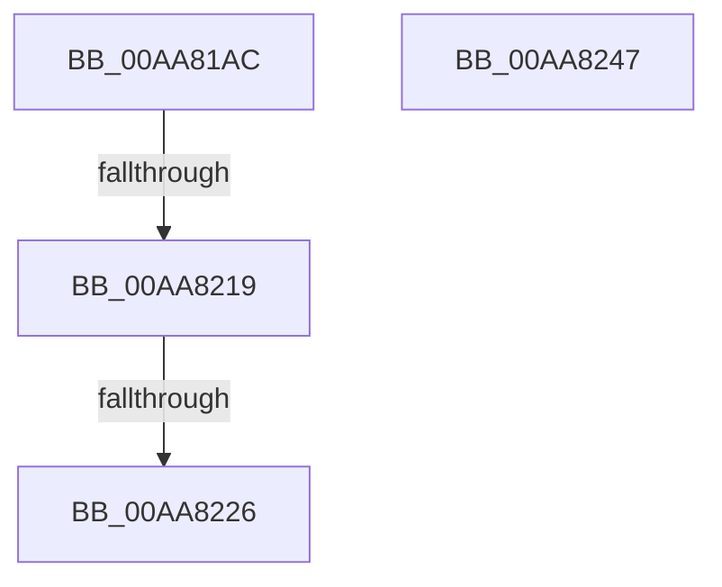

# PopDiagTraceCsEnterReason

- RVA: `0x00AA81AC`–`0x00AA8248` (길이 `156` bytes)
- VA: `0x0000000140AA81AC`
- 실행 섹션: `PAGE`
- PDB 이름 있음: `예`; PDB Function 태그: `예`
- unwind 정보 RVA: `0x000BBB70`
- 디코드: `34`개 명령, `156/156` bytes 표시
- 미해석 바이트: `0` (있으면 어셈블리에 `.byte`로 보존)

> 이 문서는 커널 이미지의 기계어와 PDB 기호를 분석해 생성했습니다. 4번과 5번은 함수 원형과 자료형을 바이너리 사용 방식에서 추정한 C 해석이며 원본 소스 복구 결과는 아닙니다.

## 1. Dependencies

- 직접 호출 지점: **1**; 고유 호출 대상: **1**
- 직접 호출자로 확인된 함수: **1**
- RIP 상대 이미지 참조: **8**

### Outgoing calls
- `0x00AA822D` → [_security_check_cookie](../../text/6A/_security_check_cookie_function_006AC640.md) (function, `0x006AC640`)

### Direct callers
- [PopCaptureSleepStudyStatistics](../../text/43/PopCaptureSleepStudyStatistics_function_004399F4.md) at `0x00439EAA`

### Static image references
- `0x00AA81C3` → RVA `0x00E0A740` (`.data`; read)
- `0x00AA81D1` → RVA `0x00F0B6B0` (`.data`; read)
- `0x00AA81DA` → RVA `0x00E67858` (`.data`; read)
- `0x00AA81E5` → RVA `0x00E67A54` (`.data`; read)
- `0x00AA81F0` → RVA `0x00E0B579` (`.data`; read)
- `0x00AA81FB` → RVA `0x00E27D00` (`.data`; read)
- `0x00AA8205` → RVA `0x00E27DE8` (`.data`; read)
- `0x00AA8219` → RVA `0x00E07748` (`.data`; read)

## 2. Other-region calls and transfers

- 다른 실행 섹션으로 향하는 call: **1**
  - `0x00AA822D` → [_security_check_cookie](../../text/6A/_security_check_cookie_function_006AC640.md) (`PAGE` → `.text`)
- call이 아닌 외부 분기/꼬리 이동: **2**
  - `0x00AA8213` → [sub_00B4A29A](../B4/Unknown_function_00B4A29A.md) (`tail-transfer`)
  - `0x00AA8220` → [sub_00B4A29A + 0xE5](../B4/Unknown_function_00B4A29A.md) (`tail-transfer`)

## 3. Assembly (complete function range)

```asm
00AA81AC  48 89 5C 24 10                  mov qword ptr [rsp + 0x10], rbx
00AA81B1  48 89 7C 24 18                  mov qword ptr [rsp + 0x18], rdi
00AA81B6  55                              push rbp
00AA81B7  48 8D 6C 24 80                  lea rbp, [rsp - 0x80]
00AA81BC  48 81 EC 80 01 00 00            sub rsp, 0x180
00AA81C3  48 8B 05 76 25 36 00            mov rax, qword ptr [rip + 0x362576]
00AA81CA  48 33 C4                        xor rax, rsp
00AA81CD  48 89 45 70                     mov qword ptr [rbp + 0x70], rax
00AA81D1  48 8B 05 D8 34 46 00            mov rax, qword ptr [rip + 0x4634d8]
00AA81D8  33 DB                           xor ebx, ebx
00AA81DA  38 1D 78 F6 3B 00               cmp byte ptr [rip + 0x3bf678], bl
00AA81E0  48 89 44 24 60                  mov qword ptr [rsp + 0x60], rax
00AA81E5  0F B6 05 68 F8 3B 00            movzx eax, byte ptr [rip + 0x3bf868]
00AA81EC  89 44 24 3C                     mov dword ptr [rsp + 0x3c], eax
00AA81F0  0F B6 05 82 33 36 00            movzx eax, byte ptr [rip + 0x363382]
00AA81F7  89 44 24 38                     mov dword ptr [rsp + 0x38], eax
00AA81FB  8B 05 FF FA 37 00               mov eax, dword ptr [rip + 0x37faff]
00AA8201  89 44 24 40                     mov dword ptr [rsp + 0x40], eax
00AA8205  8B 05 DD FB 37 00               mov eax, dword ptr [rip + 0x37fbdd]
00AA820B  89 44 24 44                     mov dword ptr [rsp + 0x44], eax
00AA820F  89 4C 24 30                     mov dword ptr [rsp + 0x30], ecx
00AA8213  0F 85 81 20 0A 00               jne 0x140b4a29a
00AA8219  83 3D 28 F5 35 00 05            cmp dword ptr [rip + 0x35f528], 5
00AA8220  0F 87 59 21 0A 00               ja 0x140b4a37f
00AA8226  48 8B 4D 70                     mov rcx, qword ptr [rbp + 0x70]
00AA822A  48 33 CC                        xor rcx, rsp
00AA822D  E8 0E 44 C0 FF                  call 0x1406ac640
00AA8232  4C 8D 9C 24 80 01 00 00         lea r11, [rsp + 0x180]
00AA823A  49 8B 5B 18                     mov rbx, qword ptr [r11 + 0x18]
00AA823E  49 8B 7B 20                     mov rdi, qword ptr [r11 + 0x20]
00AA8242  49 8B E3                        mov rsp, r11
00AA8245  5D                              pop rbp
00AA8246  C3                              ret
00AA8247  CC                              int3
```

## 4. C-style interpretation (structured pseudocode)

```c
__int64 __fastcall PopDiagTraceCsEnterReason(int a1)
{
    __int64 result;
    __int64 v_rbx;
    __int64 v_rsp;
    unsigned __int64 v_stack_m128;
    unsigned int v_stack_m144;
    unsigned int v_stack_m148;
    unsigned int v_stack_m14C;
    unsigned int v_stack_m150;
    unsigned int v_stack_m158;
    unsigned __int64 v_stack_m18;
    unsigned __int64 v_stack_m8;
    unsigned __int64 v_stack_m88;
    unsigned __int64 v_stack_p10;
    unsigned __int64 v_stack_p18;

    v_stack_p10 = v_rbx;
    v_stack_p18 = v_rdi;
    v_rsp = (v_rsp) - (384);
    result = (*(unsigned __int64 *)(v_rip + 3548534)) ^ (v_rsp);
    v_stack_m18 = result;
    v_rbx = 0;
    v_stack_m128 = *(unsigned __int64 *)(v_rip + 4601048);
    v_stack_m14C = (unsigned int)(*(unsigned __int8 *)(v_rip + 3930216));
    v_stack_m150 = (unsigned int)(*(unsigned __int8 *)(v_rip + 3552130));
    v_stack_m148 = (unsigned int)((unsigned int)(*(unsigned int *)(v_rip + 3668735)));
    v_stack_m144 = (unsigned int)((unsigned int)(*(unsigned int *)(v_rip + 3668957)));
    v_stack_m158 = a1;
    a1 = (v_stack_m18) ^ (v_rsp);
    result = _security_check_cookie(a1, a2, a3, a4);
    return result;
}
```

## 5. (Beta) C Style

```c
int64_t PopDiagTraceCsEnterReason(int32_t Arg1)
{
    int64_t result;
    int64_t local_rbx;
    int64_t local_rsp;
    uint64_t v_stack_m128;
    uint32_t v_stack_m144;
    uint32_t v_stack_m148;
    uint32_t v_stack_m14C;
    uint32_t v_stack_m150;
    uint32_t v_stack_m158;
    uint64_t v_stack_m18;
    uint64_t v_stack_m8;
    uint64_t v_stack_m88;
    uint64_t v_stack_p10;
    uint64_t v_stack_p18;

    v_stack_p10 = local_rbx;
    v_stack_p18 = local_rdi;
    local_rsp = (local_rsp) - (384);
    result = (*(uint64_t *)(v_rip + 0x362576)) ^ (local_rsp);
    v_stack_m18 = result;
    local_rbx = 0;
    v_stack_m128 = *(uint64_t *)(v_rip + 0x4634D8);
    v_stack_m14C = (uint32_t)(*(uint8_t *)(v_rip + 0x3BF868));
    v_stack_m150 = (uint32_t)(*(uint8_t *)(v_rip + 0x363382));
    v_stack_m148 = (uint32_t)((uint32_t)(*(uint32_t *)(v_rip + 0x37FAFF)));
    v_stack_m144 = (uint32_t)((uint32_t)(*(uint32_t *)(v_rip + 0x37FBDD)));
    v_stack_m158 = Arg1;
    Arg1 = (v_stack_m18) ^ (local_rsp);
    result = _security_check_cookie(Arg1, a2, a3, a4);
    return result;
}
```

## 6. Execution-region graph

[열기: 2D/3D 그래프와 함수 탐색 컨트롤 패널](../../../control-panel.html?section=page&rva=0x00AA81AC&view=graph)

- 2D 그래프는 위에서 아래로 흐르고, 3D 그래프는 빈 공간을 드래그해 회전합니다. Shift+드래그는 이동, 휠은 확대·축소, 함수 노드 선택은 대상 보고서 이동입니다.

### Static fallback


