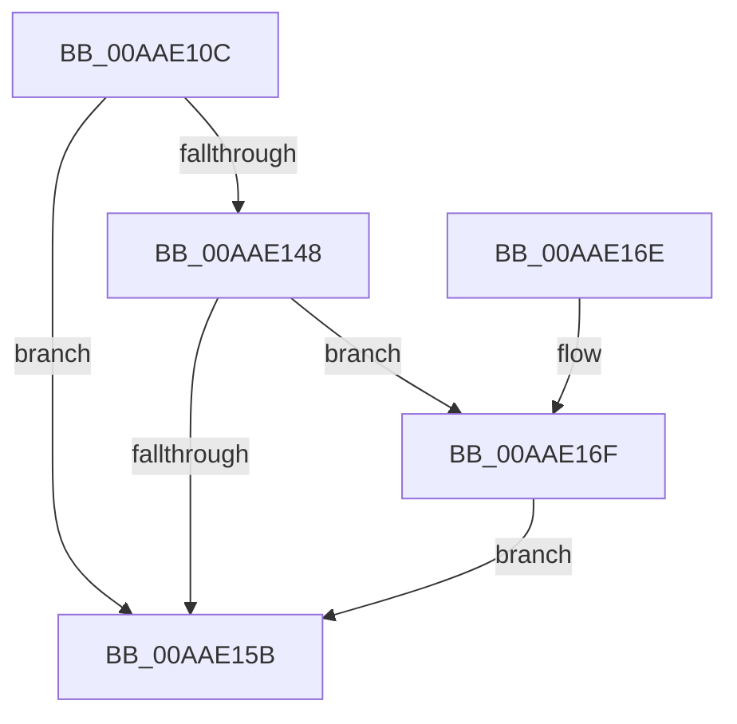

# PopDiagTraceFxPluginRegistration

- RVA: `0x00AAE10C`–`0x00AAE1BC` (길이 `176` bytes)
- VA: `0x0000000140AAE10C`
- 실행 섹션: `PAGE`
- PDB 이름 있음: `예`; PDB Function 태그: `아니요`
- unwind 정보 RVA: `0x000BC22C`
- 디코드: `42`개 명령, `176/176` bytes 표시
- 미해석 바이트: `0` (있으면 어셈블리에 `.byte`로 보존)

> 이 문서는 커널 이미지의 기계어와 PDB 기호를 분석해 생성했습니다. 4번과 5번은 함수 원형과 자료형을 바이너리 사용 방식에서 추정한 C 해석이며 원본 소스 복구 결과는 아닙니다.

## 1. Dependencies

- 직접 호출 지점: **3**; 고유 호출 대상: **3**
- 직접 호출자로 확인된 함수: **2**
- RIP 상대 이미지 참조: **5**

### Outgoing calls
- `0x00AAE152` → [EtwEventEnabled](../../text/39/EtwEventEnabled_function_00392450.md) (function, `0x00392450`)
- `0x00AAE163` → [_security_check_cookie](../../text/6A/_security_check_cookie_function_006AC640.md) (function, `0x006AC640`)
- `0x00AAE1B5` → [EtwWrite](../../text/41/EtwWrite_function_0041C720.md) (function, `0x0041C720`)

### Direct callers
- [PopDiagTraceFxRundown](../../text/43/PopDiagTraceFxRundown_function_0043A028.md) at `0x0043A168`
- [PopFxRegisterPluginEx](../../text/5D/PopFxRegisterPluginEx_function_005D31B8.md) at `0x005D33AE`

### Static image references
- `0x00AAE11B` → RVA `0x00E0A740` (`.data`; read)
- `0x00AAE12D` → RVA `0x0001E0D8` (`.rdata`; read)
- `0x00AAE134` → RVA `0x0001E0E8` (`.rdata`; read)
- `0x00AAE13F` → RVA `0x00E67858` (`.data`; read)
- `0x00AAE148` → RVA `0x00F0B408` (`.data`; read)

## 2. Other-region calls and transfers

- 다른 실행 섹션으로 향하는 call: **3**
  - `0x00AAE152` → [EtwEventEnabled](../../text/39/EtwEventEnabled_function_00392450.md) (`PAGE` → `.text`)
  - `0x00AAE163` → [_security_check_cookie](../../text/6A/_security_check_cookie_function_006AC640.md) (`PAGE` → `.text`)
  - `0x00AAE1B5` → [EtwWrite](../../text/41/EtwWrite_function_0041C720.md) (`PAGE` → `.text`)
- 별도 외부 분기/꼬리 이동을 확인하지 못했습니다.

## 3. Assembly (complete function range)

```asm
00AAE10C  48 89 54 24 10                  mov qword ptr [rsp + 0x10], rdx
00AAE111  48 89 4C 24 08                  mov qword ptr [rsp + 8], rcx
00AAE116  53                              push rbx
00AAE117  48 83 EC 60                     sub rsp, 0x60
00AAE11B  48 8B 05 1E C6 35 00            mov rax, qword ptr [rip + 0x35c61e]
00AAE122  48 33 C4                        xor rax, rsp
00AAE125  48 89 44 24 50                  mov qword ptr [rsp + 0x50], rax
00AAE12A  45 84 C0                        test r8b, r8b
00AAE12D  48 8D 05 A4 FF 56 FF            lea rax, [rip - 0xa9005c]
00AAE134  48 8D 1D AD FF 56 FF            lea rbx, [rip - 0xa90053]
00AAE13B  48 0F 44 D8                     cmove rbx, rax
00AAE13F  80 3D 12 97 3B 00 00            cmp byte ptr [rip + 0x3b9712], 0
00AAE146  74 13                           je 0x140aae15b
00AAE148  48 8B 0D B9 D2 45 00            mov rcx, qword ptr [rip + 0x45d2b9]
00AAE14F  48 8B D3                        mov rdx, rbx
00AAE152  E8 F9 42 8E FF                  call 0x140392450
00AAE157  84 C0                           test al, al
00AAE159  75 14                           jne 0x140aae16f
00AAE15B  48 8B 4C 24 50                  mov rcx, qword ptr [rsp + 0x50]
00AAE160  48 33 CC                        xor rcx, rsp
00AAE163  E8 D8 E4 BF FF                  call 0x1406ac640
00AAE168  48 83 C4 60                     add rsp, 0x60
00AAE16C  5B                              pop rbx
00AAE16D  C3                              ret
00AAE16E  CC                              int3
00AAE16F  83 64 24 3C 00                  and dword ptr [rsp + 0x3c], 0
00AAE174  48 8D 44 24 70                  lea rax, [rsp + 0x70]
00AAE179  83 64 24 4C 00                  and dword ptr [rsp + 0x4c], 0
00AAE17E  B9 08 00 00 00                  mov ecx, 8
00AAE183  48 89 44 24 30                  mov qword ptr [rsp + 0x30], rax
00AAE188  45 33 C0                        xor r8d, r8d
00AAE18B  48 8D 44 24 78                  lea rax, [rsp + 0x78]
00AAE190  89 4C 24 38                     mov dword ptr [rsp + 0x38], ecx
00AAE194  48 89 44 24 40                  mov qword ptr [rsp + 0x40], rax
00AAE199  48 8B D3                        mov rdx, rbx
00AAE19C  48 8D 44 24 30                  lea rax, [rsp + 0x30]
00AAE1A1  89 4C 24 48                     mov dword ptr [rsp + 0x48], ecx
00AAE1A5  44 8D 49 FA                     lea r9d, [rcx - 6]
00AAE1A9  48 89 44 24 20                  mov qword ptr [rsp + 0x20], rax
00AAE1AE  48 8B 0D 53 D2 45 00            mov rcx, qword ptr [rip + 0x45d253]
00AAE1B5  E8 66 E5 96 FF                  call 0x14041c720
00AAE1BA  EB 9F                           jmp 0x140aae15b
```

## 4. C-style interpretation (structured pseudocode)

```c
__int64 __fastcall PopDiagTraceFxPluginRegistration(__int64 a1, __int64 a2, int a3)
{
    __int64 result;
    __int64 v_rbx;
    __int64 v_rsp;
    unsigned __int64 v_stack_m18;
    unsigned __int64 v_stack_p10;
    unsigned __int64 v_stack_p20;
    unsigned __int64 v_stack_p30;
    unsigned int v_stack_p38;
    unsigned int v_stack_p3C;
    unsigned __int64 v_stack_p40;
    unsigned int v_stack_p48;
    unsigned int v_stack_p4C;
    unsigned __int64 v_stack_p70;
    unsigned __int64 v_stack_p78;
    unsigned __int64 v_stack_p8;

    v_stack_p10 = a2;
    v_stack_p8 = a1;
    v_rsp = (v_rsp) - (96);
    result = (*(unsigned __int64 *)(v_rip + 3524126)) ^ (v_rsp);
    v_stack_m18 = result;
    v_rbx = v_rip - 11075667;
    if ((unsigned __int8)(a3) == 0) { v_rbx = v_rip - 11075676; }
    if ((*(unsigned __int8 *)(v_rip + 3905298)) == 0) goto loc_00AAE15B;
    result = EtwEventEnabled(*(unsigned __int64 *)(v_rip + 4575929), v_rbx, a3, a4);
    if ((unsigned __int8)(result) != 0) goto loc_00AAE16F;
loc_00AAE15B:
    a1 = (v_stack_m18) ^ (v_rsp);
    result = _security_check_cookie(a1, v_rbx, a3, a4);
    v_rsp = (v_rsp) + (96);
    return result;
loc_00AAE16F:
    v_stack_p30 = v_stack_p70;
    a3 = 0;
    v_stack_p38 = 8;
    v_stack_p40 = v_stack_p78;
    v_stack_p48 = 8;
    v_stack_p20 = v_stack_p30;
    result = EtwWrite(*(unsigned __int64 *)(v_rip + 4575827), v_rbx, a3, 8 - 6);
    goto loc_00AAE15B;
}
```

## 5. (Beta) C Style

```c
int64_t PopDiagTraceFxPluginRegistration(int64_t Arg1, int64_t Arg2, int32_t Arg3)
{
    int64_t result;
    int64_t local_rbx;
    int64_t local_rsp;
    uint64_t v_stack_m18;
    uint64_t v_stack_p10;
    uint64_t v_stack_p20;
    uint64_t v_stack_p30;
    uint32_t v_stack_p38;
    uint32_t v_stack_p3C;
    uint64_t v_stack_p40;
    uint32_t v_stack_p48;
    uint32_t v_stack_p4C;
    uint64_t v_stack_p70;
    uint64_t v_stack_p78;
    uint64_t v_stack_p8;

    v_stack_p10 = Arg2;
    v_stack_p8 = Arg1;
    local_rsp = (local_rsp) - (96);
    result = (*(uint64_t *)(v_rip + 0x35C61E)) ^ (local_rsp);
    v_stack_m18 = result;
    local_rbx = v_rip - 11075667;
    if ((uint8_t)(Arg3) == 0) { local_rbx = v_rip - 11075676; }
    if ((*(uint8_t *)(v_rip + 0x3B9712)) == 0) goto loc_00AAE15B;
    result = EtwEventEnabled(*(uint64_t *)(v_rip + 0x45D2B9), local_rbx, Arg3, a4);
    if ((uint8_t)(result) != 0) goto loc_00AAE16F;
loc_00AAE15B:
    Arg1 = (v_stack_m18) ^ (local_rsp);
    result = _security_check_cookie(Arg1, local_rbx, Arg3, a4);
    local_rsp = (local_rsp) + (96);
    return result;
loc_00AAE16F:
    v_stack_p30 = v_stack_p70;
    Arg3 = 0;
    v_stack_p38 = 8;
    v_stack_p40 = v_stack_p78;
    v_stack_p48 = 8;
    v_stack_p20 = v_stack_p30;
    result = EtwWrite(*(uint64_t *)(v_rip + 0x45D253), local_rbx, Arg3, 8 - 6);
    goto loc_00AAE15B;
}
```

## 6. Execution-region graph

[열기: 2D/3D 그래프와 함수 탐색 컨트롤 패널](../../../control-panel.html?section=page&rva=0x00AAE10C&view=graph)

- 2D 그래프는 위에서 아래로 흐르고, 3D 그래프는 빈 공간을 드래그해 회전합니다. Shift+드래그는 이동, 휠은 확대·축소, 함수 노드 선택은 대상 보고서 이동입니다.

### Static fallback


