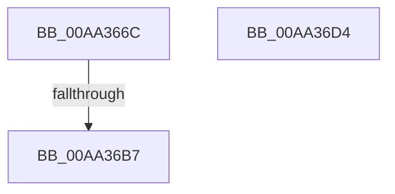

# PopDiagTraceMonitorOnWithLidClosed

- RVA: `0x00AA366C`–`0x00AA36D5` (길이 `105` bytes)
- VA: `0x0000000140AA366C`
- 실행 섹션: `PAGE`
- PDB 이름 있음: `예`; PDB Function 태그: `예`
- unwind 정보 RVA: `0x0006FCAC`
- 디코드: `23`개 명령, `105/105` bytes 표시
- 미해석 바이트: `0` (있으면 어셈블리에 `.byte`로 보존)

> 이 문서는 커널 이미지의 기계어와 PDB 기호를 분석해 생성했습니다. 4번과 5번은 함수 원형과 자료형을 바이너리 사용 방식에서 추정한 C 해석이며 원본 소스 복구 결과는 아닙니다.

## 1. Dependencies

- 직접 호출 지점: **1**; 고유 호출 대상: **1**
- 직접 호출자로 확인된 함수: **1**
- RIP 상대 이미지 참조: **5**

### Outgoing calls
- `0x00AA36BE` → [_security_check_cookie](../../text/6A/_security_check_cookie_function_006AC640.md) (function, `0x006AC640`)

### Direct callers
- [PopPowerAggregatorHandleActiveIntent](../AD/PopPowerAggregatorHandleActiveIntent_function_00ADFCB0.md) at `0x00ADFD37`
- [PopPowerAggregatorHandleActiveIntent](../AD/PopPowerAggregatorHandleActiveIntent_function_00ADFCB0.md) at `0x00ADFD43`

### Static image references
- `0x00AA367E` → RVA `0x00E0A740` (`.data`; read)
- `0x00AA368C` → RVA `0x00F0CE0C` (`.data`; read)
- `0x00AA3696` → RVA `0x00E0B579` (`.data`; read)
- `0x00AA36A0` → RVA `0x00E67A54` (`.data`; read)
- `0x00AA36AA` → RVA `0x00E07748` (`.data`; read)

## 2. Other-region calls and transfers

- 다른 실행 섹션으로 향하는 call: **1**
  - `0x00AA36BE` → [_security_check_cookie](../../text/6A/_security_check_cookie_function_006AC640.md) (`PAGE` → `.text`)
- call이 아닌 외부 분기/꼬리 이동: **1**
  - `0x00AA36B1` → [sub_00B49976](../B4/Unknown_function_00B49976.md) (`tail-transfer`)

## 3. Assembly (complete function range)

```asm
00AA366C  48 89 5C 24 08                  mov qword ptr [rsp + 8], rbx
00AA3671  55                              push rbp
00AA3672  48 8D 6C 24 A9                  lea rbp, [rsp - 0x57]
00AA3677  48 81 EC D0 00 00 00            sub rsp, 0xd0
00AA367E  48 8B 05 BB 70 36 00            mov rax, qword ptr [rip + 0x3670bb]
00AA3685  48 33 C4                        xor rax, rsp
00AA3688  48 89 45 47                     mov qword ptr [rbp + 0x47], rax
00AA368C  83 3D 79 97 46 00 00            cmp dword ptr [rip + 0x469779], 0
00AA3693  44 8A C2                        mov r8b, dl
00AA3696  44 8A 15 DC 7E 36 00            mov r10b, byte ptr [rip + 0x367edc]
00AA369D  44 8B C9                        mov r9d, ecx
00AA36A0  44 8A 1D AD 43 3C 00            mov r11b, byte ptr [rip + 0x3c43ad]
00AA36A7  0F 94 C3                        sete bl
00AA36AA  83 3D 97 40 36 00 05            cmp dword ptr [rip + 0x364097], 5
00AA36B1  0F 87 BF 62 0A 00               ja 0x140b49976
00AA36B7  48 8B 4D 47                     mov rcx, qword ptr [rbp + 0x47]
00AA36BB  48 33 CC                        xor rcx, rsp
00AA36BE  E8 7D 8F C0 FF                  call 0x1406ac640
00AA36C3  48 8B 9C 24 E0 00 00 00         mov rbx, qword ptr [rsp + 0xe0]
00AA36CB  48 81 C4 D0 00 00 00            add rsp, 0xd0
00AA36D2  5D                              pop rbp
00AA36D3  C3                              ret
00AA36D4  CC                              int3
```

## 4. C-style interpretation (structured pseudocode)

```c
__int64 __fastcall PopDiagTraceMonitorOnWithLidClosed(int a1, unsigned __int8 a2)
{
    __int64 result;
    __int64 v_rbx;
    __int64 v_rsp;
    unsigned __int64 v_stack_m18;
    unsigned __int64 v_stack_m5F;
    unsigned __int64 v_stack_p8;

    v_stack_p8 = v_rbx;
    v_rsp = (v_rsp) - (208);
    result = (*(unsigned __int64 *)(v_rip + 3567803)) ^ (v_rsp);
    v_stack_m18 = result;
    v_rbx = ((*(unsigned int *)(v_rip + 4626297)) == 0) ? 1 : 0;
    a1 = (v_stack_m18) ^ (v_rsp);
    result = _security_check_cookie(a1, a2, a2, (unsigned int)(a1));
    v_rsp = (v_rsp) + (208);
    return result;
}
```

## 5. (Beta) C Style

```c
int64_t PopDiagTraceMonitorOnWithLidClosed(int32_t Arg1, uint8_t Arg2)
{
    int64_t result;
    int64_t local_rbx;
    int64_t local_rsp;
    uint64_t v_stack_m18;
    uint64_t v_stack_m5F;
    uint64_t v_stack_p8;

    v_stack_p8 = local_rbx;
    local_rsp = (local_rsp) - (208);
    result = (*(uint64_t *)(v_rip + 0x3670BB)) ^ (local_rsp);
    v_stack_m18 = result;
    local_rbx = ((*(uint32_t *)(v_rip + 0x469779)) == 0) ? 1 : 0;
    Arg1 = (v_stack_m18) ^ (local_rsp);
    result = _security_check_cookie(Arg1, Arg2, Arg2, (uint32_t)(Arg1));
    local_rsp = (local_rsp) + (208);
    return result;
}
```

## 6. Execution-region graph

[열기: 2D/3D 그래프와 함수 탐색 컨트롤 패널](../../../control-panel.html?section=page&rva=0x00AA366C&view=graph)

- 2D 그래프는 위에서 아래로 흐르고, 3D 그래프는 빈 공간을 드래그해 회전합니다. Shift+드래그는 이동, 휠은 확대·축소, 함수 노드 선택은 대상 보고서 이동입니다.

### Static fallback


