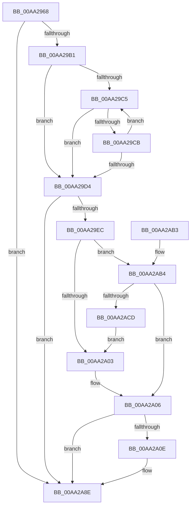

# PopDiagTracePowerSettingRegistration

- RVA: `0x00AA2968`–`0x00AA2AD2` (길이 `362` bytes)
- VA: `0x0000000140AA2968`
- 실행 섹션: `PAGE`
- PDB 이름 있음: `예`; PDB Function 태그: `아니요`
- unwind 정보 RVA: `0x000BB1DC`
- 디코드: `82`개 명령, `362/362` bytes 표시
- 미해석 바이트: `0` (있으면 어셈블리에 `.byte`로 보존)

> 이 문서는 커널 이미지의 기계어와 PDB 기호를 분석해 생성했습니다. 4번과 5번은 함수 원형과 자료형을 바이너리 사용 방식에서 추정한 C 해석이며 원본 소스 복구 결과는 아닙니다.

## 1. Dependencies

- 직접 호출 지점: **4**; 고유 호출 대상: **4**
- 직접 호출자로 확인된 함수: **1**
- RIP 상대 이미지 참조: **5**

### Outgoing calls
- `0x00AA2999` → [PsGetCurrentThreadProcess](../../text/47/PsGetCurrentThreadProcess_function_0047C7E0.md) (function, `0x0047C7E0`)
- `0x00AA2A2D` → [tlgCreate1Sz_wchar_t](../../text/42/tlgCreate1Sz_wchar_t_function_00426198.md) (function, `0x00426198`)
- `0x00AA2A89` → [tlgWriteTransfer_EtwWriteTransfer](../../text/42/tlgWriteTransfer_EtwWriteTransfer_function_004260E0.md) (function, `0x004260E0`)
- `0x00AA2A95` → [_security_check_cookie](../../text/6A/_security_check_cookie_function_006AC640.md) (function, `0x006AC640`)

### Direct callers
- [PopGetSettingNotificationName](../91/PopGetSettingNotificationName_function_0091346C.md) at `0x0091373C`

### Static image references
- `0x00AA2983` → RVA `0x00E0A740` (`.data`; read)
- `0x00AA29DF` → RVA `0x00E07748` (`.data`; read)
- `0x00AA29F6` → RVA `0x00E07758` (`.data`; read)
- `0x00AA2A3D` → RVA `0x0004C066` (`.rdata`; read)
- `0x00AA2AB4` → RVA `0x00E07760` (`.data`; read)

## 2. Other-region calls and transfers

- 다른 실행 섹션으로 향하는 call: **4**
  - `0x00AA2999` → [PsGetCurrentThreadProcess](../../text/47/PsGetCurrentThreadProcess_function_0047C7E0.md) (`PAGE` → `.text`)
  - `0x00AA2A2D` → [tlgCreate1Sz_wchar_t](../../text/42/tlgCreate1Sz_wchar_t_function_00426198.md) (`PAGE` → `.text`)
  - `0x00AA2A89` → [tlgWriteTransfer_EtwWriteTransfer](../../text/42/tlgWriteTransfer_EtwWriteTransfer_function_004260E0.md) (`PAGE` → `.text`)
  - `0x00AA2A95` → [_security_check_cookie](../../text/6A/_security_check_cookie_function_006AC640.md) (`PAGE` → `.text`)
- 별도 외부 분기/꼬리 이동을 확인하지 못했습니다.

## 3. Assembly (complete function range)

```asm
00AA2968  48 8B C4                        mov rax, rsp
00AA296B  48 89 58 08                     mov qword ptr [rax + 8], rbx
00AA296F  48 89 70 10                     mov qword ptr [rax + 0x10], rsi
00AA2973  48 89 78 18                     mov qword ptr [rax + 0x18], rdi
00AA2977  55                              push rbp
00AA2978  48 8D 68 A1                     lea rbp, [rax - 0x5f]
00AA297C  48 81 EC C0 00 00 00            sub rsp, 0xc0
00AA2983  48 8B 05 B6 7D 36 00            mov rax, qword ptr [rip + 0x367db6]
00AA298A  48 33 C4                        xor rax, rsp
00AA298D  48 89 45 47                     mov qword ptr [rbp + 0x47], rax
00AA2991  41 8A D8                        mov bl, r8b
00AA2994  8B FA                           mov edi, edx
00AA2996  48 8B F1                        mov rsi, rcx
00AA2999  E8 42 9E 9D FF                  call 0x14047c7e0
00AA299E  45 33 DB                        xor r11d, r11d
00AA29A1  4C 8B 90 50 03 00 00            mov r10, qword ptr [rax + 0x350]
00AA29A8  4D 85 D2                        test r10, r10
00AA29AB  0F 84 DD 00 00 00               je 0x140aa2a8e
00AA29B1  41 0F B7 02                     movzx eax, word ptr [r10]
00AA29B5  4D 8B 4A 08                     mov r9, qword ptr [r10 + 8]
00AA29B9  48 D1 E8                        shr rax, 1
00AA29BC  48 03 C0                        add rax, rax
00AA29BF  4A 8D 14 08                     lea rdx, [rax + r9]
00AA29C3  74 0F                           je 0x140aa29d4
00AA29C5  66 83 3A 5C                     cmp word ptr [rdx], 0x5c
00AA29C9  74 09                           je 0x140aa29d4
00AA29CB  48 83 EA 02                     sub rdx, 2
00AA29CF  49 3B D1                        cmp rdx, r9
00AA29D2  75 F1                           jne 0x140aa29c5
00AA29D4  49 3B D1                        cmp rdx, r9
00AA29D7  4C 8D 42 02                     lea r8, [rdx + 2]
00AA29DB  4C 0F 44 C2                     cmove r8, rdx
00AA29DF  83 3D 62 4D 36 00 05            cmp dword ptr [rip + 0x364d62], 5
00AA29E6  0F 86 A2 00 00 00               jbe 0x140aa2a8e
00AA29EC  48 BA 00 00 00 00 00 40 00 00   movabs rdx, 0x400000000000
00AA29F6  48 85 15 5B 4D 36 00            test qword ptr [rip + 0x364d5b], rdx
00AA29FD  0F 85 B1 00 00 00               jne 0x140aa2ab4
00AA2A03  41 8A C3                        mov al, r11b
00AA2A06  84 C0                           test al, al
00AA2A08  0F 84 80 00 00 00               je 0x140aa2a8e
00AA2A0E  48 8D 45 CF                     lea rax, [rbp - 0x31]
00AA2A12  48 C7 45 CF 00 00 00 02         mov qword ptr [rbp - 0x31], 0x2000000
00AA2A1A  49 8B D0                        mov rdx, r8
00AA2A1D  48 89 45 F7                     mov qword ptr [rbp - 9], rax
00AA2A21  48 8D 4D 07                     lea rcx, [rbp + 7]
00AA2A25  48 C7 45 FF 08 00 00 00         mov qword ptr [rbp - 1], 8
00AA2A2D  E8 66 37 98 FF                  call 0x140426198
00AA2A32  48 8D 45 CB                     lea rax, [rbp - 0x35]
00AA2A36  89 7D CB                        mov dword ptr [rbp - 0x35], edi
00AA2A39  48 89 45 17                     mov qword ptr [rbp + 0x17], rax
00AA2A3D  48 8D 15 22 96 5A FF            lea rdx, [rip - 0xa569de]
00AA2A44  48 8D 45 C7                     lea rax, [rbp - 0x39]
00AA2A48  48 C7 45 1F 04 00 00 00         mov qword ptr [rbp + 0x1f], 4
00AA2A50  48 89 45 37                     mov qword ptr [rbp + 0x37], rax
00AA2A54  48 8D 0D ED 4C 36 00            lea rcx, [rip + 0x364ced]
00AA2A5B  48 8D 45 D7                     lea rax, [rbp - 0x29]
00AA2A5F  48 89 75 27                     mov qword ptr [rbp + 0x27], rsi
00AA2A63  48 89 44 24 28                  mov qword ptr [rsp + 0x28], rax
00AA2A68  45 33 C9                        xor r9d, r9d
00AA2A6B  45 33 C0                        xor r8d, r8d
00AA2A6E  C7 44 24 20 07 00 00 00         mov dword ptr [rsp + 0x20], 7
00AA2A76  48 C7 45 2F 10 00 00 00         mov qword ptr [rbp + 0x2f], 0x10
00AA2A7E  88 5D C7                        mov byte ptr [rbp - 0x39], bl
00AA2A81  48 C7 45 3F 01 00 00 00         mov qword ptr [rbp + 0x3f], 1
00AA2A89  E8 52 36 98 FF                  call 0x1404260e0
00AA2A8E  48 8B 4D 47                     mov rcx, qword ptr [rbp + 0x47]
00AA2A92  48 33 CC                        xor rcx, rsp
00AA2A95  E8 A6 9B C0 FF                  call 0x1406ac640
00AA2A9A  4C 8D 9C 24 C0 00 00 00         lea r11, [rsp + 0xc0]
00AA2AA2  49 8B 5B 10                     mov rbx, qword ptr [r11 + 0x10]
00AA2AA6  49 8B 73 18                     mov rsi, qword ptr [r11 + 0x18]
00AA2AAA  49 8B 7B 20                     mov rdi, qword ptr [r11 + 0x20]
00AA2AAE  49 8B E3                        mov rsp, r11
00AA2AB1  5D                              pop rbp
00AA2AB2  C3                              ret
00AA2AB3  CC                              int3
00AA2AB4  48 8B 05 A5 4C 36 00            mov rax, qword ptr [rip + 0x364ca5]
00AA2ABB  48 23 C2                        and rax, rdx
00AA2ABE  48 3B 05 9B 4C 36 00            cmp rax, qword ptr [rip + 0x364c9b]
00AA2AC5  B0 01                           mov al, 1
00AA2AC7  0F 84 39 FF FF FF               je 0x140aa2a06
00AA2ACD  E9 31 FF FF FF                  jmp 0x140aa2a03
```

## 4. C-style interpretation (structured pseudocode)

```c
__int64 __fastcall PopDiagTracePowerSettingRegistration(__int64 a1, int a2, unsigned __int8 a3)
{
    __int64 result;
    __int64 v_r11;
    __int64 v_rsp;
    unsigned __int64 v_stack_m8;
    unsigned __int64 v_stack_mA0;
    unsigned int v_stack_mA8;

    *(unsigned __int64 *)(v_rsp + 8) = v_rbx;
    *(unsigned __int64 *)(v_rsp + 16) = v_rsi;
    *(unsigned __int64 *)(v_rsp + 24) = v_rdi;
    v_rsp = (v_rsp) - (192);
    result = (*(unsigned __int64 *)(v_rip + 3571126)) ^ (v_rsp);
    *(unsigned __int64 *)(v_rsp - 95 + 71) = result;
    result = PsGetCurrentThreadProcess(a1, a2, a3, a4);
    v_r11 = 0;
    if (*(unsigned __int64 *)(result + 848) == 0) goto loc_00AA2A8E;
    result = (*(unsigned __int16 *)(*(unsigned __int64 *)(result + 848))) >> (1);
    result = (result) + (result);
    if (condition_is_equal) goto loc_00AA29D4;
loc_00AA29C5:
    if ((*(unsigned __int16 *)(result + *(unsigned __int64 *)(*(unsigned __int64 *)(result + 848) + 8) * 1)) == 92) goto loc_00AA29D4;
    a2 = (result + *(unsigned __int64 *)(*(unsigned __int64 *)(result + 848) + 8) * 1) - (2);
    if (a2 != (*(unsigned __int64 *)(*(unsigned __int64 *)(result + 848) + 8))) goto loc_00AA29C5;
loc_00AA29D4:
    a3 = a2 + 2;
    if (a2 == (*(unsigned __int64 *)(*(unsigned __int64 *)(result + 848) + 8))) { a3 = a2; }
    if ((*(unsigned int *)(v_rip + 3558754)) <= 5) goto loc_00AA2A8E;
    if (((*(unsigned __int64 *)(v_rip + 3558747)) & (a2)) != 0) goto loc_00AA2AB4;
loc_00AA2A03:
loc_00AA2A06:
    result = 0;
    if (0 != 0) {
        result = v_rsp - 95 - 49;
        *(unsigned __int64 *)(v_rsp - 95 - 49) = 0x2000000ULL;
        a2 = a3;
        *(unsigned __int64 *)(v_rsp - 95 - 9) = result;
        a1 = v_rsp - 95 + 7;
        *(unsigned __int64 *)(v_rsp - 95 - 1) = 8;
        result = tlgCreate1Sz_wchar_t(a1, a2, a3, *(unsigned __int64 *)(*(unsigned __int64 *)(result + 848) + 8));
        result = v_rsp - 95 - 53;
        *(unsigned int *)(v_rsp - 95 - 53) = (unsigned int)((unsigned int)(a2));
        *(unsigned __int64 *)(v_rsp - 95 + 23) = result;
        a2 = v_rip - 10840542;
        result = v_rsp - 95 - 57;
        *(unsigned __int64 *)(v_rsp - 95 + 31) = 4;
        *(unsigned __int64 *)(v_rsp - 95 + 55) = result;
        a1 = v_rip + 3558637;
        result = v_rsp - 95 - 41;
        *(unsigned __int64 *)(v_rsp - 95 + 39) = a1;
        v_stack_mA0 = result;
        a4 = 0;
        a3 = 0;
        v_stack_mA8 = 7;
        *(unsigned __int64 *)(v_rsp - 95 + 47) = 16;
        *(unsigned __int8 *)(v_rsp - 95 - 57) = 0;
        *(unsigned __int64 *)(v_rsp - 95 + 63) = 1;
        result = tlgWriteTransfer_EtwWriteTransfer(a1, a2, a3, a4);
    }
    a1 = (*(unsigned __int64 *)(v_rsp - 95 + 71)) ^ (v_rsp);
    result = _security_check_cookie(a1, a2, a3, a4);
    return result;
loc_00AA2AB4:
    result = (*(unsigned __int64 *)(v_rip + 3558565)) & (a2);
    if (result == (*(unsigned __int64 *)(v_rip + 3558555))) goto loc_00AA2A06;
    goto loc_00AA2A03;
}
```

## 5. (Beta) C Style

```c
int64_t PopDiagTracePowerSettingRegistration(int64_t Arg1, int32_t Arg2, uint8_t Arg3)
{
    int64_t result;
    int64_t local_r11;
    int64_t local_rsp;
    uint64_t v_stack_m8;
    uint64_t v_stack_mA0;
    uint32_t v_stack_mA8;

    *(uint64_t *)(local_rsp + 0x8) = local_rbx;
    *(uint64_t *)(local_rsp + 0x10) = local_rsi;
    *(uint64_t *)(local_rsp + 0x18) = local_rdi;
    local_rsp = (local_rsp) - (192);
    result = (*(uint64_t *)(v_rip + 0x367DB6)) ^ (local_rsp);
    *(uint64_t *)(local_rsp - 0x5F + 0x47) = result;
    result = PsGetCurrentThreadProcess(Arg1, Arg2, Arg3, a4);
    local_r11 = 0;
    if (*(uint64_t *)(result + 0x350) == 0) goto loc_00AA2A8E;
    result = (*(uint16_t *)(*(uint64_t *)(result + 0x350))) >> (1);
    result = (result) + (result);
    if (condition_is_equal) goto loc_00AA29D4;
loc_00AA29C5:
    if ((*(uint16_t *)(result + *(uint64_t *)(*(uint64_t *)(result + 0x350) + 0x8) * 1)) == 92) goto loc_00AA29D4;
    Arg2 = (result + *(uint64_t *)(*(uint64_t *)(result + 0x350) + 0x8) * 1) - (2);
    if (Arg2 != (*(uint64_t *)(*(uint64_t *)(result + 0x350) + 0x8))) goto loc_00AA29C5;
loc_00AA29D4:
    Arg3 = Arg2 + 2;
    if (Arg2 == (*(uint64_t *)(*(uint64_t *)(result + 0x350) + 0x8))) { Arg3 = Arg2; }
    if ((*(uint32_t *)(v_rip + 0x364D62)) <= 5) goto loc_00AA2A8E;
    if (((*(uint64_t *)(v_rip + 0x364D5B)) & (Arg2)) != 0) goto loc_00AA2AB4;
loc_00AA2A03:
loc_00AA2A06:
    result = 0;
    if (0 != 0) {
        result = local_rsp - 95 - 49;
        *(uint64_t *)(local_rsp - 0x5F - 0x31) = 0x2000000ULL;
        Arg2 = Arg3;
        *(uint64_t *)(local_rsp - 0x5F - 0x9) = result;
        Arg1 = local_rsp - 95 + 7;
        *(uint64_t *)(local_rsp - 0x5F - 0x1) = 8;
        result = tlgCreate1Sz_wchar_t(Arg1, Arg2, Arg3, *(uint64_t *)(*(uint64_t *)(result + 0x350) + 0x8));
        result = local_rsp - 95 - 53;
        *(uint32_t *)(local_rsp - 0x5F - 0x35) = (uint32_t)((uint32_t)(Arg2));
        *(uint64_t *)(local_rsp - 0x5F + 0x17) = result;
        Arg2 = v_rip - 10840542;
        result = local_rsp - 95 - 57;
        *(uint64_t *)(local_rsp - 0x5F + 0x1F) = 4;
        *(uint64_t *)(local_rsp - 0x5F + 0x37) = result;
        Arg1 = v_rip + 3558637;
        result = local_rsp - 95 - 41;
        *(uint64_t *)(local_rsp - 0x5F + 0x27) = Arg1;
        v_stack_mA0 = result;
        a4 = 0;
        Arg3 = 0;
        v_stack_mA8 = 7;
        *(uint64_t *)(local_rsp - 0x5F + 0x2F) = 16;
        *(uint8_t *)(local_rsp - 0x5F - 0x39) = 0;
        *(uint64_t *)(local_rsp - 0x5F + 0x3F) = 1;
        result = tlgWriteTransfer_EtwWriteTransfer(Arg1, Arg2, Arg3, a4);
    }
    Arg1 = (*(uint64_t *)(local_rsp - 0x5F + 0x47)) ^ (local_rsp);
    result = _security_check_cookie(Arg1, Arg2, Arg3, a4);
    return result;
loc_00AA2AB4:
    result = (*(uint64_t *)(v_rip + 0x364CA5)) & (Arg2);
    if (result == (*(uint64_t *)(v_rip + 0x364C9B))) goto loc_00AA2A06;
    goto loc_00AA2A03;
}
```

## 6. Execution-region graph

[열기: 2D/3D 그래프와 함수 탐색 컨트롤 패널](../../../control-panel.html?section=page&rva=0x00AA2968&view=graph)

- 2D 그래프는 위에서 아래로 흐르고, 3D 그래프는 빈 공간을 드래그해 회전합니다. Shift+드래그는 이동, 휠은 확대·축소, 함수 노드 선택은 대상 보고서 이동입니다.

### Static fallback


