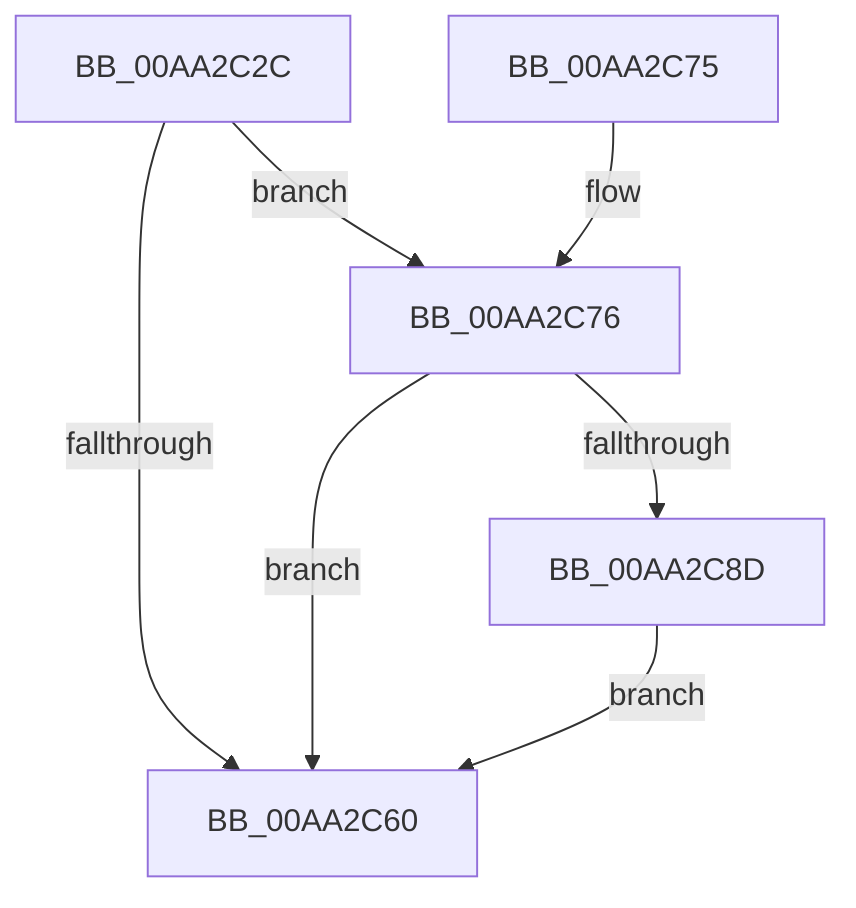

# PopDiagTraceSessionStateCounted

- RVA: `0x00AA2C2C`–`0x00AA2CE7` (길이 `187` bytes)
- VA: `0x0000000140AA2C2C`
- 실행 섹션: `PAGE`
- PDB 이름 있음: `예`; PDB Function 태그: `아니요`
- unwind 정보 RVA: `0x000BB210`
- 디코드: `45`개 명령, `187/187` bytes 표시
- 미해석 바이트: `0` (있으면 어셈블리에 `.byte`로 보존)

> 이 문서는 커널 이미지의 기계어와 PDB 기호를 분석해 생성했습니다. 4번과 5번은 함수 원형과 자료형을 바이너리 사용 방식에서 추정한 C 해석이며 원본 소스 복구 결과는 아닙니다.

## 1. Dependencies

- 직접 호출 지점: **3**; 고유 호출 대상: **3**
- 직접 호출자로 확인된 함수: **1**
- RIP 상대 이미지 참조: **5**

### Outgoing calls
- `0x00AA2C67` → [_security_check_cookie](../../text/6A/_security_check_cookie_function_006AC640.md) (function, `0x006AC640`)
- `0x00AA2C84` → [EtwEventEnabled](../../text/39/EtwEventEnabled_function_00392450.md) (function, `0x00392450`)
- `0x00AA2CDD` → [EtwWrite](../../text/41/EtwWrite_function_0041C720.md) (function, `0x0041C720`)

### Direct callers
- [sub_00B218E0](../B2/Unknown_function_00B218E0.md) at `0x00B21919`

### Static image references
- `0x00AA2C3C` → RVA `0x00E0A740` (`.data`; read)
- `0x00AA2C4E` → RVA `0x00E67858` (`.data`; read)
- `0x00AA2C55` → RVA `0x00E67A4C` (`.data`; read)
- `0x00AA2C76` → RVA `0x00F0B408` (`.data`; read)
- `0x00AA2C7D` → RVA `0x0001C7F0` (`.rdata`; read)

## 2. Other-region calls and transfers

- 다른 실행 섹션으로 향하는 call: **3**
  - `0x00AA2C67` → [_security_check_cookie](../../text/6A/_security_check_cookie_function_006AC640.md) (`PAGE` → `.text`)
  - `0x00AA2C84` → [EtwEventEnabled](../../text/39/EtwEventEnabled_function_00392450.md) (`PAGE` → `.text`)
  - `0x00AA2CDD` → [EtwWrite](../../text/41/EtwWrite_function_0041C720.md) (`PAGE` → `.text`)
- 별도 외부 분기/꼬리 이동을 확인하지 못했습니다.

## 3. Assembly (complete function range)

```asm
00AA2C2C  44 89 44 24 18                  mov dword ptr [rsp + 0x18], r8d
00AA2C31  55                              push rbp
00AA2C32  48 8B EC                        mov rbp, rsp
00AA2C35  48 81 EC 80 00 00 00            sub rsp, 0x80
00AA2C3C  48 8B 05 FD 7A 36 00            mov rax, qword ptr [rip + 0x367afd]
00AA2C43  48 33 C4                        xor rax, rsp
00AA2C46  48 89 45 F0                     mov qword ptr [rbp - 0x10], rax
00AA2C4A  83 4D B0 FF                     or dword ptr [rbp - 0x50], 0xffffffff
00AA2C4E  80 3D 03 4C 3C 00 00            cmp byte ptr [rip + 0x3c4c03], 0
00AA2C55  8B 05 F1 4D 3C 00               mov eax, dword ptr [rip + 0x3c4df1]
00AA2C5B  89 45 B8                        mov dword ptr [rbp - 0x48], eax
00AA2C5E  75 16                           jne 0x140aa2c76
00AA2C60  48 8B 4D F0                     mov rcx, qword ptr [rbp - 0x10]
00AA2C64  48 33 CC                        xor rcx, rsp
00AA2C67  E8 D4 99 C0 FF                  call 0x1406ac640
00AA2C6C  48 81 C4 80 00 00 00            add rsp, 0x80
00AA2C73  5D                              pop rbp
00AA2C74  C3                              ret
00AA2C75  CC                              int3
00AA2C76  48 8B 0D 8B 87 46 00            mov rcx, qword ptr [rip + 0x46878b]
00AA2C7D  48 8D 15 6C 9B 57 FF            lea rdx, [rip - 0xa86494]
00AA2C84  E8 C7 F7 8E FF                  call 0x140392450
00AA2C89  84 C0                           test al, al
00AA2C8B  74 D3                           je 0x140aa2c60
00AA2C8D  83 65 CC 00                     and dword ptr [rbp - 0x34], 0
00AA2C91  48 8D 45 B0                     lea rax, [rbp - 0x50]
00AA2C95  83 65 DC 00                     and dword ptr [rbp - 0x24], 0
00AA2C99  48 8D 15 50 9B 57 FF            lea rdx, [rip - 0xa864b0]
00AA2CA0  83 65 EC 00                     and dword ptr [rbp - 0x14], 0
00AA2CA4  B9 04 00 00 00                  mov ecx, 4
00AA2CA9  48 89 45 C0                     mov qword ptr [rbp - 0x40], rax
00AA2CAD  45 33 C0                        xor r8d, r8d
00AA2CB0  48 8D 45 20                     lea rax, [rbp + 0x20]
00AA2CB4  89 4D C8                        mov dword ptr [rbp - 0x38], ecx
00AA2CB7  48 89 45 D0                     mov qword ptr [rbp - 0x30], rax
00AA2CBB  48 8D 45 B8                     lea rax, [rbp - 0x48]
00AA2CBF  48 89 45 E0                     mov qword ptr [rbp - 0x20], rax
00AA2CC3  44 8D 49 FF                     lea r9d, [rcx - 1]
00AA2CC7  48 8D 45 C0                     lea rax, [rbp - 0x40]
00AA2CCB  89 4D D8                        mov dword ptr [rbp - 0x28], ecx
00AA2CCE  89 4D E8                        mov dword ptr [rbp - 0x18], ecx
00AA2CD1  48 8B 0D 30 87 46 00            mov rcx, qword ptr [rip + 0x468730]
00AA2CD8  48 89 44 24 20                  mov qword ptr [rsp + 0x20], rax
00AA2CDD  E8 3E 9A 97 FF                  call 0x14041c720
00AA2CE2  E9 79 FF FF FF                  jmp 0x140aa2c60
```

## 4. C-style interpretation (structured pseudocode)

```c
__int64 __fastcall PopDiagTraceSessionStateCounted(__int64 a1, __int64 a2, int a3)
{
    __int64 result;
    __int64 v_rsp;
    unsigned __int64 v_stack_m18;
    unsigned int v_stack_m1C;
    unsigned int v_stack_m20;
    unsigned __int64 v_stack_m28;
    unsigned int v_stack_m2C;
    unsigned int v_stack_m30;
    unsigned __int64 v_stack_m38;
    unsigned int v_stack_m3C;
    unsigned int v_stack_m40;
    unsigned __int64 v_stack_m48;
    unsigned int v_stack_m50;
    unsigned int v_stack_m58;
    unsigned int v_stack_p18;
    unsigned __int64 v_stack_p20;

    v_stack_p18 = a3;
    v_rsp = (v_rsp) - (128);
    result = (*(unsigned __int64 *)(v_rip + 3570429)) ^ (v_rsp);
    v_stack_m18 = result;
    v_stack_m50 = (unsigned int)((unsigned int)(*(unsigned int *)(v_rip + 3952113)));
    if ((*(unsigned __int8 *)(v_rip + 3951619)) != 0) goto loc_00AA2C76;
loc_00AA2C60:
    a1 = (v_stack_m18) ^ (v_rsp);
    result = _security_check_cookie(a1, a2, a3, a4);
    v_rsp = (v_rsp) + (128);
    return result;
loc_00AA2C76:
    result = EtwEventEnabled(*(unsigned __int64 *)(v_rip + 4622219), v_rip - 11035796, a3, a4);
    if ((unsigned __int8)(result) == 0) goto loc_00AA2C60;
    v_stack_m48 = v_stack_m58;
    a3 = 0;
    v_stack_m40 = 4;
    v_stack_m38 = v_stack_p18;
    v_stack_m28 = v_stack_m50;
    v_stack_m30 = 4;
    v_stack_m20 = 4;
    v_stack_p20 = v_stack_m48;
    result = EtwWrite(*(unsigned __int64 *)(v_rip + 4622128), v_rip - 11035824, a3, 4 - 1);
    goto loc_00AA2C60;
}
```

## 5. (Beta) C Style

```c
int64_t PopDiagTraceSessionStateCounted(int64_t Arg1, int64_t Arg2, int32_t Arg3)
{
    int64_t result;
    int64_t local_rsp;
    uint64_t v_stack_m18;
    uint32_t v_stack_m1C;
    uint32_t v_stack_m20;
    uint64_t v_stack_m28;
    uint32_t v_stack_m2C;
    uint32_t v_stack_m30;
    uint64_t v_stack_m38;
    uint32_t v_stack_m3C;
    uint32_t v_stack_m40;
    uint64_t v_stack_m48;
    uint32_t v_stack_m50;
    uint32_t v_stack_m58;
    uint32_t v_stack_p18;
    uint64_t v_stack_p20;

    v_stack_p18 = Arg3;
    local_rsp = (local_rsp) - (128);
    result = (*(uint64_t *)(v_rip + 0x367AFD)) ^ (local_rsp);
    v_stack_m18 = result;
    v_stack_m50 = (uint32_t)((uint32_t)(*(uint32_t *)(v_rip + 0x3C4DF1)));
    if ((*(uint8_t *)(v_rip + 0x3C4C03)) != 0) goto loc_00AA2C76;
loc_00AA2C60:
    Arg1 = (v_stack_m18) ^ (local_rsp);
    result = _security_check_cookie(Arg1, Arg2, Arg3, a4);
    local_rsp = (local_rsp) + (128);
    return result;
loc_00AA2C76:
    result = EtwEventEnabled(*(uint64_t *)(v_rip + 0x46878B), v_rip - 11035796, Arg3, a4);
    if ((uint8_t)(result) == 0) goto loc_00AA2C60;
    v_stack_m48 = v_stack_m58;
    Arg3 = 0;
    v_stack_m40 = 4;
    v_stack_m38 = v_stack_p18;
    v_stack_m28 = v_stack_m50;
    v_stack_m30 = 4;
    v_stack_m20 = 4;
    v_stack_p20 = v_stack_m48;
    result = EtwWrite(*(uint64_t *)(v_rip + 0x468730), v_rip - 11035824, Arg3, 4 - 1);
    goto loc_00AA2C60;
}
```

## 6. Execution-region graph

[열기: 2D/3D 그래프와 함수 탐색 컨트롤 패널](../../../control-panel.html?section=page&rva=0x00AA2C2C&view=graph)

- 2D 그래프는 위에서 아래로 흐르고, 3D 그래프는 빈 공간을 드래그해 회전합니다. Shift+드래그는 이동, 휠은 확대·축소, 함수 노드 선택은 대상 보고서 이동입니다.

### Static fallback


