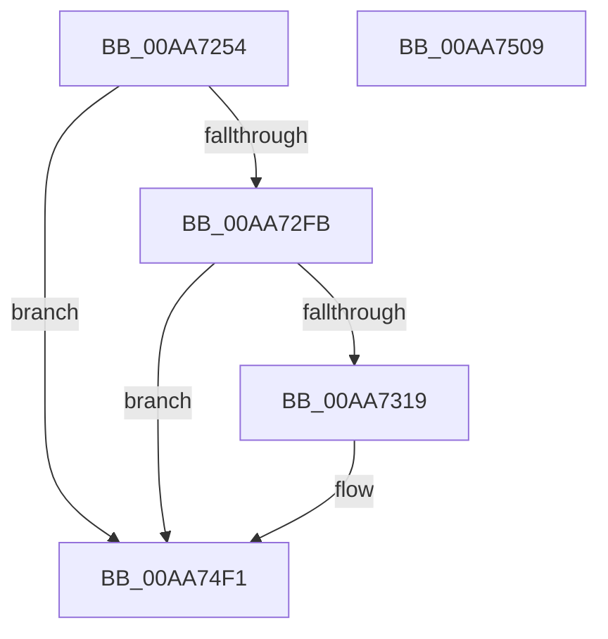

# PopDiagTraceSmartSuspendValidation

- RVA: `0x00AA7254`–`0x00AA750A` (길이 `694` bytes)
- VA: `0x0000000140AA7254`
- 실행 섹션: `PAGE`
- PDB 이름 있음: `예`; PDB Function 태그: `아니요`
- unwind 정보 RVA: `0x000BBA14`
- 디코드: `131`개 명령, `694/694` bytes 표시
- 미해석 바이트: `0` (있으면 어셈블리에 `.byte`로 보존)

> 이 문서는 커널 이미지의 기계어와 PDB 기호를 분석해 생성했습니다. 4번과 5번은 함수 원형과 자료형을 바이너리 사용 방식에서 추정한 C 해석이며 원본 소스 복구 결과는 아닙니다.

## 1. Dependencies

- 직접 호출 지점: **9**; 고유 호출 대상: **4**
- 직접 호출자로 확인된 함수: **1**
- RIP 상대 이미지 참조: **3**

### Outgoing calls
- `0x00AA72A3` → [PopSystemTimeToLocalTime](../../text/4C/PopSystemTimeToLocalTime_function_004C1724.md) (function, `0x004C1724`)
- `0x00AA72B1` → [PopSystemTimeToLocalTime](../../text/4C/PopSystemTimeToLocalTime_function_004C1724.md) (function, `0x004C1724`)
- `0x00AA72BF` → [PopSystemTimeToLocalTime](../../text/4C/PopSystemTimeToLocalTime_function_004C1724.md) (function, `0x004C1724`)
- `0x00AA72CD` → [PopSystemTimeToLocalTime](../../text/4C/PopSystemTimeToLocalTime_function_004C1724.md) (function, `0x004C1724`)
- `0x00AA72DB` → [PopSystemTimeToLocalTime](../../text/4C/PopSystemTimeToLocalTime_function_004C1724.md) (function, `0x004C1724`)
- `0x00AA72E9` → [PopSystemTimeToLocalTime](../../text/4C/PopSystemTimeToLocalTime_function_004C1724.md) (function, `0x004C1724`)
- `0x00AA730C` → [tlgKeywordOn](../../text/42/tlgKeywordOn_function_0042EAA0.md) (function, `0x0042EAA0`)
- `0x00AA74EC` → [tlgWriteTransfer_EtwWriteTransfer](../../text/42/tlgWriteTransfer_EtwWriteTransfer_function_004260E0.md) (function, `0x004260E0`)
- `0x00AA74FB` → [_security_check_cookie](../../text/6A/_security_check_cookie_function_006AC640.md) (function, `0x006AC640`)

### Direct callers
- [PopSmartSuspendValidateSinglePrediction](PopSmartSuspendValidateSinglePrediction_function_00AA7124.md) at `0x00AA723E`

### Static image references
- `0x00AA7265` → RVA `0x00E0A740` (`.data`; read)
- `0x00AA72EE` → RVA `0x00E07748` (`.data`; read)
- `0x00AA74DE` → RVA `0x0004B361` (`.rdata`; read)

## 2. Other-region calls and transfers

- 다른 실행 섹션으로 향하는 call: **9**
  - `0x00AA72A3` → [PopSystemTimeToLocalTime](../../text/4C/PopSystemTimeToLocalTime_function_004C1724.md) (`PAGE` → `.text`)
  - `0x00AA72B1` → [PopSystemTimeToLocalTime](../../text/4C/PopSystemTimeToLocalTime_function_004C1724.md) (`PAGE` → `.text`)
  - `0x00AA72BF` → [PopSystemTimeToLocalTime](../../text/4C/PopSystemTimeToLocalTime_function_004C1724.md) (`PAGE` → `.text`)
  - `0x00AA72CD` → [PopSystemTimeToLocalTime](../../text/4C/PopSystemTimeToLocalTime_function_004C1724.md) (`PAGE` → `.text`)
  - `0x00AA72DB` → [PopSystemTimeToLocalTime](../../text/4C/PopSystemTimeToLocalTime_function_004C1724.md) (`PAGE` → `.text`)
  - `0x00AA72E9` → [PopSystemTimeToLocalTime](../../text/4C/PopSystemTimeToLocalTime_function_004C1724.md) (`PAGE` → `.text`)
  - `0x00AA730C` → [tlgKeywordOn](../../text/42/tlgKeywordOn_function_0042EAA0.md) (`PAGE` → `.text`)
  - `0x00AA74EC` → [tlgWriteTransfer_EtwWriteTransfer](../../text/42/tlgWriteTransfer_EtwWriteTransfer_function_004260E0.md) (`PAGE` → `.text`)
  - `0x00AA74FB` → [_security_check_cookie](../../text/6A/_security_check_cookie_function_006AC640.md) (`PAGE` → `.text`)
- 별도 외부 분기/꼬리 이동을 확인하지 못했습니다.

## 3. Assembly (complete function range)

```asm
00AA7254  40 55                           push rbp
00AA7256  48 8D AC 24 20 FF FF FF         lea rbp, [rsp - 0xe0]
00AA725E  48 81 EC E0 01 00 00            sub rsp, 0x1e0
00AA7265  48 8B 05 D4 34 36 00            mov rax, qword ptr [rip + 0x3634d4]
00AA726C  48 33 C4                        xor rax, rsp
00AA726F  48 89 85 D0 00 00 00            mov qword ptr [rbp + 0xd0], rax
00AA7276  45 33 DB                        xor r11d, r11d
00AA7279  48 8D 51 18                     lea rdx, [rcx + 0x18]
00AA727D  4C 8B D1                        mov r10, rcx
00AA7280  4C 89 5C 24 50                  mov qword ptr [rsp + 0x50], r11
00AA7285  48 8D 4C 24 50                  lea rcx, [rsp + 0x50]
00AA728A  4C 89 5C 24 58                  mov qword ptr [rsp + 0x58], r11
00AA728F  4C 89 5C 24 60                  mov qword ptr [rsp + 0x60], r11
00AA7294  4C 89 5C 24 68                  mov qword ptr [rsp + 0x68], r11
00AA7299  4C 89 5C 24 70                  mov qword ptr [rsp + 0x70], r11
00AA729E  4C 89 5C 24 78                  mov qword ptr [rsp + 0x78], r11
00AA72A3  E8 7C A4 A1 FF                  call 0x1404c1724
00AA72A8  49 8D 52 20                     lea rdx, [r10 + 0x20]
00AA72AC  48 8D 4C 24 58                  lea rcx, [rsp + 0x58]
00AA72B1  E8 6E A4 A1 FF                  call 0x1404c1724
00AA72B6  49 8D 52 28                     lea rdx, [r10 + 0x28]
00AA72BA  48 8D 4C 24 60                  lea rcx, [rsp + 0x60]
00AA72BF  E8 60 A4 A1 FF                  call 0x1404c1724
00AA72C4  49 8D 52 30                     lea rdx, [r10 + 0x30]
00AA72C8  48 8D 4C 24 68                  lea rcx, [rsp + 0x68]
00AA72CD  E8 52 A4 A1 FF                  call 0x1404c1724
00AA72D2  49 8D 52 38                     lea rdx, [r10 + 0x38]
00AA72D6  48 8D 4C 24 70                  lea rcx, [rsp + 0x70]
00AA72DB  E8 44 A4 A1 FF                  call 0x1404c1724
00AA72E0  49 8D 52 58                     lea rdx, [r10 + 0x58]
00AA72E4  48 8D 4C 24 78                  lea rcx, [rsp + 0x78]
00AA72E9  E8 36 A4 A1 FF                  call 0x1404c1724
00AA72EE  83 3D 53 04 36 00 05            cmp dword ptr [rip + 0x360453], 5
00AA72F5  0F 86 F6 01 00 00               jbe 0x140aa74f1
00AA72FB  48 BA 00 00 00 00 00 40 00 00   movabs rdx, 0x400000000000
00AA7305  48 8D 0D 3C 04 36 00            lea rcx, [rip + 0x36043c]
00AA730C  E8 8F 77 98 FF                  call 0x14042eaa0
00AA7311  84 C0                           test al, al
00AA7313  0F 84 D8 01 00 00               je 0x140aa74f1
00AA7319  48 8D 44 24 50                  lea rax, [rsp + 0x50]
00AA731E  48 C7 45 B8 08 00 00 00         mov qword ptr [rbp - 0x48], 8
00AA7326  48 89 45 B0                     mov qword ptr [rbp - 0x50], rax
00AA732A  45 33 C9                        xor r9d, r9d
00AA732D  41 8B 42 48                     mov eax, dword ptr [r10 + 0x48]
00AA7331  89 44 24 34                     mov dword ptr [rsp + 0x34], eax
00AA7335  48 8D 44 24 34                  lea rax, [rsp + 0x34]
00AA733A  48 89 45 C0                     mov qword ptr [rbp - 0x40], rax
00AA733E  41 8B 42 44                     mov eax, dword ptr [r10 + 0x44]
00AA7342  89 44 24 38                     mov dword ptr [rsp + 0x38], eax
00AA7346  48 8D 44 24 38                  lea rax, [rsp + 0x38]
00AA734B  48 89 45 D0                     mov qword ptr [rbp - 0x30], rax
00AA734F  41 8B 42 04                     mov eax, dword ptr [r10 + 4]
00AA7353  89 44 24 3C                     mov dword ptr [rsp + 0x3c], eax
00AA7357  48 8D 44 24 3C                  lea rax, [rsp + 0x3c]
00AA735C  48 89 45 E0                     mov qword ptr [rbp - 0x20], rax
00AA7360  41 8A 02                        mov al, byte ptr [r10]
00AA7363  88 44 24 30                     mov byte ptr [rsp + 0x30], al
00AA7367  48 8D 44 24 30                  lea rax, [rsp + 0x30]
00AA736C  48 89 45 F0                     mov qword ptr [rbp - 0x10], rax
00AA7370  41 8A 42 01                     mov al, byte ptr [r10 + 1]
00AA7374  88 44 24 31                     mov byte ptr [rsp + 0x31], al
00AA7378  48 8D 44 24 31                  lea rax, [rsp + 0x31]
00AA737D  48 89 45 00                     mov qword ptr [rbp], rax
00AA7381  41 8B 42 08                     mov eax, dword ptr [r10 + 8]
00AA7385  89 44 24 40                     mov dword ptr [rsp + 0x40], eax
00AA7389  48 8D 44 24 40                  lea rax, [rsp + 0x40]
00AA738E  48 89 45 10                     mov qword ptr [rbp + 0x10], rax
00AA7392  48 8D 44 24 58                  lea rax, [rsp + 0x58]
00AA7397  48 89 45 20                     mov qword ptr [rbp + 0x20], rax
00AA739B  48 8D 44 24 60                  lea rax, [rsp + 0x60]
00AA73A0  48 89 45 30                     mov qword ptr [rbp + 0x30], rax
00AA73A4  41 8A 42 02                     mov al, byte ptr [r10 + 2]
00AA73A8  88 44 24 32                     mov byte ptr [rsp + 0x32], al
00AA73AC  48 8D 44 24 32                  lea rax, [rsp + 0x32]
00AA73B1  48 89 45 40                     mov qword ptr [rbp + 0x40], rax
00AA73B5  41 8A 42 03                     mov al, byte ptr [r10 + 3]
00AA73B9  88 44 24 33                     mov byte ptr [rsp + 0x33], al
00AA73BD  48 8D 44 24 33                  lea rax, [rsp + 0x33]
00AA73C2  48 89 45 50                     mov qword ptr [rbp + 0x50], rax
00AA73C6  41 8B 42 0C                     mov eax, dword ptr [r10 + 0xc]
00AA73CA  89 44 24 44                     mov dword ptr [rsp + 0x44], eax
00AA73CE  48 8D 44 24 44                  lea rax, [rsp + 0x44]
00AA73D3  48 89 45 60                     mov qword ptr [rbp + 0x60], rax
00AA73D7  48 8D 44 24 68                  lea rax, [rsp + 0x68]
00AA73DC  48 89 45 70                     mov qword ptr [rbp + 0x70], rax
00AA73E0  48 8D 44 24 70                  lea rax, [rsp + 0x70]
00AA73E5  48 89 85 80 00 00 00            mov qword ptr [rbp + 0x80], rax
00AA73EC  41 8B 42 4C                     mov eax, dword ptr [r10 + 0x4c]
00AA73F0  89 44 24 48                     mov dword ptr [rsp + 0x48], eax
00AA73F4  48 8D 44 24 48                  lea rax, [rsp + 0x48]
00AA73F9  48 89 85 90 00 00 00            mov qword ptr [rbp + 0x90], rax
00AA7400  41 8B 42 50                     mov eax, dword ptr [r10 + 0x50]
00AA7404  89 44 24 4C                     mov dword ptr [rsp + 0x4c], eax
00AA7408  48 8D 44 24 4C                  lea rax, [rsp + 0x4c]
00AA740D  48 89 85 A0 00 00 00            mov qword ptr [rbp + 0xa0], rax
00AA7414  48 8D 44 24 78                  lea rax, [rsp + 0x78]
00AA7419  48 89 85 B0 00 00 00            mov qword ptr [rbp + 0xb0], rax
00AA7420  48 8D 45 80                     lea rax, [rbp - 0x80]
00AA7424  48 89 85 C0 00 00 00            mov qword ptr [rbp + 0xc0], rax
00AA742B  48 8D 45 90                     lea rax, [rbp - 0x70]
00AA742F  48 89 44 24 28                  mov qword ptr [rsp + 0x28], rax
00AA7434  C7 44 24 20 14 00 00 00         mov dword ptr [rsp + 0x20], 0x14
00AA743C  48 C7 45 C8 04 00 00 00         mov qword ptr [rbp - 0x38], 4
00AA7444  48 C7 45 D8 04 00 00 00         mov qword ptr [rbp - 0x28], 4
00AA744C  48 C7 45 E8 04 00 00 00         mov qword ptr [rbp - 0x18], 4
00AA7454  48 C7 45 F8 01 00 00 00         mov qword ptr [rbp - 8], 1
00AA745C  48 C7 45 08 01 00 00 00         mov qword ptr [rbp + 8], 1
00AA7464  48 C7 45 18 04 00 00 00         mov qword ptr [rbp + 0x18], 4
00AA746C  48 C7 45 28 08 00 00 00         mov qword ptr [rbp + 0x28], 8
00AA7474  48 C7 45 38 08 00 00 00         mov qword ptr [rbp + 0x38], 8
00AA747C  48 C7 45 48 01 00 00 00         mov qword ptr [rbp + 0x48], 1
00AA7484  48 C7 45 58 01 00 00 00         mov qword ptr [rbp + 0x58], 1
00AA748C  48 C7 45 68 04 00 00 00         mov qword ptr [rbp + 0x68], 4
00AA7494  48 C7 45 78 08 00 00 00         mov qword ptr [rbp + 0x78], 8
00AA749C  48 C7 85 88 00 00 00 08 00 00 00  mov qword ptr [rbp + 0x88], 8
00AA74A7  48 C7 85 98 00 00 00 04 00 00 00  mov qword ptr [rbp + 0x98], 4
00AA74B2  48 C7 85 A8 00 00 00 04 00 00 00  mov qword ptr [rbp + 0xa8], 4
00AA74BD  48 C7 85 B8 00 00 00 08 00 00 00  mov qword ptr [rbp + 0xb8], 8
00AA74C8  48 C7 45 80 00 00 00 02         mov qword ptr [rbp - 0x80], 0x2000000
00AA74D0  48 C7 85 C8 00 00 00 08 00 00 00  mov qword ptr [rbp + 0xc8], 8
00AA74DB  45 33 C0                        xor r8d, r8d
00AA74DE  48 8D 15 7C 3E 5A FF            lea rdx, [rip - 0xa5c184]
00AA74E5  48 8D 0D 5C 02 36 00            lea rcx, [rip + 0x36025c]
00AA74EC  E8 EF EB 97 FF                  call 0x1404260e0
00AA74F1  48 8B 8D D0 00 00 00            mov rcx, qword ptr [rbp + 0xd0]
00AA74F8  48 33 CC                        xor rcx, rsp
00AA74FB  E8 40 51 C0 FF                  call 0x1406ac640
00AA7500  48 81 C4 E0 01 00 00            add rsp, 0x1e0
00AA7507  5D                              pop rbp
00AA7508  C3                              ret
00AA7509  CC                              int3
```

## 4. C-style interpretation (structured pseudocode)

```c
__int64 __fastcall PopDiagTraceSmartSuspendValidation(__int64 a1, __int64 a2, int a3, int a4)
{
    __int64 result;
    __int64 v_r11;
    __int64 v_rsp;
    unsigned __int64 v_stack_m100;
    unsigned __int64 v_stack_m108;
    unsigned __int64 v_stack_m110;
    unsigned __int64 v_stack_m118;
    unsigned __int64 v_stack_m120;
    unsigned __int64 v_stack_m128;
    unsigned __int64 v_stack_m130;
    unsigned __int64 v_stack_m138;
    unsigned __int64 v_stack_m158;
    unsigned __int64 v_stack_m168;
    unsigned __int64 v_stack_m170;
    unsigned __int64 v_stack_m178;
    unsigned __int64 v_stack_m18;
    unsigned __int64 v_stack_m180;
    unsigned __int64 v_stack_m188;
    unsigned __int64 v_stack_m190;
    unsigned __int64 v_stack_m198;
    unsigned int v_stack_m19C;
    unsigned int v_stack_m1A0;
    unsigned int v_stack_m1A4;
    unsigned int v_stack_m1A8;
    unsigned int v_stack_m1AC;
    unsigned int v_stack_m1B0;
    unsigned int v_stack_m1B4;
    unsigned __int8 v_stack_m1B5;
    unsigned __int8 v_stack_m1B6;
    unsigned __int8 v_stack_m1B7;
    unsigned __int8 v_stack_m1B8;
    unsigned __int64 v_stack_m1C0;
    unsigned int v_stack_m1C8;
    unsigned __int64 v_stack_m20;
    unsigned __int64 v_stack_m28;
    unsigned __int64 v_stack_m30;
    unsigned __int64 v_stack_m38;
    unsigned __int64 v_stack_m40;
    unsigned __int64 v_stack_m48;
    unsigned __int64 v_stack_m50;
    unsigned __int64 v_stack_m58;
    unsigned __int64 v_stack_m60;
    unsigned __int64 v_stack_m68;
    unsigned __int64 v_stack_m70;
    unsigned __int64 v_stack_m78;
    unsigned __int64 v_stack_m80;
    unsigned __int64 v_stack_m88;
    unsigned __int64 v_stack_m90;
    unsigned __int64 v_stack_m98;
    unsigned __int64 v_stack_mA0;
    unsigned __int64 v_stack_mA8;
    unsigned __int64 v_stack_mB0;
    unsigned __int64 v_stack_mB8;
    unsigned __int64 v_stack_mC0;
    unsigned __int64 v_stack_mC8;
    unsigned __int64 v_stack_mD0;
    unsigned __int64 v_stack_mD8;
    unsigned __int64 v_stack_mE0;
    unsigned __int64 v_stack_mE8;
    unsigned __int64 v_stack_mF0;
    unsigned __int64 v_stack_mF8;

    v_rsp = (v_rsp) - (480);
    result = (*(unsigned __int64 *)(v_rip + 3552468)) ^ (v_rsp);
    v_stack_m18 = result;
    v_r11 = 0;
    v_stack_m198 = 0;
    v_stack_m190 = 0;
    v_stack_m188 = 0;
    v_stack_m180 = 0;
    v_stack_m178 = 0;
    v_stack_m170 = 0;
    result = PopSystemTimeToLocalTime(v_stack_m198, a1 + 24, a3, a4);
    result = PopSystemTimeToLocalTime(v_stack_m190, a1 + 32, a3, a4);
    result = PopSystemTimeToLocalTime(v_stack_m188, a1 + 40, a3, a4);
    result = PopSystemTimeToLocalTime(v_stack_m180, a1 + 48, a3, a4);
    result = PopSystemTimeToLocalTime(v_stack_m178, a1 + 56, a3, a4);
    result = PopSystemTimeToLocalTime(v_stack_m170, a1 + 88, a3, a4);
    if ((*(unsigned int *)(v_rip + 3540051)) <= 5) goto loc_00AA74F1;
    result = tlgKeywordOn(v_rip + 3540028, a1 + 88, a3, a4);
    if ((unsigned __int8)(result) != 0) {
        result = v_stack_m198;
        v_stack_m130 = 8;
        v_stack_m138 = result;
        a4 = 0;
        result = *(unsigned int *)(a1 + 72);
        v_stack_m1B4 = (unsigned int)(result);
        result = v_stack_m1B4;
        v_stack_m128 = result;
        result = *(unsigned int *)(a1 + 68);
        v_stack_m1B0 = (unsigned int)(result);
        result = v_stack_m1B0;
        v_stack_m118 = result;
        result = *(unsigned int *)(a1 + 4);
        v_stack_m1AC = (unsigned int)(result);
        result = v_stack_m1AC;
        v_stack_m108 = result;
        result = *(unsigned __int8 *)(a1);
        v_stack_m1B8 = (unsigned __int8)(result);
        result = v_stack_m1B8;
        v_stack_mF8 = result;
        result = *(unsigned __int8 *)(a1 + 1);
        v_stack_m1B7 = (unsigned __int8)(result);
        result = v_stack_m1B7;
        v_stack_mE8 = result;
        result = *(unsigned int *)(a1 + 8);
        v_stack_m1A8 = (unsigned int)(result);
        result = v_stack_m1A8;
        v_stack_mD8 = result;
        result = v_stack_m190;
        v_stack_mC8 = result;
        result = v_stack_m188;
        v_stack_mB8 = result;
        result = *(unsigned __int8 *)(a1 + 2);
        v_stack_m1B6 = (unsigned __int8)(result);
        result = v_stack_m1B6;
        v_stack_mA8 = result;
        result = *(unsigned __int8 *)(a1 + 3);
        v_stack_m1B5 = (unsigned __int8)(result);
        result = v_stack_m1B5;
        v_stack_m98 = result;
        result = *(unsigned int *)(a1 + 12);
        v_stack_m1A4 = (unsigned int)(result);
        result = v_stack_m1A4;
        v_stack_m88 = result;
        result = v_stack_m180;
        v_stack_m78 = result;
        result = v_stack_m178;
        v_stack_m68 = result;
        result = *(unsigned int *)(a1 + 76);
        v_stack_m1A0 = (unsigned int)(result);
        result = v_stack_m1A0;
        v_stack_m58 = result;
        result = *(unsigned int *)(a1 + 80);
        v_stack_m19C = (unsigned int)(result);
        result = v_stack_m19C;
        v_stack_m48 = result;
        result = v_stack_m170;
        v_stack_m38 = result;
        result = v_stack_m168;
        v_stack_m28 = result;
        result = v_stack_m158;
        v_stack_m1C0 = result;
        v_stack_m1C8 = 20;
        v_stack_m120 = 4;
        v_stack_m110 = 4;
        v_stack_m100 = 4;
        v_stack_mF0 = 1;
        v_stack_mE0 = 1;
        v_stack_mD0 = 4;
        v_stack_mC0 = 8;
        v_stack_mB0 = 8;
        v_stack_mA0 = 1;
        v_stack_m90 = 1;
        v_stack_m80 = 4;
        v_stack_m70 = 8;
        v_stack_m60 = 8;
        v_stack_m50 = 4;
        v_stack_m40 = 4;
        v_stack_m30 = 8;
        v_stack_m168 = 0x2000000ULL;
        v_stack_m20 = 8;
        a3 = 0;
        a2 = v_rip - 10862980;
        a1 = v_rip + 3539548;
        result = tlgWriteTransfer_EtwWriteTransfer(a1, a2, a3, a4);
    }
    a1 = (v_stack_m18) ^ (v_rsp);
    result = _security_check_cookie(a1, a2, a3, a4);
    v_rsp = (v_rsp) + (480);
    return result;
}
```

## 5. (Beta) C Style

```c
int64_t PopDiagTraceSmartSuspendValidation(void *Arg1, int64_t Arg2, int32_t Arg3, int32_t Arg4)
{
    uint8_t *arg1 = (uint8_t *)Arg1;

    int64_t result;
    int64_t local_r11;
    int64_t local_rsp;
    uint64_t v_stack_m100;
    uint64_t v_stack_m108;
    uint64_t v_stack_m110;
    uint64_t v_stack_m118;
    uint64_t v_stack_m120;
    uint64_t v_stack_m128;
    uint64_t v_stack_m130;
    uint64_t v_stack_m138;
    uint64_t v_stack_m158;
    uint64_t v_stack_m168;
    uint64_t v_stack_m170;
    uint64_t v_stack_m178;
    uint64_t v_stack_m18;
    uint64_t v_stack_m180;
    uint64_t v_stack_m188;
    uint64_t v_stack_m190;
    uint64_t v_stack_m198;
    uint32_t v_stack_m19C;
    uint32_t v_stack_m1A0;
    uint32_t v_stack_m1A4;
    uint32_t v_stack_m1A8;
    uint32_t v_stack_m1AC;
    uint32_t v_stack_m1B0;
    uint32_t v_stack_m1B4;
    uint8_t v_stack_m1B5;
    uint8_t v_stack_m1B6;
    uint8_t v_stack_m1B7;
    uint8_t v_stack_m1B8;
    uint64_t v_stack_m1C0;
    uint32_t v_stack_m1C8;
    uint64_t v_stack_m20;
    uint64_t v_stack_m28;
    uint64_t v_stack_m30;
    uint64_t v_stack_m38;
    uint64_t v_stack_m40;
    uint64_t v_stack_m48;
    uint64_t v_stack_m50;
    uint64_t v_stack_m58;
    uint64_t v_stack_m60;
    uint64_t v_stack_m68;
    uint64_t v_stack_m70;
    uint64_t v_stack_m78;
    uint64_t v_stack_m80;
    uint64_t v_stack_m88;
    uint64_t v_stack_m90;
    uint64_t v_stack_m98;
    uint64_t v_stack_mA0;
    uint64_t v_stack_mA8;
    uint64_t v_stack_mB0;
    uint64_t v_stack_mB8;
    uint64_t v_stack_mC0;
    uint64_t v_stack_mC8;
    uint64_t v_stack_mD0;
    uint64_t v_stack_mD8;
    uint64_t v_stack_mE0;
    uint64_t v_stack_mE8;
    uint64_t v_stack_mF0;
    uint64_t v_stack_mF8;

    local_rsp = (local_rsp) - (480);
    result = (*(uint64_t *)(v_rip + 0x3634D4)) ^ (local_rsp);
    v_stack_m18 = result;
    local_r11 = 0;
    v_stack_m198 = 0;
    v_stack_m190 = 0;
    v_stack_m188 = 0;
    v_stack_m180 = 0;
    v_stack_m178 = 0;
    v_stack_m170 = 0;
    result = PopSystemTimeToLocalTime(v_stack_m198, Arg1 + 24, Arg3, Arg4);
    result = PopSystemTimeToLocalTime(v_stack_m190, Arg1 + 32, Arg3, Arg4);
    result = PopSystemTimeToLocalTime(v_stack_m188, Arg1 + 40, Arg3, Arg4);
    result = PopSystemTimeToLocalTime(v_stack_m180, Arg1 + 48, Arg3, Arg4);
    result = PopSystemTimeToLocalTime(v_stack_m178, Arg1 + 56, Arg3, Arg4);
    result = PopSystemTimeToLocalTime(v_stack_m170, Arg1 + 88, Arg3, Arg4);
    if ((*(uint32_t *)(v_rip + 0x360453)) <= 5) goto loc_00AA74F1;
    result = tlgKeywordOn(v_rip + 3540028, Arg1 + 88, Arg3, Arg4);
    if ((uint8_t)(result) != 0) {
        result = v_stack_m198;
        v_stack_m130 = 8;
        v_stack_m138 = result;
        Arg4 = 0;
        result = *(uint32_t *)(arg1 + 0x48);
        v_stack_m1B4 = (uint32_t)(result);
        result = v_stack_m1B4;
        v_stack_m128 = result;
        result = *(uint32_t *)(arg1 + 0x44);
        v_stack_m1B0 = (uint32_t)(result);
        result = v_stack_m1B0;
        v_stack_m118 = result;
        result = *(uint32_t *)(arg1 + 0x4);
        v_stack_m1AC = (uint32_t)(result);
        result = v_stack_m1AC;
        v_stack_m108 = result;
        result = *(uint8_t *)(arg1);
        v_stack_m1B8 = (uint8_t)(result);
        result = v_stack_m1B8;
        v_stack_mF8 = result;
        result = *(uint8_t *)(arg1 + 0x1);
        v_stack_m1B7 = (uint8_t)(result);
        result = v_stack_m1B7;
        v_stack_mE8 = result;
        result = *(uint32_t *)(arg1 + 0x8);
        v_stack_m1A8 = (uint32_t)(result);
        result = v_stack_m1A8;
        v_stack_mD8 = result;
        result = v_stack_m190;
        v_stack_mC8 = result;
        result = v_stack_m188;
        v_stack_mB8 = result;
        result = *(uint8_t *)(arg1 + 0x2);
        v_stack_m1B6 = (uint8_t)(result);
        result = v_stack_m1B6;
        v_stack_mA8 = result;
        result = *(uint8_t *)(arg1 + 0x3);
        v_stack_m1B5 = (uint8_t)(result);
        result = v_stack_m1B5;
        v_stack_m98 = result;
        result = *(uint32_t *)(arg1 + 0xC);
        v_stack_m1A4 = (uint32_t)(result);
        result = v_stack_m1A4;
        v_stack_m88 = result;
        result = v_stack_m180;
        v_stack_m78 = result;
        result = v_stack_m178;
        v_stack_m68 = result;
        result = *(uint32_t *)(arg1 + 0x4C);
        v_stack_m1A0 = (uint32_t)(result);
        result = v_stack_m1A0;
        v_stack_m58 = result;
        result = *(uint32_t *)(arg1 + 0x50);
        v_stack_m19C = (uint32_t)(result);
        result = v_stack_m19C;
        v_stack_m48 = result;
        result = v_stack_m170;
        v_stack_m38 = result;
        result = v_stack_m168;
        v_stack_m28 = result;
        result = v_stack_m158;
        v_stack_m1C0 = result;
        v_stack_m1C8 = 20;
        v_stack_m120 = 4;
        v_stack_m110 = 4;
        v_stack_m100 = 4;
        v_stack_mF0 = 1;
        v_stack_mE0 = 1;
        v_stack_mD0 = 4;
        v_stack_mC0 = 8;
        v_stack_mB0 = 8;
        v_stack_mA0 = 1;
        v_stack_m90 = 1;
        v_stack_m80 = 4;
        v_stack_m70 = 8;
        v_stack_m60 = 8;
        v_stack_m50 = 4;
        v_stack_m40 = 4;
        v_stack_m30 = 8;
        v_stack_m168 = 0x2000000ULL;
        v_stack_m20 = 8;
        Arg3 = 0;
        Arg2 = v_rip - 10862980;
        Arg1 = v_rip + 3539548;
        result = tlgWriteTransfer_EtwWriteTransfer(Arg1, Arg2, Arg3, Arg4);
    }
    Arg1 = (v_stack_m18) ^ (local_rsp);
    result = _security_check_cookie(Arg1, Arg2, Arg3, Arg4);
    local_rsp = (local_rsp) + (480);
    return result;
}
```

### 관측된 메모리 오프셋

구조체 형식이 확인되지 않은 접근은 인자 기준의 오프셋으로만 기록했습니다.

| 기준 인자 | 오프셋 표현 | 폭 (bit) | 접근 |
|---|---:|---:|---|
| `Arg1` | `+ 0x18` | `64` | `R` |

## 6. Execution-region graph

[열기: 2D/3D 그래프와 함수 탐색 컨트롤 패널](../../../control-panel.html?section=page&rva=0x00AA7254&view=graph)

- 2D 그래프는 위에서 아래로 흐르고, 3D 그래프는 빈 공간을 드래그해 회전합니다. Shift+드래그는 이동, 휠은 확대·축소, 함수 노드 선택은 대상 보고서 이동입니다.

### Static fallback


