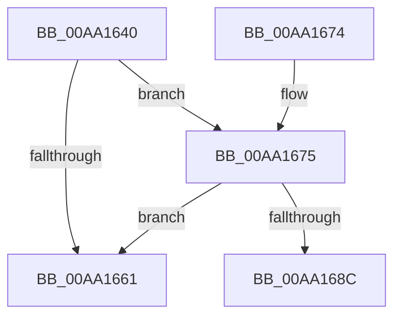

# PopDiagTraceThermalRequestPassiveUpdate

- RVA: `0x00AA1640`–`0x00AA1691` (길이 `81` bytes)
- VA: `0x0000000140AA1640`
- 실행 섹션: `PAGE`
- PDB 이름 있음: `예`; PDB Function 태그: `예`
- unwind 정보 RVA: `0x000BAC88`
- 디코드: `21`개 명령, `81/81` bytes 표시
- 미해석 바이트: `0` (있으면 어셈블리에 `.byte`로 보존)

> 이 문서는 커널 이미지의 기계어와 PDB 기호를 분석해 생성했습니다. 4번과 5번은 함수 원형과 자료형을 바이너리 사용 방식에서 추정한 C 해석이며 원본 소스 복구 결과는 아닙니다.

## 1. Dependencies

- 직접 호출 지점: **2**; 고유 호출 대상: **2**
- 직접 호출자로 확인된 함수: **1**
- RIP 상대 이미지 참조: **4**

### Outgoing calls
- `0x00AA1669` → [_security_check_cookie](../../text/6A/_security_check_cookie_function_006AC640.md) (function, `0x006AC640`)
- `0x00AA1683` → [EtwEventEnabled](../../text/39/EtwEventEnabled_function_00392450.md) (function, `0x00392450`)

### Direct callers
- [PoSetThermalPassiveCooling](PoSetThermalPassiveCooling_function_00AA1540.md) at `0x00AA15C0`

### Static image references
- `0x00AA1646` → RVA `0x00E0A740` (`.data`; read)
- `0x00AA1655` → RVA `0x00E67858` (`.data`; read)
- `0x00AA1675` → RVA `0x00F0B408` (`.data`; read)
- `0x00AA167C` → RVA `0x0001C7B0` (`.rdata`; read)

## 2. Other-region calls and transfers

- 다른 실행 섹션으로 향하는 call: **2**
  - `0x00AA1669` → [_security_check_cookie](../../text/6A/_security_check_cookie_function_006AC640.md) (`PAGE` → `.text`)
  - `0x00AA1683` → [EtwEventEnabled](../../text/39/EtwEventEnabled_function_00392450.md) (`PAGE` → `.text`)
- call이 아닌 외부 분기/꼬리 이동: **1**
  - `0x00AA168C` → [sub_00B49642](../B4/Unknown_function_00B49642.md) (`tail-transfer`)

## 3. Assembly (complete function range)

```asm
00AA1640  40 53                           push rbx
00AA1642  48 83 EC 70                     sub rsp, 0x70
00AA1646  48 8B 05 F3 90 36 00            mov rax, qword ptr [rip + 0x3690f3]
00AA164D  48 33 C4                        xor rax, rsp
00AA1650  48 89 44 24 60                  mov qword ptr [rsp + 0x60], rax
00AA1655  80 3D FC 61 3C 00 00            cmp byte ptr [rip + 0x3c61fc], 0
00AA165C  48 8B D9                        mov rbx, rcx
00AA165F  75 14                           jne 0x140aa1675
00AA1661  48 8B 4C 24 60                  mov rcx, qword ptr [rsp + 0x60]
00AA1666  48 33 CC                        xor rcx, rsp
00AA1669  E8 D2 AF C0 FF                  call 0x1406ac640
00AA166E  48 83 C4 70                     add rsp, 0x70
00AA1672  5B                              pop rbx
00AA1673  C3                              ret
00AA1674  CC                              int3
00AA1675  48 8B 0D 8C 9D 46 00            mov rcx, qword ptr [rip + 0x469d8c]
00AA167C  48 8D 15 2D B1 57 FF            lea rdx, [rip - 0xa84ed3]
00AA1683  E8 C8 0D 8F FF                  call 0x140392450
00AA1688  84 C0                           test al, al
00AA168A  74 D5                           je 0x140aa1661
00AA168C  E9 B1 7F 0A 00                  jmp 0x140b49642
```

## 4. C-style interpretation (structured pseudocode)

```c
__int64 __fastcall PopDiagTraceThermalRequestPassiveUpdate(__int64 a1)
{
    __int64 result;
    __int64 v_rsp;
    unsigned __int64 v_stack_m18;

    v_rsp = (v_rsp) - (112);
    result = (*(unsigned __int64 *)(v_rip + 3576051)) ^ (v_rsp);
    v_stack_m18 = result;
    if ((*(unsigned __int8 *)(v_rip + 3957244)) != 0) goto loc_00AA1675;
loc_00AA1661:
    a1 = (v_stack_m18) ^ (v_rsp);
    result = _security_check_cookie(a1, a2, a3, a4);
    v_rsp = (v_rsp) + (112);
    return result;
loc_00AA1675:
    result = EtwEventEnabled(*(unsigned __int64 *)(v_rip + 4627852), v_rip - 11030227, a3, a4);
    if ((unsigned __int8)(result) == 0) goto loc_00AA1661;
}
```

## 5. (Beta) C Style

```c
int64_t PopDiagTraceThermalRequestPassiveUpdate(int64_t Arg1)
{
    int64_t result;
    int64_t local_rsp;
    uint64_t v_stack_m18;

    local_rsp = (local_rsp) - (112);
    result = (*(uint64_t *)(v_rip + 0x3690F3)) ^ (local_rsp);
    v_stack_m18 = result;
    if ((*(uint8_t *)(v_rip + 0x3C61FC)) != 0) goto loc_00AA1675;
loc_00AA1661:
    Arg1 = (v_stack_m18) ^ (local_rsp);
    result = _security_check_cookie(Arg1, a2, a3, a4);
    local_rsp = (local_rsp) + (112);
    return result;
loc_00AA1675:
    result = EtwEventEnabled(*(uint64_t *)(v_rip + 0x469D8C), v_rip - 11030227, a3, a4);
    if ((uint8_t)(result) == 0) goto loc_00AA1661;
}
```

## 6. Execution-region graph

[열기: 2D/3D 그래프와 함수 탐색 컨트롤 패널](../../../control-panel.html?section=page&rva=0x00AA1640&view=graph)

- 2D 그래프는 위에서 아래로 흐르고, 3D 그래프는 빈 공간을 드래그해 회전합니다. Shift+드래그는 이동, 휠은 확대·축소, 함수 노드 선택은 대상 보고서 이동입니다.

### Static fallback


