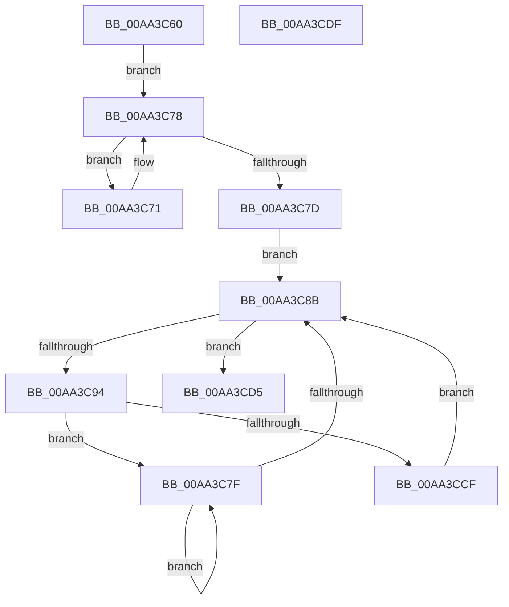

# PopDirectedDripsDestroyBroadcast

- RVA: `0x00AA3C60`–`0x00AA3CE0` (길이 `128` bytes)
- VA: `0x0000000140AA3C60`
- 실행 섹션: `PAGE`
- PDB 이름 있음: `예`; PDB Function 태그: `아니요`
- unwind 정보 RVA: `0x0005C788`
- 디코드: `35`개 명령, `128/128` bytes 표시
- 미해석 바이트: `0` (있으면 어셈블리에 `.byte`로 보존)

> 이 문서는 커널 이미지의 기계어와 PDB 기호를 분석해 생성했습니다. 4번과 5번은 함수 원형과 자료형을 바이너리 사용 방식에서 추정한 C 해석이며 원본 소스 복구 결과는 아닙니다.

## 1. Dependencies

- 직접 호출 지점: **1**; 고유 호출 대상: **1**
- 직접 호출자로 확인된 함수: **2**
- RIP 상대 이미지 참조: **1**

### Outgoing calls
- `0x00AA3CD5` → [PoClearBroadcast](PoClearBroadcast_function_00AA3CE8.md) (function, `0x00AA3CE8`)

### Direct callers
- [PopDirectedDripsSuspendDevices](../A4/PopDirectedDripsSuspendDevices_function_00A4D474.md) at `0x00A4D5C0`
- [PopDirectedDripsResumeDevices](../A4/PopDirectedDripsResumeDevices_function_00A4DB10.md) at `0x00A4DBF9`

### Static image references
- `0x00AA3C64` → RVA `0x00F8C438` (`.data`; read)

## 2. Other-region calls and transfers

- 다른 실행 섹션으로 향하는 call: **0**
- 별도 외부 분기/꼬리 이동을 확인하지 못했습니다.

## 3. Assembly (complete function range)

```asm
00AA3C60  48 83 EC 28                     sub rsp, 0x28
00AA3C64  48 8B 15 CD 87 4E 00            mov rdx, qword ptr [rip + 0x4e87cd]
00AA3C6B  48 8B 42 08                     mov rax, qword ptr [rdx + 8]
00AA3C6F  EB 07                           jmp 0x140aa3c78
00AA3C71  48 8B D0                        mov rdx, rax
00AA3C74  48 8B 40 08                     mov rax, qword ptr [rax + 8]
00AA3C78  48 85 C0                        test rax, rax
00AA3C7B  75 F4                           jne 0x140aa3c71
00AA3C7D  EB 0C                           jmp 0x140aa3c8b
00AA3C7F  48 8B D0                        mov rdx, rax
00AA3C82  48 8B 40 08                     mov rax, qword ptr [rax + 8]
00AA3C86  48 85 C0                        test rax, rax
00AA3C89  75 F4                           jne 0x140aa3c7f
00AA3C8B  48 3B 15 A6 87 4E 00            cmp rdx, qword ptr [rip + 0x4e87a6]
00AA3C92  74 41                           je 0x140aa3cd5
00AA3C94  F0 81 A2 28 01 00 00 FF FE FF FF  lock and dword ptr [rdx + 0x128], 0xfffffeff
00AA3C9F  48 8D 8A D8 02 00 00            lea rcx, [rdx + 0x2d8]
00AA3CA6  48 89 49 08                     mov qword ptr [rcx + 8], rcx
00AA3CAA  48 8D 41 10                     lea rax, [rcx + 0x10]
00AA3CAE  48 89 09                        mov qword ptr [rcx], rcx
00AA3CB1  48 89 40 08                     mov qword ptr [rax + 8], rax
00AA3CB5  48 89 00                        mov qword ptr [rax], rax
00AA3CB8  8B 41 20                        mov eax, dword ptr [rcx + 0x20]
00AA3CBB  83 61 24 00                     and dword ptr [rcx + 0x24], 0
00AA3CBF  25 FF FF F0 FF                  and eax, 0xfff0ffff
00AA3CC4  89 41 20                        mov dword ptr [rcx + 0x20], eax
00AA3CC7  48 8B 02                        mov rax, qword ptr [rdx]
00AA3CCA  48 85 C0                        test rax, rax
00AA3CCD  75 B0                           jne 0x140aa3c7f
00AA3CCF  48 8B 52 10                     mov rdx, qword ptr [rdx + 0x10]
00AA3CD3  EB B6                           jmp 0x140aa3c8b
00AA3CD5  E8 0E 00 00 00                  call 0x140aa3ce8
00AA3CDA  48 83 C4 28                     add rsp, 0x28
00AA3CDE  C3                              ret
00AA3CDF  CC                              int3
```

## 4. C-style interpretation (structured pseudocode)

```c
__int64 __fastcall PopDirectedDripsDestroyBroadcast(void)
{
    __int64 result;
    __int64 v_rsp;

    v_rsp = (v_rsp) - (40);
    goto loc_00AA3C78;
loc_00AA3C71:
loc_00AA3C78:
    if (*(unsigned __int64 *)(*(unsigned __int64 *)(*(unsigned __int64 *)(v_rip + 5146573) + 8) + 8) != 0) goto loc_00AA3C71;
    goto loc_00AA3C8B;
loc_00AA3C7F:
    if (*(unsigned __int64 *)(*(unsigned __int64 *)(*(unsigned __int64 *)(*(unsigned __int64 *)(v_rip + 5146573) + 8) + 8) + 8) != 0) goto loc_00AA3C7F;
loc_00AA3C8B:
    if ((*(unsigned __int64 *)(*(unsigned __int64 *)(*(unsigned __int64 *)(v_rip + 5146573) + 8) + 8)) == (*(unsigned __int64 *)(v_rip + 5146534))) goto loc_00AA3CD5;
    *(unsigned __int64 *)(*(unsigned __int64 *)(*(unsigned __int64 *)(*(unsigned __int64 *)(v_rip + 5146573) + 8) + 8) + 728 + 8) = *(unsigned __int64 *)(*(unsigned __int64 *)(*(unsigned __int64 *)(v_rip + 5146573) + 8) + 8) + 728;
    *(unsigned __int64 *)(*(unsigned __int64 *)(*(unsigned __int64 *)(*(unsigned __int64 *)(v_rip + 5146573) + 8) + 8) + 728) = *(unsigned __int64 *)(*(unsigned __int64 *)(*(unsigned __int64 *)(v_rip + 5146573) + 8) + 8) + 728;
    *(unsigned __int64 *)(*(unsigned __int64 *)(*(unsigned __int64 *)(*(unsigned __int64 *)(v_rip + 5146573) + 8) + 8) + 728 + 16 + 8) = *(unsigned __int64 *)(*(unsigned __int64 *)(*(unsigned __int64 *)(v_rip + 5146573) + 8) + 8) + 728 + 16;
    *(unsigned __int64 *)(*(unsigned __int64 *)(*(unsigned __int64 *)(*(unsigned __int64 *)(v_rip + 5146573) + 8) + 8) + 728 + 16) = *(unsigned __int64 *)(*(unsigned __int64 *)(*(unsigned __int64 *)(v_rip + 5146573) + 8) + 8) + 728 + 16;
    result = (unsigned int)(((unsigned int)(*(unsigned int *)(*(unsigned __int64 *)(*(unsigned __int64 *)(*(unsigned __int64 *)(v_rip + 5146573) + 8) + 8) + 728 + 32))) & (0xFFF0FFFFULL));
    *(unsigned int *)(*(unsigned __int64 *)(*(unsigned __int64 *)(*(unsigned __int64 *)(v_rip + 5146573) + 8) + 8) + 728 + 32) = (unsigned int)(result);
    if (*(unsigned __int64 *)(*(unsigned __int64 *)(*(unsigned __int64 *)(*(unsigned __int64 *)(v_rip + 5146573) + 8) + 8)) != 0) goto loc_00AA3C7F;
    goto loc_00AA3C8B;
loc_00AA3CD5:
    result = PoClearBroadcast(*(unsigned __int64 *)(*(unsigned __int64 *)(*(unsigned __int64 *)(v_rip + 5146573) + 8) + 8) + 728, *(unsigned __int64 *)(*(unsigned __int64 *)(*(unsigned __int64 *)(*(unsigned __int64 *)(v_rip + 5146573) + 8) + 8) + 16), a3, a4);
    v_rsp = (v_rsp) + (40);
    return result;
}
```

## 5. (Beta) C Style

```c
void PopDirectedDripsDestroyBroadcast(void)
{
    int64_t result;
    int64_t local_rsp;

    local_rsp = (local_rsp) - (40);
    goto loc_00AA3C78;
loc_00AA3C71:
loc_00AA3C78:
    if (*(uint64_t *)(*(uint64_t *)(*(uint64_t *)(v_rip + 0x4E87CD) + 0x8) + 0x8) != 0) goto loc_00AA3C71;
    goto loc_00AA3C8B;
loc_00AA3C7F:
    if (*(uint64_t *)(*(uint64_t *)(*(uint64_t *)(*(uint64_t *)(v_rip + 0x4E87CD) + 0x8) + 0x8) + 0x8) != 0) goto loc_00AA3C7F;
loc_00AA3C8B:
    if ((*(uint64_t *)(*(uint64_t *)(*(uint64_t *)(v_rip + 0x4E87CD) + 0x8) + 0x8)) == (*(uint64_t *)(v_rip + 0x4E87A6))) goto loc_00AA3CD5;
    *(uint64_t *)(*(uint64_t *)(*(uint64_t *)(*(uint64_t *)(v_rip + 0x4E87CD) + 0x8) + 0x8) + 0x2D8 + 0x8) = *(uint64_t *)(*(uint64_t *)(*(uint64_t *)(v_rip + 0x4E87CD) + 0x8) + 0x8) + 728;
    *(uint64_t *)(*(uint64_t *)(*(uint64_t *)(*(uint64_t *)(v_rip + 0x4E87CD) + 0x8) + 0x8) + 0x2D8) = *(uint64_t *)(*(uint64_t *)(*(uint64_t *)(v_rip + 0x4E87CD) + 0x8) + 0x8) + 728;
    *(uint64_t *)(*(uint64_t *)(*(uint64_t *)(*(uint64_t *)(v_rip + 0x4E87CD) + 0x8) + 0x8) + 0x2D8 + 0x10 + 0x8) = *(uint64_t *)(*(uint64_t *)(*(uint64_t *)(v_rip + 0x4E87CD) + 0x8) + 0x8) + 728 + 16;
    *(uint64_t *)(*(uint64_t *)(*(uint64_t *)(*(uint64_t *)(v_rip + 0x4E87CD) + 0x8) + 0x8) + 0x2D8 + 0x10) = *(uint64_t *)(*(uint64_t *)(*(uint64_t *)(v_rip + 0x4E87CD) + 0x8) + 0x8) + 728 + 16;
    result = (uint32_t)(((uint32_t)(*(uint32_t *)(*(uint64_t *)(*(uint64_t *)(*(uint64_t *)(v_rip + 0x4E87CD) + 0x8) + 0x8) + 0x2D8 + 0x20))) & (0xFFF0FFFFULL));
    *(uint32_t *)(*(uint64_t *)(*(uint64_t *)(*(uint64_t *)(v_rip + 0x4E87CD) + 0x8) + 0x8) + 0x2D8 + 0x20) = (uint32_t)(result);
    if (*(uint64_t *)(*(uint64_t *)(*(uint64_t *)(*(uint64_t *)(v_rip + 0x4E87CD) + 0x8) + 0x8)) != 0) goto loc_00AA3C7F;
    goto loc_00AA3C8B;
loc_00AA3CD5:
    result = PoClearBroadcast(*(uint64_t *)(*(uint64_t *)(*(uint64_t *)(v_rip + 0x4E87CD) + 0x8) + 0x8) + 728, *(uint64_t *)(*(uint64_t *)(*(uint64_t *)(*(uint64_t *)(v_rip + 0x4E87CD) + 0x8) + 0x8) + 0x10), a3, a4);
    local_rsp = (local_rsp) + (40);
    return result;
}
```

## 6. Execution-region graph

[열기: 2D/3D 그래프와 함수 탐색 컨트롤 패널](../../../control-panel.html?section=page&rva=0x00AA3C60&view=graph)

- 2D 그래프는 위에서 아래로 흐르고, 3D 그래프는 빈 공간을 드래그해 회전합니다. Shift+드래그는 이동, 휠은 확대·축소, 함수 노드 선택은 대상 보고서 이동입니다.

### Static fallback


