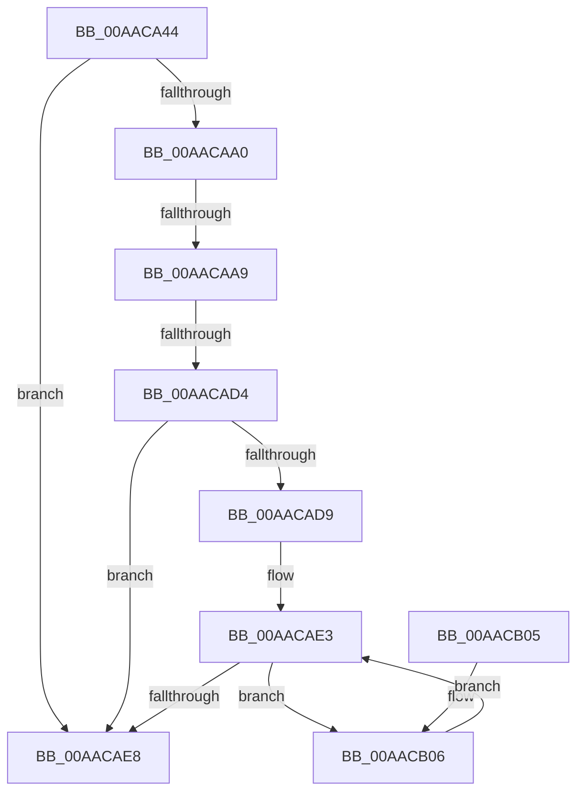

# PopDirectedDripsMarkDfxDevice

- RVA: `0x00AACA44`–`0x00AACB36` (길이 `242` bytes)
- VA: `0x0000000140AACA44`
- 실행 섹션: `PAGE`
- PDB 이름 있음: `예`; PDB Function 태그: `예`
- unwind 정보 RVA: `0x000BBF40`
- 디코드: `67`개 명령, `242/242` bytes 표시
- 미해석 바이트: `0` (있으면 어셈블리에 `.byte`로 보존)

> 이 문서는 커널 이미지의 기계어와 PDB 기호를 분석해 생성했습니다. 4번과 5번은 함수 원형과 자료형을 바이너리 사용 방식에서 추정한 C 해석이며 원본 소스 복구 결과는 아닙니다.

## 1. Dependencies

- 직접 호출 지점: **3**; 고유 호출 대상: **2**
- 직접 호출자로 확인된 함수: **1**
- RIP 상대 이미지 참조: **0**

### Outgoing calls
- `0x00AACA87` → [PopDirectedDripsVisitDevice](../70/PopDirectedDripsVisitDevice_function_00703068.md) (function, `0x00703068`)
- `0x00AACB1D` → [PopDirectedDripsVisitDevice](../70/PopDirectedDripsVisitDevice_function_00703068.md) (function, `0x00703068`)
- `0x00AACB2C` → [PopDirectedDripsInsertQueueDevice](../77/PopDirectedDripsInsertQueueDevice_function_00771E28.md) (function, `0x00771E28`)

### Direct callers
- [PopDirectedDripsBuildBroadcastTreeFull](../77/PopDirectedDripsBuildBroadcastTreeFull_function_00771970.md) at `0x00771A8E`

### Static image references
- 디코드된 RIP-relative 메모리 참조가 없습니다.

## 2. Other-region calls and transfers

- 다른 실행 섹션으로 향하는 call: **0**
- call이 아닌 외부 분기/꼬리 이동: **2**
  - `0x00AACAA3` → [sub_00B4A78A](../B4/Unknown_function_00B4A78A.md) (`tail-transfer`)
  - `0x00AACACE` → [sub_00B4A78A](../B4/Unknown_function_00B4A78A.md) (`tail-transfer`)

## 3. Assembly (complete function range)

```asm
00AACA44  48 89 5C 24 08                  mov qword ptr [rsp + 8], rbx
00AACA49  48 89 6C 24 10                  mov qword ptr [rsp + 0x10], rbp
00AACA4E  48 89 74 24 20                  mov qword ptr [rsp + 0x20], rsi
00AACA53  57                              push rdi
00AACA54  41 54                           push r12
00AACA56  41 55                           push r13
00AACA58  41 56                           push r14
00AACA5A  41 57                           push r15
00AACA5C  48 83 EC 20                     sub rsp, 0x20
00AACA60  41 8B 40 20                     mov eax, dword ptr [r8 + 0x20]
00AACA64  4D 8B F1                        mov r14, r9
00AACA67  49 8B F0                        mov rsi, r8
00AACA6A  4C 8B FA                        mov r15, rdx
00AACA6D  0F BA E8 10                     bts eax, 0x10
00AACA71  4C 8B E1                        mov r12, rcx
00AACA74  41 89 40 20                     mov dword ptr [r8 + 0x20], eax
00AACA78  41 B9 01 00 00 00               mov r9d, 1
00AACA7E  4D 8B C6                        mov r8, r14
00AACA81  48 8B D6                        mov rdx, rsi
00AACA84  49 8B CF                        mov rcx, r15
00AACA87  E8 DC 65 C5 FF                  call 0x140703068
00AACA8C  8B 46 20                        mov eax, dword ptr [rsi + 0x20]
00AACA8F  45 33 ED                        xor r13d, r13d
00AACA92  4C 8B 86 78 FD FF FF            mov r8, qword ptr [rsi - 0x288]
00AACA99  41 8A ED                        mov bpl, r13b
00AACA9C  A8 04                           test al, 4
00AACA9E  75 48                           jne 0x140aacae8
00AACAA0  4D 85 C0                        test r8, r8
00AACAA3  0F 84 E1 DC 09 00               je 0x140b4a78a
00AACAA9  33 C0                           xor eax, eax
00AACAAB  F0 45 0F B1 A8 60 03 00 00      lock cmpxchg dword ptr [r8 + 0x360], r13d
00AACAB4  8B C8                           mov ecx, eax
00AACAB6  33 C0                           xor eax, eax
00AACAB8  F0 45 0F B1 A8 60 03 00 00      lock cmpxchg dword ptr [r8 + 0x360], r13d
00AACAC1  8B E8                           mov ebp, eax
00AACAC3  C1 ED 0A                        shr ebp, 0xa
00AACAC6  40 80 E5 01                     and bpl, 1
00AACACA  0F BA E1 09                     bt ecx, 9
00AACACE  0F 83 B6 DC 09 00               jae 0x140b4a78a
00AACAD4  40 84 ED                        test bpl, bpl
00AACAD7  75 0F                           jne 0x140aacae8
00AACAD9  48 81 C6 D8 FD FF FF            add rsi, -0x228
00AACAE0  48 8B 3E                        mov rdi, qword ptr [rsi]
00AACAE3  48 3B FE                        cmp rdi, rsi
00AACAE6  75 1E                           jne 0x140aacb06
00AACAE8  48 8B 5C 24 50                  mov rbx, qword ptr [rsp + 0x50]
00AACAED  48 8B 6C 24 58                  mov rbp, qword ptr [rsp + 0x58]
00AACAF2  48 8B 74 24 68                  mov rsi, qword ptr [rsp + 0x68]
00AACAF7  48 83 C4 20                     add rsp, 0x20
00AACAFB  41 5F                           pop r15
00AACAFD  41 5E                           pop r14
00AACAFF  41 5D                           pop r13
00AACB01  41 5C                           pop r12
00AACB03  5F                              pop rdi
00AACB04  C3                              ret
00AACB05  CC                              int3
00AACB06  48 8B 5F F8                     mov rbx, qword ptr [rdi - 8]
00AACB0A  41 B9 03 00 00 00               mov r9d, 3
00AACB10  4D 8B C6                        mov r8, r14
00AACB13  49 8B CF                        mov rcx, r15
00AACB16  48 8D 93 38 02 00 00            lea rdx, [rbx + 0x238]
00AACB1D  E8 46 65 C5 FF                  call 0x140703068
00AACB22  48 8D 93 38 02 00 00            lea rdx, [rbx + 0x238]
00AACB29  49 8B CC                        mov rcx, r12
00AACB2C  E8 F7 52 CC FF                  call 0x140771e28
00AACB31  48 8B 3F                        mov rdi, qword ptr [rdi]
00AACB34  EB AD                           jmp 0x140aacae3
```

## 4. C-style interpretation (structured pseudocode)

```c
__int64 __fastcall PopDirectedDripsMarkDfxDevice(__int64 a1, __int64 a2, __int64 a3, __int64 a4)
{
    __int64 result;
    __int64 v_r13;
    __int64 v_rbp;
    __int64 v_rsi;
    __int64 v_rsp;
    unsigned __int64 v_stack_p10;
    unsigned __int64 v_stack_p20;
    unsigned __int64 v_stack_p8;

    v_stack_p8 = v_rbx;
    v_stack_p10 = v_rbp;
    v_stack_p20 = v_rsi;
    v_rsp = (v_rsp) - (32);
    *(unsigned int *)(a3 + 32) = (unsigned int)((unsigned int)(*(unsigned int *)(a3 + 32)));
    result = PopDirectedDripsVisitDevice(a2, a3, a4, 1);
    v_r13 = 0;
    if ((((unsigned __int8)((unsigned int)(*(unsigned int *)(a3 + 32)))) & (4)) != 0) goto loc_00AACAE8;
    result = 0;
    result = 0;
    v_rbp = (unsigned int)((0) >> (10));
    v_rbp = (unsigned __int8)((v_rbp) & (1));
    if ((unsigned __int8)(v_rbp) != 0) goto loc_00AACAE8;
    v_rsi = (a3) + (-552);
loc_00AACAE3:
    if ((*(unsigned __int64 *)(v_rsi)) != v_rsi) goto loc_00AACB06;
loc_00AACAE8:
    v_rsp = (v_rsp) + (32);
    return result;
loc_00AACB06:
    result = PopDirectedDripsVisitDevice(a2, *(unsigned __int64 *)(*(unsigned __int64 *)(v_rsi) - 8) + 568, a4, 3);
    result = PopDirectedDripsInsertQueueDevice(a1, *(unsigned __int64 *)(*(unsigned __int64 *)(v_rsi) - 8) + 568, a4, 3);
    goto loc_00AACAE3;
}
```

## 5. (Beta) C Style

```c
int64_t PopDirectedDripsMarkDfxDevice(int64_t Arg1, int64_t Arg2, void *Arg3, int64_t Arg4)
{
    uint8_t *arg3 = (uint8_t *)Arg3;

    int64_t result;
    int64_t local_r13;
    int64_t local_rbp;
    int64_t local_rsi;
    int64_t local_rsp;
    uint64_t v_stack_p10;
    uint64_t v_stack_p20;
    uint64_t v_stack_p8;

    v_stack_p8 = local_rbx;
    v_stack_p10 = local_rbp;
    v_stack_p20 = local_rsi;
    local_rsp = (local_rsp) - (32);
    *(uint32_t *)(arg3 + 0x20) = (uint32_t)((uint32_t)(*(uint32_t *)(arg3 + 0x20)));
    result = PopDirectedDripsVisitDevice(Arg2, Arg3, Arg4, 1);
    local_r13 = 0;
    if ((((uint8_t)((uint32_t)(*(uint32_t *)(arg3 + 0x20)))) & (4)) != 0) goto loc_00AACAE8;
    result = 0;
    result = 0;
    local_rbp = (uint32_t)((0) >> (10));
    local_rbp = (uint8_t)((local_rbp) & (1));
    if ((uint8_t)(local_rbp) != 0) goto loc_00AACAE8;
    local_rsi = (Arg3) + (-552);
loc_00AACAE3:
    if ((*(uint64_t *)(local_rsi)) != local_rsi) goto loc_00AACB06;
loc_00AACAE8:
    local_rsp = (local_rsp) + (32);
    return result;
loc_00AACB06:
    result = PopDirectedDripsVisitDevice(Arg2, *(uint64_t *)(*(uint64_t *)(local_rsi) - 0x8) + 568, Arg4, 3);
    result = PopDirectedDripsInsertQueueDevice(Arg1, *(uint64_t *)(*(uint64_t *)(local_rsi) - 0x8) + 568, Arg4, 3);
    goto loc_00AACAE3;
}
```

### 관측된 메모리 오프셋

구조체 형식이 확인되지 않은 접근은 인자 기준의 오프셋으로만 기록했습니다.

| 기준 인자 | 오프셋 표현 | 폭 (bit) | 접근 |
|---|---:|---:|---|
| `Arg3` | `- 0x288` | `64` | `R` |
| `Arg3` | `+ 0x0` | `64` | `R` |
| `Arg3` | `+ 0x20` | `32` | `R` |
| `Arg3` | `+ 0x20` | `32` | `W` |

## 6. Execution-region graph

[열기: 2D/3D 그래프와 함수 탐색 컨트롤 패널](../../../control-panel.html?section=page&rva=0x00AACA44&view=graph)

- 2D 그래프는 위에서 아래로 흐르고, 3D 그래프는 빈 공간을 드래그해 회전합니다. Shift+드래그는 이동, 휠은 확대·축소, 함수 노드 선택은 대상 보고서 이동입니다.

### Static fallback


