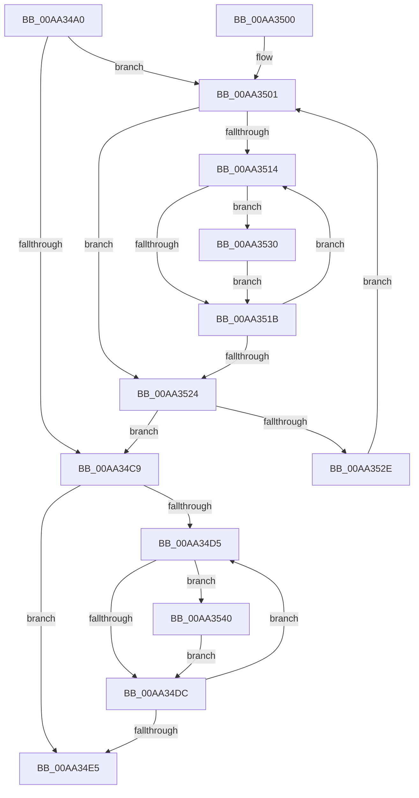

# PopDripsWatchdogInvokeDeviceCallbacks

- RVA: `0x00AA34A0`–`0x00AA3550` (길이 `176` bytes)
- VA: `0x0000000140AA34A0`
- 실행 섹션: `PAGE`
- PDB 이름 있음: `예`; PDB Function 태그: `아니요`
- unwind 정보 RVA: `0x00090784`
- 디코드: `53`개 명령, `176/176` bytes 표시
- 미해석 바이트: `0` (있으면 어셈블리에 `.byte`로 보존)

> 이 문서는 커널 이미지의 기계어와 PDB 기호를 분석해 생성했습니다. 4번과 5번은 함수 원형과 자료형을 바이너리 사용 방식에서 추정한 C 해석이며 원본 소스 복구 결과는 아닙니다.

## 1. Dependencies

- 직접 호출 지점: **2**; 고유 호출 대상: **1**
- 직접 호출자로 확인된 함수: **1**
- RIP 상대 이미지 참조: **0**

### Outgoing calls
- `0x00AA3539` → [PopFxInvokeDripsWatchdogCallback](../75/PopFxInvokeDripsWatchdogCallback_function_00759348.md) (function, `0x00759348`)
- `0x00AA3549` → [PopFxInvokeDripsWatchdogCallback](../75/PopFxInvokeDripsWatchdogCallback_function_00759348.md) (function, `0x00759348`)

### Direct callers
- [PopDripsWatchdogCallbackHandler](../76/PopDripsWatchdogCallbackHandler_function_0076C1C0.md) at `0x0076C315`

### Static image references
- 디코드된 RIP-relative 메모리 참조가 없습니다.

## 2. Other-region calls and transfers

- 다른 실행 섹션으로 향하는 call: **0**
- 별도 외부 분기/꼬리 이동을 확인하지 못했습니다.

## 3. Assembly (complete function range)

```asm
00AA34A0  48 8B C4                        mov rax, rsp
00AA34A3  48 89 58 08                     mov qword ptr [rax + 8], rbx
00AA34A7  48 89 68 10                     mov qword ptr [rax + 0x10], rbp
00AA34AB  48 89 70 18                     mov qword ptr [rax + 0x18], rsi
00AA34AF  48 89 78 20                     mov qword ptr [rax + 0x20], rdi
00AA34B3  41 56                           push r14
00AA34B5  48 83 EC 20                     sub rsp, 0x20
00AA34B9  33 FF                           xor edi, edi
00AA34BB  44 8B F2                        mov r14d, edx
00AA34BE  48 8B F1                        mov rsi, rcx
00AA34C1  39 B9 B0 03 00 00               cmp dword ptr [rcx + 0x3b0], edi
00AA34C7  77 38                           ja 0x140aa3501
00AA34C9  48 8B 7E 30                     mov rdi, qword ptr [rsi + 0x30]
00AA34CD  48 8B DF                        mov rbx, rdi
00AA34D0  48 85 FF                        test rdi, rdi
00AA34D3  74 10                           je 0x140aa34e5
00AA34D5  48 83 7B 50 00                  cmp qword ptr [rbx + 0x50], 0
00AA34DA  75 64                           jne 0x140aa3540
00AA34DC  48 8B 5B 10                     mov rbx, qword ptr [rbx + 0x10]
00AA34E0  48 85 DB                        test rbx, rbx
00AA34E3  75 F0                           jne 0x140aa34d5
00AA34E5  48 8B 5C 24 30                  mov rbx, qword ptr [rsp + 0x30]
00AA34EA  48 8B 6C 24 38                  mov rbp, qword ptr [rsp + 0x38]
00AA34EF  48 8B 74 24 40                  mov rsi, qword ptr [rsp + 0x40]
00AA34F4  48 8B 7C 24 48                  mov rdi, qword ptr [rsp + 0x48]
00AA34F9  48 83 C4 20                     add rsp, 0x20
00AA34FD  41 5E                           pop r14
00AA34FF  C3                              ret
00AA3500  CC                              int3
00AA3501  48 8B 86 A8 03 00 00            mov rax, qword ptr [rsi + 0x3a8]
00AA3508  48 8B 2C F8                     mov rbp, qword ptr [rax + rdi*8]
00AA350C  48 8B DD                        mov rbx, rbp
00AA350F  48 85 ED                        test rbp, rbp
00AA3512  74 10                           je 0x140aa3524
00AA3514  48 83 7B 50 00                  cmp qword ptr [rbx + 0x50], 0
00AA3519  75 15                           jne 0x140aa3530
00AA351B  48 8B 5B 10                     mov rbx, qword ptr [rbx + 0x10]
00AA351F  48 85 DB                        test rbx, rbx
00AA3522  75 F0                           jne 0x140aa3514
00AA3524  FF C7                           inc edi
00AA3526  3B BE B0 03 00 00               cmp edi, dword ptr [rsi + 0x3b0]
00AA352C  73 9B                           jae 0x140aa34c9
00AA352E  EB D1                           jmp 0x140aa3501
00AA3530  45 8B C6                        mov r8d, r14d
00AA3533  48 8B D5                        mov rdx, rbp
00AA3536  48 8B CB                        mov rcx, rbx
00AA3539  E8 0A 5E CB FF                  call 0x140759348
00AA353E  EB DB                           jmp 0x140aa351b
00AA3540  45 8B C6                        mov r8d, r14d
00AA3543  48 8B D7                        mov rdx, rdi
00AA3546  48 8B CB                        mov rcx, rbx
00AA3549  E8 FA 5D CB FF                  call 0x140759348
00AA354E  EB 8C                           jmp 0x140aa34dc
```

## 4. C-style interpretation (structured pseudocode)

```c
__int64 __fastcall PopDripsWatchdogInvokeDeviceCallbacks(__int64 a1, int a2)
{
    __int64 result;
    __int64 v_rdi;
    __int64 v_rsp;
    unsigned __int64 v_stack_p10;
    unsigned __int64 v_stack_p18;
    unsigned __int64 v_stack_p20;
    unsigned __int64 v_stack_p8;

    *(unsigned __int64 *)(v_rsp + 8) = v_rbx;
    *(unsigned __int64 *)(v_rsp + 16) = v_rbp;
    *(unsigned __int64 *)(v_rsp + 24) = v_rsi;
    *(unsigned __int64 *)(v_rsp + 32) = v_rdi;
    v_rsp = (v_rsp) - (32);
    v_rdi = 0;
    if ((*(unsigned int *)(a1 + 944)) > 0) goto loc_00AA3501;
loc_00AA34C9:
    if (*(unsigned __int64 *)(a1 + 48) == 0) goto loc_00AA34E5;
loc_00AA34D5:
    if ((*(unsigned __int64 *)(*(unsigned __int64 *)(a1 + 48) + 80)) != 0) goto loc_00AA3540;
loc_00AA34DC:
    if (*(unsigned __int64 *)(*(unsigned __int64 *)(a1 + 48) + 16) != 0) goto loc_00AA34D5;
loc_00AA34E5:
    v_rsp = (v_rsp) + (32);
    return v_rsp;
loc_00AA3501:
    if (*(unsigned __int64 *)(*(unsigned __int64 *)(v_stack_p18 + 936) + v_stack_p20 * 8) == 0) goto loc_00AA3524;
loc_00AA3514:
    if ((*(unsigned __int64 *)(*(unsigned __int64 *)(*(unsigned __int64 *)(v_stack_p18 + 936) + v_stack_p20 * 8) + 80)) != 0) goto loc_00AA3530;
loc_00AA351B:
    if (*(unsigned __int64 *)(*(unsigned __int64 *)(*(unsigned __int64 *)(v_stack_p18 + 936) + v_stack_p20 * 8) + 16) != 0) goto loc_00AA3514;
loc_00AA3524:
    v_rdi = (unsigned int)((v_stack_p20) + 1);
    if (((unsigned int)(v_rdi)) >= (*(unsigned int *)(v_stack_p18 + 944))) goto loc_00AA34C9;
    goto loc_00AA3501;
loc_00AA3530:
    result = PopFxInvokeDripsWatchdogCallback(*(unsigned __int64 *)(*(unsigned __int64 *)(*(unsigned __int64 *)(v_stack_p18 + 936) + v_stack_p20 * 8) + 16), *(unsigned __int64 *)(*(unsigned __int64 *)(v_stack_p18 + 936) + v_stack_p20 * 8), (unsigned int)((unsigned int)((unsigned int)(a2))), a4);
    goto loc_00AA351B;
loc_00AA3540:
    result = PopFxInvokeDripsWatchdogCallback(*(unsigned __int64 *)(*(unsigned __int64 *)(*(unsigned __int64 *)(v_stack_p18 + 936) + v_stack_p20 * 8) + 16), v_rdi, (unsigned int)((unsigned int)((unsigned int)(a2))), a4);
    goto loc_00AA34DC;
}
```

## 5. (Beta) C Style

```c
int64_t PopDripsWatchdogInvokeDeviceCallbacks(void *Arg1, int32_t Arg2)
{
    uint8_t *arg1 = (uint8_t *)Arg1;

    int64_t result;
    int64_t local_rdi;
    int64_t local_rsp;
    uint64_t v_stack_p10;
    uint64_t v_stack_p18;
    uint64_t v_stack_p20;
    uint64_t v_stack_p8;

    *(uint64_t *)(local_rsp + 0x8) = local_rbx;
    *(uint64_t *)(local_rsp + 0x10) = local_rbp;
    *(uint64_t *)(local_rsp + 0x18) = local_rsi;
    *(uint64_t *)(local_rsp + 0x20) = local_rdi;
    local_rsp = (local_rsp) - (32);
    local_rdi = 0;
    if ((*(uint32_t *)(arg1 + 0x3B0)) > 0) goto loc_00AA3501;
loc_00AA34C9:
    if (*(uint64_t *)(arg1 + 0x30) == 0) goto loc_00AA34E5;
loc_00AA34D5:
    if ((*(uint64_t *)(*(uint64_t *)(arg1 + 0x30) + 0x50)) != 0) goto loc_00AA3540;
loc_00AA34DC:
    if (*(uint64_t *)(*(uint64_t *)(arg1 + 0x30) + 0x10) != 0) goto loc_00AA34D5;
loc_00AA34E5:
    local_rsp = (local_rsp) + (32);
    return local_rsp;
loc_00AA3501:
    if (*(uint64_t *)(*(uint64_t *)(v_stack_p18 + 0x3A8) + v_stack_p20 * 8) == 0) goto loc_00AA3524;
loc_00AA3514:
    if ((*(uint64_t *)(*(uint64_t *)(*(uint64_t *)(v_stack_p18 + 0x3A8) + v_stack_p20 * 8) + 0x50)) != 0) goto loc_00AA3530;
loc_00AA351B:
    if (*(uint64_t *)(*(uint64_t *)(*(uint64_t *)(v_stack_p18 + 0x3A8) + v_stack_p20 * 8) + 0x10) != 0) goto loc_00AA3514;
loc_00AA3524:
    local_rdi = (uint32_t)((v_stack_p20) + 1);
    if (((uint32_t)(local_rdi)) >= (*(uint32_t *)(v_stack_p18 + 0x3B0))) goto loc_00AA34C9;
    goto loc_00AA3501;
loc_00AA3530:
    result = PopFxInvokeDripsWatchdogCallback(*(uint64_t *)(*(uint64_t *)(*(uint64_t *)(v_stack_p18 + 0x3A8) + v_stack_p20 * 8) + 0x10), *(uint64_t *)(*(uint64_t *)(v_stack_p18 + 0x3A8) + v_stack_p20 * 8), (uint32_t)((uint32_t)((uint32_t)(Arg2))), a4);
    goto loc_00AA351B;
loc_00AA3540:
    result = PopFxInvokeDripsWatchdogCallback(*(uint64_t *)(*(uint64_t *)(*(uint64_t *)(v_stack_p18 + 0x3A8) + v_stack_p20 * 8) + 0x10), local_rdi, (uint32_t)((uint32_t)((uint32_t)(Arg2))), a4);
    goto loc_00AA34DC;
}
```

### 관측된 메모리 오프셋

구조체 형식이 확인되지 않은 접근은 인자 기준의 오프셋으로만 기록했습니다.

| 기준 인자 | 오프셋 표현 | 폭 (bit) | 접근 |
|---|---:|---:|---|
| `Arg1` | `+ 0x30` | `64` | `R` |
| `Arg1` | `+ 0x3A8` | `64` | `R` |
| `Arg1` | `+ 0x3B0` | `32` | `R` |

## 6. Execution-region graph

[열기: 2D/3D 그래프와 함수 탐색 컨트롤 패널](../../../control-panel.html?section=page&rva=0x00AA34A0&view=graph)

- 2D 그래프는 위에서 아래로 흐르고, 3D 그래프는 빈 공간을 드래그해 회전합니다. Shift+드래그는 이동, 휠은 확대·축소, 함수 노드 선택은 대상 보고서 이동입니다.

### Static fallback


