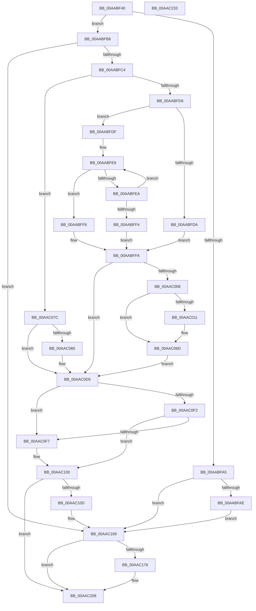

# PopFanUpdateSpeed

- RVA: `0x00AABF40`–`0x00AAC234` (길이 `756` bytes)
- VA: `0x0000000140AABF40`
- 실행 섹션: `PAGE`
- PDB 이름 있음: `예`; PDB Function 태그: `아니요`
- unwind 정보 RVA: `0x000BBE94`
- 디코드: `184`개 명령, `756/756` bytes 표시
- 미해석 바이트: `0` (있으면 어셈블리에 `.byte`로 보존)

> 이 문서는 커널 이미지의 기계어와 PDB 기호를 분석해 생성했습니다. 4번과 5번은 함수 원형과 자료형을 바이너리 사용 방식에서 추정한 C 해석이며 원본 소스 복구 결과는 아닙니다.

## 1. Dependencies

- 직접 호출 지점: **8**; 고유 호출 대상: **5**
- 직접 호출자로 확인된 함수: **1**
- RIP 상대 이미지 참조: **9**

### Outgoing calls
- `0x00AABFB6` → [PopFanUpdateStatistics](PopFanUpdateStatistics_function_00AAC23C.md) (function, `0x00AAC23C`)
- `0x00AAC068` → [tlgWriteTransfer_EtwWriteTransfer](../../text/42/tlgWriteTransfer_EtwWriteTransfer_function_004260E0.md) (function, `0x004260E0`)
- `0x00AAC06F` → [PopSendFanNoiseChangeWnf](../76/PopSendFanNoiseChangeWnf_function_00769240.md) (function, `0x00769240`)
- `0x00AAC0D0` → [tlgWriteTransfer_EtwWriteTransfer](../../text/42/tlgWriteTransfer_EtwWriteTransfer_function_004260E0.md) (function, `0x004260E0`)
- `0x00AAC0E2` → [PopFanFindBucketIndex](../AC/PopFanFindBucketIndex_function_00AC8C80.md) (function, `0x00AC8C80`)
- `0x00AAC164` → [tlgWriteTransfer_EtwWriteTransfer](../../text/42/tlgWriteTransfer_EtwWriteTransfer_function_004260E0.md) (function, `0x004260E0`)
- `0x00AAC203` → [tlgWriteTransfer_EtwWriteTransfer](../../text/42/tlgWriteTransfer_EtwWriteTransfer_function_004260E0.md) (function, `0x004260E0`)
- `0x00AAC212` → [_security_check_cookie](../../text/6A/_security_check_cookie_function_006AC640.md) (function, `0x006AC640`)

### Direct callers
- [sub_00B48194](../B4/Unknown_function_00B48194.md) at `0x00B4828A`

### Static image references
- `0x00AABF5E` → RVA `0x00E0A740` (`.data`; read)
- `0x00AABFC7` → RVA `0x00F0C988` (`.data`; read)
- `0x00AABFFA` → RVA `0x00F0C98C` (`.data`; read)
- `0x00AAC008` → RVA `0x00E07748` (`.data`; read)
- `0x00AAC024` → RVA `0x0004E568` (`.rdata`; read)
- `0x00AAC074` → RVA `0x00F0C98C` (`.data`; write)
- `0x00AAC091` → RVA `0x0004E4C0` (`.rdata`; read)
- `0x00AAC120` → RVA `0x0004E51A` (`.rdata`; read)
- `0x00AAC182` → RVA `0x0004E39A` (`.rdata`; read)

## 2. Other-region calls and transfers

- 다른 실행 섹션으로 향하는 call: **5**
  - `0x00AAC068` → [tlgWriteTransfer_EtwWriteTransfer](../../text/42/tlgWriteTransfer_EtwWriteTransfer_function_004260E0.md) (`PAGE` → `.text`)
  - `0x00AAC0D0` → [tlgWriteTransfer_EtwWriteTransfer](../../text/42/tlgWriteTransfer_EtwWriteTransfer_function_004260E0.md) (`PAGE` → `.text`)
  - `0x00AAC164` → [tlgWriteTransfer_EtwWriteTransfer](../../text/42/tlgWriteTransfer_EtwWriteTransfer_function_004260E0.md) (`PAGE` → `.text`)
  - `0x00AAC203` → [tlgWriteTransfer_EtwWriteTransfer](../../text/42/tlgWriteTransfer_EtwWriteTransfer_function_004260E0.md) (`PAGE` → `.text`)
  - `0x00AAC212` → [_security_check_cookie](../../text/6A/_security_check_cookie_function_006AC640.md) (`PAGE` → `.text`)
- 별도 외부 분기/꼬리 이동을 확인하지 못했습니다.

## 3. Assembly (complete function range)

```asm
00AABF40  48 89 5C 24 10                  mov qword ptr [rsp + 0x10], rbx
00AABF45  48 89 74 24 18                  mov qword ptr [rsp + 0x18], rsi
00AABF4A  55                              push rbp
00AABF4B  57                              push rdi
00AABF4C  41 54                           push r12
00AABF4E  41 56                           push r14
00AABF50  41 57                           push r15
00AABF52  48 8D 6C 24 C9                  lea rbp, [rsp - 0x37]
00AABF57  48 81 EC E0 00 00 00            sub rsp, 0xe0
00AABF5E  48 8B 05 DB E7 35 00            mov rax, qword ptr [rip + 0x35e7db]
00AABF65  48 33 C4                        xor rax, rsp
00AABF68  48 89 45 27                     mov qword ptr [rbp + 0x27], rax
00AABF6C  45 33 FF                        xor r15d, r15d
00AABF6F  C7 45 9F 01 00 00 00            mov dword ptr [rbp - 0x61], 1
00AABF76  8B FA                           mov edi, edx
00AABF78  48 8B D9                        mov rbx, rcx
00AABF7B  45 8A F7                        mov r14b, r15b
00AABF7E  44 89 7D 93                     mov dword ptr [rbp - 0x6d], r15d
00AABF82  44 89 7D 97                     mov dword ptr [rbp - 0x69], r15d
00AABF86  41 8D 77 03                     lea esi, [r15 + 3]
00AABF8A  C7 45 A3 02 00 00 00            mov dword ptr [rbp - 0x5d], 2
00AABF91  45 8D 67 04                     lea r12d, [r15 + 4]
00AABF95  89 75 AB                        mov dword ptr [rbp - 0x55], esi
00AABF98  C7 45 A7 02 00 00 00            mov dword ptr [rbp - 0x59], 2
00AABF9F  44 38 79 58                     cmp byte ptr [rcx + 0x58], r15b
00AABFA3  75 11                           jne 0x140aabfb6
00AABFA5  39 51 54                        cmp dword ptr [rcx + 0x54], edx
00AABFA8  0F 84 BB 01 00 00               je 0x140aac169
00AABFAE  89 51 54                        mov dword ptr [rcx + 0x54], edx
00AABFB1  E9 B3 01 00 00                  jmp 0x140aac169
00AABFB6  E8 81 02 00 00                  call 0x140aac23c
00AABFBB  39 7B 54                        cmp dword ptr [rbx + 0x54], edi
00AABFBE  0F 84 A5 01 00 00               je 0x140aac169
00AABFC4  89 7B 54                        mov dword ptr [rbx + 0x54], edi
00AABFC7  8B 05 BB 09 46 00               mov eax, dword ptr [rip + 0x4609bb]
00AABFCD  83 F8 01                        cmp eax, 1
00AABFD0  0F 85 A6 00 00 00               jne 0x140aac07c
00AABFD6  85 FF                           test edi, edi
00AABFD8  75 05                           jne 0x140aabfdf
00AABFDA  41 8B F7                        mov esi, r15d
00AABFDD  EB 1B                           jmp 0x140aabffa
00AABFDF  41 8B C7                        mov eax, r15d
00AABFE2  48 8D 4B 70                     lea rcx, [rbx + 0x70]
00AABFE6  3B 39                           cmp edi, dword ptr [rcx]
00AABFE8  76 0C                           jbe 0x140aabff6
00AABFEA  FF C0                           inc eax
00AABFEC  49 03 CC                        add rcx, r12
00AABFEF  41 3B C4                        cmp eax, r12d
00AABFF2  72 F2                           jb 0x140aabfe6
00AABFF4  EB 04                           jmp 0x140aabffa
00AABFF6  8B 74 85 9F                     mov esi, dword ptr [rbp + rax*4 - 0x61]
00AABFFA  8B 05 8C 09 46 00               mov eax, dword ptr [rip + 0x46098c]
00AAC000  3B C6                           cmp eax, esi
00AAC002  0F 84 CD 00 00 00               je 0x140aac0d5
00AAC008  83 3D 39 B7 35 00 05            cmp dword ptr [rip + 0x35b739], 5
00AAC00F  76 5C                           jbe 0x140aac06d
00AAC011  89 45 8F                        mov dword ptr [rbp - 0x71], eax
00AAC014  48 8D 4D 9F                     lea rcx, [rbp - 0x61]
00AAC018  48 8D 45 8F                     lea rax, [rbp - 0x71]
00AAC01C  48 89 4D D7                     mov qword ptr [rbp - 0x29], rcx
00AAC020  48 89 45 E7                     mov qword ptr [rbp - 0x19], rax
00AAC024  48 8D 15 3D 25 5A FF            lea rdx, [rip - 0xa5dac3]
00AAC02B  48 8D 45 8B                     lea rax, [rbp - 0x75]
00AAC02F  48 89 5D 9F                     mov qword ptr [rbp - 0x61], rbx
00AAC033  48 89 45 F7                     mov qword ptr [rbp - 9], rax
00AAC037  48 8D 0D 0A B7 35 00            lea rcx, [rip + 0x35b70a]
00AAC03E  48 8D 45 B7                     lea rax, [rbp - 0x49]
00AAC042  48 C7 45 DF 08 00 00 00         mov qword ptr [rbp - 0x21], 8
00AAC04A  48 89 44 24 28                  mov qword ptr [rsp + 0x28], rax
00AAC04F  45 33 C9                        xor r9d, r9d
00AAC052  45 33 C0                        xor r8d, r8d
00AAC055  C7 44 24 20 05 00 00 00         mov dword ptr [rsp + 0x20], 5
00AAC05D  4C 89 65 EF                     mov qword ptr [rbp - 0x11], r12
00AAC061  89 75 8B                        mov dword ptr [rbp - 0x75], esi
00AAC064  4C 89 65 FF                     mov qword ptr [rbp - 1], r12
00AAC068  E8 73 A0 97 FF                  call 0x1404260e0
00AAC06D  8B CE                           mov ecx, esi
00AAC06F  E8 CC D1 CB FF                  call 0x140769240
00AAC074  89 35 12 09 46 00               mov dword ptr [rip + 0x460912], esi
00AAC07A  EB 59                           jmp 0x140aac0d5
00AAC07C  83 3D C5 B6 35 00 02            cmp dword ptr [rip + 0x35b6c5], 2
00AAC083  76 50                           jbe 0x140aac0d5
00AAC085  48 8D 45 9F                     lea rax, [rbp - 0x61]
00AAC089  48 89 5D 9F                     mov qword ptr [rbp - 0x61], rbx
00AAC08D  48 89 45 D7                     mov qword ptr [rbp - 0x29], rax
00AAC091  48 8D 15 28 24 5A FF            lea rdx, [rip - 0xa5dbd8]
00AAC098  8B 05 EA 08 46 00               mov eax, dword ptr [rip + 0x4608ea]
00AAC09E  48 8D 0D A3 B6 35 00            lea rcx, [rip + 0x35b6a3]
00AAC0A5  89 45 8B                        mov dword ptr [rbp - 0x75], eax
00AAC0A8  45 33 C9                        xor r9d, r9d
00AAC0AB  48 8D 45 8B                     lea rax, [rbp - 0x75]
00AAC0AF  48 C7 45 DF 08 00 00 00         mov qword ptr [rbp - 0x21], 8
00AAC0B7  48 89 45 E7                     mov qword ptr [rbp - 0x19], rax
00AAC0BB  45 33 C0                        xor r8d, r8d
00AAC0BE  48 8D 45 B7                     lea rax, [rbp - 0x49]
00AAC0C2  4C 89 65 EF                     mov qword ptr [rbp - 0x11], r12
00AAC0C6  48 89 44 24 28                  mov qword ptr [rsp + 0x28], rax
00AAC0CB  44 89 64 24 20                  mov dword ptr [rsp + 0x20], r12d
00AAC0D0  E8 0B A0 97 FF                  call 0x1404260e0
00AAC0D5  4C 8D 4D 93                     lea r9, [rbp - 0x6d]
00AAC0D9  8B D7                           mov edx, edi
00AAC0DB  4C 8D 45 97                     lea r8, [rbp - 0x69]
00AAC0DF  48 8B CB                        mov rcx, rbx
00AAC0E2  E8 99 CB 01 00                  call 0x140ac8c80
00AAC0E7  8B 45 97                        mov eax, dword ptr [rbp - 0x69]
00AAC0EA  8B 4D 93                        mov ecx, dword ptr [rbp - 0x6d]
00AAC0ED  3B 43 64                        cmp eax, dword ptr [rbx + 0x64]
00AAC0F0  75 05                           jne 0x140aac0f7
00AAC0F2  3B 4B 68                        cmp ecx, dword ptr [rbx + 0x68]
00AAC0F5  74 09                           je 0x140aac100
00AAC0F7  89 43 5C                        mov dword ptr [rbx + 0x5c], eax
00AAC0FA  41 B6 01                        mov r14b, 1
00AAC0FD  89 4B 60                        mov dword ptr [rbx + 0x60], ecx
00AAC100  83 3D 41 B6 35 00 05            cmp dword ptr [rip + 0x35b641], 5
00AAC107  0F 86 FB 00 00 00               jbe 0x140aac208
00AAC10D  89 45 8B                        mov dword ptr [rbp - 0x75], eax
00AAC110  48 8D 55 9F                     lea rdx, [rbp - 0x61]
00AAC114  48 8D 45 8B                     lea rax, [rbp - 0x75]
00AAC118  48 89 55 D7                     mov qword ptr [rbp - 0x29], rdx
00AAC11C  48 89 45 E7                     mov qword ptr [rbp - 0x19], rax
00AAC120  48 8D 15 F3 23 5A FF            lea rdx, [rip - 0xa5dc0d]
00AAC127  48 8D 45 8F                     lea rax, [rbp - 0x71]
00AAC12B  89 4D 8F                        mov dword ptr [rbp - 0x71], ecx
00AAC12E  48 89 45 F7                     mov qword ptr [rbp - 9], rax
00AAC132  48 8D 0D 0F B6 35 00            lea rcx, [rip + 0x35b60f]
00AAC139  48 8D 45 B7                     lea rax, [rbp - 0x49]
00AAC13D  48 89 5D 9F                     mov qword ptr [rbp - 0x61], rbx
00AAC141  48 89 44 24 28                  mov qword ptr [rsp + 0x28], rax
00AAC146  45 33 C9                        xor r9d, r9d
00AAC149  45 33 C0                        xor r8d, r8d
00AAC14C  C7 44 24 20 05 00 00 00         mov dword ptr [rsp + 0x20], 5
00AAC154  48 C7 45 DF 08 00 00 00         mov qword ptr [rbp - 0x21], 8
00AAC15C  4C 89 65 EF                     mov qword ptr [rbp - 0x11], r12
00AAC160  4C 89 65 FF                     mov qword ptr [rbp - 1], r12
00AAC164  E8 77 9F 97 FF                  call 0x1404260e0
00AAC169  83 3D D8 B5 35 00 05            cmp dword ptr [rip + 0x35b5d8], 5
00AAC170  0F 86 92 00 00 00               jbe 0x140aac208
00AAC176  48 8D 45 9F                     lea rax, [rbp - 0x61]
00AAC17A  48 89 5D 9F                     mov qword ptr [rbp - 0x61], rbx
00AAC17E  48 89 45 D7                     mov qword ptr [rbp - 0x29], rax
00AAC182  48 8D 15 11 22 5A FF            lea rdx, [rip - 0xa5ddef]
00AAC189  8B 43 54                        mov eax, dword ptr [rbx + 0x54]
00AAC18C  48 8D 0D B5 B5 35 00            lea rcx, [rip + 0x35b5b5]
00AAC193  89 45 8B                        mov dword ptr [rbp - 0x75], eax
00AAC196  45 33 C9                        xor r9d, r9d
00AAC199  48 8D 45 8B                     lea rax, [rbp - 0x75]
00AAC19D  48 C7 45 DF 08 00 00 00         mov qword ptr [rbp - 0x21], 8
00AAC1A5  48 89 45 E7                     mov qword ptr [rbp - 0x19], rax
00AAC1A9  45 33 C0                        xor r8d, r8d
00AAC1AC  8A 43 58                        mov al, byte ptr [rbx + 0x58]
00AAC1AF  88 45 87                        mov byte ptr [rbp - 0x79], al
00AAC1B2  48 8D 45 87                     lea rax, [rbp - 0x79]
00AAC1B6  48 89 45 F7                     mov qword ptr [rbp - 9], rax
00AAC1BA  8A 83 C8 00 00 00               mov al, byte ptr [rbx + 0xc8]
00AAC1C0  88 45 88                        mov byte ptr [rbp - 0x78], al
00AAC1C3  48 8D 45 88                     lea rax, [rbp - 0x78]
00AAC1C7  48 89 45 07                     mov qword ptr [rbp + 7], rax
00AAC1CB  41 0F B6 C6                     movzx eax, r14b
00AAC1CF  89 45 8F                        mov dword ptr [rbp - 0x71], eax
00AAC1D2  48 8D 45 8F                     lea rax, [rbp - 0x71]
00AAC1D6  48 89 45 17                     mov qword ptr [rbp + 0x17], rax
00AAC1DA  48 8D 45 B7                     lea rax, [rbp - 0x49]
00AAC1DE  48 89 44 24 28                  mov qword ptr [rsp + 0x28], rax
00AAC1E3  C7 44 24 20 07 00 00 00         mov dword ptr [rsp + 0x20], 7
00AAC1EB  4C 89 65 EF                     mov qword ptr [rbp - 0x11], r12
00AAC1EF  48 C7 45 FF 01 00 00 00         mov qword ptr [rbp - 1], 1
00AAC1F7  48 C7 45 0F 01 00 00 00         mov qword ptr [rbp + 0xf], 1
00AAC1FF  4C 89 65 1F                     mov qword ptr [rbp + 0x1f], r12
00AAC203  E8 D8 9E 97 FF                  call 0x1404260e0
00AAC208  41 8A C6                        mov al, r14b
00AAC20B  48 8B 4D 27                     mov rcx, qword ptr [rbp + 0x27]
00AAC20F  48 33 CC                        xor rcx, rsp
00AAC212  E8 29 04 C0 FF                  call 0x1406ac640
00AAC217  4C 8D 9C 24 E0 00 00 00         lea r11, [rsp + 0xe0]
00AAC21F  49 8B 5B 38                     mov rbx, qword ptr [r11 + 0x38]
00AAC223  49 8B 73 40                     mov rsi, qword ptr [r11 + 0x40]
00AAC227  49 8B E3                        mov rsp, r11
00AAC22A  41 5F                           pop r15
00AAC22C  41 5E                           pop r14
00AAC22E  41 5C                           pop r12
00AAC230  5F                              pop rdi
00AAC231  5D                              pop rbp
00AAC232  C3                              ret
00AAC233  CC                              int3
```

## 4. C-style interpretation (structured pseudocode)

```c
__int64 __fastcall PopFanUpdateSpeed(__int64 a1, int a2, int a3, int a4)
{
    __int64 result;
    __int64 v_r14;
    __int64 v_r15;
    __int64 v_rsp;
    unsigned __int64 v_stack_m28;
    unsigned __int64 v_stack_m38;
    unsigned __int64 v_stack_m40;
    unsigned __int64 v_stack_m48;
    unsigned __int64 v_stack_m50;
    unsigned __int64 v_stack_m58;
    unsigned __int64 v_stack_m5F;
    unsigned __int64 v_stack_m60;
    unsigned __int64 v_stack_m68;
    unsigned __int64 v_stack_m70;
    unsigned __int64 v_stack_m78;
    unsigned __int64 v_stack_m80;
    unsigned __int64 v_stack_m88;
    unsigned __int64 v_stack_mA8;
    unsigned int v_stack_mB4;
    unsigned int v_stack_mB8;
    unsigned int v_stack_mBC;
    unsigned int v_stack_mC0;
    unsigned int v_stack_mC8;
    unsigned int v_stack_mCC;
    unsigned int v_stack_mD0;
    unsigned __int64 v_stack_mD4;
    unsigned __int8 v_stack_mD7;
    unsigned __int8 v_stack_mD8;
    unsigned __int64 v_stack_mE0;
    unsigned int v_stack_mE8;
    unsigned __int64 v_stack_p10;
    unsigned __int64 v_stack_p18;

    v_stack_p10 = v_rbx;
    v_stack_p18 = v_rsi;
    v_rsp = (v_rsp) - (224);
    result = (*(unsigned __int64 *)(v_rip + 3532763)) ^ (v_rsp);
    v_stack_m38 = result;
    v_r15 = 0;
    v_stack_mC0 = 1;
    v_stack_mCC = 0;
    v_stack_mC8 = 0;
    v_stack_mBC = 2;
    v_stack_mB4 = (unsigned int)(v_r15 + 3);
    v_stack_mB8 = 2;
    if ((*(unsigned __int8 *)(a1 + 88)) != 0) goto loc_00AABFB6;
    if ((*(unsigned int *)(a1 + 84)) == a2) goto loc_00AAC169;
    *(unsigned int *)(a1 + 84) = a2;
    goto loc_00AAC169;
loc_00AABFB6:
    result = PopFanUpdateStatistics(a1, a2, a3, a4);
    if ((*(unsigned int *)(a1 + 84)) == ((unsigned int)((unsigned int)(a2)))) goto loc_00AAC169;
    *(unsigned int *)(a1 + 84) = (unsigned int)((unsigned int)(a2));
    if (((unsigned int)((unsigned int)(*(unsigned int *)(v_rip + 4590011)))) != 1) goto loc_00AAC07C;
    if ((unsigned int)((unsigned int)(a2)) != 0) goto loc_00AABFDF;
    goto loc_00AABFFA;
loc_00AABFDF:
loc_00AABFE6:
    if (((unsigned int)((unsigned int)(a2))) <= (*(unsigned int *)(a1 + 112))) goto loc_00AABFF6;
    result = (unsigned int)((0) + 1);
    a1 = (a1 + 112) + (v_r15 + 4);
    if (((unsigned int)(result)) < ((unsigned int)(v_r15 + 4))) goto loc_00AABFE6;
    goto loc_00AABFFA;
loc_00AABFF6:
loc_00AABFFA:
    if (((unsigned int)((unsigned int)(*(unsigned int *)(v_rip + 4589964)))) == ((unsigned int)((unsigned int)(*(unsigned int *)(v_stack_m5F + result * 4 - 97))))) goto loc_00AAC0D5;
    result = (unsigned int)(*(unsigned int *)(v_rip + 4589964));
    if ((*(unsigned int *)(v_rip + 3520313)) >= = 5) {
        v_stack_mD0 = (unsigned int)((unsigned int)(*(unsigned int *)(v_rip + 4589964)));
        a1 = v_stack_mC0;
        result = v_stack_mD0;
        v_stack_m88 = a1;
        v_stack_m78 = result;
        a2 = v_rip - 10869443;
        result = v_stack_mD4;
        v_stack_mC0 = a1;
        v_stack_m68 = result;
        a1 = v_rip + 3520266;
        result = v_stack_mA8;
        v_stack_m80 = 8;
        v_stack_mE0 = result;
        a4 = 0;
        a3 = 0;
        v_stack_mE8 = 5;
        v_stack_m70 = v_r15 + 4;
        v_stack_mD4 = (unsigned int)((unsigned int)(*(unsigned int *)(v_stack_m5F + result * 4 - 97)));
        v_stack_m60 = v_r15 + 4;
        result = tlgWriteTransfer_EtwWriteTransfer(a1, a2, a3, a4);
    }
    result = PopSendFanNoiseChangeWnf((unsigned int)((unsigned int)((unsigned int)(*(unsigned int *)(v_stack_m5F + result * 4 - 97)))), a2, a3, a4);
    *(unsigned int *)(v_rip + 4589842) = (unsigned int)((unsigned int)(*(unsigned int *)(v_stack_m5F + result * 4 - 97)));
    goto loc_00AAC0D5;
loc_00AAC07C:
    if ((*(unsigned int *)(v_rip + 3520197)) >= = 2) {
        result = v_stack_mC0;
        v_stack_mC0 = a1;
        v_stack_m88 = result;
        a2 = v_rip - 10869720;
        result = *(unsigned int *)(v_rip + 4589802);
        a1 = v_rip + 3520163;
        v_stack_mD4 = (unsigned int)(result);
        a4 = 0;
        result = v_stack_mD4;
        v_stack_m80 = 8;
        v_stack_m78 = result;
        a3 = 0;
        result = v_stack_mA8;
        v_stack_m70 = v_r15 + 4;
        v_stack_mE0 = result;
        v_stack_mE8 = (unsigned int)(v_r15 + 4);
        result = tlgWriteTransfer_EtwWriteTransfer(a1, a2, a3, a4);
    }
    result = PopFanFindBucketIndex(a1, (unsigned int)((unsigned int)((unsigned int)(a2))), v_stack_mC8, v_stack_mCC);
    if (((unsigned int)((unsigned int)(v_stack_mC8))) != (*(unsigned int *)(a1 + 100))) goto loc_00AAC0F7;
    v_r14 = 0;
    if (((unsigned int)((unsigned int)(v_stack_mCC))) != (*(unsigned int *)(a1 + 104))) {
        *(unsigned int *)(a1 + 92) = (unsigned int)((unsigned int)(v_stack_mC8));
        v_r14 = 1;
        *(unsigned int *)(a1 + 96) = (unsigned int)((unsigned int)(v_stack_mCC));
    }
    if ((*(unsigned int *)(v_rip + 3520065)) <= 5) goto loc_00AAC208;
    v_stack_mD4 = (unsigned int)((unsigned int)(v_stack_mC8));
    v_stack_m88 = v_stack_mC0;
    v_stack_m78 = v_stack_mD4;
    v_stack_mD0 = (unsigned int)((unsigned int)(v_stack_mCC));
    v_stack_m68 = v_stack_mD0;
    v_stack_mC0 = a1;
    v_stack_mE0 = v_stack_mA8;
    a4 = 0;
    a3 = 0;
    v_stack_mE8 = 5;
    v_stack_m80 = 8;
    v_stack_m70 = v_r15 + 4;
    v_stack_m60 = v_r15 + 4;
    result = tlgWriteTransfer_EtwWriteTransfer(v_rip + 3520015, v_rip - 10869773, a3, a4);
loc_00AAC169:
    if ((*(unsigned int *)(v_rip + 3519960)) >= = 5) {
        result = v_stack_mC0;
        v_stack_mC0 = a1;
        v_stack_m88 = result;
        a2 = v_rip - 10870255;
        result = *(unsigned int *)(a1 + 84);
        a1 = v_rip + 3519925;
        v_stack_mD4 = (unsigned int)(result);
        a4 = 0;
        result = v_stack_mD4;
        v_stack_m80 = 8;
        v_stack_m78 = result;
        a3 = 0;
        result = *(unsigned __int8 *)(a1 + 88);
        v_stack_mD8 = (unsigned __int8)(result);
        result = v_stack_mD8;
        v_stack_m68 = result;
        result = *(unsigned __int8 *)(a1 + 200);
        v_stack_mD7 = (unsigned __int8)(result);
        result = v_stack_mD7;
        v_stack_m58 = result;
        result = (unsigned __int8)(v_r14);
        v_stack_mD0 = (unsigned int)(result);
        result = v_stack_mD0;
        v_stack_m48 = result;
        result = v_stack_mA8;
        v_stack_mE0 = result;
        v_stack_mE8 = 7;
        v_stack_m70 = v_r15 + 4;
        v_stack_m60 = 1;
        v_stack_m50 = 1;
        v_stack_m40 = v_r15 + 4;
        result = tlgWriteTransfer_EtwWriteTransfer(a1, a2, a3, a4);
    }
    a1 = (v_stack_m38) ^ (v_rsp);
    result = _security_check_cookie(a1, a2, a3, a4);
    return result;
}
```

## 5. (Beta) C Style

```c
int64_t PopFanUpdateSpeed(void *Arg1, int32_t Arg2, int32_t Arg3, int32_t Arg4)
{
    uint8_t *arg1 = (uint8_t *)Arg1;

    int64_t result;
    int64_t local_r14;
    int64_t local_r15;
    int64_t local_rsp;
    uint64_t v_stack_m28;
    uint64_t v_stack_m38;
    uint64_t v_stack_m40;
    uint64_t v_stack_m48;
    uint64_t v_stack_m50;
    uint64_t v_stack_m58;
    uint64_t v_stack_m5F;
    uint64_t v_stack_m60;
    uint64_t v_stack_m68;
    uint64_t v_stack_m70;
    uint64_t v_stack_m78;
    uint64_t v_stack_m80;
    uint64_t v_stack_m88;
    uint64_t v_stack_mA8;
    uint32_t v_stack_mB4;
    uint32_t v_stack_mB8;
    uint32_t v_stack_mBC;
    uint32_t v_stack_mC0;
    uint32_t v_stack_mC8;
    uint32_t v_stack_mCC;
    uint32_t v_stack_mD0;
    uint64_t v_stack_mD4;
    uint8_t v_stack_mD7;
    uint8_t v_stack_mD8;
    uint64_t v_stack_mE0;
    uint32_t v_stack_mE8;
    uint64_t v_stack_p10;
    uint64_t v_stack_p18;

    v_stack_p10 = local_rbx;
    v_stack_p18 = local_rsi;
    local_rsp = (local_rsp) - (224);
    result = (*(uint64_t *)(v_rip + 0x35E7DB)) ^ (local_rsp);
    v_stack_m38 = result;
    local_r15 = 0;
    v_stack_mC0 = 1;
    v_stack_mCC = 0;
    v_stack_mC8 = 0;
    v_stack_mBC = 2;
    v_stack_mB4 = (uint32_t)(local_r15 + 3);
    v_stack_mB8 = 2;
    if ((*(uint8_t *)(arg1 + 0x58)) != 0) goto loc_00AABFB6;
    if ((*(uint32_t *)(arg1 + 0x54)) == Arg2) goto loc_00AAC169;
    *(uint32_t *)(arg1 + 0x54) = Arg2;
    goto loc_00AAC169;
loc_00AABFB6:
    result = PopFanUpdateStatistics(Arg1, Arg2, Arg3, Arg4);
    if ((*(uint32_t *)(arg1 + 0x54)) == ((uint32_t)((uint32_t)(Arg2)))) goto loc_00AAC169;
    *(uint32_t *)(arg1 + 0x54) = (uint32_t)((uint32_t)(Arg2));
    if (((uint32_t)((uint32_t)(*(uint32_t *)(v_rip + 0x4609BB)))) != 1) goto loc_00AAC07C;
    if ((uint32_t)((uint32_t)(Arg2)) != 0) goto loc_00AABFDF;
    goto loc_00AABFFA;
loc_00AABFDF:
loc_00AABFE6:
    if (((uint32_t)((uint32_t)(Arg2))) <= (*(uint32_t *)(arg1 + 0x70))) goto loc_00AABFF6;
    result = (uint32_t)((0) + 1);
    Arg1 = (Arg1 + 112) + (local_r15 + 4);
    if (((uint32_t)(result)) < ((uint32_t)(local_r15 + 4))) goto loc_00AABFE6;
    goto loc_00AABFFA;
loc_00AABFF6:
loc_00AABFFA:
    if (((uint32_t)((uint32_t)(*(uint32_t *)(v_rip + 0x46098C)))) == ((uint32_t)((uint32_t)(*(uint32_t *)(v_stack_m5F + result * 4 - 0x61))))) goto loc_00AAC0D5;
    result = (uint32_t)(*(uint32_t *)(v_rip + 0x46098C));
    if ((*(uint32_t *)(v_rip + 0x35B739)) >= = 5) {
        v_stack_mD0 = (uint32_t)((uint32_t)(*(uint32_t *)(v_rip + 0x46098C)));
        Arg1 = v_stack_mC0;
        result = v_stack_mD0;
        v_stack_m88 = Arg1;
        v_stack_m78 = result;
        Arg2 = v_rip - 10869443;
        result = v_stack_mD4;
        v_stack_mC0 = Arg1;
        v_stack_m68 = result;
        Arg1 = v_rip + 3520266;
        result = v_stack_mA8;
        v_stack_m80 = 8;
        v_stack_mE0 = result;
        Arg4 = 0;
        Arg3 = 0;
        v_stack_mE8 = 5;
        v_stack_m70 = local_r15 + 4;
        v_stack_mD4 = (uint32_t)((uint32_t)(*(uint32_t *)(v_stack_m5F + result * 4 - 0x61)));
        v_stack_m60 = local_r15 + 4;
        result = tlgWriteTransfer_EtwWriteTransfer(Arg1, Arg2, Arg3, Arg4);
    }
    result = PopSendFanNoiseChangeWnf((uint32_t)((uint32_t)((uint32_t)(*(uint32_t *)(v_stack_m5F + result * 4 - 0x61)))), Arg2, Arg3, Arg4);
    *(uint32_t *)(v_rip + 0x460912) = (uint32_t)((uint32_t)(*(uint32_t *)(v_stack_m5F + result * 4 - 0x61)));
    goto loc_00AAC0D5;
loc_00AAC07C:
    if ((*(uint32_t *)(v_rip + 0x35B6C5)) >= = 2) {
        result = v_stack_mC0;
        v_stack_mC0 = Arg1;
        v_stack_m88 = result;
        Arg2 = v_rip - 10869720;
        result = *(uint32_t *)(v_rip + 0x4608EA);
        Arg1 = v_rip + 3520163;
        v_stack_mD4 = (uint32_t)(result);
        Arg4 = 0;
        result = v_stack_mD4;
        v_stack_m80 = 8;
        v_stack_m78 = result;
        Arg3 = 0;
        result = v_stack_mA8;
        v_stack_m70 = local_r15 + 4;
        v_stack_mE0 = result;
        v_stack_mE8 = (uint32_t)(local_r15 + 4);
        result = tlgWriteTransfer_EtwWriteTransfer(Arg1, Arg2, Arg3, Arg4);
    }
    result = PopFanFindBucketIndex(Arg1, (uint32_t)((uint32_t)((uint32_t)(Arg2))), v_stack_mC8, v_stack_mCC);
    if (((uint32_t)((uint32_t)(v_stack_mC8))) != (*(uint32_t *)(arg1 + 0x64))) goto loc_00AAC0F7;
    local_r14 = 0;
    if (((uint32_t)((uint32_t)(v_stack_mCC))) != (*(uint32_t *)(arg1 + 0x68))) {
        *(uint32_t *)(arg1 + 0x5C) = (uint32_t)((uint32_t)(v_stack_mC8));
        local_r14 = 1;
        *(uint32_t *)(arg1 + 0x60) = (uint32_t)((uint32_t)(v_stack_mCC));
    }
    if ((*(uint32_t *)(v_rip + 0x35B641)) <= 5) goto loc_00AAC208;
    v_stack_mD4 = (uint32_t)((uint32_t)(v_stack_mC8));
    v_stack_m88 = v_stack_mC0;
    v_stack_m78 = v_stack_mD4;
    v_stack_mD0 = (uint32_t)((uint32_t)(v_stack_mCC));
    v_stack_m68 = v_stack_mD0;
    v_stack_mC0 = Arg1;
    v_stack_mE0 = v_stack_mA8;
    Arg4 = 0;
    Arg3 = 0;
    v_stack_mE8 = 5;
    v_stack_m80 = 8;
    v_stack_m70 = local_r15 + 4;
    v_stack_m60 = local_r15 + 4;
    result = tlgWriteTransfer_EtwWriteTransfer(v_rip + 3520015, v_rip - 10869773, Arg3, Arg4);
loc_00AAC169:
    if ((*(uint32_t *)(v_rip + 0x35B5D8)) >= = 5) {
        result = v_stack_mC0;
        v_stack_mC0 = Arg1;
        v_stack_m88 = result;
        Arg2 = v_rip - 10870255;
        result = *(uint32_t *)(arg1 + 0x54);
        Arg1 = v_rip + 3519925;
        v_stack_mD4 = (uint32_t)(result);
        Arg4 = 0;
        result = v_stack_mD4;
        v_stack_m80 = 8;
        v_stack_m78 = result;
        Arg3 = 0;
        result = *(uint8_t *)(arg1 + 0x58);
        v_stack_mD8 = (uint8_t)(result);
        result = v_stack_mD8;
        v_stack_m68 = result;
        result = *(uint8_t *)(arg1 + 0xC8);
        v_stack_mD7 = (uint8_t)(result);
        result = v_stack_mD7;
        v_stack_m58 = result;
        result = (uint8_t)(local_r14);
        v_stack_mD0 = (uint32_t)(result);
        result = v_stack_mD0;
        v_stack_m48 = result;
        result = v_stack_mA8;
        v_stack_mE0 = result;
        v_stack_mE8 = 7;
        v_stack_m70 = local_r15 + 4;
        v_stack_m60 = 1;
        v_stack_m50 = 1;
        v_stack_m40 = local_r15 + 4;
        result = tlgWriteTransfer_EtwWriteTransfer(Arg1, Arg2, Arg3, Arg4);
    }
    Arg1 = (v_stack_m38) ^ (local_rsp);
    result = _security_check_cookie(Arg1, Arg2, Arg3, Arg4);
    return result;
}
```

### 관측된 메모리 오프셋

구조체 형식이 확인되지 않은 접근은 인자 기준의 오프셋으로만 기록했습니다.

| 기준 인자 | 오프셋 표현 | 폭 (bit) | 접근 |
|---|---:|---:|---|
| `Arg1` | `+ 0x0` | `32` | `R` |
| `Arg1` | `+ 0x54` | `32` | `R` |
| `Arg1` | `+ 0x54` | `32` | `W` |
| `Arg1` | `+ 0x58` | `8` | `R` |
| `Arg1` | `+ 0x5C` | `32` | `W` |
| `Arg1` | `+ 0x60` | `32` | `W` |
| `Arg1` | `+ 0x64` | `32` | `R` |
| `Arg1` | `+ 0x68` | `32` | `R` |
| `Arg1` | `+ 0x70` | `64` | `R` |
| `Arg1` | `+ 0xC8` | `8` | `R` |

## 6. Execution-region graph

[열기: 2D/3D 그래프와 함수 탐색 컨트롤 패널](../../../control-panel.html?section=page&rva=0x00AABF40&view=graph)

- 2D 그래프는 위에서 아래로 흐르고, 3D 그래프는 빈 공간을 드래그해 회전합니다. Shift+드래그는 이동, 휠은 확대·축소, 함수 노드 선택은 대상 보고서 이동입니다.

### Static fallback


