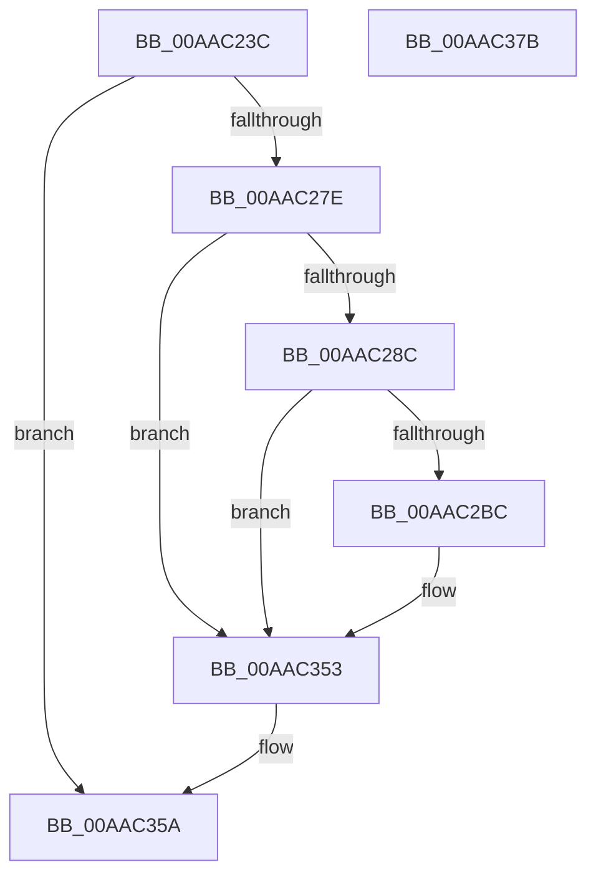

# PopFanUpdateStatistics

- RVA: `0x00AAC23C`–`0x00AAC37C` (길이 `320` bytes)
- VA: `0x0000000140AAC23C`
- 실행 섹션: `PAGE`
- PDB 이름 있음: `예`; PDB Function 태그: `아니요`
- unwind 정보 RVA: `0x0009F188`
- 디코드: `72`개 명령, `320/320` bytes 표시
- 미해석 바이트: `0` (있으면 어셈블리에 `.byte`로 보존)

> 이 문서는 커널 이미지의 기계어와 PDB 기호를 분석해 생성했습니다. 4번과 5번은 함수 원형과 자료형을 바이너리 사용 방식에서 추정한 C 해석이며 원본 소스 복구 결과는 아닙니다.

## 1. Dependencies

- 직접 호출 지점: **3**; 고유 호출 대상: **3**
- 직접 호출자로 확인된 함수: **3**
- RIP 상대 이미지 참조: **3**

### Outgoing calls
- `0x00AAC295` → [PopFanFindBucketIndex](../AC/PopFanFindBucketIndex_function_00AC8C80.md) (function, `0x00AC8C80`)
- `0x00AAC34E` → [tlgWriteTransfer_EtwWriteTransfer](../../text/42/tlgWriteTransfer_EtwWriteTransfer_function_004260E0.md) (function, `0x004260E0`)
- `0x00AAC361` → [_security_check_cookie](../../text/6A/_security_check_cookie_function_006AC640.md) (function, `0x006AC640`)

### Direct callers
- [PopFanSxEntry](../../text/4B/PopFanSxEntry_function_004BEF04.md) at `0x004BEF61`
- [PopFanReadFanNoiseInfo](../A9/PopFanReadFanNoiseInfo_function_00A91138.md) at `0x00A91238`
- [PopFanUpdateSpeed](PopFanUpdateSpeed_function_00AABF40.md) at `0x00AABFB6`

### Static image references
- `0x00AAC253` → RVA `0x00E0A740` (`.data`; read)
- `0x00AAC2AF` → RVA `0x00E07748` (`.data`; read)
- `0x00AAC2D0` → RVA `0x0004E40F` (`.rdata`; read)

## 2. Other-region calls and transfers

- 다른 실행 섹션으로 향하는 call: **2**
  - `0x00AAC34E` → [tlgWriteTransfer_EtwWriteTransfer](../../text/42/tlgWriteTransfer_EtwWriteTransfer_function_004260E0.md) (`PAGE` → `.text`)
  - `0x00AAC361` → [_security_check_cookie](../../text/6A/_security_check_cookie_function_006AC640.md) (`PAGE` → `.text`)
- 별도 외부 분기/꼬리 이동을 확인하지 못했습니다.

## 3. Assembly (complete function range)

```asm
00AAC23C  48 89 5C 24 10                  mov qword ptr [rsp + 0x10], rbx
00AAC241  48 89 7C 24 18                  mov qword ptr [rsp + 0x18], rdi
00AAC246  55                              push rbp
00AAC247  48 8D 6C 24 A9                  lea rbp, [rsp - 0x57]
00AAC24C  48 81 EC D0 00 00 00            sub rsp, 0xd0
00AAC253  48 8B 05 E6 E4 35 00            mov rax, qword ptr [rip + 0x35e4e6]
00AAC25A  48 33 C4                        xor rax, rsp
00AAC25D  48 89 45 47                     mov qword ptr [rbp + 0x47], rax
00AAC261  48 BF 08 00 00 00 80 F7 FF FF   movabs rdi, 0xfffff78000000008
00AAC26B  48 8B D9                        mov rbx, rcx
00AAC26E  48 8B 3F                        mov rdi, qword ptr [rdi]
00AAC271  80 B9 C8 00 00 00 00            cmp byte ptr [rcx + 0xc8], 0
00AAC278  0F 85 DC 00 00 00               jne 0x140aac35a
00AAC27E  48 83 B9 D0 00 00 00 00         cmp qword ptr [rcx + 0xd0], 0
00AAC286  0F 84 C7 00 00 00               je 0x140aac353
00AAC28C  8B 51 54                        mov edx, dword ptr [rcx + 0x54]
00AAC28F  45 33 C9                        xor r9d, r9d
00AAC292  45 33 C0                        xor r8d, r8d
00AAC295  E8 E6 C9 01 00                  call 0x140ac8c80
00AAC29A  44 8B C0                        mov r8d, eax
00AAC29D  48 8B CF                        mov rcx, rdi
00AAC2A0  48 2B 8B D0 00 00 00            sub rcx, qword ptr [rbx + 0xd0]
00AAC2A7  4A 01 8C C3 D8 00 00 00         add qword ptr [rbx + r8*8 + 0xd8], rcx
00AAC2AF  83 3D 92 B4 35 00 05            cmp dword ptr [rip + 0x35b492], 5
00AAC2B6  0F 86 97 00 00 00               jbe 0x140aac353
00AAC2BC  44 21 4D 03                     and dword ptr [rbp + 3], r9d
00AAC2C0  41 8D 49 08                     lea ecx, [r9 + 8]
00AAC2C4  44 21 4D 13                     and dword ptr [rbp + 0x13], r9d
00AAC2C8  48 8D 45 BF                     lea rax, [rbp - 0x41]
00AAC2CC  44 21 4D 23                     and dword ptr [rbp + 0x23], r9d
00AAC2D0  48 8D 15 38 21 5A FF            lea rdx, [rip - 0xa5dec8]
00AAC2D7  44 21 4D 33                     and dword ptr [rbp + 0x33], r9d
00AAC2DB  44 21 4D 43                     and dword ptr [rbp + 0x43], r9d
00AAC2DF  48 89 45 F7                     mov qword ptr [rbp - 9], rax
00AAC2E3  48 8B 83 D0 00 00 00            mov rax, qword ptr [rbx + 0xd0]
00AAC2EA  48 89 45 C7                     mov qword ptr [rbp - 0x39], rax
00AAC2EE  48 8D 45 C7                     lea rax, [rbp - 0x39]
00AAC2F2  48 89 45 07                     mov qword ptr [rbp + 7], rax
00AAC2F6  48 8D 45 CF                     lea rax, [rbp - 0x31]
00AAC2FA  48 89 45 17                     mov qword ptr [rbp + 0x17], rax
00AAC2FE  8B 43 54                        mov eax, dword ptr [rbx + 0x54]
00AAC301  89 45 B7                        mov dword ptr [rbp - 0x49], eax
00AAC304  48 8D 45 B7                     lea rax, [rbp - 0x49]
00AAC308  48 89 45 27                     mov qword ptr [rbp + 0x27], rax
00AAC30C  48 8D 45 BB                     lea rax, [rbp - 0x45]
00AAC310  89 4D FF                        mov dword ptr [rbp - 1], ecx
00AAC313  89 4D 0F                        mov dword ptr [rbp + 0xf], ecx
00AAC316  89 4D 1F                        mov dword ptr [rbp + 0x1f], ecx
00AAC319  41 8D 49 04                     lea ecx, [r9 + 4]
00AAC31D  48 89 45 37                     mov qword ptr [rbp + 0x37], rax
00AAC321  48 8D 45 D7                     lea rax, [rbp - 0x29]
00AAC325  89 4D 2F                        mov dword ptr [rbp + 0x2f], ecx
00AAC328  44 89 45 BB                     mov dword ptr [rbp - 0x45], r8d
00AAC32C  45 33 C0                        xor r8d, r8d
00AAC32F  89 4D 3F                        mov dword ptr [rbp + 0x3f], ecx
00AAC332  48 8D 0D 0F B4 35 00            lea rcx, [rip + 0x35b40f]
00AAC339  48 89 44 24 28                  mov qword ptr [rsp + 0x28], rax
00AAC33E  C7 44 24 20 07 00 00 00         mov dword ptr [rsp + 0x20], 7
00AAC346  48 89 5D BF                     mov qword ptr [rbp - 0x41], rbx
00AAC34A  48 89 7D CF                     mov qword ptr [rbp - 0x31], rdi
00AAC34E  E8 8D 9D 97 FF                  call 0x1404260e0
00AAC353  48 89 BB D0 00 00 00            mov qword ptr [rbx + 0xd0], rdi
00AAC35A  48 8B 4D 47                     mov rcx, qword ptr [rbp + 0x47]
00AAC35E  48 33 CC                        xor rcx, rsp
00AAC361  E8 DA 02 C0 FF                  call 0x1406ac640
00AAC366  4C 8D 9C 24 D0 00 00 00         lea r11, [rsp + 0xd0]
00AAC36E  49 8B 5B 18                     mov rbx, qword ptr [r11 + 0x18]
00AAC372  49 8B 7B 20                     mov rdi, qword ptr [r11 + 0x20]
00AAC376  49 8B E3                        mov rsp, r11
00AAC379  5D                              pop rbp
00AAC37A  C3                              ret
00AAC37B  CC                              int3
```

## 4. C-style interpretation (structured pseudocode)

```c
__int64 __fastcall PopFanUpdateStatistics(__int64 a1, __int64 a2, int a3, int a4)
{
    __int64 result;
    __int64 v_rsp;
    unsigned __int64 v_stack_m18;
    unsigned int v_stack_m1C;
    unsigned int v_stack_m20;
    unsigned __int64 v_stack_m28;
    unsigned int v_stack_m2C;
    unsigned int v_stack_m30;
    unsigned __int64 v_stack_m38;
    unsigned int v_stack_m3C;
    unsigned int v_stack_m40;
    unsigned __int64 v_stack_m48;
    unsigned int v_stack_m4C;
    unsigned int v_stack_m50;
    unsigned __int64 v_stack_m58;
    unsigned int v_stack_m5C;
    unsigned __int64 v_stack_m5F;
    unsigned int v_stack_m60;
    unsigned __int64 v_stack_m68;
    unsigned __int64 v_stack_m8;
    unsigned __int64 v_stack_m88;
    unsigned __int64 v_stack_m90;
    unsigned __int64 v_stack_m98;
    unsigned __int64 v_stack_mA0;
    unsigned __int64 v_stack_mA4;
    unsigned int v_stack_mA8;
    unsigned __int64 v_stack_mB0;
    unsigned int v_stack_mB8;
    unsigned __int64 v_stack_p10;
    unsigned __int64 v_stack_p18;

    v_stack_p10 = v_rbx;
    v_stack_p18 = v_rdi;
    v_rsp = (v_rsp) - (208);
    result = (*(unsigned __int64 *)(v_rip + 3532006)) ^ (v_rsp);
    v_stack_m18 = result;
    if ((*(unsigned __int8 *)(a1 + 200)) != 0) goto loc_00AAC35A;
    if ((*(unsigned __int64 *)(a1 + 208)) == 0) goto loc_00AAC353;
    a4 = 0;
    a3 = 0;
    result = PopFanFindBucketIndex(a1, (unsigned int)(*(unsigned int *)(a1 + 84)), a3, a4);
    a1 = (*(unsigned __int64 *)(v_rdi)) - (*(unsigned __int64 *)(a1 + 208));
    if ((*(unsigned int *)(v_rip + 3519634)) >= = 5) {
        a1 = a4 + 8;
        result = v_stack_mA0;
        a2 = v_rip - 10870472;
        v_stack_m68 = result;
        result = *(unsigned __int64 *)(a1 + 208);
        v_stack_m98 = result;
        result = v_stack_m98;
        v_stack_m58 = result;
        result = v_stack_m90;
        v_stack_m48 = result;
        result = *(unsigned int *)(a1 + 84);
        v_stack_mA8 = (unsigned int)(result);
        result = v_stack_mA8;
        v_stack_m38 = result;
        result = v_stack_mA4;
        v_stack_m60 = (unsigned int)(a1);
        v_stack_m50 = (unsigned int)(a1);
        v_stack_m40 = (unsigned int)(a1);
        a1 = a4 + 4;
        v_stack_m28 = result;
        result = v_stack_m88;
        v_stack_m30 = (unsigned int)(a1);
        v_stack_mA4 = (unsigned int)((unsigned int)((unsigned int)(result)));
        a3 = 0;
        v_stack_m20 = (unsigned int)(a1);
        a1 = v_rip + 3519503;
        v_stack_mB0 = result;
        v_stack_mB8 = 7;
        v_stack_mA0 = a1;
        v_stack_m90 = *(unsigned __int64 *)(v_rdi);
        result = tlgWriteTransfer_EtwWriteTransfer(a1, a2, a3, a4);
    }
    *(unsigned __int64 *)(a1 + 208) = *(unsigned __int64 *)(v_rdi);
loc_00AAC35A:
    a1 = (v_stack_m18) ^ (v_rsp);
    result = _security_check_cookie(a1, a2, a3, a4);
    return result;
}
```

## 5. (Beta) C Style

```c
int64_t PopFanUpdateStatistics(void *Arg1, int64_t Arg2, int32_t Arg3, int32_t Arg4)
{
    uint8_t *arg1 = (uint8_t *)Arg1;

    int64_t result;
    int64_t local_rsp;
    uint64_t v_stack_m18;
    uint32_t v_stack_m1C;
    uint32_t v_stack_m20;
    uint64_t v_stack_m28;
    uint32_t v_stack_m2C;
    uint32_t v_stack_m30;
    uint64_t v_stack_m38;
    uint32_t v_stack_m3C;
    uint32_t v_stack_m40;
    uint64_t v_stack_m48;
    uint32_t v_stack_m4C;
    uint32_t v_stack_m50;
    uint64_t v_stack_m58;
    uint32_t v_stack_m5C;
    uint64_t v_stack_m5F;
    uint32_t v_stack_m60;
    uint64_t v_stack_m68;
    uint64_t v_stack_m8;
    uint64_t v_stack_m88;
    uint64_t v_stack_m90;
    uint64_t v_stack_m98;
    uint64_t v_stack_mA0;
    uint64_t v_stack_mA4;
    uint32_t v_stack_mA8;
    uint64_t v_stack_mB0;
    uint32_t v_stack_mB8;
    uint64_t v_stack_p10;
    uint64_t v_stack_p18;

    v_stack_p10 = local_rbx;
    v_stack_p18 = local_rdi;
    local_rsp = (local_rsp) - (208);
    result = (*(uint64_t *)(v_rip + 0x35E4E6)) ^ (local_rsp);
    v_stack_m18 = result;
    if ((*(uint8_t *)(arg1 + 0xC8)) != 0) goto loc_00AAC35A;
    if ((*(uint64_t *)(arg1 + 0xD0)) == 0) goto loc_00AAC353;
    Arg4 = 0;
    Arg3 = 0;
    result = PopFanFindBucketIndex(Arg1, (uint32_t)(*(uint32_t *)(arg1 + 0x54)), Arg3, Arg4);
    Arg1 = (*(uint64_t *)(local_rdi)) - (*(uint64_t *)(arg1 + 0xD0));
    if ((*(uint32_t *)(v_rip + 0x35B492)) >= = 5) {
        Arg1 = Arg4 + 8;
        result = v_stack_mA0;
        Arg2 = v_rip - 10870472;
        v_stack_m68 = result;
        result = *(uint64_t *)(arg1 + 0xD0);
        v_stack_m98 = result;
        result = v_stack_m98;
        v_stack_m58 = result;
        result = v_stack_m90;
        v_stack_m48 = result;
        result = *(uint32_t *)(arg1 + 0x54);
        v_stack_mA8 = (uint32_t)(result);
        result = v_stack_mA8;
        v_stack_m38 = result;
        result = v_stack_mA4;
        v_stack_m60 = (uint32_t)(Arg1);
        v_stack_m50 = (uint32_t)(Arg1);
        v_stack_m40 = (uint32_t)(Arg1);
        Arg1 = Arg4 + 4;
        v_stack_m28 = result;
        result = v_stack_m88;
        v_stack_m30 = (uint32_t)(Arg1);
        v_stack_mA4 = (uint32_t)((uint32_t)((uint32_t)(result)));
        Arg3 = 0;
        v_stack_m20 = (uint32_t)(Arg1);
        Arg1 = v_rip + 3519503;
        v_stack_mB0 = result;
        v_stack_mB8 = 7;
        v_stack_mA0 = Arg1;
        v_stack_m90 = *(uint64_t *)(local_rdi);
        result = tlgWriteTransfer_EtwWriteTransfer(Arg1, Arg2, Arg3, Arg4);
    }
    *(uint64_t *)(arg1 + 0xD0) = *(uint64_t *)(local_rdi);
loc_00AAC35A:
    Arg1 = (v_stack_m18) ^ (local_rsp);
    result = _security_check_cookie(Arg1, Arg2, Arg3, Arg4);
    return result;
}
```

### 관측된 메모리 오프셋

구조체 형식이 확인되지 않은 접근은 인자 기준의 오프셋으로만 기록했습니다.

| 기준 인자 | 오프셋 표현 | 폭 (bit) | 접근 |
|---|---:|---:|---|
| `Arg1` | `+ 0x54` | `32` | `R` |
| `Arg1` | `+ 0xC8` | `8` | `R` |
| `Arg1` | `+ 0xD0` | `64` | `R` |
| `Arg1` | `+ 0xD0` | `64` | `W` |
| `Arg1` | `+ 0xD8 + r8*8` | `64` | `R/W` |

## 6. Execution-region graph

[열기: 2D/3D 그래프와 함수 탐색 컨트롤 패널](../../../control-panel.html?section=page&rva=0x00AAC23C&view=graph)

- 2D 그래프는 위에서 아래로 흐르고, 3D 그래프는 빈 공간을 드래그해 회전합니다. Shift+드래그는 이동, 휠은 확대·축소, 함수 노드 선택은 대상 보고서 이동입니다.

### Static fallback


