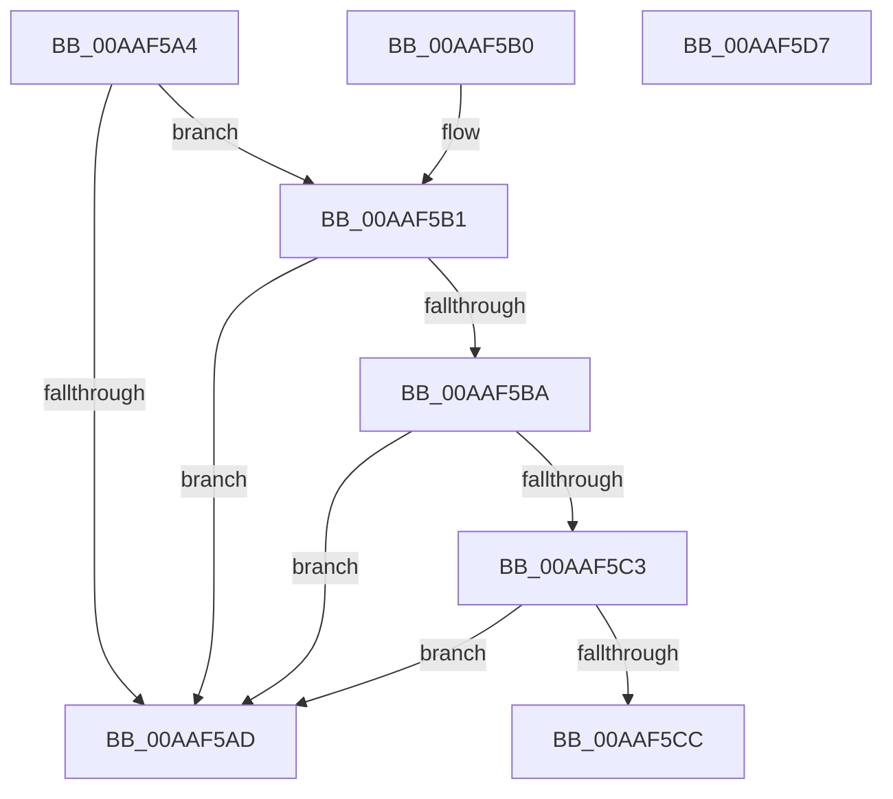

# PopFastS4Check

- RVA: `0x00AAF5A4`–`0x00AAF5D8` (길이 `52` bytes)
- VA: `0x0000000140AAF5A4`
- 실행 섹션: `PAGE`
- PDB 이름 있음: `예`; PDB Function 태그: `아니요`
- unwind 정보 RVA: `0x000DB714`
- 디코드: `15`개 명령, `52/52` bytes 표시
- 미해석 바이트: `0` (있으면 어셈블리에 `.byte`로 보존)

> 이 문서는 커널 이미지의 기계어와 PDB 기호를 분석해 생성했습니다. 4번과 5번은 함수 원형과 자료형을 바이너리 사용 방식에서 추정한 C 해석이며 원본 소스 복구 결과는 아닙니다.

## 1. Dependencies

- 직접 호출 지점: **0**; 고유 호출 대상: **0**
- 직접 호출자로 확인된 함수: **2**
- RIP 상대 이미지 참조: **5**

### Outgoing calls
- 직접 디코드된 call 명령이 없습니다.

### Direct callers
- [PopActionRetrieveInitialState](../../text/4B/PopActionRetrieveInitialState_function_004B8AEC.md) at `0x004B8B58`
- [PopTransitionSystemPowerStateEx](../../pagelk/B7/PopTransitionSystemPowerStateEx_function_00B7E8C0.md) at `0x00B7ECDF`

### Static image references
- `0x00AAF5A4` → RVA `0x00F0BD6C` (`.data`; read)
- `0x00AAF5B1` → RVA `0x00F0CE1C` (`.data`; read)
- `0x00AAF5BA` → RVA `0x00F0BE29` (`.data`; read)
- `0x00AAF5C3` → RVA `0x00F0BE20` (`.data`; read)
- `0x00AAF5CC` → RVA `0x00F0BE2E` (`.data`; read)

## 2. Other-region calls and transfers

- 다른 실행 섹션으로 향하는 call: **0**
- 별도 외부 분기/꼬리 이동을 확인하지 못했습니다.

## 3. Assembly (complete function range)

```asm
00AAF5A4  83 3D C1 C7 45 00 04            cmp dword ptr [rip + 0x45c7c1], 4
00AAF5AB  74 04                           je 0x140aaf5b1
00AAF5AD  32 C0                           xor al, al
00AAF5AF  C3                              ret
00AAF5B0  CC                              int3
00AAF5B1  80 3D 64 D8 45 00 00            cmp byte ptr [rip + 0x45d864], 0
00AAF5B8  75 F3                           jne 0x140aaf5ad
00AAF5BA  80 3D 68 C8 45 00 01            cmp byte ptr [rip + 0x45c868], 1
00AAF5C1  75 EA                           jne 0x140aaf5ad
00AAF5C3  80 3D 56 C8 45 00 01            cmp byte ptr [rip + 0x45c856], 1
00AAF5CA  75 E1                           jne 0x140aaf5ad
00AAF5CC  80 3D 5B C8 45 00 02            cmp byte ptr [rip + 0x45c85b], 2
00AAF5D3  0F 94 C0                        sete al
00AAF5D6  C3                              ret
00AAF5D7  CC                              int3
```

## 4. C-style interpretation (structured pseudocode)

```c
__int64 __fastcall PopFastS4Check(void)
{
    __int64 result;

    if ((*(unsigned int *)(v_rip + 4573121)) == 4) goto loc_00AAF5B1;
loc_00AAF5AD:
    result = 0;
    return result;
loc_00AAF5B1:
    if ((*(unsigned __int8 *)(v_rip + 4577380)) != 0) goto loc_00AAF5AD;
    if ((*(unsigned __int8 *)(v_rip + 4573288)) != 1) goto loc_00AAF5AD;
    if ((*(unsigned __int8 *)(v_rip + 4573270)) != 1) goto loc_00AAF5AD;
    result = ((*(unsigned __int8 *)(v_rip + 4573275)) == 2) ? 1 : 0;
    return result;
}
```

## 5. (Beta) C Style

```c
void PopFastS4Check(void)
{
    int64_t result;

    if ((*(uint32_t *)(v_rip + 0x45C7C1)) == 4) goto loc_00AAF5B1;
loc_00AAF5AD:
    result = 0;
    return result;
loc_00AAF5B1:
    if ((*(uint8_t *)(v_rip + 0x45D864)) != 0) goto loc_00AAF5AD;
    if ((*(uint8_t *)(v_rip + 0x45C868)) != 1) goto loc_00AAF5AD;
    if ((*(uint8_t *)(v_rip + 0x45C856)) != 1) goto loc_00AAF5AD;
    result = ((*(uint8_t *)(v_rip + 0x45C85B)) == 2) ? 1 : 0;
    return result;
}
```

## 6. Execution-region graph

[열기: 2D/3D 그래프와 함수 탐색 컨트롤 패널](../../../control-panel.html?section=page&rva=0x00AAF5A4&view=graph)

- 2D 그래프는 위에서 아래로 흐르고, 3D 그래프는 빈 공간을 드래그해 회전합니다. Shift+드래그는 이동, 휠은 확대·축소, 함수 노드 선택은 대상 보고서 이동입니다.

### Static fallback


