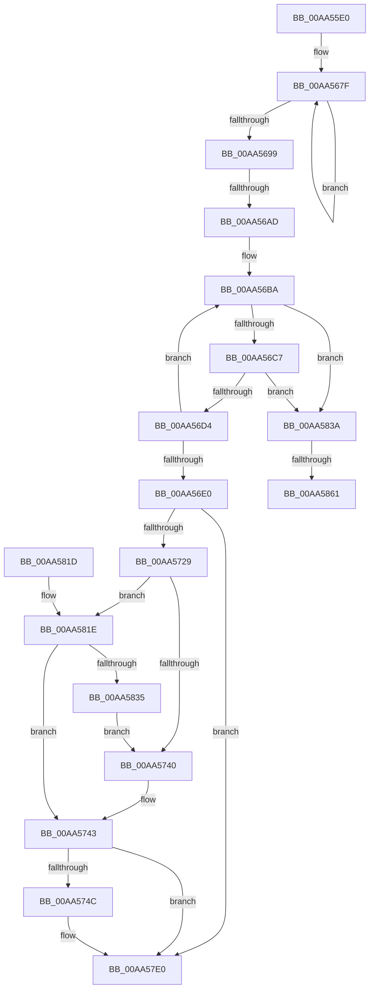

# PopIdleWakeNotifyModernStandbyExitWorker

- RVA: `0x00AA55E0`–`0x00AA5878` (길이 `664` bytes)
- VA: `0x0000000140AA55E0`
- 실행 섹션: `PAGE`
- PDB 이름 있음: `예`; PDB Function 태그: `예`
- unwind 정보 RVA: `0x000BB6B4`
- 디코드: `139`개 명령, `664/664` bytes 표시
- 미해석 바이트: `0` (있으면 어셈블리에 `.byte`로 보존)

> 이 문서는 커널 이미지의 기계어와 PDB 기호를 분석해 생성했습니다. 4번과 5번은 함수 원형과 자료형을 바이너리 사용 방식에서 추정한 C 해석이며 원본 소스 복구 결과는 아닙니다.

## 1. Dependencies

- 직접 호출 지점: **13**; 고유 호출 대상: **9**
- 직접 호출자로 확인된 함수: **0**
- RIP 상대 이미지 참조: **5**

### Outgoing calls
- `0x00AA5627` → [memset](../../text/6C/memset_function_006C6C40.md) (function, `0x006C6C40`)
- `0x00AA564D` → [KeWaitForSingleObject](../../text/20/KeWaitForSingleObject_function_0020E6B0.md) (function, `0x0020E6B0`)
- `0x00AA5657` → [KeQueryInterruptTimePrecise](../../text/20/KeQueryInterruptTimePrecise_function_00209530.md) (function, `0x00209530`)
- `0x00AA5689` → [PpmConvertTimeTo](../../text/43/PpmConvertTimeTo_function_0043B3CC.md) (function, `0x0043B3CC`)
- `0x00AA56E5` → [KeQueryInterruptTimePrecise](../../text/20/KeQueryInterruptTimePrecise_function_00209530.md) (function, `0x00209530`)
- `0x00AA56FF` → [PpmConvertTimeTo](../../text/43/PpmConvertTimeTo_function_0043B3CC.md) (function, `0x0043B3CC`)
- `0x00AA5714` → [PpmConvertTimeTo](../../text/43/PpmConvertTimeTo_function_0043B3CC.md) (function, `0x0043B3CC`)
- `0x00AA57DB` → [tlgWriteTransfer_EtwWriteTransfer](../../text/42/tlgWriteTransfer_EtwWriteTransfer_function_004260E0.md) (function, `0x004260E0`)
- `0x00AA57E8` → [ExFreePoolWithTag](../../poolcode/B8/ExFreePoolWithTag_function_00B82870.md) (function, `0x00B82870`)
- `0x00AA57F7` → [_security_check_cookie](../../text/6A/_security_check_cookie_function_006AC640.md) (function, `0x006AC640`)
- `0x00AA5847` → [memset](../../text/6C/memset_function_006C6C40.md) (function, `0x006C6C40`)
- `0x00AA5854` → [PopIdleWakeSourceAccountingToDiagnostic](../AB/PopIdleWakeSourceAccountingToDiagnostic_function_00AB1C44.md) (function, `0x00AB1C44`)
- `0x00AA586D` → [PopIdleWakeTraceWakeSourceDiagnostic](../A8/PopIdleWakeTraceWakeSourceDiagnostic_function_00A8357C.md) (function, `0x00A8357C`)

### Direct callers
- 이 함수 시작 RVA로 연결되는 직접 call은 확인되지 않았습니다. 간접 호출은 완전히 역산할 수 없습니다.

### Static image references
- `0x00AA5606` → RVA `0x00E0A740` (`.data`; read)
- `0x00AA5699` → RVA `0x00E07748` (`.data`; read)
- `0x00AA5733` → RVA `0x00E07758` (`.data`; read)
- `0x00AA5753` → RVA `0x0004EB9E` (`.rdata`; read)
- `0x00AA581E` → RVA `0x00E07760` (`.data`; read)

## 2. Other-region calls and transfers

- 다른 실행 섹션으로 향하는 call: **11**
  - `0x00AA5627` → [memset](../../text/6C/memset_function_006C6C40.md) (`PAGE` → `.text`)
  - `0x00AA564D` → [KeWaitForSingleObject](../../text/20/KeWaitForSingleObject_function_0020E6B0.md) (`PAGE` → `.text`)
  - `0x00AA5657` → [KeQueryInterruptTimePrecise](../../text/20/KeQueryInterruptTimePrecise_function_00209530.md) (`PAGE` → `.text`)
  - `0x00AA5689` → [PpmConvertTimeTo](../../text/43/PpmConvertTimeTo_function_0043B3CC.md) (`PAGE` → `.text`)
  - `0x00AA56E5` → [KeQueryInterruptTimePrecise](../../text/20/KeQueryInterruptTimePrecise_function_00209530.md) (`PAGE` → `.text`)
  - `0x00AA56FF` → [PpmConvertTimeTo](../../text/43/PpmConvertTimeTo_function_0043B3CC.md) (`PAGE` → `.text`)
  - `0x00AA5714` → [PpmConvertTimeTo](../../text/43/PpmConvertTimeTo_function_0043B3CC.md) (`PAGE` → `.text`)
  - `0x00AA57DB` → [tlgWriteTransfer_EtwWriteTransfer](../../text/42/tlgWriteTransfer_EtwWriteTransfer_function_004260E0.md) (`PAGE` → `.text`)
  - `0x00AA57E8` → [ExFreePoolWithTag](../../poolcode/B8/ExFreePoolWithTag_function_00B82870.md) (`PAGE` → `POOLCODE`)
  - `0x00AA57F7` → [_security_check_cookie](../../text/6A/_security_check_cookie_function_006AC640.md) (`PAGE` → `.text`)
  - `0x00AA5847` → [memset](../../text/6C/memset_function_006C6C40.md) (`PAGE` → `.text`)
- call이 아닌 외부 분기/꼬리 이동: **3**
  - `0x00AA56A7` → [sub_00B49D08](../B4/Unknown_function_00B49D08.md) (`tail-transfer`)
  - `0x00AA585B` → [sub_00B49D08 + 0xED](../B4/Unknown_function_00B49D08.md) (`tail-transfer`)
  - `0x00AA5873` → [sub_00B49D08 + 0xED](../B4/Unknown_function_00B49D08.md) (`tail-transfer`)

## 3. Assembly (complete function range)

```asm
00AA55E0  48 8B C4                        mov rax, rsp
00AA55E3  48 89 58 10                     mov qword ptr [rax + 0x10], rbx
00AA55E7  48 89 70 18                     mov qword ptr [rax + 0x18], rsi
00AA55EB  48 89 78 20                     mov qword ptr [rax + 0x20], rdi
00AA55EF  55                              push rbp
00AA55F0  41 54                           push r12
00AA55F2  41 55                           push r13
00AA55F4  41 56                           push r14
00AA55F6  41 57                           push r15
00AA55F8  48 8D A8 18 FB FF FF            lea rbp, [rax - 0x4e8]
00AA55FF  48 81 EC C0 05 00 00            sub rsp, 0x5c0
00AA5606  48 8B 05 33 51 36 00            mov rax, qword ptr [rip + 0x365133]
00AA560D  48 33 C4                        xor rax, rsp
00AA5610  48 89 85 B0 04 00 00            mov qword ptr [rbp + 0x4b0], rax
00AA5617  48 8B F9                        mov rdi, rcx
00AA561A  33 D2                           xor edx, edx
00AA561C  48 8D 4C 24 60                  lea rcx, [rsp + 0x60]
00AA5621  41 B8 98 04 00 00               mov r8d, 0x498
00AA5627  E8 14 16 C2 FF                  call 0x1406c6c40
00AA562C  45 33 E4                        xor r12d, r12d
00AA562F  48 8D 8F 00 95 00 00            lea rcx, [rdi + 0x9500]
00AA5636  45 33 C9                        xor r9d, r9d
00AA5639  4C 89 64 24 38                  mov qword ptr [rsp + 0x38], r12
00AA563E  45 33 C0                        xor r8d, r8d
00AA5641  4C 89 64 24 40                  mov qword ptr [rsp + 0x40], r12
00AA5646  33 D2                           xor edx, edx
00AA5648  4C 89 64 24 20                  mov qword ptr [rsp + 0x20], r12
00AA564D  E8 5E 90 76 FF                  call 0x14020e6b0
00AA5652  48 8D 4C 24 38                  lea rcx, [rsp + 0x38]
00AA5657  E8 D4 3E 76 FF                  call 0x140209530
00AA565C  48 8D 85 80 04 00 00            lea rax, [rbp + 0x480]
00AA5663  4C 8B FF                        mov r15, rdi
00AA5666  4C 2B F8                        sub r15, rax
00AA5669  48 8D 9D 80 04 00 00            lea rbx, [rbp + 0x480]
00AA5670  41 8D 74 24 01                  lea esi, [r12 + 1]
00AA5675  45 8D 74 24 06                  lea r14d, [r12 + 6]
00AA567A  45 8D 6C 24 08                  lea r13d, [r12 + 8]
00AA567F  49 8B 4C 1F 60                  mov rcx, qword ptr [r15 + rbx + 0x60]
00AA5684  BA E8 03 00 00                  mov edx, 0x3e8
00AA5689  E8 3E 5D 99 FF                  call 0x14043b3cc
00AA568E  48 89 03                        mov qword ptr [rbx], rax
00AA5691  49 03 DD                        add rbx, r13
00AA5694  4C 2B F6                        sub r14, rsi
00AA5697  75 E6                           jne 0x140aa567f
00AA5699  83 3D A8 20 36 00 05            cmp dword ptr [rip + 0x3620a8], 5
00AA56A0  4C 8D 3D A1 20 36 00            lea r15, [rip + 0x3620a1]
00AA56A7  0F 87 5B 46 0A 00               ja 0x140b49d08
00AA56AD  48 8D 9F 90 00 00 00            lea rbx, [rdi + 0x90]
00AA56B4  41 BE 20 00 00 00               mov r14d, 0x20
00AA56BA  44 39 A3 20 03 00 00            cmp dword ptr [rbx + 0x320], r12d
00AA56C1  0F 85 73 01 00 00               jne 0x140aa583a
00AA56C7  44 39 A3 A0 01 00 00            cmp dword ptr [rbx + 0x1a0], r12d
00AA56CE  0F 85 66 01 00 00               jne 0x140aa583a
00AA56D4  48 81 C3 A0 04 00 00            add rbx, 0x4a0
00AA56DB  4C 2B F6                        sub r14, rsi
00AA56DE  75 DA                           jne 0x140aa56ba
00AA56E0  48 8D 4C 24 40                  lea rcx, [rsp + 0x40]
00AA56E5  E8 46 3E 76 FF                  call 0x140209530
00AA56EA  48 8B 4C 24 38                  mov rcx, qword ptr [rsp + 0x38]
00AA56EF  41 BE E8 03 00 00               mov r14d, 0x3e8
00AA56F5  48 2B 8F B8 94 00 00            sub rcx, qword ptr [rdi + 0x94b8]
00AA56FC  41 8B D6                        mov edx, r14d
00AA56FF  E8 C8 5C 99 FF                  call 0x14043b3cc
00AA5704  48 8B 4C 24 40                  mov rcx, qword ptr [rsp + 0x40]
00AA5709  41 8B D6                        mov edx, r14d
00AA570C  48 2B 4C 24 38                  sub rcx, qword ptr [rsp + 0x38]
00AA5711  48 8B D8                        mov rbx, rax
00AA5714  E8 B3 5C 99 FF                  call 0x14043b3cc
00AA5719  83 3D 28 20 36 00 05            cmp dword ptr [rip + 0x362028], 5
00AA5720  4C 8B C0                        mov r8, rax
00AA5723  0F 86 B7 00 00 00               jbe 0x140aa57e0
00AA5729  48 B8 00 00 00 00 00 20 00 00   movabs rax, 0x200000000000
00AA5733  48 85 05 1E 20 36 00            test qword ptr [rip + 0x36201e], rax
00AA573A  0F 85 DE 00 00 00               jne 0x140aa581e
00AA5740  41 8A F4                        mov sil, r12b
00AA5743  40 84 F6                        test sil, sil
00AA5746  0F 84 94 00 00 00               je 0x140aa57e0
00AA574C  48 8B 87 B0 94 00 00            mov rax, qword ptr [rdi + 0x94b0]
00AA5753  48 8D 15 44 94 5A FF            lea rdx, [rip - 0xa56bbc]
00AA575A  48 89 44 24 50                  mov qword ptr [rsp + 0x50], rax
00AA575F  45 33 C9                        xor r9d, r9d
00AA5762  48 8D 44 24 50                  lea rax, [rsp + 0x50]
00AA5767  4C 89 44 24 40                  mov qword ptr [rsp + 0x40], r8
00AA576C  48 89 85 20 04 00 00            mov qword ptr [rbp + 0x420], rax
00AA5773  45 33 C0                        xor r8d, r8d
00AA5776  48 8D 44 24 48                  lea rax, [rsp + 0x48]
00AA577B  4C 89 AD 28 04 00 00            mov qword ptr [rbp + 0x428], r13
00AA5782  48 89 85 30 04 00 00            mov qword ptr [rbp + 0x430], rax
00AA5789  49 8B CF                        mov rcx, r15
00AA578C  48 8D 44 24 40                  lea rax, [rsp + 0x40]
00AA5791  48 89 5C 24 48                  mov qword ptr [rsp + 0x48], rbx
00AA5796  48 89 85 40 04 00 00            mov qword ptr [rbp + 0x440], rax
00AA579D  48 8D 44 24 38                  lea rax, [rsp + 0x38]
00AA57A2  48 89 85 50 04 00 00            mov qword ptr [rbp + 0x450], rax
00AA57A9  48 8D 85 00 04 00 00            lea rax, [rbp + 0x400]
00AA57B0  48 89 44 24 28                  mov qword ptr [rsp + 0x28], rax
00AA57B5  C7 44 24 20 06 00 00 00         mov dword ptr [rsp + 0x20], 6
00AA57BD  4C 89 AD 38 04 00 00            mov qword ptr [rbp + 0x438], r13
00AA57C4  4C 89 AD 48 04 00 00            mov qword ptr [rbp + 0x448], r13
00AA57CB  48 C7 44 24 38 00 00 00 01      mov qword ptr [rsp + 0x38], 0x1000000
00AA57D4  4C 89 AD 58 04 00 00            mov qword ptr [rbp + 0x458], r13
00AA57DB  E8 00 09 98 FF                  call 0x1404260e0
00AA57E0  BA 50 64 69 67                  mov edx, 0x67696450
00AA57E5  48 8B CF                        mov rcx, rdi
00AA57E8  E8 83 D0 0D 00                  call 0x140b82870
00AA57ED  48 8B 8D B0 04 00 00            mov rcx, qword ptr [rbp + 0x4b0]
00AA57F4  48 33 CC                        xor rcx, rsp
00AA57F7  E8 44 6E C0 FF                  call 0x1406ac640
00AA57FC  4C 8D 9C 24 C0 05 00 00         lea r11, [rsp + 0x5c0]
00AA5804  49 8B 5B 38                     mov rbx, qword ptr [r11 + 0x38]
00AA5808  49 8B 73 40                     mov rsi, qword ptr [r11 + 0x40]
00AA580C  49 8B 7B 48                     mov rdi, qword ptr [r11 + 0x48]
00AA5810  49 8B E3                        mov rsp, r11
00AA5813  41 5F                           pop r15
00AA5815  41 5E                           pop r14
00AA5817  41 5D                           pop r13
00AA5819  41 5C                           pop r12
00AA581B  5D                              pop rbp
00AA581C  C3                              ret
00AA581D  CC                              int3
00AA581E  48 8B 0D 3B 1F 36 00            mov rcx, qword ptr [rip + 0x361f3b]
00AA5825  48 23 C8                        and rcx, rax
00AA5828  48 3B 0D 31 1F 36 00            cmp rcx, qword ptr [rip + 0x361f31]
00AA582F  0F 84 0E FF FF FF               je 0x140aa5743
00AA5835  E9 06 FF FF FF                  jmp 0x140aa5740
00AA583A  33 D2                           xor edx, edx
00AA583C  48 8D 4C 24 60                  lea rcx, [rsp + 0x60]
00AA5841  41 B8 98 04 00 00               mov r8d, 0x498
00AA5847  E8 F4 13 C2 FF                  call 0x1406c6c40
00AA584C  48 8D 54 24 60                  lea rdx, [rsp + 0x60]
00AA5851  48 8B CB                        mov rcx, rbx
00AA5854  E8 EB C3 00 00                  call 0x140ab1c44
00AA5859  85 C0                           test eax, eax
00AA585B  0F 88 94 45 0A 00               js 0x140b49df5
00AA5861  48 8B 8F B0 94 00 00            mov rcx, qword ptr [rdi + 0x94b0]
00AA5868  48 8D 54 24 60                  lea rdx, [rsp + 0x60]
00AA586D  E8 0A DD FD FF                  call 0x140a8357c
00AA5872  90                              nop
00AA5873  E9 7D 45 0A 00                  jmp 0x140b49df5
```

## 4. C-style interpretation (structured pseudocode)

```c
__int64 __fastcall PopIdleWakeNotifyModernStandbyExitWorker(__int64 a1, int a2, __int64 a3, int a4)
{
    __int64 result;
    __int64 v_r12;
    __int64 v_r14;
    __int64 v_r15;
    __int64 v_rbx;
    __int64 v_rsp;
    unsigned __int64 v_stack_m28;
    unsigned __int64 v_stack_m560;
    unsigned __int64 v_stack_m588;
    unsigned __int64 v_stack_m598;
    unsigned __int64 v_stack_m5A0;
    unsigned __int64 v_stack_m5A8;
    unsigned __int64 v_stack_m5B0;
    unsigned __int64 v_stack_m5C0;
    unsigned __int64 v_stack_m5C8;

    *(unsigned __int64 *)(v_rsp + 16) = v_rbx;
    *(unsigned __int64 *)(v_rsp + 24) = v_rsi;
    *(unsigned __int64 *)(v_rsp + 32) = v_rdi;
    v_rsp = (v_rsp) - (0x5C0ULL);
    result = (*(unsigned __int64 *)(v_rip + 3559731)) ^ (v_rsp);
    *(unsigned __int64 *)(v_rsp - 1256 + 1200) = result;
    a2 = 0;
    result = memset(v_stack_m588, a2, (unsigned int)(0x498ULL), a4);
    v_r12 = 0;
    a4 = 0;
    v_stack_m5B0 = 0;
    a3 = 0;
    v_stack_m5A8 = 0;
    a2 = 0;
    v_stack_m5C8 = 0;
    result = KeWaitForSingleObject(a1 + 38144, a2, a3, a4);
    result = KeQueryInterruptTimePrecise(v_stack_m5B0, a2, a3, a4);
    v_r15 = (a1) - (v_rsp - 1256 + 1152);
loc_00AA567F:
    result = PpmConvertTimeTo(*(unsigned __int64 *)(v_r15 + v_rsp - 1256 + 1152 * 1 + 96), 1000, a3, a4);
    *(unsigned __int64 *)(v_rsp - 1256 + 1152) = result;
    v_rbx = (v_rsp - 1256 + 1152) + (v_r12 + 8);
    v_r14 = (v_r12 + 6) - (v_r12 + 1);
    if (condition_is_not_equal) goto loc_00AA567F;
loc_00AA56BA:
    if ((*(unsigned int *)(a1 + 144 + 800)) != 0) goto loc_00AA583A;
    if ((*(unsigned int *)(a1 + 144 + 416)) != 0) goto loc_00AA583A;
    v_rbx = (a1 + 144) + (0x4A0ULL);
    v_r14 = (32) - (v_r12 + 1);
    if (condition_is_not_equal) goto loc_00AA56BA;
    result = KeQueryInterruptTimePrecise(v_stack_m5A8, 1000, a3, a4);
    a1 = (v_stack_m5B0) - (*(unsigned __int64 *)(a1 + 38072));
    result = PpmConvertTimeTo(a1, 1000, a3, a4);
    a1 = (v_stack_m5A8) - (v_stack_m5B0);
    result = PpmConvertTimeTo(a1, 1000, a3, a4);
    if ((*(unsigned int *)(v_rip + 3547176)) <= 5) goto loc_00AA57E0;
    if (((*(unsigned __int64 *)(v_rip + 3547166)) & (result)) != 0) goto loc_00AA581E;
loc_00AA5740:
loc_00AA5743:
    if (0 != 0) {
        result = *(unsigned __int64 *)(a1 + 38064);
        a2 = v_rip - 10841020;
        v_stack_m598 = result;
        a4 = 0;
        result = v_stack_m598;
        v_stack_m5A8 = result;
        *(unsigned __int64 *)(v_rsp - 1256 + 1056) = result;
        a3 = 0;
        result = v_stack_m5A0;
        *(unsigned __int64 *)(v_rsp - 1256 + 1064) = v_r12 + 8;
        *(unsigned __int64 *)(v_rsp - 1256 + 1072) = result;
        a1 = v_rip + 3547297;
        result = v_stack_m5A8;
        v_stack_m5A0 = result;
        *(unsigned __int64 *)(v_rsp - 1256 + 1088) = result;
        result = v_stack_m5B0;
        *(unsigned __int64 *)(v_rsp - 1256 + 1104) = result;
        result = v_rsp - 1256 + 1024;
        v_stack_m5C0 = result;
        v_stack_m5C8 = 6;
        *(unsigned __int64 *)(v_rsp - 1256 + 1080) = v_r12 + 8;
        *(unsigned __int64 *)(v_rsp - 1256 + 1096) = v_r12 + 8;
        v_stack_m5B0 = 0x1000000ULL;
        *(unsigned __int64 *)(v_rsp - 1256 + 1112) = v_r12 + 8;
        result = tlgWriteTransfer_EtwWriteTransfer(a1, a2, a3, a4);
    }
    result = ExFreePoolWithTag(a1, (unsigned int)(0x67696450ULL), a3, a4);
    a1 = (*(unsigned __int64 *)(v_rsp - 1256 + 1200)) ^ (v_rsp);
    result = _security_check_cookie(a1, (unsigned int)(0x67696450ULL), a3, a4);
    return result;
loc_00AA581E:
    a1 = (*(unsigned __int64 *)(v_rip + 3546939)) & (result);
    if (a1 == (*(unsigned __int64 *)(v_rip + 3546929))) goto loc_00AA5743;
    goto loc_00AA5740;
loc_00AA583A:
    a2 = 0;
    result = memset(v_stack_m560, a2, (unsigned int)(0x498ULL), a4);
    result = PopIdleWakeSourceAccountingToDiagnostic(*(unsigned __int64 *)(v_stack_m28 + 56), v_stack_m560, (unsigned int)(0x498ULL), a4);
    result = PopIdleWakeTraceWakeSourceDiagnostic(*(unsigned __int64 *)(*(unsigned __int64 *)(v_stack_m28 + 72) + 38064), v_stack_m560, (unsigned int)(0x498ULL), a4);
}
```

## 5. (Beta) C Style

```c
int64_t PopIdleWakeNotifyModernStandbyExitWorker(void *Arg1, int32_t Arg2, int64_t Arg3, int32_t Arg4)
{
    uint8_t *arg1 = (uint8_t *)Arg1;

    int64_t result;
    int64_t local_r12;
    int64_t local_r14;
    int64_t local_r15;
    int64_t local_rbx;
    int64_t local_rsp;
    uint64_t v_stack_m28;
    uint64_t v_stack_m560;
    uint64_t v_stack_m588;
    uint64_t v_stack_m598;
    uint64_t v_stack_m5A0;
    uint64_t v_stack_m5A8;
    uint64_t v_stack_m5B0;
    uint64_t v_stack_m5C0;
    uint64_t v_stack_m5C8;

    *(uint64_t *)(local_rsp + 0x10) = local_rbx;
    *(uint64_t *)(local_rsp + 0x18) = local_rsi;
    *(uint64_t *)(local_rsp + 0x20) = local_rdi;
    local_rsp = (local_rsp) - (0x5C0ULL);
    result = (*(uint64_t *)(v_rip + 0x365133)) ^ (local_rsp);
    *(uint64_t *)(local_rsp - 0x4E8 + 0x4B0) = result;
    Arg2 = 0;
    result = memset(v_stack_m588, Arg2, (uint32_t)(0x498ULL), Arg4);
    local_r12 = 0;
    Arg4 = 0;
    v_stack_m5B0 = 0;
    Arg3 = 0;
    v_stack_m5A8 = 0;
    Arg2 = 0;
    v_stack_m5C8 = 0;
    result = KeWaitForSingleObject(Arg1 + 38144, Arg2, Arg3, Arg4);
    result = KeQueryInterruptTimePrecise(v_stack_m5B0, Arg2, Arg3, Arg4);
    local_r15 = (Arg1) - (local_rsp - 1256 + 1152);
loc_00AA567F:
    result = PpmConvertTimeTo(*(uint64_t *)(local_r15 + local_rsp - 0x4E8 + 0x480 * 1 + 0x60), 1000, Arg3, Arg4);
    *(uint64_t *)(local_rsp - 0x4E8 + 0x480) = result;
    local_rbx = (local_rsp - 1256 + 1152) + (local_r12 + 8);
    local_r14 = (local_r12 + 6) - (local_r12 + 1);
    if (condition_is_not_equal) goto loc_00AA567F;
loc_00AA56BA:
    if ((*(uint32_t *)(arg1 + 0x90 + 0x320)) != 0) goto loc_00AA583A;
    if ((*(uint32_t *)(arg1 + 0x90 + 0x1A0)) != 0) goto loc_00AA583A;
    local_rbx = (Arg1 + 144) + (0x4A0ULL);
    local_r14 = (32) - (local_r12 + 1);
    if (condition_is_not_equal) goto loc_00AA56BA;
    result = KeQueryInterruptTimePrecise(v_stack_m5A8, 1000, Arg3, Arg4);
    Arg1 = (v_stack_m5B0) - (*(uint64_t *)(arg1 + 0x94B8));
    result = PpmConvertTimeTo(Arg1, 1000, Arg3, Arg4);
    Arg1 = (v_stack_m5A8) - (v_stack_m5B0);
    result = PpmConvertTimeTo(Arg1, 1000, Arg3, Arg4);
    if ((*(uint32_t *)(v_rip + 0x362028)) <= 5) goto loc_00AA57E0;
    if (((*(uint64_t *)(v_rip + 0x36201E)) & (result)) != 0) goto loc_00AA581E;
loc_00AA5740:
loc_00AA5743:
    if (0 != 0) {
        result = *(uint64_t *)(arg1 + 0x94B0);
        Arg2 = v_rip - 10841020;
        v_stack_m598 = result;
        Arg4 = 0;
        result = v_stack_m598;
        v_stack_m5A8 = result;
        *(uint64_t *)(local_rsp - 0x4E8 + 0x420) = result;
        Arg3 = 0;
        result = v_stack_m5A0;
        *(uint64_t *)(local_rsp - 0x4E8 + 0x428) = local_r12 + 8;
        *(uint64_t *)(local_rsp - 0x4E8 + 0x430) = result;
        Arg1 = v_rip + 3547297;
        result = v_stack_m5A8;
        v_stack_m5A0 = result;
        *(uint64_t *)(local_rsp - 0x4E8 + 0x440) = result;
        result = v_stack_m5B0;
        *(uint64_t *)(local_rsp - 0x4E8 + 0x450) = result;
        result = local_rsp - 1256 + 1024;
        v_stack_m5C0 = result;
        v_stack_m5C8 = 6;
        *(uint64_t *)(local_rsp - 0x4E8 + 0x438) = local_r12 + 8;
        *(uint64_t *)(local_rsp - 0x4E8 + 0x448) = local_r12 + 8;
        v_stack_m5B0 = 0x1000000ULL;
        *(uint64_t *)(local_rsp - 0x4E8 + 0x458) = local_r12 + 8;
        result = tlgWriteTransfer_EtwWriteTransfer(Arg1, Arg2, Arg3, Arg4);
    }
    result = ExFreePoolWithTag(Arg1, (uint32_t)(0x67696450ULL), Arg3, Arg4);
    Arg1 = (*(uint64_t *)(local_rsp - 0x4E8 + 0x4B0)) ^ (local_rsp);
    result = _security_check_cookie(Arg1, (uint32_t)(0x67696450ULL), Arg3, Arg4);
    return result;
loc_00AA581E:
    Arg1 = (*(uint64_t *)(v_rip + 0x361F3B)) & (result);
    if (Arg1 == (*(uint64_t *)(v_rip + 0x361F31))) goto loc_00AA5743;
    goto loc_00AA5740;
loc_00AA583A:
    Arg2 = 0;
    result = memset(v_stack_m560, Arg2, (uint32_t)(0x498ULL), Arg4);
    result = PopIdleWakeSourceAccountingToDiagnostic(*(uint64_t *)(v_stack_m28 + 0x38), v_stack_m560, (uint32_t)(0x498ULL), Arg4);
    result = PopIdleWakeTraceWakeSourceDiagnostic(*(uint64_t *)(*(uint64_t *)(v_stack_m28 + 0x48) + 0x94B0), v_stack_m560, (uint32_t)(0x498ULL), Arg4);
}
```

### 관측된 메모리 오프셋

구조체 형식이 확인되지 않은 접근은 인자 기준의 오프셋으로만 기록했습니다.

| 기준 인자 | 오프셋 표현 | 폭 (bit) | 접근 |
|---|---:|---:|---|
| `Arg1` | `+ 0x60 + rbx*1` | `64` | `R` |
| `Arg1` | `+ 0x90` | `64` | `R` |
| `Arg1` | `+ 0x1A0` | `32` | `R` |
| `Arg1` | `+ 0x320` | `32` | `R` |
| `Arg1` | `+ 0x94B0` | `64` | `R` |
| `Arg1` | `+ 0x94B8` | `64` | `R` |
| `Arg1` | `+ 0x9500` | `64` | `R` |

## 6. Execution-region graph

[열기: 2D/3D 그래프와 함수 탐색 컨트롤 패널](../../../control-panel.html?section=page&rva=0x00AA55E0&view=graph)

- 2D 그래프는 위에서 아래로 흐르고, 3D 그래프는 빈 공간을 드래그해 회전합니다. Shift+드래그는 이동, 휠은 확대·축소, 함수 노드 선택은 대상 보고서 이동입니다.

### Static fallback


