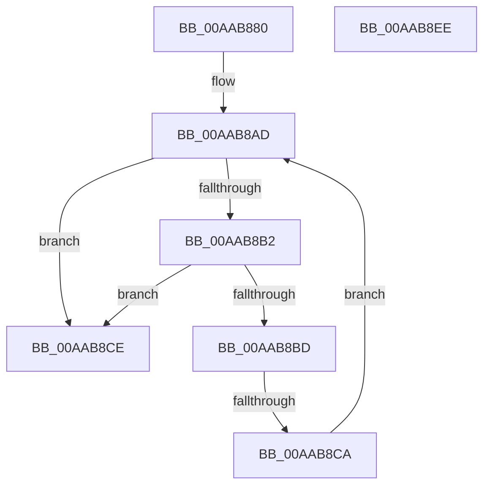

# PopIdleWakeSystemImageCallback

- RVA: `0x00AAB880`–`0x00AAB8EF` (길이 `111` bytes)
- VA: `0x0000000140AAB880`
- 실행 섹션: `PAGE`
- PDB 이름 있음: `예`; PDB Function 태그: `예`
- unwind 정보 RVA: `0x00075C18`
- 디코드: `38`개 명령, `111/111` bytes 표시
- 미해석 바이트: `0` (있으면 어셈블리에 `.byte`로 보존)

> 이 문서는 커널 이미지의 기계어와 PDB 기호를 분석해 생성했습니다. 4번과 5번은 함수 원형과 자료형을 바이너리 사용 방식에서 추정한 C 해석이며 원본 소스 복구 결과는 아닙니다.

## 1. Dependencies

- 직접 호출 지점: **0**; 고유 호출 대상: **0**
- 직접 호출자로 확인된 함수: **0**
- RIP 상대 이미지 참조: **0**

### Outgoing calls
- 직접 디코드된 call 명령이 없습니다.

### Direct callers
- 이 함수 시작 RVA로 연결되는 직접 call은 확인되지 않았습니다. 간접 호출은 완전히 역산할 수 없습니다.

### Static image references
- 디코드된 RIP-relative 메모리 참조가 없습니다.

## 2. Other-region calls and transfers

- 다른 실행 섹션으로 향하는 call: **0**
- call이 아닌 외부 분기/꼬리 이동: **1**
  - `0x00AAB8C4` → [sub_00B4A5F8](../B4/Unknown_function_00B4A5F8.md) (`tail-transfer`)

## 3. Assembly (complete function range)

```asm
00AAB880  48 89 5C 24 08                  mov qword ptr [rsp + 8], rbx
00AAB885  48 89 6C 24 10                  mov qword ptr [rsp + 0x10], rbp
00AAB88A  48 89 74 24 18                  mov qword ptr [rsp + 0x18], rsi
00AAB88F  57                              push rdi
00AAB890  41 54                           push r12
00AAB892  41 55                           push r13
00AAB894  41 56                           push r14
00AAB896  41 57                           push r15
00AAB898  48 83 EC 20                     sub rsp, 0x20
00AAB89C  4C 8B 72 18                     mov r14, qword ptr [rdx + 0x18]
00AAB8A0  48 8B E9                        mov rbp, rcx
00AAB8A3  33 C9                           xor ecx, ecx
00AAB8A5  4C 8B E2                        mov r12, rdx
00AAB8A8  44 8B C1                        mov r8d, ecx
00AAB8AB  8B D9                           mov ebx, ecx
00AAB8AD  83 FB 03                        cmp ebx, 3
00AAB8B0  73 1C                           jae 0x140aab8ce
00AAB8B2  8B C3                           mov eax, ebx
00AAB8B4  49 8B 3C C4                     mov rdi, qword ptr [r12 + rax*8]
00AAB8B8  48 85 FF                        test rdi, rdi
00AAB8BB  74 11                           je 0x140aab8ce
00AAB8BD  4C 8B 7D 30                     mov r15, qword ptr [rbp + 0x30]
00AAB8C1  49 3B FF                        cmp rdi, r15
00AAB8C4  0F 83 2E ED 09 00               jae 0x140b4a5f8
00AAB8CA  FF C3                           inc ebx
00AAB8CC  EB DF                           jmp 0x140aab8ad
00AAB8CE  48 8B 5C 24 50                  mov rbx, qword ptr [rsp + 0x50]
00AAB8D3  41 8B C0                        mov eax, r8d
00AAB8D6  48 8B 6C 24 58                  mov rbp, qword ptr [rsp + 0x58]
00AAB8DB  48 8B 74 24 60                  mov rsi, qword ptr [rsp + 0x60]
00AAB8E0  48 83 C4 20                     add rsp, 0x20
00AAB8E4  41 5F                           pop r15
00AAB8E6  41 5E                           pop r14
00AAB8E8  41 5D                           pop r13
00AAB8EA  41 5C                           pop r12
00AAB8EC  5F                              pop rdi
00AAB8ED  C3                              ret
00AAB8EE  CC                              int3
```

## 4. C-style interpretation (structured pseudocode)

```c
__int64 __fastcall PopIdleWakeSystemImageCallback(__int64 a1, __int64 a2)
{
    __int64 v_rbx;
    __int64 v_rsp;
    unsigned __int64 v_stack_p10;
    unsigned __int64 v_stack_p18;
    unsigned __int64 v_stack_p8;

    v_stack_p8 = v_rbx;
    v_stack_p10 = v_rbp;
    v_stack_p18 = v_rsi;
    v_rsp = (v_rsp) - (32);
    a1 = 0;
loc_00AAB8AD:
    if (0 >= 3) goto loc_00AAB8CE;
    if (*(unsigned __int64 *)(a2 + 0 * 8) == 0) goto loc_00AAB8CE;
    v_rbx = (unsigned int)((0) + 1);
    goto loc_00AAB8AD;
loc_00AAB8CE:
    v_rsp = (v_rsp) + (32);
    return 0;
}
```

## 5. (Beta) C Style

```c
int64_t PopIdleWakeSystemImageCallback(void *Arg1, void *Arg2)
{
    uint8_t *arg1 = (uint8_t *)Arg1;
    uint8_t *arg2 = (uint8_t *)Arg2;

    int64_t local_rbx;
    int64_t local_rsp;
    uint64_t v_stack_p10;
    uint64_t v_stack_p18;
    uint64_t v_stack_p8;

    v_stack_p8 = local_rbx;
    v_stack_p10 = local_rbp;
    v_stack_p18 = local_rsi;
    local_rsp = (local_rsp) - (32);
    Arg1 = 0;
loc_00AAB8AD:
    if (0 >= 3) goto loc_00AAB8CE;
    if (*(uint64_t *)(arg2 + 0x0 * 8) == 0) goto loc_00AAB8CE;
    local_rbx = (uint32_t)((0) + 1);
    goto loc_00AAB8AD;
loc_00AAB8CE:
    local_rsp = (local_rsp) + (32);
    return 0;
}
```

### 관측된 메모리 오프셋

구조체 형식이 확인되지 않은 접근은 인자 기준의 오프셋으로만 기록했습니다.

| 기준 인자 | 오프셋 표현 | 폭 (bit) | 접근 |
|---|---:|---:|---|
| `Arg1` | `+ 0x30` | `64` | `R` |
| `Arg2` | `+ 0x0 + rax*8` | `64` | `R` |
| `Arg2` | `+ 0x18` | `64` | `R` |

## 6. Execution-region graph

[열기: 2D/3D 그래프와 함수 탐색 컨트롤 패널](../../../control-panel.html?section=page&rva=0x00AAB880&view=graph)

- 2D 그래프는 위에서 아래로 흐르고, 3D 그래프는 빈 공간을 드래그해 회전합니다. Shift+드래그는 이동, 휠은 확대·축소, 함수 노드 선택은 대상 보고서 이동입니다.

### Static fallback


