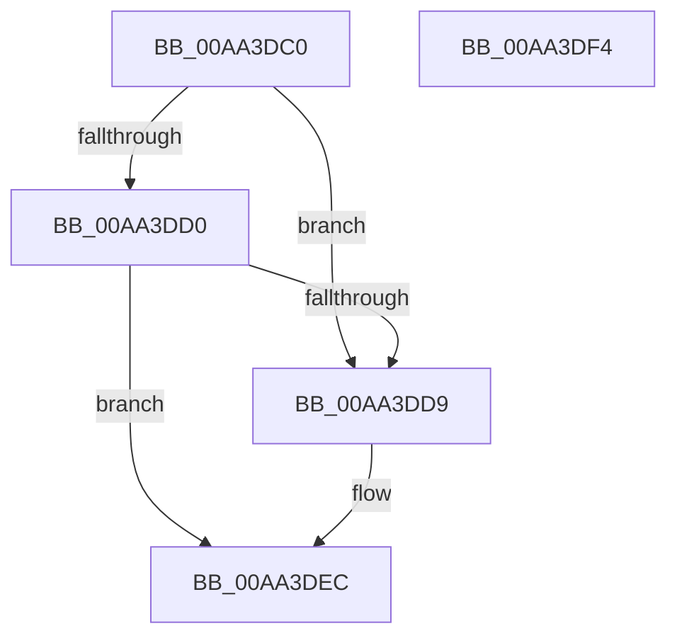

# PopIsDozeSupported

- RVA: `0x00AA3DC0`–`0x00AA3DF5` (길이 `53` bytes)
- VA: `0x0000000140AA3DC0`
- 실행 섹션: `PAGE`
- PDB 이름 있음: `예`; PDB Function 태그: `아니요`
- unwind 정보 RVA: `0x0005C788`
- 디코드: `16`개 명령, `53/53` bytes 표시
- 미해석 바이트: `0` (있으면 어셈블리에 `.byte`로 보존)

> 이 문서는 커널 이미지의 기계어와 PDB 기호를 분석해 생성했습니다. 4번과 5번은 함수 원형과 자료형을 바이너리 사용 방식에서 추정한 C 해석이며 원본 소스 복구 결과는 아닙니다.

## 1. Dependencies

- 직접 호출 지점: **1**; 고유 호출 대상: **1**
- 직접 호출자로 확인된 함수: **5**
- RIP 상대 이미지 참조: **1**

### Outgoing calls
- `0x00AA3DC7` → [PopIsHibernateSupported](PopIsHibernateSupported_function_00AA3DFC.md) (function, `0x00AA3DFC`)

### Direct callers
- [PopIdleArmAoAcDozeS4Timer](../../text/4E/PopIdleArmAoAcDozeS4Timer_function_004E03A8.md) at `0x004E0403`
- [PopDeferDoze](../75/PopDeferDoze_function_0075FF88.md) at `0x00760001`
- [PopUpdateSystemIdleContext](../91/PopUpdateSystemIdleContext_function_00911BB4.md) at `0x00911CB1`
- [PopSmartSuspendMakePredictions](../AD/PopSmartSuspendMakePredictions_function_00AD9168.md) at `0x00AD9255`
- [PopTransitionSystemPowerStateEx](../../pagelk/B7/PopTransitionSystemPowerStateEx_function_00B7E8C0.md) at `0x00B7F278`

### Static image references
- `0x00AA3DD0` → RVA `0x00FC6D44` (`ALMOSTRO`; read)

## 2. Other-region calls and transfers

- 다른 실행 섹션으로 향하는 call: **0**
- 별도 외부 분기/꼬리 이동을 확인하지 못했습니다.

## 3. Assembly (complete function range)

```asm
00AA3DC0  48 83 EC 28                     sub rsp, 0x28
00AA3DC4  45 33 C0                        xor r8d, r8d
00AA3DC7  E8 30 00 00 00                  call 0x140aa3dfc
00AA3DCC  84 C0                           test al, al
00AA3DCE  75 09                           jne 0x140aa3dd9
00AA3DD0  44 39 05 6D 2F 52 00            cmp dword ptr [rip + 0x522f6d], r8d
00AA3DD7  74 13                           je 0x140aa3dec
00AA3DD9  44 38 41 07                     cmp byte ptr [rcx + 7], r8b
00AA3DDD  BA 01 00 00 00                  mov edx, 1
00AA3DE2  41 0F B6 C0                     movzx eax, r8b
00AA3DE6  0F 45 C2                        cmovne eax, edx
00AA3DE9  44 8A C0                        mov r8b, al
00AA3DEC  41 8A C0                        mov al, r8b
00AA3DEF  48 83 C4 28                     add rsp, 0x28
00AA3DF3  C3                              ret
00AA3DF4  CC                              int3
```

## 4. C-style interpretation (structured pseudocode)

```c
__int64 __fastcall PopIsDozeSupported(__int64 a1, __int64 a2, int a3)
{
    __int64 result;
    __int64 v_rsp;

    v_rsp = (v_rsp) - (40);
    a3 = 0;
    result = PopIsHibernateSupported(a1, a2, a3, a4);
    if ((unsigned __int8)(result) != 0) goto loc_00AA3DD9;
    if ((*(unsigned int *)(v_rip + 5386093)) != 0) {
        a2 = 1;
        result = 0;
        if ((*(unsigned __int8 *)(a1 + 7)) != 0) { result = (unsigned int)(a2); }
        a3 = (unsigned __int8)(result);
    }
    v_rsp = (v_rsp) + (40);
    return (unsigned __int8)(a3);
}
```

## 5. (Beta) C Style

```c
int64_t PopIsDozeSupported(int64_t Arg1, int64_t Arg2, int32_t Arg3)
{
    int64_t result;
    int64_t local_rsp;

    local_rsp = (local_rsp) - (40);
    Arg3 = 0;
    result = PopIsHibernateSupported(Arg1, Arg2, Arg3, a4);
    if ((uint8_t)(result) != 0) goto loc_00AA3DD9;
    if ((*(uint32_t *)(v_rip + 0x522F6D)) != 0) {
        Arg2 = 1;
        result = 0;
        if ((*(uint8_t *)(Arg1 + 0x7)) != 0) { result = (uint32_t)(Arg2); }
        Arg3 = (uint8_t)(result);
    }
    local_rsp = (local_rsp) + (40);
    return (uint8_t)(Arg3);
}
```

## 6. Execution-region graph

[열기: 2D/3D 그래프와 함수 탐색 컨트롤 패널](../../../control-panel.html?section=page&rva=0x00AA3DC0&view=graph)

- 2D 그래프는 위에서 아래로 흐르고, 3D 그래프는 빈 공간을 드래그해 회전합니다. Shift+드래그는 이동, 휠은 확대·축소, 함수 노드 선택은 대상 보고서 이동입니다.

### Static fallback


