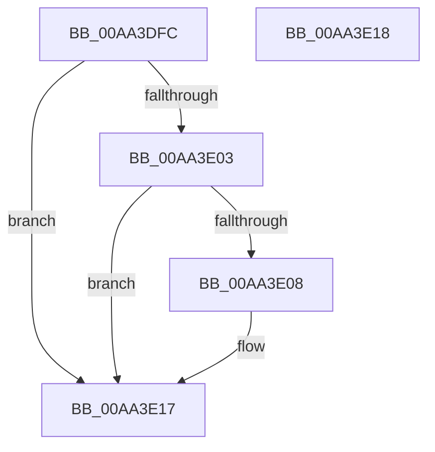

# PopIsHibernateSupported

- RVA: `0x00AA3DFC`–`0x00AA3E19` (길이 `29` bytes)
- VA: `0x0000000140AA3DFC`
- 실행 섹션: `PAGE`
- PDB 이름 있음: `예`; PDB Function 태그: `아니요`
- unwind 정보 RVA: `0x000DB714`
- 디코드: `11`개 명령, `29/29` bytes 표시
- 미해석 바이트: `0` (있으면 어셈블리에 `.byte`로 보존)

> 이 문서는 커널 이미지의 기계어와 PDB 기호를 분석해 생성했습니다. 4번과 5번은 함수 원형과 자료형을 바이너리 사용 방식에서 추정한 C 해석이며 원본 소스 복구 결과는 아닙니다.

## 1. Dependencies

- 직접 호출 지점: **0**; 고유 호출 대상: **0**
- 직접 호출자로 확인된 함수: **7**
- RIP 상대 이미지 참조: **0**

### Outgoing calls
- 직접 디코드된 call 명령이 없습니다.

### Direct callers
- [PopCaptureSleepStudyStatistics](../../text/43/PopCaptureSleepStudyStatistics_function_004399F4.md) at `0x00439D81`
- [PopCheckAndHandleThermalConditions](../../text/4A/PopCheckAndHandleThermalConditions_function_004A8C00.md) at `0x004A8CC4`
- [PopVerifySystemPowerPolicy](../91/PopVerifySystemPowerPolicy_function_00910A8C.md) at `0x00910F67`
- [PopVerifySystemPowerPolicy](../91/PopVerifySystemPowerPolicy_function_00910A8C.md) at `0x00910FAA`
- [PopVerifySystemPowerPolicy](../91/PopVerifySystemPowerPolicy_function_00910A8C.md) at `0x00910FED`
- [PopVerifySystemPowerPolicy](../91/PopVerifySystemPowerPolicy_function_00910A8C.md) at `0x00911030`
- [PopVerifySystemPowerPolicy](../91/PopVerifySystemPowerPolicy_function_00910A8C.md) at `0x0091109A`
- [PopVerifySystemPowerState](../A9/PopVerifySystemPowerState_function_00A9537C.md) at `0x00A95418`
- [PopIsDozeSupported](PopIsDozeSupported_function_00AA3DC0.md) at `0x00AA3DC7`
- [sub_00B21422](../B2/Unknown_function_00B21422.md) at `0x00B21427`
- [sub_00B47610](../B4/Unknown_function_00B47610.md) at `0x00B4769F`

### Static image references
- 디코드된 RIP-relative 메모리 참조가 없습니다.

## 2. Other-region calls and transfers

- 다른 실행 섹션으로 향하는 call: **0**
- 별도 외부 분기/꼬리 이동을 확인하지 못했습니다.

## 3. Assembly (complete function range)

```asm
00AA3DFC  32 C0                           xor al, al
00AA3DFE  38 41 06                        cmp byte ptr [rcx + 6], al
00AA3E01  74 14                           je 0x140aa3e17
00AA3E03  38 41 08                        cmp byte ptr [rcx + 8], al
00AA3E06  74 0F                           je 0x140aa3e17
00AA3E08  80 79 16 02                     cmp byte ptr [rcx + 0x16], 2
00AA3E0C  BA 01 00 00 00                  mov edx, 1
00AA3E11  0F B6 C0                        movzx eax, al
00AA3E14  0F 44 C2                        cmove eax, edx
00AA3E17  C3                              ret
00AA3E18  CC                              int3
```

## 4. C-style interpretation (structured pseudocode)

```c
__int64 __fastcall PopIsHibernateSupported(__int64 a1)
{
    __int64 result;

    result = 0;
    if ((*(unsigned __int8 *)(a1 + 6)) == 0) goto loc_00AA3E17;
    if ((*(unsigned __int8 *)(a1 + 8)) != 0) {
        a2 = 1;
        result = 0;
        if ((*(unsigned __int8 *)(a1 + 22)) == 2) { result = (unsigned int)(a2); }
    }
    return result;
}
```

## 5. (Beta) C Style

```c
int64_t PopIsHibernateSupported(void *Arg1)
{
    uint8_t *arg1 = (uint8_t *)Arg1;

    int64_t result;

    result = 0;
    if ((*(uint8_t *)(arg1 + 0x6)) == 0) goto loc_00AA3E17;
    if ((*(uint8_t *)(arg1 + 0x8)) != 0) {
        a2 = 1;
        result = 0;
        if ((*(uint8_t *)(arg1 + 0x16)) == 2) { result = (uint32_t)(a2); }
    }
    return result;
}
```

### 관측된 메모리 오프셋

구조체 형식이 확인되지 않은 접근은 인자 기준의 오프셋으로만 기록했습니다.

| 기준 인자 | 오프셋 표현 | 폭 (bit) | 접근 |
|---|---:|---:|---|
| `Arg1` | `+ 0x6` | `8` | `R` |
| `Arg1` | `+ 0x8` | `8` | `R` |
| `Arg1` | `+ 0x16` | `8` | `R` |

## 6. Execution-region graph

[열기: 2D/3D 그래프와 함수 탐색 컨트롤 패널](../../../control-panel.html?section=page&rva=0x00AA3DFC&view=graph)

- 2D 그래프는 위에서 아래로 흐르고, 3D 그래프는 빈 공간을 드래그해 회전합니다. Shift+드래그는 이동, 휠은 확대·축소, 함수 노드 선택은 대상 보고서 이동입니다.

### Static fallback


