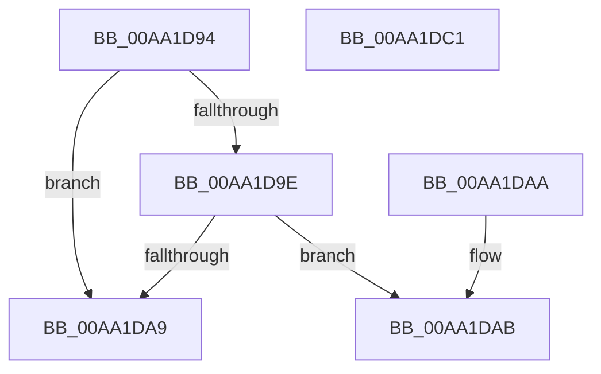

# PopNetUpdateCsConsumptionFlags

- RVA: `0x00AA1D94`–`0x00AA1DC2` (길이 `46` bytes)
- VA: `0x0000000140AA1D94`
- 실행 섹션: `PAGE`
- PDB 이름 있음: `예`; PDB Function 태그: `아니요`
- unwind 정보 RVA: `0x000DB714`
- 디코드: `14`개 명령, `46/46` bytes 표시
- 미해석 바이트: `0` (있으면 어셈블리에 `.byte`로 보존)

> 이 문서는 커널 이미지의 기계어와 PDB 기호를 분석해 생성했습니다. 4번과 5번은 함수 원형과 자료형을 바이너리 사용 방식에서 추정한 C 해석이며 원본 소스 복구 결과는 아닙니다.

## 1. Dependencies

- 직접 호출 지점: **0**; 고유 호출 대상: **0**
- 직접 호출자로 확인된 함수: **2**
- RIP 상대 이미지 참조: **4**

### Outgoing calls
- 직접 디코드된 call 명령이 없습니다.

### Direct callers
- [PopNetEvaluationWorkerCallback](../../text/4B/PopNetEvaluationWorkerCallback_function_004BE0B0.md) at `0x004BE1CA`
- [PopPdcCsDeviceNotification](PopPdcCsDeviceNotification_function_00AA1B28.md) at `0x00AA1C56`

### Static image references
- `0x00AA1D94` → RVA `0x00E27D08` (`.data`; read)
- `0x00AA1D9E` → RVA `0x00E27DD9` (`.data`; read)
- `0x00AA1DAB` → RVA `0x00F08874` (`.data`; read)
- `0x00AA1DBA` → RVA `0x00E27DD9` (`.data`; write)

## 2. Other-region calls and transfers

- 다른 실행 섹션으로 향하는 call: **0**
- 별도 외부 분기/꼬리 이동을 확인하지 못했습니다.

## 3. Assembly (complete function range)

```asm
00AA1D94  48 83 3D 6C 5F 38 00 00         cmp qword ptr [rip + 0x385f6c], 0
00AA1D9C  74 0B                           je 0x140aa1da9
00AA1D9E  8A 0D 35 60 38 00               mov cl, byte ptr [rip + 0x386035]
00AA1DA4  F6 C1 01                        test cl, 1
00AA1DA7  74 02                           je 0x140aa1dab
00AA1DA9  C3                              ret
00AA1DAA  CC                              int3
00AA1DAB  83 3D C2 6A 46 00 00            cmp dword ptr [rip + 0x466ac2], 0
00AA1DB2  0F 95 C0                        setne al
00AA1DB5  80 E1 FE                        and cl, 0xfe
00AA1DB8  0A C8                           or cl, al
00AA1DBA  88 0D 19 60 38 00               mov byte ptr [rip + 0x386019], cl
00AA1DC0  C3                              ret
00AA1DC1  CC                              int3
```

## 4. C-style interpretation (structured pseudocode)

```c
__int64 __fastcall PopNetUpdateCsConsumptionFlags(void)
{
    __int64 result;

    if ((*(unsigned __int64 *)(v_rip + 3694444)) == 0) goto loc_00AA1DA9;
    if ((((unsigned __int8)(*(unsigned __int8 *)(v_rip + 3694645))) & (1)) == 0) goto loc_00AA1DAB;
loc_00AA1DA9:
    return result;
loc_00AA1DAB:
    result = ((*(unsigned int *)(v_rip + 4614850)) != 0) ? 1 : 0;
    a1 = (unsigned __int8)((*(unsigned __int8 *)(v_rip + 3694645)) & (254));
    a1 = (unsigned __int8)((a1) | ((unsigned __int8)(result)));
    *(unsigned __int8 *)(v_rip + 3694617) = (unsigned __int8)(a1);
    return result;
}
```

## 5. (Beta) C Style

```c
void PopNetUpdateCsConsumptionFlags(void)
{
    int64_t result;

    if ((*(uint64_t *)(v_rip + 0x385F6C)) == 0) goto loc_00AA1DA9;
    if ((((uint8_t)(*(uint8_t *)(v_rip + 0x386035))) & (1)) == 0) goto loc_00AA1DAB;
loc_00AA1DA9:
    return result;
loc_00AA1DAB:
    result = ((*(uint32_t *)(v_rip + 0x466AC2)) != 0) ? 1 : 0;
    a1 = (uint8_t)((*(uint8_t *)(v_rip + 0x386035)) & (254));
    a1 = (uint8_t)((a1) | ((uint8_t)(result)));
    *(uint8_t *)(v_rip + 0x386019) = (uint8_t)(a1);
    return result;
}
```

## 6. Execution-region graph

[열기: 2D/3D 그래프와 함수 탐색 컨트롤 패널](../../../control-panel.html?section=page&rva=0x00AA1D94&view=graph)

- 2D 그래프는 위에서 아래로 흐르고, 3D 그래프는 빈 공간을 드래그해 회전합니다. Shift+드래그는 이동, 휠은 확대·축소, 함수 노드 선택은 대상 보고서 이동입니다.

### Static fallback


