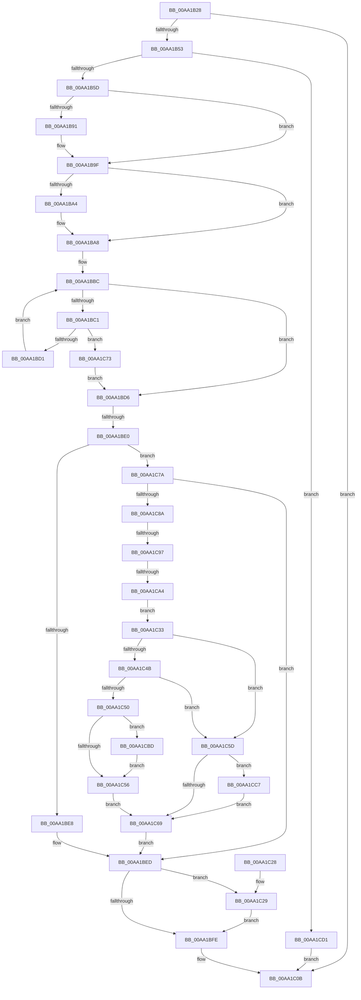

# PopPdcCsDeviceNotification

- RVA: `0x00AA1B28`–`0x00AA1CDB` (길이 `435` bytes)
- VA: `0x0000000140AA1B28`
- 실행 섹션: `PAGE`
- PDB 이름 있음: `예`; PDB Function 태그: `예`
- unwind 정보 RVA: `0x000BAD84`
- 디코드: `112`개 명령, `435/435` bytes 표시
- 미해석 바이트: `0` (있으면 어셈블리에 `.byte`로 보존)

> 이 문서는 커널 이미지의 기계어와 PDB 기호를 분석해 생성했습니다. 4번과 5번은 함수 원형과 자료형을 바이너리 사용 방식에서 추정한 C 해석이며 원본 소스 복구 결과는 아닙니다.

## 1. Dependencies

- 직접 호출 지점: **13**; 고유 호출 대상: **13**
- 직접 호출자로 확인된 함수: **2**
- RIP 상대 이미지 참조: **4**

### Outgoing calls
- `0x00AA1B46` → [PopIsPlatformAoAcCapable](../../text/49/PopIsPlatformAoAcCapable_function_0049BF40.md) (function, `0x0049BF40`)
- `0x00AA1B81` → [KeAbPreAcquire](../../text/21/KeAbPreAcquire_function_00210230.md) (function, `0x00210230`)
- `0x00AA1B9A` → [ExfAcquirePushLockExclusiveEx](../../text/20/ExfAcquirePushLockExclusiveEx_function_0020FC90.md) (function, `0x0020FC90`)
- `0x00AA1C01` → [KeAbPostRelease](../../text/2E/KeAbPostRelease_function_002E1600.md) (function, `0x002E1600`)
- `0x00AA1C06` → [KeLeaveCriticalRegion](../../text/25/KeLeaveCriticalRegion_function_0025D8B0.md) (function, `0x0025D8B0`)
- `0x00AA1C2C` → [ExfTryToWakePushLock](../../text/26/ExfTryToWakePushLock_function_00265DD0.md) (function, `0x00265DD0`)
- `0x00AA1C33` → [PopPdcUpdateDeviceCompliance](PopPdcUpdateDeviceCompliance_function_00AA1CE4.md) (function, `0x00AA1CE4`)
- `0x00AA1C38` → [PopAcquirePolicyLock](../../pagelk/B7/PopAcquirePolicyLock_function_00B783C0.md) (function, `0x00B783C0`)
- `0x00AA1C56` → [PopNetUpdateCsConsumptionFlags](PopNetUpdateCsConsumptionFlags_function_00AA1D94.md) (function, `0x00AA1D94`)
- `0x00AA1C69` → [PopReleasePolicyLock](../../pagelk/B7/PopReleasePolicyLock_function_00B78410.md) (function, `0x00B78410`)
- `0x00AA1CB3` → [ExFreePoolWithTag](../../poolcode/B8/ExFreePoolWithTag_function_00B82870.md) (function, `0x00B82870`)
- `0x00AA1CC0` → [PopNetCompliantNicUpdate](../76/PopNetCompliantNicUpdate_function_00768A40.md) (function, `0x00768A40`)
- `0x00AA1CCA` → [PopNetNonCompliantDeviceUpdate](../76/PopNetNonCompliantDeviceUpdate_function_00768CB0.md) (function, `0x00768CB0`)

### Direct callers
- [NtPowerInformation](../95/NtPowerInformation_function_00955D80.md) at `0x0095776F`
- [PopPdcCsCheckSystemVolumeDevice](../../init/C4/PopPdcCsCheckSystemVolumeDevice_function_00C42D9C.md) at `0x00C42EC8`

### Static image references
- `0x00AA1B66` → RVA `0x00F08450` (`.data`; read)
- `0x00AA1BA8` → RVA `0x00E08228` (`.data`; read)
- `0x00AA1BED` → RVA `0x00F08450` (`.data`; read/write)
- `0x00AA1C5D` → RVA `0x00E679C0` (`.data`; read)

## 2. Other-region calls and transfers

- 다른 실행 섹션으로 향하는 call: **9**
  - `0x00AA1B46` → [PopIsPlatformAoAcCapable](../../text/49/PopIsPlatformAoAcCapable_function_0049BF40.md) (`PAGE` → `.text`)
  - `0x00AA1B81` → [KeAbPreAcquire](../../text/21/KeAbPreAcquire_function_00210230.md) (`PAGE` → `.text`)
  - `0x00AA1B9A` → [ExfAcquirePushLockExclusiveEx](../../text/20/ExfAcquirePushLockExclusiveEx_function_0020FC90.md) (`PAGE` → `.text`)
  - `0x00AA1C01` → [KeAbPostRelease](../../text/2E/KeAbPostRelease_function_002E1600.md) (`PAGE` → `.text`)
  - `0x00AA1C06` → [KeLeaveCriticalRegion](../../text/25/KeLeaveCriticalRegion_function_0025D8B0.md) (`PAGE` → `.text`)
  - `0x00AA1C2C` → [ExfTryToWakePushLock](../../text/26/ExfTryToWakePushLock_function_00265DD0.md) (`PAGE` → `.text`)
  - `0x00AA1C38` → [PopAcquirePolicyLock](../../pagelk/B7/PopAcquirePolicyLock_function_00B783C0.md) (`PAGE` → `PAGELK`)
  - `0x00AA1C69` → [PopReleasePolicyLock](../../pagelk/B7/PopReleasePolicyLock_function_00B78410.md) (`PAGE` → `PAGELK`)
  - `0x00AA1CB3` → [ExFreePoolWithTag](../../poolcode/B8/ExFreePoolWithTag_function_00B82870.md) (`PAGE` → `POOLCODE`)
- call이 아닌 외부 분기/꼬리 이동: **3**
  - `0x00AA1BDA` → [sub_00B4980C](../B4/Unknown_function_00B4980C.md) (`tail-transfer`)
  - `0x00AA1C91` → [sub_00B4980C + 0x6D](../B4/Unknown_function_00B4980C.md) (`tail-transfer`)
  - `0x00AA1C9E` → [sub_00B4980C + 0x6D](../B4/Unknown_function_00B4980C.md) (`tail-transfer`)

## 3. Assembly (complete function range)

```asm
00AA1B28  48 8B C4                        mov rax, rsp
00AA1B2B  48 89 58 08                     mov qword ptr [rax + 8], rbx
00AA1B2F  48 89 68 10                     mov qword ptr [rax + 0x10], rbp
00AA1B33  48 89 70 18                     mov qword ptr [rax + 0x18], rsi
00AA1B37  48 89 78 20                     mov qword ptr [rax + 0x20], rdi
00AA1B3B  41 56                           push r14
00AA1B3D  48 83 EC 20                     sub rsp, 0x20
00AA1B41  48 8B F1                        mov rsi, rcx
00AA1B44  33 FF                           xor edi, edi
00AA1B46  E8 F5 A3 9F FF                  call 0x14049bf40
00AA1B4B  84 C0                           test al, al
00AA1B4D  0F 84 B8 00 00 00               je 0x140aa1c0b
00AA1B53  83 79 08 04                     cmp dword ptr [rcx + 8], 4
00AA1B57  0F 87 74 01 00 00               ja 0x140aa1cd1
00AA1B5D  65 48 8B 04 25 88 01 00 00      mov rax, qword ptr gs:[0x188]
00AA1B66  4C 8D 35 E3 68 46 00            lea r14, [rip + 0x4668e3]
00AA1B6D  48 83 CB FF                     or rbx, 0xffffffffffffffff
00AA1B71  45 33 C0                        xor r8d, r8d
00AA1B74  33 D2                           xor edx, edx
00AA1B76  49 8B CE                        mov rcx, r14
00AA1B79  66 01 98 E4 01 00 00            add word ptr [rax + 0x1e4], bx
00AA1B80  90                              nop
00AA1B81  E8 AA E6 76 FF                  call 0x140210230
00AA1B86  F0 49 0F BA 2E 00               lock bts qword ptr [r14], 0
00AA1B8C  48 8B E8                        mov rbp, rax
00AA1B8F  73 0E                           jae 0x140aa1b9f
00AA1B91  4D 8B C6                        mov r8, r14
00AA1B94  48 8B D0                        mov rdx, rax
00AA1B97  49 8B CE                        mov rcx, r14
00AA1B9A  E8 F1 E0 76 FF                  call 0x14020fc90
00AA1B9F  48 85 ED                        test rbp, rbp
00AA1BA2  74 04                           je 0x140aa1ba8
00AA1BA4  C6 45 0A 01                     mov byte ptr [rbp + 0xa], 1
00AA1BA8  48 8B 0D 79 66 36 00            mov rcx, qword ptr [rip + 0x366679]
00AA1BAF  48 8D 2D 72 66 36 00            lea rbp, [rip + 0x366672]
00AA1BB6  4C 8B C7                        mov r8, rdi
00AA1BB9  40 8A D7                        mov dl, dil
00AA1BBC  48 3B CD                        cmp rcx, rbp
00AA1BBF  74 15                           je 0x140aa1bd6
00AA1BC1  48 8B 06                        mov rax, qword ptr [rsi]
00AA1BC4  4C 8B C1                        mov r8, rcx
00AA1BC7  48 39 41 10                     cmp qword ptr [rcx + 0x10], rax
00AA1BCB  0F 84 A2 00 00 00               je 0x140aa1c73
00AA1BD1  48 8B 09                        mov rcx, qword ptr [rcx]
00AA1BD4  EB E6                           jmp 0x140aa1bbc
00AA1BD6  40 38 7E 0C                     cmp byte ptr [rsi + 0xc], dil
00AA1BDA  0F 85 2C 7C 0A 00               jne 0x140b4980c
00AA1BE0  84 D2                           test dl, dl
00AA1BE2  0F 85 92 00 00 00               jne 0x140aa1c7a
00AA1BE8  BF 0D 00 00 C0                  mov edi, 0xc000000d
00AA1BED  F0 48 0F C1 1D 5A 68 46 00      lock xadd qword ptr [rip + 0x46685a], rbx
00AA1BF6  80 E3 06                        and bl, 6
00AA1BF9  80 FB 02                        cmp bl, 2
00AA1BFC  74 2B                           je 0x140aa1c29
00AA1BFE  49 8B CE                        mov rcx, r14
00AA1C01  E8 FA F9 83 FF                  call 0x1402e1600
00AA1C06  E8 A5 BC 7B FF                  call 0x14025d8b0
00AA1C0B  48 8B 5C 24 30                  mov rbx, qword ptr [rsp + 0x30]
00AA1C10  8B C7                           mov eax, edi
00AA1C12  48 8B 7C 24 48                  mov rdi, qword ptr [rsp + 0x48]
00AA1C17  48 8B 6C 24 38                  mov rbp, qword ptr [rsp + 0x38]
00AA1C1C  48 8B 74 24 40                  mov rsi, qword ptr [rsp + 0x40]
00AA1C21  48 83 C4 20                     add rsp, 0x20
00AA1C25  41 5E                           pop r14
00AA1C27  C3                              ret
00AA1C28  CC                              int3
00AA1C29  49 8B CE                        mov rcx, r14
00AA1C2C  E8 9F 41 7C FF                  call 0x140265dd0
00AA1C31  EB CB                           jmp 0x140aa1bfe
00AA1C33  E8 AC 00 00 00                  call 0x140aa1ce4
00AA1C38  E8 83 67 0D 00                  call 0x140b783c0
00AA1C3D  48 63 56 08                     movsxd rdx, dword ptr [rsi + 8]
00AA1C41  8D 42 FF                        lea eax, [rdx - 1]
00AA1C44  A9 FC FF FF FF                  test eax, 0xfffffffc
00AA1C49  75 12                           jne 0x140aa1c5d
00AA1C4B  83 FA 03                        cmp edx, 3
00AA1C4E  74 0D                           je 0x140aa1c5d
00AA1C50  40 38 7E 0D                     cmp byte ptr [rsi + 0xd], dil
00AA1C54  75 67                           jne 0x140aa1cbd
00AA1C56  E8 39 01 00 00                  call 0x140aa1d94
00AA1C5B  EB 0C                           jmp 0x140aa1c69
00AA1C5D  48 8D 0D 5C 5D 3C 00            lea rcx, [rip + 0x3c5d5c]
00AA1C64  39 1C 91                        cmp dword ptr [rcx + rdx*4], ebx
00AA1C67  74 5E                           je 0x140aa1cc7
00AA1C69  E8 A2 67 0D 00                  call 0x140b78410
00AA1C6E  E9 7A FF FF FF                  jmp 0x140aa1bed
00AA1C73  B2 01                           mov dl, 1
00AA1C75  E9 5C FF FF FF                  jmp 0x140aa1bd6
00AA1C7A  41 01 58 1C                     add dword ptr [r8 + 0x1c], ebx
00AA1C7E  41 8B 40 1C                     mov eax, dword ptr [r8 + 0x1c]
00AA1C82  85 C0                           test eax, eax
00AA1C84  0F 8F 63 FF FF FF               jg 0x140aa1bed
00AA1C8A  48 8B 11                        mov rdx, qword ptr [rcx]
00AA1C8D  48 39 4A 08                     cmp qword ptr [rdx + 8], rcx
00AA1C91  0F 85 E2 7B 0A 00               jne 0x140b49879
00AA1C97  48 8B 41 08                     mov rax, qword ptr [rcx + 8]
00AA1C9B  48 39 08                        cmp qword ptr [rax], rcx
00AA1C9E  0F 85 D5 7B 0A 00               jne 0x140b49879
00AA1CA4  48 89 10                        mov qword ptr [rax], rdx
00AA1CA7  49 8B C8                        mov rcx, r8
00AA1CAA  48 89 42 08                     mov qword ptr [rdx + 8], rax
00AA1CAE  BA 43 53 43 6F                  mov edx, 0x6f435343
00AA1CB3  E8 B8 0B 0E 00                  call 0x140b82870
00AA1CB8  E9 76 FF FF FF                  jmp 0x140aa1c33
00AA1CBD  8A 4E 0C                        mov cl, byte ptr [rsi + 0xc]
00AA1CC0  E8 7B 6D CC FF                  call 0x140768a40
00AA1CC5  EB 8F                           jmp 0x140aa1c56
00AA1CC7  8A 4E 0C                        mov cl, byte ptr [rsi + 0xc]
00AA1CCA  E8 E1 6F CC FF                  call 0x140768cb0
00AA1CCF  EB 98                           jmp 0x140aa1c69
00AA1CD1  BF 0D 00 00 C0                  mov edi, 0xc000000d
00AA1CD6  E9 30 FF FF FF                  jmp 0x140aa1c0b
```

## 4. C-style interpretation (structured pseudocode)

```c
__int64 __fastcall PopPdcCsDeviceNotification(__int64 a1, int a2, int a3)
{
    __int64 result;
    __int64 v_rbx;
    __int64 v_rdi;
    __int64 v_rsp;
    unsigned __int64 v_stack_p10;
    unsigned __int64 v_stack_p18;
    unsigned __int64 v_stack_p20;
    unsigned __int64 v_stack_p8;

    *(unsigned __int64 *)(v_rsp + 8) = v_rbx;
    *(unsigned __int64 *)(v_rsp + 16) = v_rbp;
    *(unsigned __int64 *)(v_rsp + 24) = v_rsi;
    *(unsigned __int64 *)(v_rsp + 32) = v_rdi;
    v_rsp = (v_rsp) - (32);
    v_rdi = 0;
    result = PopIsPlatformAoAcCapable(a1, a2, a3, a4);
    if ((unsigned __int8)(result) == 0) goto loc_00AA1C0B;
    if ((*(unsigned int *)(a1 + 8)) > 4) goto loc_00AA1CD1;
    v_rbx = (v_rbx) | (-1);
    a3 = 0;
    a2 = 0;
    result = KeAbPreAcquire(v_rip + 4614371, a2, a3, a4);
    if (!(condition_is_above_or_equal)) {
        a3 = v_rip + 4614371;
        a2 = result;
        a1 = v_rip + 4614371;
        result = ExfAcquirePushLockExclusiveEx(a1, a2, a3, a4);
    }
    if (result != 0) {
        *(unsigned __int8 *)(result + 10) = 1;
    }
loc_00AA1BBC:
    if ((*(unsigned __int64 *)(v_rip + 3565177)) == (v_rip + 3565170)) goto loc_00AA1BD6;
    if ((*(unsigned __int64 *)(*(unsigned __int64 *)(v_rip + 3565177) + 16)) == (*(unsigned __int64 *)(a1))) goto loc_00AA1C73;
    goto loc_00AA1BBC;
loc_00AA1BD6:
    if (0 != 0) goto loc_00AA1C7A;
loc_00AA1BED:
    v_rbx = (unsigned __int8)((v_rbx) & (6));
    if (((unsigned __int8)(v_rbx)) == 2) goto loc_00AA1C29;
loc_00AA1BFE:
    result = KeAbPostRelease(v_rip + 4614371, 0, *(unsigned __int64 *)(v_rip + 3565177), a4);
    result = KeLeaveCriticalRegion(v_rip + 4614371, 0, *(unsigned __int64 *)(v_rip + 3565177), a4);
loc_00AA1C0B:
    v_rsp = (v_rsp) + (32);
    return (unsigned int)((unsigned int)((unsigned int)(0xC000000DULL)));
loc_00AA1C29:
    result = ExfTryToWakePushLock(v_rip + 4614371, 0, *(unsigned __int64 *)(v_rip + 3565177), a4);
    goto loc_00AA1BFE;
loc_00AA1C33:
    result = PopPdcUpdateDeviceCompliance(v_rip + 4614371, 0, *(unsigned __int64 *)(v_rip + 3565177), a4);
    result = PopAcquirePolicyLock(v_rip + 4614371, 0, *(unsigned __int64 *)(v_rip + 3565177), a4);
    if ((((unsigned int)((int)(*(unsigned int *)(v_stack_p18 + 8)) - 1)) & (0xFFFFFFFCULL)) != 0) goto loc_00AA1C5D;
    if (((unsigned int)((int)(*(unsigned int *)(v_stack_p18 + 8)))) == 3) goto loc_00AA1C5D;
    if ((*(unsigned __int8 *)(v_stack_p18 + 13)) != ((unsigned __int8)(v_stack_p20))) goto loc_00AA1CBD;
loc_00AA1C56:
    result = PopNetUpdateCsConsumptionFlags(v_rip + 4614371, (int)(*(unsigned int *)(v_stack_p18 + 8)), *(unsigned __int64 *)(v_rip + 3565177), a4);
    goto loc_00AA1C69;
loc_00AA1C5D:
    if ((*(unsigned int *)(v_rip + 3956060 + (int)(*(unsigned int *)(v_stack_p18 + 8)) * 4)) == ((unsigned int)(v_stack_p8))) goto loc_00AA1CC7;
loc_00AA1C69:
    result = PopReleasePolicyLock(v_rip + 3956060, (int)(*(unsigned int *)(v_stack_p18 + 8)), *(unsigned __int64 *)(v_rip + 3565177), a4);
    goto loc_00AA1BED;
loc_00AA1C73:
    goto loc_00AA1BD6;
loc_00AA1C7A:
    if (condition_is_greater) goto loc_00AA1BED;
    *(unsigned __int64 *)(*(unsigned __int64 *)(v_rip + 3956060 + 8)) = *(unsigned __int64 *)(v_rip + 3956060);
    *(unsigned __int64 *)(*(unsigned __int64 *)(v_rip + 3956060) + 8) = *(unsigned __int64 *)(v_rip + 3956060 + 8);
    result = ExFreePoolWithTag(*(unsigned __int64 *)(v_rip + 3565177), (unsigned int)(0x6F435343ULL), *(unsigned __int64 *)(v_rip + 3565177), a4);
    goto loc_00AA1C33;
loc_00AA1CBD:
    result = PopNetCompliantNicUpdate(*(unsigned __int8 *)(v_stack_p18 + 12), (unsigned int)(0x6F435343ULL), *(unsigned __int64 *)(v_rip + 3565177), a4);
    goto loc_00AA1C56;
loc_00AA1CC7:
    result = PopNetNonCompliantDeviceUpdate(*(unsigned __int8 *)(v_stack_p18 + 12), (unsigned int)(0x6F435343ULL), *(unsigned __int64 *)(v_rip + 3565177), a4);
    goto loc_00AA1C69;
loc_00AA1CD1:
    goto loc_00AA1C0B;
}
```

## 5. (Beta) C Style

```c
int64_t PopPdcCsDeviceNotification(void *Arg1, int32_t Arg2, int32_t Arg3)
{
    uint8_t *arg1 = (uint8_t *)Arg1;

    int64_t result;
    int64_t local_rbx;
    int64_t local_rdi;
    int64_t local_rsp;
    uint64_t v_stack_p10;
    uint64_t v_stack_p18;
    uint64_t v_stack_p20;
    uint64_t v_stack_p8;

    *(uint64_t *)(local_rsp + 0x8) = local_rbx;
    *(uint64_t *)(local_rsp + 0x10) = local_rbp;
    *(uint64_t *)(local_rsp + 0x18) = local_rsi;
    *(uint64_t *)(local_rsp + 0x20) = local_rdi;
    local_rsp = (local_rsp) - (32);
    local_rdi = 0;
    result = PopIsPlatformAoAcCapable(Arg1, Arg2, Arg3, a4);
    if ((uint8_t)(result) == 0) goto loc_00AA1C0B;
    if ((*(uint32_t *)(arg1 + 0x8)) > 4) goto loc_00AA1CD1;
    local_rbx = (local_rbx) | (-1);
    Arg3 = 0;
    Arg2 = 0;
    result = KeAbPreAcquire(v_rip + 4614371, Arg2, Arg3, a4);
    if (!(condition_is_above_or_equal)) {
        Arg3 = v_rip + 4614371;
        Arg2 = result;
        Arg1 = v_rip + 4614371;
        result = ExfAcquirePushLockExclusiveEx(Arg1, Arg2, Arg3, a4);
    }
    if (result != 0) {
        *(uint8_t *)(result + 0xA) = 1;
    }
loc_00AA1BBC:
    if ((*(uint64_t *)(v_rip + 0x366679)) == (v_rip + 3565170)) goto loc_00AA1BD6;
    if ((*(uint64_t *)(*(uint64_t *)(v_rip + 0x366679) + 0x10)) == (*(uint64_t *)(arg1))) goto loc_00AA1C73;
    goto loc_00AA1BBC;
loc_00AA1BD6:
    if (0 != 0) goto loc_00AA1C7A;
loc_00AA1BED:
    local_rbx = (uint8_t)((local_rbx) & (6));
    if (((uint8_t)(local_rbx)) == 2) goto loc_00AA1C29;
loc_00AA1BFE:
    result = KeAbPostRelease(v_rip + 4614371, 0, *(uint64_t *)(v_rip + 0x366679), a4);
    result = KeLeaveCriticalRegion(v_rip + 4614371, 0, *(uint64_t *)(v_rip + 0x366679), a4);
loc_00AA1C0B:
    local_rsp = (local_rsp) + (32);
    return (uint32_t)((uint32_t)((uint32_t)(0xC000000DULL)));
loc_00AA1C29:
    result = ExfTryToWakePushLock(v_rip + 4614371, 0, *(uint64_t *)(v_rip + 0x366679), a4);
    goto loc_00AA1BFE;
loc_00AA1C33:
    result = PopPdcUpdateDeviceCompliance(v_rip + 4614371, 0, *(uint64_t *)(v_rip + 0x366679), a4);
    result = PopAcquirePolicyLock(v_rip + 4614371, 0, *(uint64_t *)(v_rip + 0x366679), a4);
    if ((((uint32_t)((int32_t)(*(uint32_t *)(v_stack_p18 + 0x8)) - 1)) & (0xFFFFFFFCULL)) != 0) goto loc_00AA1C5D;
    if (((uint32_t)((int32_t)(*(uint32_t *)(v_stack_p18 + 0x8)))) == 3) goto loc_00AA1C5D;
    if ((*(uint8_t *)(v_stack_p18 + 0xD)) != ((uint8_t)(v_stack_p20))) goto loc_00AA1CBD;
loc_00AA1C56:
    result = PopNetUpdateCsConsumptionFlags(v_rip + 4614371, (int32_t)(*(uint32_t *)(v_stack_p18 + 0x8)), *(uint64_t *)(v_rip + 0x366679), a4);
    goto loc_00AA1C69;
loc_00AA1C5D:
    if ((*(uint32_t *)(v_rip + 0x3C5D5C + (int32_t)(*(uint32_t *)(v_stack_p18 + 0x8)) * 4)) == ((uint32_t)(v_stack_p8))) goto loc_00AA1CC7;
loc_00AA1C69:
    result = PopReleasePolicyLock(v_rip + 3956060, (int32_t)(*(uint32_t *)(v_stack_p18 + 0x8)), *(uint64_t *)(v_rip + 0x366679), a4);
    goto loc_00AA1BED;
loc_00AA1C73:
    goto loc_00AA1BD6;
loc_00AA1C7A:
    if (condition_is_greater) goto loc_00AA1BED;
    *(uint64_t *)(*(uint64_t *)(v_rip + 0x3C5D5C + 0x8)) = *(uint64_t *)(v_rip + 0x3C5D5C);
    *(uint64_t *)(*(uint64_t *)(v_rip + 0x3C5D5C) + 0x8) = *(uint64_t *)(v_rip + 0x3C5D5C + 0x8);
    result = ExFreePoolWithTag(*(uint64_t *)(v_rip + 0x366679), (uint32_t)(0x6F435343ULL), *(uint64_t *)(v_rip + 0x366679), a4);
    goto loc_00AA1C33;
loc_00AA1CBD:
    result = PopNetCompliantNicUpdate(*(uint8_t *)(v_stack_p18 + 0xC), (uint32_t)(0x6F435343ULL), *(uint64_t *)(v_rip + 0x366679), a4);
    goto loc_00AA1C56;
loc_00AA1CC7:
    result = PopNetNonCompliantDeviceUpdate(*(uint8_t *)(v_stack_p18 + 0xC), (uint32_t)(0x6F435343ULL), *(uint64_t *)(v_rip + 0x366679), a4);
    goto loc_00AA1C69;
loc_00AA1CD1:
    goto loc_00AA1C0B;
}
```

### 관측된 메모리 오프셋

구조체 형식이 확인되지 않은 접근은 인자 기준의 오프셋으로만 기록했습니다.

| 기준 인자 | 오프셋 표현 | 폭 (bit) | 접근 |
|---|---:|---:|---|
| `Arg1` | `+ 0x0` | `64` | `R` |
| `Arg1` | `+ 0x8` | `32` | `R` |
| `Arg1` | `+ 0xC` | `8` | `R` |
| `Arg1` | `+ 0xD` | `8` | `R` |

## 6. Execution-region graph

[열기: 2D/3D 그래프와 함수 탐색 컨트롤 패널](../../../control-panel.html?section=page&rva=0x00AA1B28&view=graph)

- 2D 그래프는 위에서 아래로 흐르고, 3D 그래프는 빈 공간을 드래그해 회전합니다. Shift+드래그는 이동, 휠은 확대·축소, 함수 노드 선택은 대상 보고서 이동입니다.

### Static fallback


