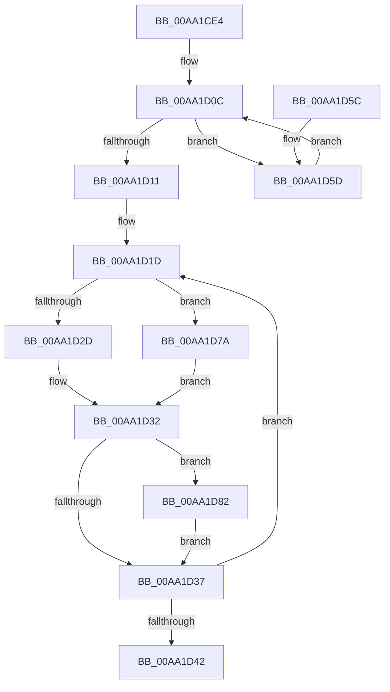

# PopPdcUpdateDeviceCompliance

- RVA: `0x00AA1CE4`–`0x00AA1D8B` (길이 `167` bytes)
- VA: `0x0000000140AA1CE4`
- 실행 섹션: `PAGE`
- PDB 이름 있음: `예`; PDB Function 태그: `아니요`
- unwind 정보 RVA: `0x000A34EC`
- 디코드: `52`개 명령, `167/167` bytes 표시
- 미해석 바이트: `0` (있으면 어셈블리에 `.byte`로 보존)

> 이 문서는 커널 이미지의 기계어와 PDB 기호를 분석해 생성했습니다. 4번과 5번은 함수 원형과 자료형을 바이너리 사용 방식에서 추정한 C 해석이며 원본 소스 복구 결과는 아닙니다.

## 1. Dependencies

- 직접 호출 지점: **3**; 고유 호출 대상: **3**
- 직접 호출자로 확인된 함수: **1**
- RIP 상대 이미지 참조: **2**

### Outgoing calls
- `0x00AA1D11` → [PopAcquirePolicyLock](../../pagelk/B7/PopAcquirePolicyLock_function_00B783C0.md) (function, `0x00B783C0`)
- `0x00AA1D42` → [PopReleasePolicyLock](../../pagelk/B7/PopReleasePolicyLock_function_00B78410.md) (function, `0x00B78410`)
- `0x00AA1D84` → [PopDiagTraceDeviceComplianceUpdate](../../text/5D/PopDiagTraceDeviceComplianceUpdate_function_005D6510.md) (function, `0x005D6510`)

### Direct callers
- [PopPdcCsDeviceNotification](PopPdcCsDeviceNotification_function_00AA1B28.md) at `0x00AA1C33`

### Static image references
- `0x00AA1CF8` → RVA `0x00E08228` (`.data`; read)
- `0x00AA1D16` → RVA `0x00E679C0` (`.data`; read)

## 2. Other-region calls and transfers

- 다른 실행 섹션으로 향하는 call: **3**
  - `0x00AA1D11` → [PopAcquirePolicyLock](../../pagelk/B7/PopAcquirePolicyLock_function_00B783C0.md) (`PAGE` → `PAGELK`)
  - `0x00AA1D42` → [PopReleasePolicyLock](../../pagelk/B7/PopReleasePolicyLock_function_00B78410.md) (`PAGE` → `PAGELK`)
  - `0x00AA1D84` → [PopDiagTraceDeviceComplianceUpdate](../../text/5D/PopDiagTraceDeviceComplianceUpdate_function_005D6510.md) (`PAGE` → `.text`)
- 별도 외부 분기/꼬리 이동을 확인하지 못했습니다.

## 3. Assembly (complete function range)

```asm
00AA1CE4  48 89 5C 24 08                  mov qword ptr [rsp + 8], rbx
00AA1CE9  48 89 6C 24 10                  mov qword ptr [rsp + 0x10], rbp
00AA1CEE  48 89 74 24 18                  mov qword ptr [rsp + 0x18], rsi
00AA1CF3  57                              push rdi
00AA1CF4  48 83 EC 20                     sub rsp, 0x20
00AA1CF8  4C 8B 05 29 65 36 00            mov r8, qword ptr [rip + 0x366529]
00AA1CFF  4C 8D 0D 22 65 36 00            lea r9, [rip + 0x366522]
00AA1D06  33 DB                           xor ebx, ebx
00AA1D08  8B FB                           mov edi, ebx
00AA1D0A  8B EB                           mov ebp, ebx
00AA1D0C  4D 3B C1                        cmp r8, r9
00AA1D0F  75 4C                           jne 0x140aa1d5d
00AA1D11  E8 AA 66 0D 00                  call 0x140b783c0
00AA1D16  48 8D 35 A3 5C 3C 00            lea rsi, [rip + 0x3c5ca3]
00AA1D1D  44 8B 06                        mov r8d, dword ptr [rsi]
00AA1D20  8B CB                           mov ecx, ebx
00AA1D22  B8 01 00 00 00                  mov eax, 1
00AA1D27  D3 E0                           shl eax, cl
00AA1D29  85 C7                           test edi, eax
00AA1D2B  74 4D                           je 0x140aa1d7a
00AA1D2D  BA 01 00 00 00                  mov edx, 1
00AA1D32  41 3B D0                        cmp edx, r8d
00AA1D35  75 4B                           jne 0x140aa1d82
00AA1D37  FF C3                           inc ebx
00AA1D39  48 83 C6 04                     add rsi, 4
00AA1D3D  83 FB 05                        cmp ebx, 5
00AA1D40  72 DB                           jb 0x140aa1d1d
00AA1D42  E8 C9 66 0D 00                  call 0x140b78410
00AA1D47  48 8B 5C 24 30                  mov rbx, qword ptr [rsp + 0x30]
00AA1D4C  48 8B 6C 24 38                  mov rbp, qword ptr [rsp + 0x38]
00AA1D51  48 8B 74 24 40                  mov rsi, qword ptr [rsp + 0x40]
00AA1D56  48 83 C4 20                     add rsp, 0x20
00AA1D5A  5F                              pop rdi
00AA1D5B  C3                              ret
00AA1D5C  CC                              int3
00AA1D5D  41 8B 48 18                     mov ecx, dword ptr [r8 + 0x18]
00AA1D61  8B D7                           mov edx, edi
00AA1D63  BF 01 00 00 00                  mov edi, 1
00AA1D68  D3 E7                           shl edi, cl
00AA1D6A  0B EF                           or ebp, edi
00AA1D6C  0B FA                           or edi, edx
00AA1D6E  41 38 58 20                     cmp byte ptr [r8 + 0x20], bl
00AA1D72  4D 8B 00                        mov r8, qword ptr [r8]
00AA1D75  0F 44 FA                        cmove edi, edx
00AA1D78  EB 92                           jmp 0x140aa1d0c
00AA1D7A  23 C5                           and eax, ebp
00AA1D7C  F7 D8                           neg eax
00AA1D7E  1B D2                           sbb edx, edx
00AA1D80  EB B0                           jmp 0x140aa1d32
00AA1D82  89 16                           mov dword ptr [rsi], edx
00AA1D84  E8 87 47 B3 FF                  call 0x1405d6510
00AA1D89  EB AC                           jmp 0x140aa1d37
```

## 4. C-style interpretation (structured pseudocode)

```c
__int64 __fastcall PopPdcUpdateDeviceCompliance(void)
{
    __int64 result;
    __int64 v_rbp;
    __int64 v_rbx;
    __int64 v_rdi;
    __int64 v_rsi;
    __int64 v_rsp;
    unsigned __int64 v_stack_p10;
    unsigned __int64 v_stack_p18;
    unsigned __int64 v_stack_p8;

    v_stack_p8 = v_rbx;
    v_stack_p10 = v_rbp;
    v_stack_p18 = v_rsi;
    v_rsp = (v_rsp) - (32);
    v_rbx = 0;
loc_00AA1D0C:
    if ((*(unsigned __int64 *)(v_rip + 3564841)) != (v_rip + 3564834)) goto loc_00AA1D5D;
    result = PopAcquirePolicyLock(a1, a2, *(unsigned __int64 *)(v_rip + 3564841), v_rip + 3564834);
loc_00AA1D1D:
    result = (unsigned int)((1) << (0));
    if (((0) & ((unsigned int)(result))) == 0) goto loc_00AA1D7A;
loc_00AA1D32:
    if (1 != ((unsigned int)((unsigned int)(*(unsigned int *)(v_rip + 3955875))))) goto loc_00AA1D82;
loc_00AA1D37:
    v_rbx = (unsigned int)((v_rbx) + 1);
    v_rsi = (v_rip + 3955875) + (4);
    if (((unsigned int)(v_rbx)) < 5) goto loc_00AA1D1D;
    result = PopReleasePolicyLock(0, 1, (unsigned int)(*(unsigned int *)(v_rip + 3955875)), v_rip + 3564834);
    v_rsp = (v_rsp) + (32);
    return result;
loc_00AA1D5D:
    v_rdi = (unsigned int)((1) << ((unsigned __int8)((unsigned int)(*(unsigned int *)((unsigned int)(*(unsigned int *)(v_rip + 3955875)) + 24)))));
    v_rbp = (unsigned int)((v_stack_p10) | ((unsigned int)(v_rdi)));
    v_rdi = (unsigned int)((v_rdi) | (0));
    if ((*(unsigned __int8 *)((unsigned int)(*(unsigned int *)(v_rip + 3955875)) + 32)) == ((unsigned __int8)(v_stack_p8))) { v_rdi = 0; }
    goto loc_00AA1D0C;
loc_00AA1D7A:
    result = (unsigned int)((result) & ((unsigned int)(v_rbp)));
    result = (unsigned int)(-(result));
    goto loc_00AA1D32;
loc_00AA1D82:
    *(unsigned int *)(v_stack_p18) = 0;
    result = PopDiagTraceDeviceComplianceUpdate((unsigned int)(*(unsigned int *)((unsigned int)(*(unsigned int *)(v_rip + 3955875)) + 24)), 0, *(unsigned __int64 *)((unsigned int)(*(unsigned int *)(v_rip + 3955875))), v_rip + 3564834);
    goto loc_00AA1D37;
}
```

## 5. (Beta) C Style

```c
void PopPdcUpdateDeviceCompliance(void)
{
    int64_t result;
    int64_t local_rbp;
    int64_t local_rbx;
    int64_t local_rdi;
    int64_t local_rsi;
    int64_t local_rsp;
    uint64_t v_stack_p10;
    uint64_t v_stack_p18;
    uint64_t v_stack_p8;

    v_stack_p8 = local_rbx;
    v_stack_p10 = local_rbp;
    v_stack_p18 = local_rsi;
    local_rsp = (local_rsp) - (32);
    local_rbx = 0;
loc_00AA1D0C:
    if ((*(uint64_t *)(v_rip + 0x366529)) != (v_rip + 3564834)) goto loc_00AA1D5D;
    result = PopAcquirePolicyLock(a1, a2, *(uint64_t *)(v_rip + 0x366529), v_rip + 3564834);
loc_00AA1D1D:
    result = (uint32_t)((1) << (0));
    if (((0) & ((uint32_t)(result))) == 0) goto loc_00AA1D7A;
loc_00AA1D32:
    if (1 != ((uint32_t)((uint32_t)(*(uint32_t *)(v_rip + 0x3C5CA3))))) goto loc_00AA1D82;
loc_00AA1D37:
    local_rbx = (uint32_t)((local_rbx) + 1);
    local_rsi = (v_rip + 3955875) + (4);
    if (((uint32_t)(local_rbx)) < 5) goto loc_00AA1D1D;
    result = PopReleasePolicyLock(0, 1, (uint32_t)(*(uint32_t *)(v_rip + 0x3C5CA3)), v_rip + 3564834);
    local_rsp = (local_rsp) + (32);
    return result;
loc_00AA1D5D:
    local_rdi = (uint32_t)((1) << ((uint8_t)((uint32_t)(*(uint32_t *)((uint32_t)(*(uint32_t *)(v_rip + 0x3C5CA3)) + 0x18)))));
    local_rbp = (uint32_t)((v_stack_p10) | ((uint32_t)(local_rdi)));
    local_rdi = (uint32_t)((local_rdi) | (0));
    if ((*(uint8_t *)((uint32_t)(*(uint32_t *)(v_rip + 0x3C5CA3)) + 0x20)) == ((uint8_t)(v_stack_p8))) { local_rdi = 0; }
    goto loc_00AA1D0C;
loc_00AA1D7A:
    result = (uint32_t)((result) & ((uint32_t)(local_rbp)));
    result = (uint32_t)(-(result));
    goto loc_00AA1D32;
loc_00AA1D82:
    *(uint32_t *)(v_stack_p18) = 0;
    result = PopDiagTraceDeviceComplianceUpdate((uint32_t)(*(uint32_t *)((uint32_t)(*(uint32_t *)(v_rip + 0x3C5CA3)) + 0x18)), 0, *(uint64_t *)((uint32_t)(*(uint32_t *)(v_rip + 0x3C5CA3))), v_rip + 3564834);
    goto loc_00AA1D37;
}
```

## 6. Execution-region graph

[열기: 2D/3D 그래프와 함수 탐색 컨트롤 패널](../../../control-panel.html?section=page&rva=0x00AA1CE4&view=graph)

- 2D 그래프는 위에서 아래로 흐르고, 3D 그래프는 빈 공간을 드래그해 회전합니다. Shift+드래그는 이동, 휠은 확대·축소, 함수 노드 선택은 대상 보고서 이동입니다.

### Static fallback


