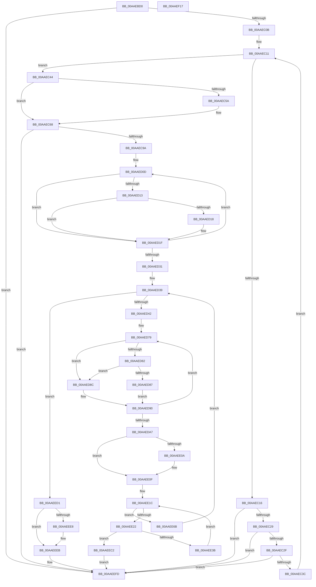

# PopPepRegisterDevice

- RVA: `0x00AAEBD0`–`0x00AAEF18` (길이 `840` bytes)
- VA: `0x0000000140AAEBD0`
- 실행 섹션: `PAGE`
- PDB 이름 있음: `예`; PDB Function 태그: `아니요`
- unwind 정보 RVA: `0x000BBDE4`
- 디코드: `212`개 명령, `840/840` bytes 표시
- 미해석 바이트: `0` (있으면 어셈블리에 `.byte`로 보존)

> 이 문서는 커널 이미지의 기계어와 PDB 기호를 분석해 생성했습니다. 4번과 5번은 함수 원형과 자료형을 바이너리 사용 방식에서 추정한 C 해석이며 원본 소스 복구 결과는 아닙니다.

## 1. Dependencies

- 직접 호출 지점: **8**; 고유 호출 대상: **7**
- 직접 호출자로 확인된 함수: **1**
- RIP 상대 이미지 참조: **3**

### Outgoing calls
- `0x00AAEC89` → [ExAllocatePool2](../../poolcode/B8/ExAllocatePool2_function_00B820F0.md) (function, `0x00B820F0`)
- `0x00AAECB3` → [DbgPrintEx](../../text/35/DbgPrintEx_function_00359290.md) (function, `0x00359290`)
- `0x00AAECDD` → [KeInitializeEvent](../../text/40/KeInitializeEvent_function_0040DD10.md) (function, `0x0040DD10`)
- `0x00AAEDB0` → [KeInitializeEvent](../../text/40/KeInitializeEvent_function_0040DD10.md) (function, `0x0040DD10`)
- `0x00AAEE78` → [PopPepComponentGetLatencyIdleState](../../text/46/PopPepComponentGetLatencyIdleState_function_00460A64.md) (function, `0x00460A64`)
- `0x00AAEE8A` → [PopPepComponentGetResidencyIdleState](../../text/45/PopPepComponentGetResidencyIdleState_function_00459038.md) (function, `0x00459038`)
- `0x00AAEECA` → [ExFreePoolWithTag](../../poolcode/B8/ExFreePoolWithTag_function_00B82870.md) (function, `0x00B82870`)
- `0x00AAEEF8` → [PopPepInsertDevice](../../text/4C/PopPepInsertDevice_function_004CBD58.md) (function, `0x004CBD58`)

### Direct callers
- [PopFxRegisterDeviceWithPep](../../text/4C/PopFxRegisterDeviceWithPep_function_004CF794.md) at `0x004CF8CF`

### Static image references
- `0x00AAECA2` → RVA `0x00B03DF0` (` ?? ::NNGAKEGL::`string'`; read)
- `0x00AAECFC` → RVA `0x00001030` (`.rdata`; read)
- `0x00AAED06` → RVA `0x00001360` (`.rdata`; read)

## 2. Other-region calls and transfers

- 다른 실행 섹션으로 향하는 call: **8**
  - `0x00AAEC89` → [ExAllocatePool2](../../poolcode/B8/ExAllocatePool2_function_00B820F0.md) (`PAGE` → `POOLCODE`)
  - `0x00AAECB3` → [DbgPrintEx](../../text/35/DbgPrintEx_function_00359290.md) (`PAGE` → `.text`)
  - `0x00AAECDD` → [KeInitializeEvent](../../text/40/KeInitializeEvent_function_0040DD10.md) (`PAGE` → `.text`)
  - `0x00AAEDB0` → [KeInitializeEvent](../../text/40/KeInitializeEvent_function_0040DD10.md) (`PAGE` → `.text`)
  - `0x00AAEE78` → [PopPepComponentGetLatencyIdleState](../../text/46/PopPepComponentGetLatencyIdleState_function_00460A64.md) (`PAGE` → `.text`)
  - `0x00AAEE8A` → [PopPepComponentGetResidencyIdleState](../../text/45/PopPepComponentGetResidencyIdleState_function_00459038.md) (`PAGE` → `.text`)
  - `0x00AAEECA` → [ExFreePoolWithTag](../../poolcode/B8/ExFreePoolWithTag_function_00B82870.md) (`PAGE` → `POOLCODE`)
  - `0x00AAEEF8` → [PopPepInsertDevice](../../text/4C/PopPepInsertDevice_function_004CBD58.md) (`PAGE` → `.text`)
- 별도 외부 분기/꼬리 이동을 확인하지 못했습니다.

## 3. Assembly (complete function range)

```asm
00AAEBD0  48 89 5C 24 08                  mov qword ptr [rsp + 8], rbx
00AAEBD5  44 89 4C 24 20                  mov dword ptr [rsp + 0x20], r9d
00AAEBDA  55                              push rbp
00AAEBDB  56                              push rsi
00AAEBDC  57                              push rdi
00AAEBDD  41 54                           push r12
00AAEBDF  41 55                           push r13
00AAEBE1  41 56                           push r14
00AAEBE3  41 57                           push r15
00AAEBE5  48 83 EC 40                     sub rsp, 0x40
00AAEBE9  48 8B 84 24 A0 00 00 00         mov rax, qword ptr [rsp + 0xa0]
00AAEBF1  33 DB                           xor ebx, ebx
00AAEBF3  4D 8B E0                        mov r12, r8
00AAEBF6  4C 8B FA                        mov r15, rdx
00AAEBF9  4C 8B E9                        mov r13, rcx
00AAEBFC  48 89 18                        mov qword ptr [rax], rbx
00AAEBFF  41 8B 68 08                     mov ebp, dword ptr [r8 + 8]
00AAEC03  85 ED                           test ebp, ebp
00AAEC05  0F 84 F2 02 00 00               je 0x140aaeefd
00AAEC0B  44 8B D3                        mov r10d, ebx
00AAEC0E  44 8B DB                        mov r11d, ebx
00AAEC11  44 3B DD                        cmp r11d, ebp
00AAEC14  73 2E                           jae 0x140aaec44
00AAEC16  41 8B C3                        mov eax, r11d
00AAEC19  49 8B 4C C0 10                  mov rcx, qword ptr [r8 + rax*8 + 0x10]
00AAEC1E  8B 41 1C                        mov eax, dword ptr [rcx + 0x1c]
00AAEC21  85 C0                           test eax, eax
00AAEC23  0F 84 D4 02 00 00               je 0x140aaeefd
00AAEC29  0F 88 CE 02 00 00               js 0x140aaeefd
00AAEC2F  42 8D 0C 10                     lea ecx, [rax + r10]
00AAEC33  41 3B CA                        cmp ecx, r10d
00AAEC36  0F 82 C1 02 00 00               jb 0x140aaeefd
00AAEC3C  44 8B D1                        mov r10d, ecx
00AAEC3F  41 FF C3                        inc r11d
00AAEC42  EB CD                           jmp 0x140aaec11
00AAEC44  69 C5 D0 00 00 00               imul eax, ebp, 0xd0
00AAEC4A  4C 8B F3                        mov r14, rbx
00AAEC4D  05 C0 00 00 00                  add eax, 0xc0
00AAEC52  48 63 F0                        movsxd rsi, eax
00AAEC55  45 85 D2                        test r10d, r10d
00AAEC58  74 0E                           je 0x140aaec68
00AAEC5A  41 8B C2                        mov eax, r10d
00AAEC5D  4C 8B F6                        mov r14, rsi
00AAEC60  48 8D 0C 40                     lea rcx, [rax + rax*2]
00AAEC64  48 8D 34 CE                     lea rsi, [rsi + rcx*8]
00AAEC68  8D 45 01                        lea eax, [rbp + 1]
00AAEC6B  41 B8 50 65 70 54               mov r8d, 0x54706550
00AAEC71  8D 04 40                        lea eax, [rax + rax*2]
00AAEC74  B9 40 00 00 00                  mov ecx, 0x40
00AAEC79  48 8D 04 80                     lea rax, [rax + rax*4]
00AAEC7D  48 8D 04 86                     lea rax, [rsi + rax*4]
00AAEC81  48 8B D0                        mov rdx, rax
00AAEC84  48 89 44 24 30                  mov qword ptr [rsp + 0x30], rax
00AAEC89  E8 62 34 0D 00                  call 0x140b820f0
00AAEC8E  48 8B F8                        mov rdi, rax
00AAEC91  48 85 C0                        test rax, rax
00AAEC94  0F 84 63 02 00 00               je 0x140aaeefd
00AAEC9A  4C 8B C8                        mov r9, rax
00AAEC9D  4C 89 6C 24 20                  mov qword ptr [rsp + 0x20], r13
00AAECA2  4C 8D 05 47 51 05 00            lea r8, [rip + 0x55147]
00AAECA9  BA 03 00 00 00                  mov edx, 3
00AAECAE  B9 92 00 00 00                  mov ecx, 0x92
00AAECB3  E8 D8 A5 8A FF                  call 0x140359290
00AAECB8  49 8D 04 3E                     lea rax, [r14 + rdi]
00AAECBC  4C 89 7F 20                     mov qword ptr [rdi + 0x20], r15
00AAECC0  48 89 84 24 90 00 00 00         mov qword ptr [rsp + 0x90], rax
00AAECC8  48 8D 4F 28                     lea rcx, [rdi + 0x28]
00AAECCC  49 8B 04 24                     mov rax, qword ptr [r12]
00AAECD0  4C 8D 34 37                     lea r14, [rdi + rsi]
00AAECD4  45 33 C0                        xor r8d, r8d
00AAECD7  48 89 47 18                     mov qword ptr [rdi + 0x18], rax
00AAECDB  33 D2                           xor edx, edx
00AAECDD  E8 2E F0 95 FF                  call 0x14040dd10
00AAECE2  4C 8D 47 48                     lea r8, [rdi + 0x48]
00AAECE6  89 AF B4 00 00 00               mov dword ptr [rdi + 0xb4], ebp
00AAECEC  49 8B D0                        mov rdx, r8
00AAECEF  89 AF 8C 00 00 00               mov dword ptr [rdi + 0x8c], ebp
00AAECF5  C6 87 88 00 00 00 01            mov byte ptr [rdi + 0x88], 1
00AAECFC  48 8D 05 2D 23 55 FF            lea rax, [rip - 0xaadcd3]
00AAED03  48 8B CB                        mov rcx, rbx
00AAED06  4C 8D 15 53 26 55 FF            lea r10, [rip - 0xaad9ad]
00AAED0D  48 83 F9 05                     cmp rcx, 5
00AAED11  77 0C                           ja 0x140aaed1f
00AAED13  80 38 01                        cmp byte ptr [rax], 1
00AAED16  75 07                           jne 0x140aaed1f
00AAED18  4C 89 32                        mov qword ptr [rdx], r14
00AAED1B  49 83 C6 14                     add r14, 0x14
00AAED1F  48 FF C1                        inc rcx
00AAED22  48 83 C2 08                     add rdx, 8
00AAED26  48 05 88 00 00 00               add rax, 0x88
00AAED2C  49 3B C2                        cmp rax, r10
00AAED2F  7C DC                           jl 0x140aaed0d
00AAED31  48 83 4F 10 01                  or qword ptr [rdi + 0x10], 1
00AAED36  44 8B FB                        mov r15d, ebx
00AAED39  44 3B FD                        cmp r15d, ebp
00AAED3C  0F 83 8F 01 00 00               jae 0x140aaeed1
00AAED42  41 8B C7                        mov eax, r15d
00AAED45  49 8B C8                        mov rcx, r8
00AAED48  48 69 F0 D0 00 00 00            imul rsi, rax, 0xd0
00AAED4F  4D 8B 6C C4 10                  mov r13, qword ptr [r12 + rax*8 + 0x10]
00AAED54  48 8B D3                        mov rdx, rbx
00AAED57  48 81 C6 C0 00 00 00            add rsi, 0xc0
00AAED5E  48 8D 05 CB 22 55 FF            lea rax, [rip - 0xaadd35]
00AAED65  48 03 F7                        add rsi, rdi
00AAED68  4C 8B C6                        mov r8, rsi
00AAED6B  4C 2B C7                        sub r8, rdi
00AAED6E  44 89 7E 08                     mov dword ptr [rsi + 8], r15d
00AAED72  C7 46 04 03 00 00 00            mov dword ptr [rsi + 4], 3
00AAED79  4D 8B CE                        mov r9, r14
00AAED7C  48 83 FA 05                     cmp rdx, 5
00AAED80  77 0A                           ja 0x140aaed8c
00AAED82  80 38 01                        cmp byte ptr [rax], 1
00AAED85  75 05                           jne 0x140aaed8c
00AAED87  4C 8B 09                        mov r9, qword ptr [rcx]
00AAED8A  EB 04                           jmp 0x140aaed90
00AAED8C  49 83 C6 14                     add r14, 0x14
00AAED90  4D 89 4C 08 F0                  mov qword ptr [r8 + rcx - 0x10], r9
00AAED95  48 FF C2                        inc rdx
00AAED98  48 83 C1 08                     add rcx, 8
00AAED9C  48 05 88 00 00 00               add rax, 0x88
00AAEDA2  49 3B C2                        cmp rax, r10
00AAEDA5  7C D2                           jl 0x140aaed79
00AAEDA7  48 8D 4E 20                     lea rcx, [rsi + 0x20]
00AAEDAB  45 33 C0                        xor r8d, r8d
00AAEDAE  33 D2                           xor edx, edx
00AAEDB0  E8 5B EF 95 FF                  call 0x14040dd10
00AAEDB5  49 8B 45 10                     mov rax, qword ptr [r13 + 0x10]
00AAEDB9  4C 8B 94 24 90 00 00 00         mov r10, qword ptr [rsp + 0x90]
00AAEDC1  48 89 46 10                     mov qword ptr [rsi + 0x10], rax
00AAEDC5  41 8B 45 1C                     mov eax, dword ptr [r13 + 0x1c]
00AAEDC9  89 86 BC 00 00 00               mov dword ptr [rsi + 0xbc], eax
00AAEDCF  8D 48 FF                        lea ecx, [rax - 1]
00AAEDD2  41 8B 45 18                     mov eax, dword ptr [r13 + 0x18]
00AAEDD6  3B C8                           cmp ecx, eax
00AAEDD8  0F 43 C8                        cmovae ecx, eax
00AAEDDB  41 89 4D 18                     mov dword ptr [r13 + 0x18], ecx
00AAEDDF  48 83 4E 70 FF                  or qword ptr [rsi + 0x70], 0xffffffffffffffff
00AAEDE4  48 89 5E 78                     mov qword ptr [rsi + 0x78], rbx
00AAEDE8  48 8B 46 50                     mov rax, qword ptr [rsi + 0x50]
00AAEDEC  89 8E 94 00 00 00               mov dword ptr [rsi + 0x94], ecx
00AAEDF2  4C 89 96 C8 00 00 00            mov qword ptr [rsi + 0xc8], r10
00AAEDF9  48 89 9E 80 00 00 00            mov qword ptr [rsi + 0x80], rbx
00AAEE00  83 08 04                        or dword ptr [rax], 4
00AAEE03  41 83 7D 1C 01                  cmp dword ptr [r13 + 0x1c], 1
00AAEE08  76 05                           jbe 0x140aaee0f
00AAEE0A  48 83 67 10 FE                  and qword ptr [rdi + 0x10], 0xfffffffffffffffe
00AAEE0F  49 C7 C1 F8 FF FF FF            mov r9, 0xfffffffffffffff8
00AAEE16  44 8B C3                        mov r8d, ebx
00AAEE19  4C 2B CF                        sub r9, rdi
00AAEE1C  45 3B 45 1C                     cmp r8d, dword ptr [r13 + 0x1c]
00AAEE20  73 49                           jae 0x140aaee6b
00AAEE22  48 8B 44 24 30                  mov rax, qword ptr [rsp + 0x30]
00AAEE27  49 8D 4A 08                     lea rcx, [r10 + 8]
00AAEE2B  49 03 C9                        add rcx, r9
00AAEE2E  48 83 C0 E8                     add rax, -0x18
00AAEE32  48 3B C8                        cmp rcx, rax
00AAEE35  0F 87 87 00 00 00               ja 0x140aaeec2
00AAEE3B  41 8B C0                        mov eax, r8d
00AAEE3E  48 8D 14 40                     lea rdx, [rax + rax*2]
00AAEE42  49 8B 45 20                     mov rax, qword ptr [r13 + 0x20]
00AAEE46  48 8B 0C D0                     mov rcx, qword ptr [rax + rdx*8]
00AAEE4A  49 89 0A                        mov qword ptr [r10], rcx
00AAEE4D  49 8B 45 20                     mov rax, qword ptr [r13 + 0x20]
00AAEE51  48 8B 4C D0 08                  mov rcx, qword ptr [rax + rdx*8 + 8]
00AAEE56  49 89 4A 08                     mov qword ptr [r10 + 8], rcx
00AAEE5A  49 83 C2 18                     add r10, 0x18
00AAEE5E  4C 89 94 24 90 00 00 00         mov qword ptr [rsp + 0x90], r10
00AAEE66  41 FF C0                        inc r8d
00AAEE69  EB B1                           jmp 0x140aaee1c
00AAEE6B  48 8B 56 70                     mov rdx, qword ptr [rsi + 0x70]
00AAEE6F  48 8B CE                        mov rcx, rsi
00AAEE72  89 9E 98 00 00 00               mov dword ptr [rsi + 0x98], ebx
00AAEE78  E8 E7 1B 9B FF                  call 0x140460a64
00AAEE7D  48 8B 56 78                     mov rdx, qword ptr [rsi + 0x78]
00AAEE81  48 8B CE                        mov rcx, rsi
00AAEE84  89 86 9C 00 00 00               mov dword ptr [rsi + 0x9c], eax
00AAEE8A  E8 A9 A1 9A FF                  call 0x140459038
00AAEE8F  89 86 A0 00 00 00               mov dword ptr [rsi + 0xa0], eax
00AAEE95  4C 8D 47 48                     lea r8, [rdi + 0x48]
00AAEE99  8B 86 BC 00 00 00               mov eax, dword ptr [rsi + 0xbc]
00AAEE9F  4C 8D 15 BA 24 55 FF            lea r10, [rip - 0xaadb46]
00AAEEA6  FF C8                           dec eax
00AAEEA8  89 86 A4 00 00 00               mov dword ptr [rsi + 0xa4], eax
00AAEEAE  41 FF C7                        inc r15d
00AAEEB1  89 86 A8 00 00 00               mov dword ptr [rsi + 0xa8], eax
00AAEEB7  89 86 AC 00 00 00               mov dword ptr [rsi + 0xac], eax
00AAEEBD  E9 77 FE FF FF                  jmp 0x140aaed39
00AAEEC2  BA 50 65 70 54                  mov edx, 0x54706550
00AAEEC7  48 8B CF                        mov rcx, rdi
00AAEECA  E8 A1 39 0D 00                  call 0x140b82870
00AAEECF  EB 2C                           jmp 0x140aaeefd
00AAEED1  83 BC 24 98 00 00 00 02         cmp dword ptr [rsp + 0x98], 2
00AAEED9  B3 01                           mov bl, 1
00AAEEDB  48 8B 84 24 A0 00 00 00         mov rax, qword ptr [rsp + 0xa0]
00AAEEE3  48 89 38                        mov qword ptr [rax], rdi
00AAEEE6  75 03                           jne 0x140aaeeeb
00AAEEE8  88 5F 7C                        mov byte ptr [rdi + 0x7c], bl
00AAEEEB  48 8B D7                        mov rdx, rdi
00AAEEEE  C7 87 A8 00 00 00 01 00 00 00   mov dword ptr [rdi + 0xa8], 1
00AAEEF8  E8 5B CE A1 FF                  call 0x1404cbd58
00AAEEFD  8A C3                           mov al, bl
00AAEEFF  48 8B 9C 24 80 00 00 00         mov rbx, qword ptr [rsp + 0x80]
00AAEF07  48 83 C4 40                     add rsp, 0x40
00AAEF0B  41 5F                           pop r15
00AAEF0D  41 5E                           pop r14
00AAEF0F  41 5D                           pop r13
00AAEF11  41 5C                           pop r12
00AAEF13  5F                              pop rdi
00AAEF14  5E                              pop rsi
00AAEF15  5D                              pop rbp
00AAEF16  C3                              ret
00AAEF17  CC                              int3
```

## 4. C-style interpretation (structured pseudocode)

```c
__int64 __fastcall PopPepRegisterDevice(__int64 a1, __int64 a2, __int64 a3, int a4, __int64 a5)
{
    __int64 result;
    __int64 v_r10;
    __int64 v_r11;
    __int64 v_r14;
    __int64 v_r15;
    __int64 v_rbx;
    __int64 v_rsi;
    __int64 v_rsp;
    unsigned __int64 v_stack_m48;
    unsigned __int64 v_stack_m58;
    unsigned __int64 v_stack_p18;
    unsigned int v_stack_p20;
    unsigned __int64 v_stack_p8;

    v_stack_p8 = v_rbx;
    v_stack_p20 = a4;
    v_rsp = (v_rsp) - (64);
    v_rbx = 0;
    *(unsigned __int64 *)(a5) = 0;
    if ((unsigned int)((unsigned int)(*(unsigned int *)(a3 + 8))) == 0) goto loc_00AAEEFD;
loc_00AAEC11:
    if (0 >= ((unsigned int)((unsigned int)(*(unsigned int *)(a3 + 8))))) goto loc_00AAEC44;
    if ((unsigned int)((unsigned int)(*(unsigned int *)(*(unsigned __int64 *)(a3 + 0 * 8 + 16) + 28))) == 0) goto loc_00AAEEFD;
    if (sign_flag) goto loc_00AAEEFD;
    if (((unsigned int)((unsigned int)(*(unsigned int *)(*(unsigned __int64 *)(a3 + 0 * 8 + 16) + 28)) + 0 * 1)) < 0) goto loc_00AAEEFD;
    v_r11 = (unsigned int)((0) + 1);
    goto loc_00AAEC11;
loc_00AAEC44:
    result = (unsigned int)(((unsigned int)(*(unsigned int *)(*(unsigned __int64 *)(a3 + 0 * 8 + 16) + 28))) * ((unsigned int)((unsigned int)(*(unsigned int *)(a3 + 8)))));
    result = (unsigned int)((result) + (192));
    v_rsi = (int)((unsigned int)(result));
    v_r14 = 0;
    if ((unsigned int)((unsigned int)((unsigned int)((unsigned int)(*(unsigned int *)(*(unsigned __int64 *)(a3 + 0 * 8 + 16) + 28)) + 0 * 1))) != 0) {
        result = (unsigned int)((unsigned int)((unsigned int)((unsigned int)(*(unsigned int *)(*(unsigned __int64 *)(a3 + 0 * 8 + 16) + 28)) + 0 * 1)));
        v_r14 = (int)((unsigned int)(result));
        a1 = result + result * 2;
        v_rsi = (int)((unsigned int)(result)) + a1 * 8;
    }
    v_stack_m48 = v_rsi + (unsigned int)(*(unsigned int *)(a3 + 8)) + 1 + (unsigned int)(*(unsigned int *)(a3 + 8)) + 1 * 2 + (unsigned int)(*(unsigned int *)(a3 + 8)) + 1 + (unsigned int)(*(unsigned int *)(a3 + 8)) + 1 * 2 * 4 * 4;
    result = ExAllocatePool2(64, v_rsi + (unsigned int)(*(unsigned int *)(a3 + 8)) + 1 + (unsigned int)(*(unsigned int *)(a3 + 8)) + 1 * 2 + (unsigned int)(*(unsigned int *)(a3 + 8)) + 1 + (unsigned int)(*(unsigned int *)(a3 + 8)) + 1 * 2 * 4 * 4, (unsigned int)(0x54706550ULL), a4);
    if (result == 0) goto loc_00AAEEFD;
    v_stack_m58 = a1;
    result = DbgPrintEx(146, 3, v_rip + 348487, result);
    *(unsigned __int64 *)(result + 32) = a2;
    v_stack_p18 = v_r14 + result * 1;
    a3 = 0;
    *(unsigned __int64 *)(result + 24) = *(unsigned __int64 *)(a3);
    a2 = 0;
    result = KeInitializeEvent(result + 40, a2, a3, result);
    *(unsigned int *)(result + 180) = (unsigned int)((unsigned int)(*(unsigned int *)(a3 + 8)));
    *(unsigned int *)(result + 140) = (unsigned int)((unsigned int)(*(unsigned int *)(a3 + 8)));
    *(unsigned __int8 *)(result + 136) = 1;
loc_00AAED0D:
    if (0 > 5) goto loc_00AAED1F;
    v_r14 = result + v_rsi * 1;
    if ((*(unsigned __int8 *)(v_rip - 11197651)) == 1) {
        *(unsigned __int64 *)(result + 72) = result + v_rsi * 1;
        v_r14 = (result + v_rsi * 1) + (20);
    }
    a1 = (0) + 1;
    a2 = (result + 72) + (8);
    result = (v_rip - 11197651) + (136);
    if (result < (v_rip - 11196845)) goto loc_00AAED0D;
loc_00AAED39:
    if (0 >= ((unsigned int)((unsigned int)(*(unsigned int *)(a3 + 8))))) goto loc_00AAEED1;
    v_rsi = (v_rsi) * (0);
    v_rsi = (v_rsi) + (192);
    v_rsi = (v_rsi) + (result);
    a3 = (v_rsi) - (result);
    *(unsigned int *)(v_rsi + 8) = 0;
    *(unsigned int *)(v_rsi + 4) = 3;
loc_00AAED79:
    if (0 > 5) goto loc_00AAED8C;
    if ((*(unsigned __int8 *)(v_rip - 11197749)) != 1) goto loc_00AAED8C;
    goto loc_00AAED90;
loc_00AAED8C:
    v_r14 = (v_r14) + (20);
loc_00AAED90:
    *(unsigned __int64 *)(a3 + result + 72 * 1 - 16) = *(unsigned __int64 *)(result + 72);
    a2 = (0) + 1;
    a1 = (result + 72) + (8);
    result = (v_rip - 11197749) + (136);
    if (result < (v_rip - 11196845)) goto loc_00AAED79;
    a3 = 0;
    a2 = 0;
    result = KeInitializeEvent(v_rsi + 32, a2, a3, *(unsigned __int64 *)(result + 72));
    *(unsigned __int64 *)(v_rsi + 16) = *(unsigned __int64 *)(*(unsigned __int64 *)(a3 + 0 * 8 + 16) + 16);
    *(unsigned int *)(v_rsi + 188) = (unsigned int)((unsigned int)(*(unsigned int *)(*(unsigned __int64 *)(a3 + 0 * 8 + 16) + 28)));
    a1 = (unsigned int)(*(unsigned int *)(*(unsigned __int64 *)(a3 + 0 * 8 + 16) + 28)) - 1;
    if (((unsigned int)((unsigned int)(*(unsigned int *)(*(unsigned __int64 *)(a3 + 0 * 8 + 16) + 28)) - 1)) >= ((unsigned int)((unsigned int)(*(unsigned int *)(*(unsigned __int64 *)(a3 + 0 * 8 + 16) + 24))))) { a1 = (unsigned int)((unsigned int)(*(unsigned int *)(*(unsigned __int64 *)(a3 + 0 * 8 + 16) + 24))); }
    *(unsigned int *)(*(unsigned __int64 *)(a3 + 0 * 8 + 16) + 24) = (unsigned int)(a1);
    *(unsigned __int64 *)(v_rsi + 120) = 0;
    *(unsigned int *)(v_rsi + 148) = (unsigned int)(a1);
    *(unsigned __int64 *)(v_rsi + 200) = v_stack_p18;
    *(unsigned __int64 *)(v_rsi + 128) = 0;
    if ((*(unsigned int *)(*(unsigned __int64 *)(a3 + 0 * 8 + 16) + 28)) >= = 1) {
    }
    a4 = (-8) - (result);
loc_00AAEE1C:
    if (0 >= (*(unsigned int *)(*(unsigned __int64 *)(a3 + 0 * 8 + 16) + 28))) goto loc_00AAEE6B;
    a1 = (v_stack_p18 + 8) + (a4);
    result = (v_stack_m48) + (-24);
    if (a1 > result) goto loc_00AAEEC2;
    *(unsigned __int64 *)(v_stack_p18) = *(unsigned __int64 *)(*(unsigned __int64 *)(*(unsigned __int64 *)(a3 + 0 * 8 + 16) + 32) + 0 + 0 * 2 * 8);
    *(unsigned __int64 *)(v_stack_p18 + 8) = *(unsigned __int64 *)(*(unsigned __int64 *)(*(unsigned __int64 *)(a3 + 0 * 8 + 16) + 32) + 0 + 0 * 2 * 8 + 8);
    v_r10 = (v_stack_p18) + (24);
    v_stack_p18 = v_r10;
    a3 = (unsigned int)((0) + 1);
    goto loc_00AAEE1C;
loc_00AAEE6B:
    *(unsigned int *)(v_rsi + 152) = 0;
    result = PopPepComponentGetLatencyIdleState(v_rsi, *(unsigned __int64 *)(v_rsi + 112), a3, a4);
    *(unsigned int *)(v_rsi + 156) = (unsigned int)(result);
    result = PopPepComponentGetResidencyIdleState(v_rsi, *(unsigned __int64 *)(v_rsi + 120), a3, a4);
    *(unsigned int *)(v_rsi + 160) = (unsigned int)(result);
    result = (unsigned int)(((unsigned int)(*(unsigned int *)(v_rsi + 188))) - 1);
    *(unsigned int *)(v_rsi + 164) = (unsigned int)(result);
    v_r15 = (unsigned int)((0) + 1);
    *(unsigned int *)(v_rsi + 168) = (unsigned int)(result);
    *(unsigned int *)(v_rsi + 172) = (unsigned int)(result);
    goto loc_00AAED39;
loc_00AAEEC2:
    result = ExFreePoolWithTag(result, (unsigned int)(0x54706550ULL), result + 72, a4);
    goto loc_00AAEEFD;
loc_00AAEED1:
    *(unsigned __int64 *)(a5) = result;
    if (v_stack_p20 == 2) {
        *(unsigned __int8 *)(result + 124) = 1;
    }
    *(unsigned int *)(result + 168) = 1;
    result = PopPepInsertDevice(result, result, result + 72, a4);
loc_00AAEEFD:
    v_rsp = (v_rsp) + (64);
    return 1;
}
```

## 5. (Beta) C Style

```c
int64_t PopPepRegisterDevice(int64_t Arg1, int64_t Arg2, void *Arg3, int32_t Arg4, void *Arg5)
{
    uint8_t *arg3 = (uint8_t *)Arg3;
    uint8_t *arg5 = (uint8_t *)Arg5;

    int64_t result;
    int64_t local_r10;
    int64_t local_r11;
    int64_t local_r14;
    int64_t local_r15;
    int64_t local_rbx;
    int64_t local_rsi;
    int64_t local_rsp;
    uint64_t v_stack_m48;
    uint64_t v_stack_m58;
    uint64_t v_stack_p18;
    uint32_t v_stack_p20;
    uint64_t v_stack_p8;

    v_stack_p8 = local_rbx;
    v_stack_p20 = Arg4;
    local_rsp = (local_rsp) - (64);
    local_rbx = 0;
    *(uint64_t *)(arg5) = 0;
    if ((uint32_t)((uint32_t)(*(uint32_t *)(arg3 + 0x8))) == 0) goto loc_00AAEEFD;
loc_00AAEC11:
    if (0 >= ((uint32_t)((uint32_t)(*(uint32_t *)(arg3 + 0x8))))) goto loc_00AAEC44;
    if ((uint32_t)((uint32_t)(*(uint32_t *)(*(uint64_t *)(arg3 + 0x0 * 8 + 0x10) + 0x1C))) == 0) goto loc_00AAEEFD;
    if (sign_flag) goto loc_00AAEEFD;
    if (((uint32_t)((uint32_t)(*(uint32_t *)(*(uint64_t *)(arg3 + 0x0 * 8 + 0x10) + 0x1C)) + 0 * 1)) < 0) goto loc_00AAEEFD;
    local_r11 = (uint32_t)((0) + 1);
    goto loc_00AAEC11;
loc_00AAEC44:
    result = (uint32_t)(((uint32_t)(*(uint32_t *)(*(uint64_t *)(arg3 + 0x0 * 8 + 0x10) + 0x1C))) * ((uint32_t)((uint32_t)(*(uint32_t *)(arg3 + 0x8)))));
    result = (uint32_t)((result) + (192));
    local_rsi = (int32_t)((uint32_t)(result));
    local_r14 = 0;
    if ((uint32_t)((uint32_t)((uint32_t)((uint32_t)(*(uint32_t *)(*(uint64_t *)(arg3 + 0x0 * 8 + 0x10) + 0x1C)) + 0 * 1))) != 0) {
        result = (uint32_t)((uint32_t)((uint32_t)((uint32_t)(*(uint32_t *)(*(uint64_t *)(arg3 + 0x0 * 8 + 0x10) + 0x1C)) + 0 * 1)));
        local_r14 = (int32_t)((uint32_t)(result));
        Arg1 = result + result * 2;
        local_rsi = (int32_t)((uint32_t)(result)) + Arg1 * 8;
    }
    v_stack_m48 = local_rsi + (uint32_t)(*(uint32_t *)(arg3 + 0x8)) + 1 + (uint32_t)(*(uint32_t *)(arg3 + 0x8)) + 1 * 2 + (uint32_t)(*(uint32_t *)(arg3 + 0x8)) + 1 + (uint32_t)(*(uint32_t *)(arg3 + 0x8)) + 1 * 2 * 4 * 4;
    result = ExAllocatePool2(64, local_rsi + (uint32_t)(*(uint32_t *)(arg3 + 0x8)) + 1 + (uint32_t)(*(uint32_t *)(arg3 + 0x8)) + 1 * 2 + (uint32_t)(*(uint32_t *)(arg3 + 0x8)) + 1 + (uint32_t)(*(uint32_t *)(arg3 + 0x8)) + 1 * 2 * 4 * 4, (uint32_t)(0x54706550ULL), Arg4);
    if (result == 0) goto loc_00AAEEFD;
    v_stack_m58 = Arg1;
    result = DbgPrintEx(146, 3, v_rip + 348487, result);
    *(uint64_t *)(result + 0x20) = Arg2;
    v_stack_p18 = local_r14 + result * 1;
    Arg3 = 0;
    *(uint64_t *)(result + 0x18) = *(uint64_t *)(arg3);
    Arg2 = 0;
    result = KeInitializeEvent(result + 40, Arg2, Arg3, result);
    *(uint32_t *)(result + 0xB4) = (uint32_t)((uint32_t)(*(uint32_t *)(arg3 + 0x8)));
    *(uint32_t *)(result + 0x8C) = (uint32_t)((uint32_t)(*(uint32_t *)(arg3 + 0x8)));
    *(uint8_t *)(result + 0x88) = 1;
loc_00AAED0D:
    if (0 > 5) goto loc_00AAED1F;
    local_r14 = result + local_rsi * 1;
    if ((*(uint8_t *)(v_rip - 0xAADCD3)) == 1) {
        *(uint64_t *)(result + 0x48) = result + local_rsi * 1;
        local_r14 = (result + local_rsi * 1) + (20);
    }
    Arg1 = (0) + 1;
    Arg2 = (result + 72) + (8);
    result = (v_rip - 11197651) + (136);
    if (result < (v_rip - 11196845)) goto loc_00AAED0D;
loc_00AAED39:
    if (0 >= ((uint32_t)((uint32_t)(*(uint32_t *)(arg3 + 0x8))))) goto loc_00AAEED1;
    local_rsi = (local_rsi) * (0);
    local_rsi = (local_rsi) + (192);
    local_rsi = (local_rsi) + (result);
    Arg3 = (local_rsi) - (result);
    *(uint32_t *)(local_rsi + 0x8) = 0;
    *(uint32_t *)(local_rsi + 0x4) = 3;
loc_00AAED79:
    if (0 > 5) goto loc_00AAED8C;
    if ((*(uint8_t *)(v_rip - 0xAADD35)) != 1) goto loc_00AAED8C;
    goto loc_00AAED90;
loc_00AAED8C:
    local_r14 = (local_r14) + (20);
loc_00AAED90:
    *(uint64_t *)(arg3 + result + 0x48 * 1 - 0x10) = *(uint64_t *)(result + 0x48);
    Arg2 = (0) + 1;
    Arg1 = (result + 72) + (8);
    result = (v_rip - 11197749) + (136);
    if (result < (v_rip - 11196845)) goto loc_00AAED79;
    Arg3 = 0;
    Arg2 = 0;
    result = KeInitializeEvent(local_rsi + 32, Arg2, Arg3, *(uint64_t *)(result + 0x48));
    *(uint64_t *)(local_rsi + 0x10) = *(uint64_t *)(*(uint64_t *)(arg3 + 0x0 * 8 + 0x10) + 0x10);
    *(uint32_t *)(local_rsi + 0xBC) = (uint32_t)((uint32_t)(*(uint32_t *)(*(uint64_t *)(arg3 + 0x0 * 8 + 0x10) + 0x1C)));
    Arg1 = (uint32_t)(*(uint32_t *)(*(uint64_t *)(arg3 + 0x0 * 8 + 0x10) + 0x1C)) - 1;
    if (((uint32_t)((uint32_t)(*(uint32_t *)(*(uint64_t *)(arg3 + 0x0 * 8 + 0x10) + 0x1C)) - 1)) >= ((uint32_t)((uint32_t)(*(uint32_t *)(*(uint64_t *)(arg3 + 0x0 * 8 + 0x10) + 0x18))))) { Arg1 = (uint32_t)((uint32_t)(*(uint32_t *)(*(uint64_t *)(arg3 + 0x0 * 8 + 0x10) + 0x18))); }
    *(uint32_t *)(*(uint64_t *)(arg3 + 0x0 * 8 + 0x10) + 0x18) = (uint32_t)(Arg1);
    *(uint64_t *)(local_rsi + 0x78) = 0;
    *(uint32_t *)(local_rsi + 0x94) = (uint32_t)(Arg1);
    *(uint64_t *)(local_rsi + 0xC8) = v_stack_p18;
    *(uint64_t *)(local_rsi + 0x80) = 0;
    if ((*(uint32_t *)(*(uint64_t *)(arg3 + 0x0 * 8 + 0x10) + 0x1C)) >= = 1) {
    }
    Arg4 = (-8) - (result);
loc_00AAEE1C:
    if (0 >= (*(uint32_t *)(*(uint64_t *)(arg3 + 0x0 * 8 + 0x10) + 0x1C))) goto loc_00AAEE6B;
    Arg1 = (v_stack_p18 + 8) + (Arg4);
    result = (v_stack_m48) + (-24);
    if (Arg1 > result) goto loc_00AAEEC2;
    *(uint64_t *)(v_stack_p18) = *(uint64_t *)(*(uint64_t *)(*(uint64_t *)(arg3 + 0x0 * 8 + 0x10) + 0x20) + 0x0 + 0x0 * 2 * 8);
    *(uint64_t *)(v_stack_p18 + 0x8) = *(uint64_t *)(*(uint64_t *)(*(uint64_t *)(arg3 + 0x0 * 8 + 0x10) + 0x20) + 0x0 + 0x0 * 2 * 8 + 0x8);
    local_r10 = (v_stack_p18) + (24);
    v_stack_p18 = local_r10;
    Arg3 = (uint32_t)((0) + 1);
    goto loc_00AAEE1C;
loc_00AAEE6B:
    *(uint32_t *)(local_rsi + 0x98) = 0;
    result = PopPepComponentGetLatencyIdleState(local_rsi, *(uint64_t *)(local_rsi + 0x70), Arg3, Arg4);
    *(uint32_t *)(local_rsi + 0x9C) = (uint32_t)(result);
    result = PopPepComponentGetResidencyIdleState(local_rsi, *(uint64_t *)(local_rsi + 0x78), Arg3, Arg4);
    *(uint32_t *)(local_rsi + 0xA0) = (uint32_t)(result);
    result = (uint32_t)(((uint32_t)(*(uint32_t *)(local_rsi + 0xBC))) - 1);
    *(uint32_t *)(local_rsi + 0xA4) = (uint32_t)(result);
    local_r15 = (uint32_t)((0) + 1);
    *(uint32_t *)(local_rsi + 0xA8) = (uint32_t)(result);
    *(uint32_t *)(local_rsi + 0xAC) = (uint32_t)(result);
    goto loc_00AAED39;
loc_00AAEEC2:
    result = ExFreePoolWithTag(result, (uint32_t)(0x54706550ULL), result + 72, Arg4);
    goto loc_00AAEEFD;
loc_00AAEED1:
    *(uint64_t *)(arg5) = result;
    if (v_stack_p20 == 2) {
        *(uint8_t *)(result + 0x7C) = 1;
    }
    *(uint32_t *)(result + 0xA8) = 1;
    result = PopPepInsertDevice(result, result, result + 72, Arg4);
loc_00AAEEFD:
    local_rsp = (local_rsp) + (64);
    return 1;
}
```

### 관측된 메모리 오프셋

구조체 형식이 확인되지 않은 접근은 인자 기준의 오프셋으로만 기록했습니다.

| 기준 인자 | 오프셋 표현 | 폭 (bit) | 접근 |
|---|---:|---:|---|
| `Arg3` | `+ 0x0` | `64` | `R` |
| `Arg3` | `+ 0x8` | `32` | `R` |
| `Arg3` | `+ 0x10 + rax*8` | `64` | `R` |
| `Arg5` | `+ 0x0` | `64` | `W` |

## 6. Execution-region graph

[열기: 2D/3D 그래프와 함수 탐색 컨트롤 패널](../../../control-panel.html?section=page&rva=0x00AAEBD0&view=graph)

- 2D 그래프는 위에서 아래로 흐르고, 3D 그래프는 빈 공간을 드래그해 회전합니다. Shift+드래그는 이동, 휠은 확대·축소, 함수 노드 선택은 대상 보고서 이동입니다.

### Static fallback


