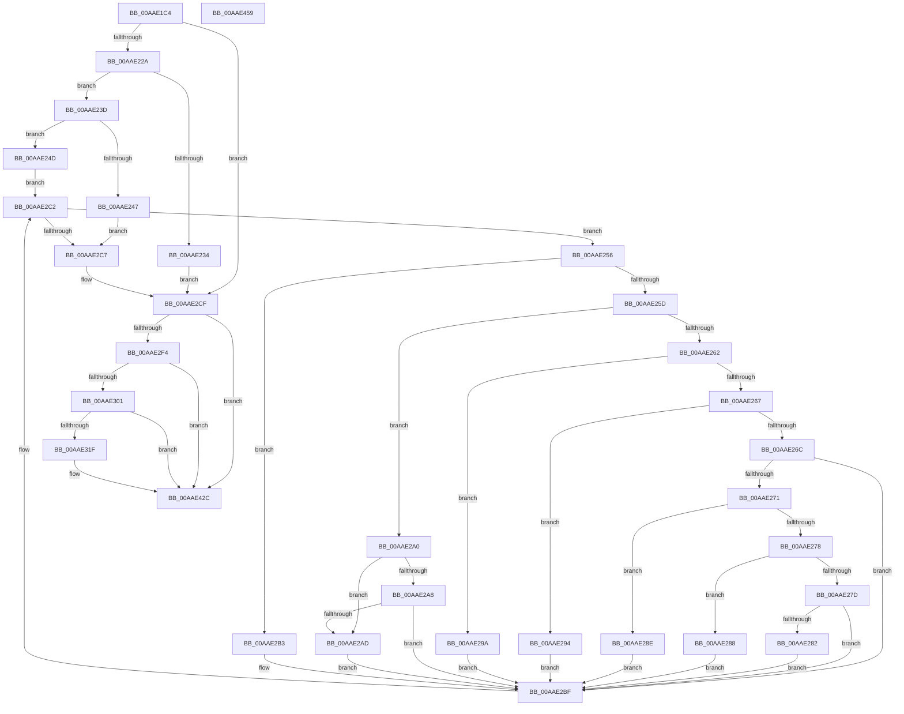

# PopPotsLogPowerTransitionReliability

- RVA: `0x00AAE1C4`–`0x00AAE45A` (길이 `662` bytes)
- VA: `0x0000000140AAE1C4`
- 실행 섹션: `PAGE`
- PDB 이름 있음: `예`; PDB Function 태그: `아니요`
- unwind 정보 RVA: `0x000BC264`
- 디코드: `165`개 명령, `662/662` bytes 표시
- 미해석 바이트: `0` (있으면 어셈블리에 `.byte`로 보존)

> 이 문서는 커널 이미지의 기계어와 PDB 기호를 분석해 생성했습니다. 4번과 5번은 함수 원형과 자료형을 바이너리 사용 방식에서 추정한 C 해석이며 원본 소스 복구 결과는 아닙니다.

## 1. Dependencies

- 직접 호출 지점: **7**; 고유 호출 대상: **7**
- 직접 호출자로 확인된 함수: **1**
- RIP 상대 이미지 참조: **7**

### Outgoing calls
- `0x00AAE22A` → [PopGetMostRecentWakeInfo](../../text/4B/PopGetMostRecentWakeInfo_function_004BE4F8.md) (function, `0x004BE4F8`)
- `0x00AAE2CA` → [PopWakeInfoDereference](../../text/4C/PopWakeInfoDereference_function_004C74AC.md) (function, `0x004C74AC`)
- `0x00AAE2E2` → [swprintf_s](../../text/50/swprintf_s_function_00504B20.md) (function, `0x00504B20`)
- `0x00AAE312` → [tlgKeywordOn](../../text/42/tlgKeywordOn_function_0042EAA0.md) (function, `0x0042EAA0`)
- `0x00AAE36C` → [tlgCreate1Sz_wchar_t](../../text/42/tlgCreate1Sz_wchar_t_function_00426198.md) (function, `0x00426198`)
- `0x00AAE427` → [tlgWriteTransfer_EtwWriteTransfer](../../text/42/tlgWriteTransfer_EtwWriteTransfer_function_004260E0.md) (function, `0x004260E0`)
- `0x00AAE433` → [_security_check_cookie](../../text/6A/_security_check_cookie_function_006AC640.md) (function, `0x006AC640`)

### Direct callers
- [PopIssueActionRequest](../A9/PopIssueActionRequest_function_00A9CE54.md) at `0x00A9D2EF`

### Static image references
- `0x00AAE1E7` → RVA `0x00E0A740` (`.data`; read)
- `0x00AAE201` → RVA `0x00AFCAD0` (` ?? ::NNGAKEGL::`string'`; read)
- `0x00AAE2D2` → RVA `0x00B03F30` (` ?? ::NNGAKEGL::`string'`; read)
- `0x00AAE2E7` → RVA `0x00F070B8` (`.data`; read)
- `0x00AAE2F4` → RVA `0x00E08390` (`.data`; read)
- `0x00AAE3A9` → RVA `0x00F0CCE8` (`.data`; read)
- `0x00AAE3D7` → RVA `0x00050D57` (`.rdata`; read)

## 2. Other-region calls and transfers

- 다른 실행 섹션으로 향하는 call: **7**
  - `0x00AAE22A` → [PopGetMostRecentWakeInfo](../../text/4B/PopGetMostRecentWakeInfo_function_004BE4F8.md) (`PAGE` → `.text`)
  - `0x00AAE2CA` → [PopWakeInfoDereference](../../text/4C/PopWakeInfoDereference_function_004C74AC.md) (`PAGE` → `.text`)
  - `0x00AAE2E2` → [swprintf_s](../../text/50/swprintf_s_function_00504B20.md) (`PAGE` → `.text`)
  - `0x00AAE312` → [tlgKeywordOn](../../text/42/tlgKeywordOn_function_0042EAA0.md) (`PAGE` → `.text`)
  - `0x00AAE36C` → [tlgCreate1Sz_wchar_t](../../text/42/tlgCreate1Sz_wchar_t_function_00426198.md) (`PAGE` → `.text`)
  - `0x00AAE427` → [tlgWriteTransfer_EtwWriteTransfer](../../text/42/tlgWriteTransfer_EtwWriteTransfer_function_004260E0.md) (`PAGE` → `.text`)
  - `0x00AAE433` → [_security_check_cookie](../../text/6A/_security_check_cookie_function_006AC640.md) (`PAGE` → `.text`)
- 별도 외부 분기/꼬리 이동을 확인하지 못했습니다.

## 3. Assembly (complete function range)

```asm
00AAE1C4  48 8B C4                        mov rax, rsp
00AAE1C7  48 89 58 10                     mov qword ptr [rax + 0x10], rbx
00AAE1CB  48 89 70 18                     mov qword ptr [rax + 0x18], rsi
00AAE1CF  48 89 78 20                     mov qword ptr [rax + 0x20], rdi
00AAE1D3  55                              push rbp
00AAE1D4  41 54                           push r12
00AAE1D6  41 55                           push r13
00AAE1D8  41 56                           push r14
00AAE1DA  41 57                           push r15
00AAE1DC  48 8D 68 88                     lea rbp, [rax - 0x78]
00AAE1E0  48 81 EC 50 01 00 00            sub rsp, 0x150
00AAE1E7  48 8B 05 52 C5 35 00            mov rax, qword ptr [rip + 0x35c552]
00AAE1EE  48 33 C4                        xor rax, rsp
00AAE1F1  48 89 45 48                     mov qword ptr [rbp + 0x48], rax
00AAE1F5  45 33 ED                        xor r13d, r13d
00AAE1F8  48 C7 44 24 48 00 00 02 00      mov qword ptr [rsp + 0x48], 0x20000
00AAE201  48 8D 05 C8 E8 04 00            lea rax, [rip + 0x4e8c8]
00AAE208  41 8B D8                        mov ebx, r8d
00AAE20B  48 89 44 24 50                  mov qword ptr [rsp + 0x50], rax
00AAE210  44 8B E2                        mov r12d, edx
00AAE213  48 8D 74 24 48                  lea rsi, [rsp + 0x48]
00AAE218  8B F9                           mov edi, ecx
00AAE21A  4C 8D 74 24 48                  lea r14, [rsp + 0x48]
00AAE21F  45 8B FD                        mov r15d, r13d
00AAE222  85 C9                           test ecx, ecx
00AAE224  0F 88 A5 00 00 00               js 0x140aae2cf
00AAE22A  E8 C9 02 A1 FF                  call 0x1404be4f8
00AAE22F  48 85 C0                        test rax, rax
00AAE232  75 09                           jne 0x140aae23d
00AAE234  0F BA EB 1A                     bts ebx, 0x1a
00AAE238  E9 92 00 00 00                  jmp 0x140aae2cf
00AAE23D  44 8B 78 54                     mov r15d, dword ptr [rax + 0x54]
00AAE241  44 39 68 28                     cmp dword ptr [rax + 0x28], r13d
00AAE245  75 06                           jne 0x140aae24d
00AAE247  0F BA EB 1A                     bts ebx, 0x1a
00AAE24B  EB 7A                           jmp 0x140aae2c7
00AAE24D  4C 8D 48 18                     lea r9, [rax + 0x18]
00AAE251  49 8B 09                        mov rcx, qword ptr [r9]
00AAE254  EB 6C                           jmp 0x140aae2c2
00AAE256  8B 51 10                        mov edx, dword ptr [rcx + 0x10]
00AAE259  85 D2                           test edx, edx
00AAE25B  74 56                           je 0x140aae2b3
00AAE25D  83 EA 01                        sub edx, 1
00AAE260  74 3E                           je 0x140aae2a0
00AAE262  83 EA 01                        sub edx, 1
00AAE265  74 33                           je 0x140aae29a
00AAE267  83 EA 01                        sub edx, 1
00AAE26A  74 28                           je 0x140aae294
00AAE26C  83 FA 01                        cmp edx, 1
00AAE26F  75 4E                           jne 0x140aae2bf
00AAE271  8B 51 18                        mov edx, dword ptr [rcx + 0x18]
00AAE274  85 D2                           test edx, edx
00AAE276  74 16                           je 0x140aae28e
00AAE278  83 EA 01                        sub edx, 1
00AAE27B  74 0B                           je 0x140aae288
00AAE27D  83 FA 01                        cmp edx, 1
00AAE280  75 3D                           jne 0x140aae2bf
00AAE282  0F BA EB 19                     bts ebx, 0x19
00AAE286  EB 37                           jmp 0x140aae2bf
00AAE288  0F BA EB 14                     bts ebx, 0x14
00AAE28C  EB 31                           jmp 0x140aae2bf
00AAE28E  0F BA EB 10                     bts ebx, 0x10
00AAE292  EB 2B                           jmp 0x140aae2bf
00AAE294  0F BA EB 12                     bts ebx, 0x12
00AAE298  EB 25                           jmp 0x140aae2bf
00AAE29A  0F BA EB 0D                     bts ebx, 0xd
00AAE29E  EB 1F                           jmp 0x140aae2bf
00AAE2A0  8B 51 18                        mov edx, dword ptr [rcx + 0x18]
00AAE2A3  83 EA 01                        sub edx, 1
00AAE2A6  74 05                           je 0x140aae2ad
00AAE2A8  83 FA 01                        cmp edx, 1
00AAE2AB  75 12                           jne 0x140aae2bf
00AAE2AD  0F BA EB 0B                     bts ebx, 0xb
00AAE2B1  EB 0C                           jmp 0x140aae2bf
00AAE2B3  0F BA EB 0C                     bts ebx, 0xc
00AAE2B7  48 8D 71 60                     lea rsi, [rcx + 0x60]
00AAE2BB  4C 8D 71 28                     lea r14, [rcx + 0x28]
00AAE2BF  48 8B 09                        mov rcx, qword ptr [rcx]
00AAE2C2  49 3B C9                        cmp rcx, r9
00AAE2C5  75 8F                           jne 0x140aae256
00AAE2C7  48 8B C8                        mov rcx, rax
00AAE2CA  E8 DD 91 A1 FF                  call 0x1404c74ac
00AAE2CF  44 8B CF                        mov r9d, edi
00AAE2D2  4C 8D 05 57 5C 05 00            lea r8, [rip + 0x55c57]
00AAE2D9  BA 09 00 00 00                  mov edx, 9
00AAE2DE  48 8D 4D 30                     lea rcx, [rbp + 0x30]
00AAE2E2  E8 39 68 A5 FF                  call 0x140504b20
00AAE2E7  44 38 2D CA 8D 45 00            cmp byte ptr [rip + 0x458dca], r13b
00AAE2EE  0F 84 38 01 00 00               je 0x140aae42c
00AAE2F4  83 3D 95 A0 35 00 05            cmp dword ptr [rip + 0x35a095], 5
00AAE2FB  0F 86 2B 01 00 00               jbe 0x140aae42c
00AAE301  48 BA 00 00 00 00 00 40 00 00   movabs rdx, 0x400000000000
00AAE30B  48 8D 0D 7E A0 35 00            lea rcx, [rip + 0x35a07e]
00AAE312  E8 89 07 98 FF                  call 0x14042eaa0
00AAE317  84 C0                           test al, al
00AAE319  0F 84 0D 01 00 00               je 0x140aae42c
00AAE31F  48 8D 44 24 30                  lea rax, [rsp + 0x30]
00AAE324  48 C7 45 88 04 00 00 00         mov qword ptr [rbp - 0x78], 4
00AAE32C  48 89 45 80                     mov qword ptr [rbp - 0x80], rax
00AAE330  48 8D 55 30                     lea rdx, [rbp + 0x30]
00AAE334  48 8D 44 24 34                  lea rax, [rsp + 0x34]
00AAE339  44 89 64 24 34                  mov dword ptr [rsp + 0x34], r12d
00AAE33E  48 89 45 90                     mov qword ptr [rbp - 0x70], rax
00AAE342  48 8D 4D B0                     lea rcx, [rbp - 0x50]
00AAE346  48 8D 44 24 38                  lea rax, [rsp + 0x38]
00AAE34B  48 C7 45 98 04 00 00 00         mov qword ptr [rbp - 0x68], 4
00AAE353  F7 D7                           not edi
00AAE355  48 89 45 A0                     mov qword ptr [rbp - 0x60], rax
00AAE359  C1 EF 1F                        shr edi, 0x1f
00AAE35C  89 7C 24 30                     mov dword ptr [rsp + 0x30], edi
00AAE360  89 5C 24 38                     mov dword ptr [rsp + 0x38], ebx
00AAE364  48 C7 45 A8 04 00 00 00         mov qword ptr [rbp - 0x58], 4
00AAE36C  E8 27 7E 97 FF                  call 0x140426198
00AAE371  0F B7 0E                        movzx ecx, word ptr [rsi]
00AAE374  48 8D 55 D8                     lea rdx, [rbp - 0x28]
00AAE378  48 8B 46 08                     mov rax, qword ptr [rsi + 8]
00AAE37C  45 33 C9                        xor r9d, r9d
00AAE37F  48 89 45 D0                     mov qword ptr [rbp - 0x30], rax
00AAE383  45 33 C0                        xor r8d, r8d
00AAE386  48 89 55 C0                     mov qword ptr [rbp - 0x40], rdx
00AAE38A  48 8D 55 F8                     lea rdx, [rbp - 8]
00AAE38E  89 4D D8                        mov dword ptr [rbp - 0x28], ecx
00AAE391  48 C7 45 C8 02 00 00 00         mov qword ptr [rbp - 0x38], 2
00AAE399  44 89 6D DC                     mov dword ptr [rbp - 0x24], r13d
00AAE39D  49 8B 46 08                     mov rax, qword ptr [r14 + 8]
00AAE3A1  41 0F B7 0E                     movzx ecx, word ptr [r14]
00AAE3A5  48 89 45 F0                     mov qword ptr [rbp - 0x10], rax
00AAE3A9  8B 05 39 E9 45 00               mov eax, dword ptr [rip + 0x45e939]
00AAE3AF  89 44 24 3C                     mov dword ptr [rsp + 0x3c], eax
00AAE3B3  48 8D 44 24 3C                  lea rax, [rsp + 0x3c]
00AAE3B8  48 89 45 00                     mov qword ptr [rbp], rax
00AAE3BC  48 8D 44 24 40                  lea rax, [rsp + 0x40]
00AAE3C1  48 89 45 10                     mov qword ptr [rbp + 0x10], rax
00AAE3C5  48 8D 44 24 58                  lea rax, [rsp + 0x58]
00AAE3CA  48 89 45 20                     mov qword ptr [rbp + 0x20], rax
00AAE3CE  48 8D 44 24 60                  lea rax, [rsp + 0x60]
00AAE3D3  48 89 55 E0                     mov qword ptr [rbp - 0x20], rdx
00AAE3D7  48 8D 15 79 29 5A FF            lea rdx, [rip - 0xa5d687]
00AAE3DE  89 4D F8                        mov dword ptr [rbp - 8], ecx
00AAE3E1  48 8D 0D A8 9F 35 00            lea rcx, [rip + 0x359fa8]
00AAE3E8  48 89 44 24 28                  mov qword ptr [rsp + 0x28], rax
00AAE3ED  C7 44 24 20 0D 00 00 00         mov dword ptr [rsp + 0x20], 0xd
00AAE3F5  48 C7 45 E8 02 00 00 00         mov qword ptr [rbp - 0x18], 2
00AAE3FD  44 89 6D FC                     mov dword ptr [rbp - 4], r13d
00AAE401  48 C7 45 08 04 00 00 00         mov qword ptr [rbp + 8], 4
00AAE409  44 89 7C 24 40                  mov dword ptr [rsp + 0x40], r15d
00AAE40E  48 C7 45 18 04 00 00 00         mov qword ptr [rbp + 0x18], 4
00AAE416  48 C7 44 24 58 00 00 00 01      mov qword ptr [rsp + 0x58], 0x1000000
00AAE41F  48 C7 45 28 08 00 00 00         mov qword ptr [rbp + 0x28], 8
00AAE427  E8 B4 7C 97 FF                  call 0x1404260e0
00AAE42C  48 8B 4D 48                     mov rcx, qword ptr [rbp + 0x48]
00AAE430  48 33 CC                        xor rcx, rsp
00AAE433  E8 08 E2 BF FF                  call 0x1406ac640
00AAE438  4C 8D 9C 24 50 01 00 00         lea r11, [rsp + 0x150]
00AAE440  49 8B 5B 38                     mov rbx, qword ptr [r11 + 0x38]
00AAE444  49 8B 73 40                     mov rsi, qword ptr [r11 + 0x40]
00AAE448  49 8B 7B 48                     mov rdi, qword ptr [r11 + 0x48]
00AAE44C  49 8B E3                        mov rsp, r11
00AAE44F  41 5F                           pop r15
00AAE451  41 5E                           pop r14
00AAE453  41 5D                           pop r13
00AAE455  41 5C                           pop r12
00AAE457  5D                              pop rbp
00AAE458  C3                              ret
00AAE459  CC                              int3
```

## 4. C-style interpretation (structured pseudocode)

```c
__int64 __fastcall PopPotsLogPowerTransitionReliability(int a1, int a2, int a3)
{
    __int64 result;
    __int64 v_r13;
    __int64 v_rdi;
    __int64 v_rsp;
    unsigned __int64 v_stack_m118;
    unsigned __int64 v_stack_m120;
    unsigned __int64 v_stack_m128;
    unsigned __int64 v_stack_m130;
    unsigned __int64 v_stack_m138;
    unsigned int v_stack_m13C;
    unsigned __int64 v_stack_m140;
    unsigned __int64 v_stack_m144;
    unsigned __int64 v_stack_m148;
    unsigned __int64 v_stack_m150;
    unsigned int v_stack_m158;
    unsigned __int64 v_stack_m28;

    *(unsigned __int64 *)(v_rsp + 16) = v_rbx;
    *(unsigned __int64 *)(v_rsp + 24) = v_rsi;
    *(unsigned __int64 *)(v_rsp + 32) = v_rdi;
    v_rsp = (v_rsp) - (336);
    result = (*(unsigned __int64 *)(v_rip + 3523922)) ^ (v_rsp);
    *(unsigned __int64 *)(v_rsp - 120 + 72) = result;
    v_r13 = 0;
    v_stack_m130 = 0x20000ULL;
    v_stack_m128 = v_rip + 321736;
    if (sign_flag) goto loc_00AAE2CF;
    result = PopGetMostRecentWakeInfo(a1, a2, a3, a4);
    if (result != 0) goto loc_00AAE23D;
    goto loc_00AAE2CF;
loc_00AAE23D:
    if ((*(unsigned int *)(result + 40)) != 0) goto loc_00AAE24D;
    goto loc_00AAE2C7;
loc_00AAE24D:
    goto loc_00AAE2C2;
loc_00AAE256:
    if ((unsigned int)((unsigned int)(*(unsigned int *)(*(unsigned __int64 *)(result + 24) + 16))) == 0) goto loc_00AAE2B3;
    a2 = (unsigned int)(((unsigned int)(*(unsigned int *)(*(unsigned __int64 *)(result + 24) + 16))) - (1));
    if (condition_is_equal) goto loc_00AAE2A0;
    a2 = (unsigned int)((a2) - (1));
    if (condition_is_equal) goto loc_00AAE29A;
    a2 = (unsigned int)((a2) - (1));
    if (condition_is_equal) goto loc_00AAE294;
    if (a2 != 1) goto loc_00AAE2BF;
    if ((unsigned int)((unsigned int)(*(unsigned int *)(*(unsigned __int64 *)(result + 24) + 24))) == 0) goto loc_00AAE28E;
    a2 = (unsigned int)(((unsigned int)(*(unsigned int *)(*(unsigned __int64 *)(result + 24) + 24))) - (1));
    if (condition_is_equal) goto loc_00AAE288;
    if (a2 != 1) goto loc_00AAE2BF;
    goto loc_00AAE2BF;
loc_00AAE288:
    goto loc_00AAE2BF;
loc_00AAE28E:
    goto loc_00AAE2BF;
loc_00AAE294:
    goto loc_00AAE2BF;
loc_00AAE29A:
    goto loc_00AAE2BF;
loc_00AAE2A0:
    a2 = (unsigned int)(((unsigned int)(*(unsigned int *)(*(unsigned __int64 *)(result + 24) + 24))) - (1));
    if (condition_is_equal) goto loc_00AAE2AD;
    if (a2 != 1) goto loc_00AAE2BF;
loc_00AAE2AD:
    goto loc_00AAE2BF;
loc_00AAE2B3:
loc_00AAE2BF:
loc_00AAE2C2:
    if ((*(unsigned __int64 *)(*(unsigned __int64 *)(result + 24))) != (result + 24)) goto loc_00AAE256;
loc_00AAE2C7:
    result = PopWakeInfoDereference(result, a2, a3, result + 24);
loc_00AAE2CF:
    result = swprintf_s(v_rsp - 120 + 48, 9, v_rip + 351319, (unsigned int)((unsigned int)((unsigned int)(a1))));
    if ((*(unsigned __int8 *)(v_rip + 4558282)) == 0) goto loc_00AAE42C;
    if ((*(unsigned int *)(v_rip + 3514517)) <= 5) goto loc_00AAE42C;
    result = tlgKeywordOn(v_rip + 3514494, 9, v_rip + 351319, (unsigned int)((unsigned int)((unsigned int)(a1))));
    v_rdi = (unsigned int)(a1);
    if ((unsigned __int8)(result) != 0) {
        result = v_stack_m148;
        *(unsigned __int64 *)(v_rsp - 120 - 120) = 4;
        *(unsigned __int64 *)(v_rsp - 120 - 128) = result;
        a2 = v_rsp - 120 + 48;
        result = v_stack_m144;
        v_stack_m144 = (unsigned int)((unsigned int)(a2));
        *(unsigned __int64 *)(v_rsp - 120 - 112) = result;
        a1 = v_rsp - 120 - 80;
        result = v_stack_m140;
        *(unsigned __int64 *)(v_rsp - 120 - 104) = 4;
        v_rdi = (unsigned int)(~((unsigned int)(a1)));
        *(unsigned __int64 *)(v_rsp - 120 - 96) = result;
        v_rdi = (unsigned int)((v_rdi) >> (31));
        v_stack_m148 = (unsigned int)(v_rdi);
        v_stack_m140 = (unsigned int)((unsigned int)(a3));
        *(unsigned __int64 *)(v_rsp - 120 - 88) = 4;
        result = tlgCreate1Sz_wchar_t(a1, a2, v_rip + 351319, (unsigned int)((unsigned int)((unsigned int)(a1))));
        a1 = *(unsigned __int16 *)(*(unsigned __int64 *)(result + 24) + 96);
        a2 = v_rsp - 120 - 40;
        result = *(unsigned __int64 *)(*(unsigned __int64 *)(result + 24) + 96 + 8);
        a4 = 0;
        *(unsigned __int64 *)(v_rsp - 120 - 48) = result;
        a3 = 0;
        *(unsigned __int64 *)(v_rsp - 120 - 64) = a2;
        a2 = v_rsp - 120 - 8;
        *(unsigned int *)(v_rsp - 120 - 40) = a1;
        *(unsigned __int64 *)(v_rsp - 120 - 56) = 2;
        *(unsigned int *)(v_rsp - 120 - 36) = 0;
        result = *(unsigned __int64 *)(*(unsigned __int64 *)(result + 24) + 40 + 8);
        a1 = *(unsigned __int16 *)(*(unsigned __int64 *)(result + 24) + 40);
        *(unsigned __int64 *)(v_rsp - 120 - 16) = result;
        result = *(unsigned int *)(v_rip + 4581689);
        v_stack_m13C = (unsigned int)(result);
        result = v_stack_m13C;
        *(unsigned __int64 *)(v_rsp - 120) = result;
        result = v_stack_m138;
        *(unsigned __int64 *)(v_rsp - 120 + 16) = result;
        result = v_stack_m120;
        *(unsigned __int64 *)(v_rsp - 120 + 32) = result;
        result = v_stack_m118;
        *(unsigned __int64 *)(v_rsp - 120 - 32) = a2;
        a2 = v_rip - 10868359;
        *(unsigned int *)(v_rsp - 120 - 8) = a1;
        a1 = v_rip + 3514280;
        v_stack_m150 = result;
        v_stack_m158 = 13;
        *(unsigned __int64 *)(v_rsp - 120 - 24) = 2;
        *(unsigned int *)(v_rsp - 120 - 4) = 0;
        *(unsigned __int64 *)(v_rsp - 120 + 8) = 4;
        v_stack_m138 = (unsigned int)((unsigned int)(*(unsigned int *)(result + 84)));
        *(unsigned __int64 *)(v_rsp - 120 + 24) = 4;
        v_stack_m120 = 0x1000000ULL;
        *(unsigned __int64 *)(v_rsp - 120 + 40) = 8;
        result = tlgWriteTransfer_EtwWriteTransfer(a1, a2, a3, a4);
    }
    a1 = (*(unsigned __int64 *)(v_rsp - 120 + 72)) ^ (v_rsp);
    result = _security_check_cookie(a1, a2, a3, a4);
    return result;
}
```

## 5. (Beta) C Style

```c
int64_t PopPotsLogPowerTransitionReliability(int32_t Arg1, int32_t Arg2, int32_t Arg3)
{
    int64_t result;
    int64_t local_r13;
    int64_t local_rdi;
    int64_t local_rsp;
    uint64_t v_stack_m118;
    uint64_t v_stack_m120;
    uint64_t v_stack_m128;
    uint64_t v_stack_m130;
    uint64_t v_stack_m138;
    uint32_t v_stack_m13C;
    uint64_t v_stack_m140;
    uint64_t v_stack_m144;
    uint64_t v_stack_m148;
    uint64_t v_stack_m150;
    uint32_t v_stack_m158;
    uint64_t v_stack_m28;

    *(uint64_t *)(local_rsp + 0x10) = local_rbx;
    *(uint64_t *)(local_rsp + 0x18) = local_rsi;
    *(uint64_t *)(local_rsp + 0x20) = local_rdi;
    local_rsp = (local_rsp) - (336);
    result = (*(uint64_t *)(v_rip + 0x35C552)) ^ (local_rsp);
    *(uint64_t *)(local_rsp - 0x78 + 0x48) = result;
    local_r13 = 0;
    v_stack_m130 = 0x20000ULL;
    v_stack_m128 = v_rip + 321736;
    if (sign_flag) goto loc_00AAE2CF;
    result = PopGetMostRecentWakeInfo(Arg1, Arg2, Arg3, a4);
    if (result != 0) goto loc_00AAE23D;
    goto loc_00AAE2CF;
loc_00AAE23D:
    if ((*(uint32_t *)(result + 0x28)) != 0) goto loc_00AAE24D;
    goto loc_00AAE2C7;
loc_00AAE24D:
    goto loc_00AAE2C2;
loc_00AAE256:
    if ((uint32_t)((uint32_t)(*(uint32_t *)(*(uint64_t *)(result + 0x18) + 0x10))) == 0) goto loc_00AAE2B3;
    Arg2 = (uint32_t)(((uint32_t)(*(uint32_t *)(*(uint64_t *)(result + 0x18) + 0x10))) - (1));
    if (condition_is_equal) goto loc_00AAE2A0;
    Arg2 = (uint32_t)((Arg2) - (1));
    if (condition_is_equal) goto loc_00AAE29A;
    Arg2 = (uint32_t)((Arg2) - (1));
    if (condition_is_equal) goto loc_00AAE294;
    if (Arg2 != 1) goto loc_00AAE2BF;
    if ((uint32_t)((uint32_t)(*(uint32_t *)(*(uint64_t *)(result + 0x18) + 0x18))) == 0) goto loc_00AAE28E;
    Arg2 = (uint32_t)(((uint32_t)(*(uint32_t *)(*(uint64_t *)(result + 0x18) + 0x18))) - (1));
    if (condition_is_equal) goto loc_00AAE288;
    if (Arg2 != 1) goto loc_00AAE2BF;
    goto loc_00AAE2BF;
loc_00AAE288:
    goto loc_00AAE2BF;
loc_00AAE28E:
    goto loc_00AAE2BF;
loc_00AAE294:
    goto loc_00AAE2BF;
loc_00AAE29A:
    goto loc_00AAE2BF;
loc_00AAE2A0:
    Arg2 = (uint32_t)(((uint32_t)(*(uint32_t *)(*(uint64_t *)(result + 0x18) + 0x18))) - (1));
    if (condition_is_equal) goto loc_00AAE2AD;
    if (Arg2 != 1) goto loc_00AAE2BF;
loc_00AAE2AD:
    goto loc_00AAE2BF;
loc_00AAE2B3:
loc_00AAE2BF:
loc_00AAE2C2:
    if ((*(uint64_t *)(*(uint64_t *)(result + 0x18))) != (result + 24)) goto loc_00AAE256;
loc_00AAE2C7:
    result = PopWakeInfoDereference(result, Arg2, Arg3, result + 24);
loc_00AAE2CF:
    result = swprintf_s(local_rsp - 120 + 48, 9, v_rip + 351319, (uint32_t)((uint32_t)((uint32_t)(Arg1))));
    if ((*(uint8_t *)(v_rip + 0x458DCA)) == 0) goto loc_00AAE42C;
    if ((*(uint32_t *)(v_rip + 0x35A095)) <= 5) goto loc_00AAE42C;
    result = tlgKeywordOn(v_rip + 3514494, 9, v_rip + 351319, (uint32_t)((uint32_t)((uint32_t)(Arg1))));
    local_rdi = (uint32_t)(Arg1);
    if ((uint8_t)(result) != 0) {
        result = v_stack_m148;
        *(uint64_t *)(local_rsp - 0x78 - 0x78) = 4;
        *(uint64_t *)(local_rsp - 0x78 - 0x80) = result;
        Arg2 = local_rsp - 120 + 48;
        result = v_stack_m144;
        v_stack_m144 = (uint32_t)((uint32_t)(Arg2));
        *(uint64_t *)(local_rsp - 0x78 - 0x70) = result;
        Arg1 = local_rsp - 120 - 80;
        result = v_stack_m140;
        *(uint64_t *)(local_rsp - 0x78 - 0x68) = 4;
        local_rdi = (uint32_t)(~((uint32_t)(Arg1)));
        *(uint64_t *)(local_rsp - 0x78 - 0x60) = result;
        local_rdi = (uint32_t)((local_rdi) >> (31));
        v_stack_m148 = (uint32_t)(local_rdi);
        v_stack_m140 = (uint32_t)((uint32_t)(Arg3));
        *(uint64_t *)(local_rsp - 0x78 - 0x58) = 4;
        result = tlgCreate1Sz_wchar_t(Arg1, Arg2, v_rip + 351319, (uint32_t)((uint32_t)((uint32_t)(Arg1))));
        Arg1 = *(uint16_t *)(*(uint64_t *)(result + 0x18) + 0x60);
        Arg2 = local_rsp - 120 - 40;
        result = *(uint64_t *)(*(uint64_t *)(result + 0x18) + 0x60 + 0x8);
        a4 = 0;
        *(uint64_t *)(local_rsp - 0x78 - 0x30) = result;
        Arg3 = 0;
        *(uint64_t *)(local_rsp - 0x78 - 0x40) = Arg2;
        Arg2 = local_rsp - 120 - 8;
        *(uint32_t *)(local_rsp - 0x78 - 0x28) = Arg1;
        *(uint64_t *)(local_rsp - 0x78 - 0x38) = 2;
        *(uint32_t *)(local_rsp - 0x78 - 0x24) = 0;
        result = *(uint64_t *)(*(uint64_t *)(result + 0x18) + 0x28 + 0x8);
        Arg1 = *(uint16_t *)(*(uint64_t *)(result + 0x18) + 0x28);
        *(uint64_t *)(local_rsp - 0x78 - 0x10) = result;
        result = *(uint32_t *)(v_rip + 0x45E939);
        v_stack_m13C = (uint32_t)(result);
        result = v_stack_m13C;
        *(uint64_t *)(local_rsp - 0x78) = result;
        result = v_stack_m138;
        *(uint64_t *)(local_rsp - 0x78 + 0x10) = result;
        result = v_stack_m120;
        *(uint64_t *)(local_rsp - 0x78 + 0x20) = result;
        result = v_stack_m118;
        *(uint64_t *)(local_rsp - 0x78 - 0x20) = Arg2;
        Arg2 = v_rip - 10868359;
        *(uint32_t *)(local_rsp - 0x78 - 0x8) = Arg1;
        Arg1 = v_rip + 3514280;
        v_stack_m150 = result;
        v_stack_m158 = 13;
        *(uint64_t *)(local_rsp - 0x78 - 0x18) = 2;
        *(uint32_t *)(local_rsp - 0x78 - 0x4) = 0;
        *(uint64_t *)(local_rsp - 0x78 + 0x8) = 4;
        v_stack_m138 = (uint32_t)((uint32_t)(*(uint32_t *)(result + 0x54)));
        *(uint64_t *)(local_rsp - 0x78 + 0x18) = 4;
        v_stack_m120 = 0x1000000ULL;
        *(uint64_t *)(local_rsp - 0x78 + 0x28) = 8;
        result = tlgWriteTransfer_EtwWriteTransfer(Arg1, Arg2, Arg3, a4);
    }
    Arg1 = (*(uint64_t *)(local_rsp - 0x78 + 0x48)) ^ (local_rsp);
    result = _security_check_cookie(Arg1, Arg2, Arg3, a4);
    return result;
}
```

## 6. Execution-region graph

[열기: 2D/3D 그래프와 함수 탐색 컨트롤 패널](../../../control-panel.html?section=page&rva=0x00AAE1C4&view=graph)

- 2D 그래프는 위에서 아래로 흐르고, 3D 그래프는 빈 공간을 드래그해 회전합니다. Shift+드래그는 이동, 휠은 확대·축소, 함수 노드 선택은 대상 보고서 이동입니다.

### Static fallback


