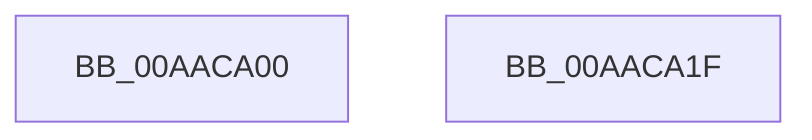

# PopPowerRequestCallbackAwayModeRequired

- RVA: `0x00AACA00`–`0x00AACA20` (길이 `32` bytes)
- VA: `0x0000000140AACA00`
- 실행 섹션: `PAGE`
- PDB 이름 있음: `예`; PDB Function 태그: `아니요`
- unwind 정보 RVA: `0x0005CF00`
- 디코드: `10`개 명령, `32/32` bytes 표시
- 미해석 바이트: `0` (있으면 어셈블리에 `.byte`로 보존)

> 이 문서는 커널 이미지의 기계어와 PDB 기호를 분석해 생성했습니다. 4번과 5번은 함수 원형과 자료형을 바이너리 사용 방식에서 추정한 C 해석이며 원본 소스 복구 결과는 아닙니다.

## 1. Dependencies

- 직접 호출 지점: **2**; 고유 호출 대상: **2**
- 직접 호출자로 확인된 함수: **0**
- RIP 상대 이미지 참조: **1**

### Outgoing calls
- `0x00AACA09` → [PopAcquireAwaymodeLock](../../pagelk/B7/PopAcquireAwaymodeLock_function_00B7BF60.md) (function, `0x00B7BF60`)
- `0x00AACA14` → [PopReleaseAwaymodeLock](../../pagelk/B7/PopReleaseAwaymodeLock_function_00B7BB3C.md) (function, `0x00B7BB3C`)

### Direct callers
- 이 함수 시작 RVA로 연결되는 직접 call은 확인되지 않았습니다. 간접 호출은 완전히 역산할 수 없습니다.

### Static image references
- `0x00AACA0E` → RVA `0x00F0CE10` (`.data`; write)

## 2. Other-region calls and transfers

- 다른 실행 섹션으로 향하는 call: **2**
  - `0x00AACA09` → [PopAcquireAwaymodeLock](../../pagelk/B7/PopAcquireAwaymodeLock_function_00B7BF60.md) (`PAGE` → `PAGELK`)
  - `0x00AACA14` → [PopReleaseAwaymodeLock](../../pagelk/B7/PopReleaseAwaymodeLock_function_00B7BB3C.md) (`PAGE` → `PAGELK`)
- 별도 외부 분기/꼬리 이동을 확인하지 못했습니다.

## 3. Assembly (complete function range)

```asm
00AACA00  40 53                           push rbx
00AACA02  48 83 EC 20                     sub rsp, 0x20
00AACA06  41 8A D8                        mov bl, r8b
00AACA09  E8 52 F5 0C 00                  call 0x140b7bf60
00AACA0E  88 1D FC 03 46 00               mov byte ptr [rip + 0x4603fc], bl
00AACA14  E8 23 F1 0C 00                  call 0x140b7bb3c
00AACA19  48 83 C4 20                     add rsp, 0x20
00AACA1D  5B                              pop rbx
00AACA1E  C3                              ret
00AACA1F  CC                              int3
```

## 4. C-style interpretation (structured pseudocode)

```c
__int64 __fastcall PopPowerRequestCallbackAwayModeRequired(__int64 a1, __int64 a2, unsigned __int8 a3)
{
    __int64 result;
    __int64 v_rsp;

    v_rsp = (v_rsp) - (32);
    result = PopAcquireAwaymodeLock(a1, a2, a3, a4);
    *(unsigned __int8 *)(v_rip + 4588540) = a3;
    result = PopReleaseAwaymodeLock(a1, a2, a3, a4);
    v_rsp = (v_rsp) + (32);
    return result;
}
```

## 5. (Beta) C Style

```c
int64_t PopPowerRequestCallbackAwayModeRequired(int64_t Arg1, int64_t Arg2, uint8_t Arg3)
{
    int64_t result;
    int64_t local_rsp;

    local_rsp = (local_rsp) - (32);
    result = PopAcquireAwaymodeLock(Arg1, Arg2, Arg3, a4);
    *(uint8_t *)(v_rip + 0x4603FC) = Arg3;
    result = PopReleaseAwaymodeLock(Arg1, Arg2, Arg3, a4);
    local_rsp = (local_rsp) + (32);
    return result;
}
```

## 6. Execution-region graph

[열기: 2D/3D 그래프와 함수 탐색 컨트롤 패널](../../../control-panel.html?section=page&rva=0x00AACA00&view=graph)

- 2D 그래프는 위에서 아래로 흐르고, 3D 그래프는 빈 공간을 드래그해 회전합니다. Shift+드래그는 이동, 휠은 확대·축소, 함수 노드 선택은 대상 보고서 이동입니다.

### Static fallback


