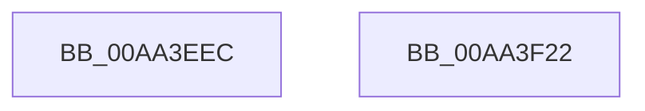

# PopRecordSleepCheckpoint

- RVA: `0x00AA3EEC`–`0x00AA3F23` (길이 `55` bytes)
- VA: `0x0000000140AA3EEC`
- 실행 섹션: `PAGE`
- PDB 이름 있음: `예`; PDB Function 태그: `아니요`
- unwind 정보 RVA: `0x0005CF00`
- 디코드: `14`개 명령, `55/55` bytes 표시
- 미해석 바이트: `0` (있으면 어셈블리에 `.byte`로 보존)

> 이 문서는 커널 이미지의 기계어와 PDB 기호를 분석해 생성했습니다. 4번과 5번은 함수 원형과 자료형을 바이너리 사용 방식에서 추정한 C 해석이며 원본 소스 복구 결과는 아닙니다.

## 1. Dependencies

- 직접 호출 지점: **3**; 고유 호출 대상: **3**
- 직접 호출자로 확인된 함수: **2**
- RIP 상대 이미지 참조: **2**

### Outgoing calls
- `0x00AA3EFB` → [PopAcquireRwLockExclusive](../../text/43/PopAcquireRwLockExclusive_function_00430B44.md) (function, `0x00430B44`)
- `0x00AA3F0B` → [PopBsdHandleRequest](../../text/4B/PopBsdHandleRequest_function_004B27A0.md) (function, `0x004B27A0`)
- `0x00AA3F17` → [PopReleaseRwLock](../../text/2D/PopReleaseRwLock_function_002DFBBC.md) (function, `0x002DFBBC`)

### Direct callers
- [PopCheckpointSystemSleep](../../pagelk/B7/PopCheckpointSystemSleep_function_00B77C90.md) at `0x00B77CBA`
- [PopCheckShutdownMarker](../../init/C3/PopCheckShutdownMarker_function_00C3DAD4.md) at `0x00C3DF59`

### Static image references
- `0x00AA3EF4` → RVA `0x00F0F1E0` (`.data`; read)
- `0x00AA3F05` → RVA `0x00E673F2` (`.data`; write)

## 2. Other-region calls and transfers

- 다른 실행 섹션으로 향하는 call: **3**
  - `0x00AA3EFB` → [PopAcquireRwLockExclusive](../../text/43/PopAcquireRwLockExclusive_function_00430B44.md) (`PAGE` → `.text`)
  - `0x00AA3F0B` → [PopBsdHandleRequest](../../text/4B/PopBsdHandleRequest_function_004B27A0.md) (`PAGE` → `.text`)
  - `0x00AA3F17` → [PopReleaseRwLock](../../text/2D/PopReleaseRwLock_function_002DFBBC.md) (`PAGE` → `.text`)
- 별도 외부 분기/꼬리 이동을 확인하지 못했습니다.

## 3. Assembly (complete function range)

```asm
00AA3EEC  40 53                           push rbx
00AA3EEE  48 83 EC 20                     sub rsp, 0x20
00AA3EF2  8B D9                           mov ebx, ecx
00AA3EF4  48 8D 0D E5 B2 46 00            lea rcx, [rip + 0x46b2e5]
00AA3EFB  E8 44 CC 98 FF                  call 0x140430b44
00AA3F00  B9 0A 00 00 00                  mov ecx, 0xa
00AA3F05  88 1D E7 34 3C 00               mov byte ptr [rip + 0x3c34e7], bl
00AA3F0B  E8 90 E8 A0 FF                  call 0x1404b27a0
00AA3F10  48 8D 0D C9 B2 46 00            lea rcx, [rip + 0x46b2c9]
00AA3F17  E8 A0 BC 83 FF                  call 0x1402dfbbc
00AA3F1C  48 83 C4 20                     add rsp, 0x20
00AA3F20  5B                              pop rbx
00AA3F21  C3                              ret
00AA3F22  CC                              int3
```

## 4. C-style interpretation (structured pseudocode)

```c
__int64 __fastcall PopRecordSleepCheckpoint(int a1)
{
    __int64 result;
    __int64 v_rsp;

    v_rsp = (v_rsp) - (32);
    result = PopAcquireRwLockExclusive(v_rip + 4633317, a2, a3, a4);
    *(unsigned __int8 *)(v_rip + 3945703) = (unsigned __int8)((unsigned int)(a1));
    result = PopBsdHandleRequest(10, a2, a3, a4);
    result = PopReleaseRwLock(v_rip + 4633289, a2, a3, a4);
    v_rsp = (v_rsp) + (32);
    return result;
}
```

## 5. (Beta) C Style

```c
int64_t PopRecordSleepCheckpoint(int32_t Arg1)
{
    int64_t result;
    int64_t local_rsp;

    local_rsp = (local_rsp) - (32);
    result = PopAcquireRwLockExclusive(v_rip + 4633317, a2, a3, a4);
    *(uint8_t *)(v_rip + 0x3C34E7) = (uint8_t)((uint32_t)(Arg1));
    result = PopBsdHandleRequest(10, a2, a3, a4);
    result = PopReleaseRwLock(v_rip + 4633289, a2, a3, a4);
    local_rsp = (local_rsp) + (32);
    return result;
}
```

## 6. Execution-region graph

[열기: 2D/3D 그래프와 함수 탐색 컨트롤 패널](../../../control-panel.html?section=page&rva=0x00AA3EEC&view=graph)

- 2D 그래프는 위에서 아래로 흐르고, 3D 그래프는 빈 공간을 드래그해 회전합니다. Shift+드래그는 이동, 휠은 확대·축소, 함수 노드 선택은 대상 보고서 이동입니다.

### Static fallback


