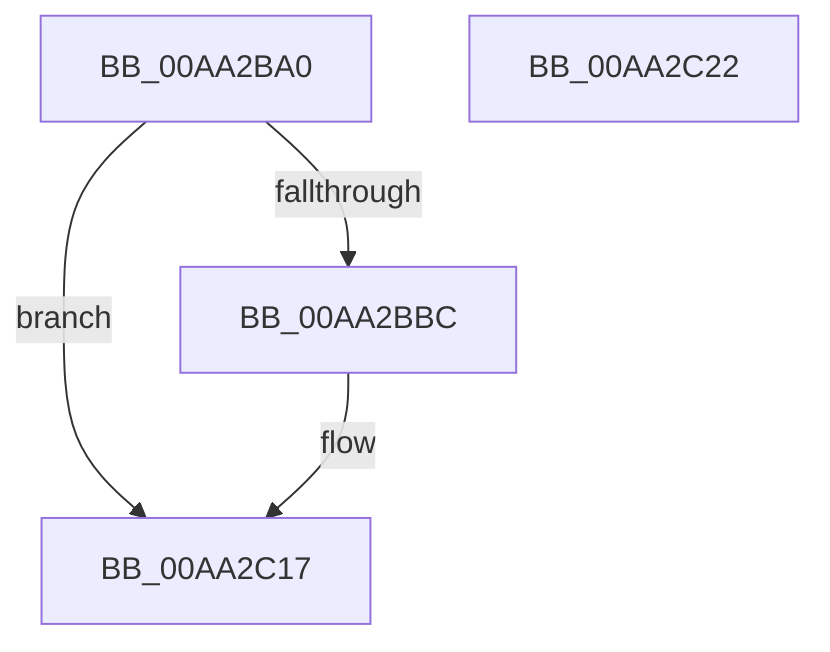

# PopSetConnectedStandbyMarker

- RVA: `0x00AA2BA0`–`0x00AA2C23` (길이 `131` bytes)
- VA: `0x0000000140AA2BA0`
- 실행 섹션: `PAGE`
- PDB 이름 있음: `예`; PDB Function 태그: `아니요`
- unwind 정보 RVA: `0x0005CAAC`
- 디코드: `32`개 명령, `131/131` bytes 표시
- 미해석 바이트: `0` (있으면 어셈블리에 `.byte`로 보존)

> 이 문서는 커널 이미지의 기계어와 PDB 기호를 분석해 생성했습니다. 4번과 5번은 함수 원형과 자료형을 바이너리 사용 방식에서 추정한 C 해석이며 원본 소스 복구 결과는 아닙니다.

## 1. Dependencies

- 직접 호출 지점: **3**; 고유 호출 대상: **3**
- 직접 호출자로 확인된 함수: **1**
- RIP 상대 이미지 참조: **9**

### Outgoing calls
- `0x00AA2BC3` → [PopAcquireRwLockExclusive](../../text/43/PopAcquireRwLockExclusive_function_00430B44.md) (function, `0x00430B44`)
- `0x00AA2C06` → [PopBsdHandleRequest](../../text/4B/PopBsdHandleRequest_function_004B27A0.md) (function, `0x004B27A0`)
- `0x00AA2C12` → [PopReleaseRwLock](../../text/2D/PopReleaseRwLock_function_002DFBBC.md) (function, `0x002DFBBC`)

### Direct callers
- [PopCaptureSleepStudyStatistics](../../text/43/PopCaptureSleepStudyStatistics_function_004399F4.md) at `0x00439EB1`

### Static image references
- `0x00AA2BAA` → RVA `0x00F0F1F0` (`.data`; read)
- `0x00AA2BB3` → RVA `0x00F0B6B0` (`.data`; read)
- `0x00AA2BBC` → RVA `0x00F0F1E0` (`.data`; read)
- `0x00AA2BC8` → RVA `0x00E6741A` (`.data`; read)
- `0x00AA2BD0` → RVA `0x00E67418` (`.data`; read/write)
- `0x00AA2BE1` → RVA `0x00E67408` (`.data`; write)
- `0x00AA2BE8` → RVA `0x00E67407` (`.data`; read)
- `0x00AA2BF3` → RVA `0x00E6741A` (`.data`; write)
- `0x00AA2C00` → RVA `0x00E67407` (`.data`; write)

## 2. Other-region calls and transfers

- 다른 실행 섹션으로 향하는 call: **3**
  - `0x00AA2BC3` → [PopAcquireRwLockExclusive](../../text/43/PopAcquireRwLockExclusive_function_00430B44.md) (`PAGE` → `.text`)
  - `0x00AA2C06` → [PopBsdHandleRequest](../../text/4B/PopBsdHandleRequest_function_004B27A0.md) (`PAGE` → `.text`)
  - `0x00AA2C12` → [PopReleaseRwLock](../../text/2D/PopReleaseRwLock_function_002DFBBC.md) (`PAGE` → `.text`)
- 별도 외부 분기/꼬리 이동을 확인하지 못했습니다.

## 3. Assembly (complete function range)

```asm
00AA2BA0  48 89 5C 24 08                  mov qword ptr [rsp + 8], rbx
00AA2BA5  57                              push rdi
00AA2BA6  48 83 EC 20                     sub rsp, 0x20
00AA2BAA  80 3D 3F C6 46 00 00            cmp byte ptr [rip + 0x46c63f], 0
00AA2BB1  8B DA                           mov ebx, edx
00AA2BB3  48 8B 3D F6 8A 46 00            mov rdi, qword ptr [rip + 0x468af6]
00AA2BBA  75 5B                           jne 0x140aa2c17
00AA2BBC  48 8D 0D 1D C6 46 00            lea rcx, [rip + 0x46c61d]
00AA2BC3  E8 7C DF 98 FF                  call 0x140430b44
00AA2BC8  8A 15 4C 48 3C 00               mov dl, byte ptr [rip + 0x3c484c]
00AA2BCE  8A C3                           mov al, bl
00AA2BD0  80 0D 41 48 3C 00 02            or byte ptr [rip + 0x3c4841], 2
00AA2BD7  24 3F                           and al, 0x3f
00AA2BD9  80 E2 C0                        and dl, 0xc0
00AA2BDC  C1 EB 18                        shr ebx, 0x18
00AA2BDF  0A D0                           or dl, al
00AA2BE1  48 89 3D 20 48 3C 00            mov qword ptr [rip + 0x3c4820], rdi
00AA2BE8  8A 05 19 48 3C 00               mov al, byte ptr [rip + 0x3c4819]
00AA2BEE  80 E3 0F                        and bl, 0xf
00AA2BF1  24 F0                           and al, 0xf0
00AA2BF3  88 15 21 48 3C 00               mov byte ptr [rip + 0x3c4821], dl
00AA2BF9  0A D8                           or bl, al
00AA2BFB  B9 03 00 00 00                  mov ecx, 3
00AA2C00  88 1D 01 48 3C 00               mov byte ptr [rip + 0x3c4801], bl
00AA2C06  E8 95 FB A0 FF                  call 0x1404b27a0
00AA2C0B  48 8D 0D CE C5 46 00            lea rcx, [rip + 0x46c5ce]
00AA2C12  E8 A5 CF 83 FF                  call 0x1402dfbbc
00AA2C17  48 8B 5C 24 30                  mov rbx, qword ptr [rsp + 0x30]
00AA2C1C  48 83 C4 20                     add rsp, 0x20
00AA2C20  5F                              pop rdi
00AA2C21  C3                              ret
00AA2C22  CC                              int3
```

## 4. C-style interpretation (structured pseudocode)

```c
__int64 __fastcall PopSetConnectedStandbyMarker(__int64 a1, int a2)
{
    __int64 result;
    __int64 v_rbx;
    __int64 v_rsp;
    unsigned __int64 v_stack_p8;

    v_stack_p8 = v_rbx;
    v_rsp = (v_rsp) - (32);
    v_rbx = (unsigned int)(a2);
    if ((*(unsigned __int8 *)(v_rip + 4638271)) == 0) {
        a1 = v_rip + 4638237;
        result = PopAcquireRwLockExclusive(a1, a2, a3, a4);
        a2 = *(unsigned __int8 *)(v_rip + 3950668);
        result = (unsigned __int8)((unsigned int)(a2));
        result = (unsigned __int8)((result) & (63));
        a2 = (unsigned __int8)((a2) & (192));
        v_rbx = (unsigned int)(((unsigned int)(a2)) >> (24));
        a2 = (unsigned __int8)((a2) | ((unsigned __int8)(result)));
        *(unsigned __int64 *)(v_rip + 3950624) = *(unsigned __int64 *)(v_rip + 4623094);
        result = *(unsigned __int8 *)(v_rip + 3950617);
        v_rbx = (unsigned __int8)((v_rbx) & (15));
        result = (unsigned __int8)((result) & (240));
        *(unsigned __int8 *)(v_rip + 3950625) = (unsigned __int8)(a2);
        v_rbx = (unsigned __int8)((v_rbx) | ((unsigned __int8)(result)));
        a1 = 3;
        *(unsigned __int8 *)(v_rip + 3950593) = (unsigned __int8)(v_rbx);
        result = PopBsdHandleRequest(a1, a2, a3, a4);
        a1 = v_rip + 4638158;
        result = PopReleaseRwLock(a1, a2, a3, a4);
    }
    v_rsp = (v_rsp) + (32);
    return result;
}
```

## 5. (Beta) C Style

```c
int64_t PopSetConnectedStandbyMarker(int64_t Arg1, int32_t Arg2)
{
    int64_t result;
    int64_t local_rbx;
    int64_t local_rsp;
    uint64_t v_stack_p8;

    v_stack_p8 = local_rbx;
    local_rsp = (local_rsp) - (32);
    local_rbx = (uint32_t)(Arg2);
    if ((*(uint8_t *)(v_rip + 0x46C63F)) == 0) {
        Arg1 = v_rip + 4638237;
        result = PopAcquireRwLockExclusive(Arg1, Arg2, a3, a4);
        Arg2 = *(uint8_t *)(v_rip + 0x3C484C);
        result = (uint8_t)((uint32_t)(Arg2));
        result = (uint8_t)((result) & (63));
        Arg2 = (uint8_t)((Arg2) & (192));
        local_rbx = (uint32_t)(((uint32_t)(Arg2)) >> (24));
        Arg2 = (uint8_t)((Arg2) | ((uint8_t)(result)));
        *(uint64_t *)(v_rip + 0x3C4820) = *(uint64_t *)(v_rip + 0x468AF6);
        result = *(uint8_t *)(v_rip + 0x3C4819);
        local_rbx = (uint8_t)((local_rbx) & (15));
        result = (uint8_t)((result) & (240));
        *(uint8_t *)(v_rip + 0x3C4821) = (uint8_t)(Arg2);
        local_rbx = (uint8_t)((local_rbx) | ((uint8_t)(result)));
        Arg1 = 3;
        *(uint8_t *)(v_rip + 0x3C4801) = (uint8_t)(local_rbx);
        result = PopBsdHandleRequest(Arg1, Arg2, a3, a4);
        Arg1 = v_rip + 4638158;
        result = PopReleaseRwLock(Arg1, Arg2, a3, a4);
    }
    local_rsp = (local_rsp) + (32);
    return result;
}
```

## 6. Execution-region graph

[열기: 2D/3D 그래프와 함수 탐색 컨트롤 패널](../../../control-panel.html?section=page&rva=0x00AA2BA0&view=graph)

- 2D 그래프는 위에서 아래로 흐르고, 3D 그래프는 빈 공간을 드래그해 회전합니다. Shift+드래그는 이동, 휠은 확대·축소, 함수 노드 선택은 대상 보고서 이동입니다.

### Static fallback


