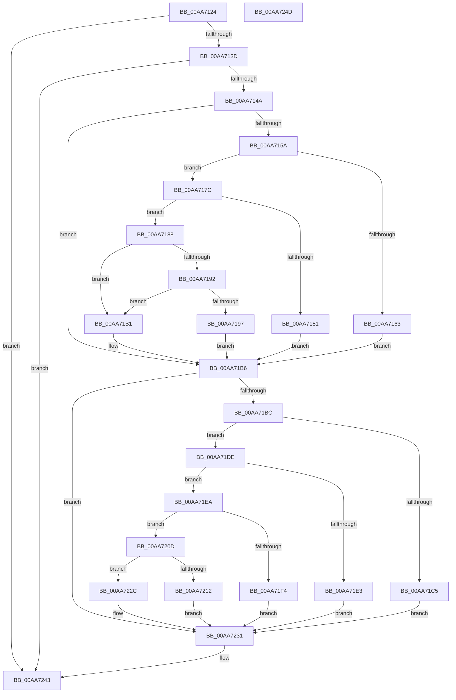

# PopSmartSuspendValidateSinglePrediction

- RVA: `0x00AA7124`–`0x00AA724E` (길이 `298` bytes)
- VA: `0x0000000140AA7124`
- 실행 섹션: `PAGE`
- PDB 이름 있음: `예`; PDB Function 태그: `아니요`
- unwind 정보 RVA: `0x0005CF00`
- 디코드: `88`개 명령, `298/298` bytes 표시
- 미해석 바이트: `0` (있으면 어셈블리에 `.byte`로 보존)

> 이 문서는 커널 이미지의 기계어와 PDB 기호를 분석해 생성했습니다. 4번과 5번은 함수 원형과 자료형을 바이너리 사용 방식에서 추정한 C 해석이며 원본 소스 복구 결과는 아닙니다.

## 1. Dependencies

- 직접 호출 지점: **1**; 고유 호출 대상: **1**
- 직접 호출자로 확인된 함수: **1**
- RIP 상대 이미지 참조: **0**

### Outgoing calls
- `0x00AA723E` → [PopDiagTraceSmartSuspendValidation](PopDiagTraceSmartSuspendValidation_function_00AA7254.md) (function, `0x00AA7254`)

### Direct callers
- [PopSmartSuspendValidatePredictions](../76/PopSmartSuspendValidatePredictions_function_007688EC.md) at `0x00768923`

### Static image references
- 디코드된 RIP-relative 메모리 참조가 없습니다.

## 2. Other-region calls and transfers

- 다른 실행 섹션으로 향하는 call: **0**
- 별도 외부 분기/꼬리 이동을 확인하지 못했습니다.

## 3. Assembly (complete function range)

```asm
00AA7124  40 53                           push rbx
00AA7126  48 83 EC 20                     sub rsp, 0x20
00AA712A  45 33 D2                        xor r10d, r10d
00AA712D  4C 8B C2                        mov r8, rdx
00AA7130  48 8B D9                        mov rbx, rcx
00AA7133  44 38 51 40                     cmp byte ptr [rcx + 0x40], r10b
00AA7137  0F 85 06 01 00 00               jne 0x140aa7243
00AA713D  4C 8B 49 18                     mov r9, qword ptr [rcx + 0x18]
00AA7141  4D 85 C9                        test r9, r9
00AA7144  0F 84 F9 00 00 00               je 0x140aa7243
00AA714A  41 8D 52 64                     lea edx, [r10 + 0x64]
00AA714E  44 8D 5A 64                     lea r11d, [rdx + 0x64]
00AA7152  8B CA                           mov ecx, edx
00AA7154  44 38 53 01                     cmp byte ptr [rbx + 1], r10b
00AA7158  74 5C                           je 0x140aa71b6
00AA715A  48 8B 43 20                     mov rax, qword ptr [rbx + 0x20]
00AA715E  48 85 C0                        test rax, rax
00AA7161  75 19                           jne 0x140aa717c
00AA7163  48 B8 00 34 E2 30 04 00 00 00   movabs rax, 0x430e23400
00AA716D  49 03 C1                        add rax, r9
00AA7170  4C 3B C0                        cmp r8, rax
00AA7173  1B C9                           sbb ecx, ecx
00AA7175  F7 D1                           not ecx
00AA7177  41 23 CB                        and ecx, r11d
00AA717A  EB 3A                           jmp 0x140aa71b6
00AA717C  4C 3B C0                        cmp r8, rax
00AA717F  77 07                           ja 0x140aa7188
00AA7181  B9 03 00 00 00                  mov ecx, 3
00AA7186  EB 2E                           jmp 0x140aa71b6
00AA7188  48 8B 43 28                     mov rax, qword ptr [rbx + 0x28]
00AA718C  48 83 F8 FF                     cmp rax, -1
00AA7190  74 1F                           je 0x140aa71b1
00AA7192  4C 3B C0                        cmp r8, rax
00AA7195  72 1A                           jb 0x140aa71b1
00AA7197  48 B9 00 34 E2 30 04 00 00 00   movabs rcx, 0x430e23400
00AA71A1  48 03 C1                        add rax, rcx
00AA71A4  49 3B C0                        cmp rax, r8
00AA71A7  1B C9                           sbb ecx, ecx
00AA71A9  41 23 CB                        and ecx, r11d
00AA71AC  83 C1 02                        add ecx, 2
00AA71AF  EB 05                           jmp 0x140aa71b6
00AA71B1  B9 CB 00 00 00                  mov ecx, 0xcb
00AA71B6  44 38 53 03                     cmp byte ptr [rbx + 3], r10b
00AA71BA  74 75                           je 0x140aa7231
00AA71BC  48 8B 43 30                     mov rax, qword ptr [rbx + 0x30]
00AA71C0  48 85 C0                        test rax, rax
00AA71C3  75 19                           jne 0x140aa71de
00AA71C5  48 B8 00 68 C4 61 08 00 00 00   movabs rax, 0x861c46800
00AA71CF  49 03 C1                        add rax, r9
00AA71D2  4C 3B C0                        cmp r8, rax
00AA71D5  1B D2                           sbb edx, edx
00AA71D7  F7 D2                           not edx
00AA71D9  41 23 D3                        and edx, r11d
00AA71DC  EB 53                           jmp 0x140aa7231
00AA71DE  4C 3B C0                        cmp r8, rax
00AA71E1  77 07                           ja 0x140aa71ea
00AA71E3  BA 03 00 00 00                  mov edx, 3
00AA71E8  EB 47                           jmp 0x140aa7231
00AA71EA  48 8B 43 38                     mov rax, qword ptr [rbx + 0x38]
00AA71EE  48 83 F8 FF                     cmp rax, -1
00AA71F2  75 19                           jne 0x140aa720d
00AA71F4  48 B8 00 40 3D 7F 5B 02 00 00   movabs rax, 0x25b7f3d4000
00AA71FE  49 03 C1                        add rax, r9
00AA7201  4C 3B C0                        cmp r8, rax
00AA7204  1B D2                           sbb edx, edx
00AA7206  41 23 D3                        and edx, r11d
00AA7209  FF C2                           inc edx
00AA720B  EB 24                           jmp 0x140aa7231
00AA720D  4C 3B C0                        cmp r8, rax
00AA7210  72 1A                           jb 0x140aa722c
00AA7212  48 BA 00 68 C4 61 08 00 00 00   movabs rdx, 0x861c46800
00AA721C  48 03 C2                        add rax, rdx
00AA721F  49 3B C0                        cmp rax, r8
00AA7222  1B D2                           sbb edx, edx
00AA7224  41 23 D3                        and edx, r11d
00AA7227  83 C2 02                        add edx, 2
00AA722A  EB 05                           jmp 0x140aa7231
00AA722C  BA CB 00 00 00                  mov edx, 0xcb
00AA7231  89 4B 4C                        mov dword ptr [rbx + 0x4c], ecx
00AA7234  48 8B CB                        mov rcx, rbx
00AA7237  89 53 50                        mov dword ptr [rbx + 0x50], edx
00AA723A  4C 89 43 58                     mov qword ptr [rbx + 0x58], r8
00AA723E  E8 11 00 00 00                  call 0x140aa7254
00AA7243  C6 43 40 01                     mov byte ptr [rbx + 0x40], 1
00AA7247  48 83 C4 20                     add rsp, 0x20
00AA724B  5B                              pop rbx
00AA724C  C3                              ret
00AA724D  CC                              int3
```

## 4. C-style interpretation (structured pseudocode)

```c
__int64 __fastcall PopSmartSuspendValidateSinglePrediction(__int64 a1, __int64 a2)
{
    __int64 result;
    __int64 v_r10;
    __int64 v_rsp;

    v_rsp = (v_rsp) - (32);
    v_r10 = 0;
    if ((*(unsigned __int8 *)(a1 + 64)) != 0) goto loc_00AA7243;
    if (*(unsigned __int64 *)(a1 + 24) == 0) goto loc_00AA7243;
    if ((*(unsigned __int8 *)(a1 + 1)) == 0) goto loc_00AA71B6;
    if (*(unsigned __int64 *)(a1 + 32) != 0) goto loc_00AA717C;
    result = (*(unsigned __int64 *)(a1 + 32)) + (*(unsigned __int64 *)(a1 + 24));
    a1 = (unsigned int)(~((unsigned int)((unsigned int)(v_r10 + 100))));
    a1 = (unsigned int)((a1) & ((unsigned int)(v_r10 + 100 + 100)));
    goto loc_00AA71B6;
loc_00AA717C:
    if (a2 > result) goto loc_00AA7188;
    goto loc_00AA71B6;
loc_00AA7188:
    if ((*(unsigned __int64 *)(a1 + 40)) == -1) goto loc_00AA71B1;
    if (a2 < (*(unsigned __int64 *)(a1 + 40))) goto loc_00AA71B1;
    result = (*(unsigned __int64 *)(a1 + 40)) + (3);
    a1 = (unsigned int)((3) & ((unsigned int)(v_r10 + 100 + 100)));
    a1 = (unsigned int)((a1) + (2));
    goto loc_00AA71B6;
loc_00AA71B1:
loc_00AA71B6:
    if ((*(unsigned __int8 *)(a1 + 3)) == 0) goto loc_00AA7231;
    if (*(unsigned __int64 *)(a1 + 48) != 0) goto loc_00AA71DE;
    result = (*(unsigned __int64 *)(a1 + 48)) + (*(unsigned __int64 *)(a1 + 24));
    a2 = (unsigned int)(~(v_r10 + 100));
    a2 = (unsigned int)((a2) & ((unsigned int)(v_r10 + 100 + 100)));
    goto loc_00AA7231;
loc_00AA71DE:
    if (a2 > result) goto loc_00AA71EA;
    goto loc_00AA7231;
loc_00AA71EA:
    if ((*(unsigned __int64 *)(a1 + 56)) != -1) goto loc_00AA720D;
    result = (*(unsigned __int64 *)(a1 + 56)) + (*(unsigned __int64 *)(a1 + 24));
    a2 = (unsigned int)((3) & ((unsigned int)(v_r10 + 100 + 100)));
    a2 = (unsigned int)((a2) + 1);
    goto loc_00AA7231;
loc_00AA720D:
    if (a2 < result) goto loc_00AA722C;
    result = (result) + (a2);
    a2 = (unsigned int)((a2) & ((unsigned int)(v_r10 + 100 + 100)));
    a2 = (unsigned int)((a2) + (2));
    goto loc_00AA7231;
loc_00AA722C:
loc_00AA7231:
    *(unsigned int *)(a1 + 76) = 203;
    *(unsigned int *)(a1 + 80) = 203;
    *(unsigned __int64 *)(a1 + 88) = a2;
    result = PopDiagTraceSmartSuspendValidation(a1, 203, a2, *(unsigned __int64 *)(a1 + 24));
loc_00AA7243:
    *(unsigned __int8 *)(a1 + 64) = 1;
    v_rsp = (v_rsp) + (32);
    return result;
}
```

## 5. (Beta) C Style

```c
int64_t PopSmartSuspendValidateSinglePrediction(void *Arg1, int64_t Arg2)
{
    uint8_t *arg1 = (uint8_t *)Arg1;

    int64_t result;
    int64_t local_r10;
    int64_t local_rsp;

    local_rsp = (local_rsp) - (32);
    local_r10 = 0;
    if ((*(uint8_t *)(arg1 + 0x40)) != 0) goto loc_00AA7243;
    if (*(uint64_t *)(arg1 + 0x18) == 0) goto loc_00AA7243;
    if ((*(uint8_t *)(arg1 + 0x1)) == 0) goto loc_00AA71B6;
    if (*(uint64_t *)(arg1 + 0x20) != 0) goto loc_00AA717C;
    result = (*(uint64_t *)(arg1 + 0x20)) + (*(uint64_t *)(arg1 + 0x18));
    Arg1 = (uint32_t)(~((uint32_t)((uint32_t)(local_r10 + 100))));
    Arg1 = (uint32_t)((Arg1) & ((uint32_t)(local_r10 + 100 + 100)));
    goto loc_00AA71B6;
loc_00AA717C:
    if (Arg2 > result) goto loc_00AA7188;
    goto loc_00AA71B6;
loc_00AA7188:
    if ((*(uint64_t *)(arg1 + 0x28)) == -1) goto loc_00AA71B1;
    if (Arg2 < (*(uint64_t *)(arg1 + 0x28))) goto loc_00AA71B1;
    result = (*(uint64_t *)(arg1 + 0x28)) + (3);
    Arg1 = (uint32_t)((3) & ((uint32_t)(local_r10 + 100 + 100)));
    Arg1 = (uint32_t)((Arg1) + (2));
    goto loc_00AA71B6;
loc_00AA71B1:
loc_00AA71B6:
    if ((*(uint8_t *)(arg1 + 0x3)) == 0) goto loc_00AA7231;
    if (*(uint64_t *)(arg1 + 0x30) != 0) goto loc_00AA71DE;
    result = (*(uint64_t *)(arg1 + 0x30)) + (*(uint64_t *)(arg1 + 0x18));
    Arg2 = (uint32_t)(~(local_r10 + 100));
    Arg2 = (uint32_t)((Arg2) & ((uint32_t)(local_r10 + 100 + 100)));
    goto loc_00AA7231;
loc_00AA71DE:
    if (Arg2 > result) goto loc_00AA71EA;
    goto loc_00AA7231;
loc_00AA71EA:
    if ((*(uint64_t *)(arg1 + 0x38)) != -1) goto loc_00AA720D;
    result = (*(uint64_t *)(arg1 + 0x38)) + (*(uint64_t *)(arg1 + 0x18));
    Arg2 = (uint32_t)((3) & ((uint32_t)(local_r10 + 100 + 100)));
    Arg2 = (uint32_t)((Arg2) + 1);
    goto loc_00AA7231;
loc_00AA720D:
    if (Arg2 < result) goto loc_00AA722C;
    result = (result) + (Arg2);
    Arg2 = (uint32_t)((Arg2) & ((uint32_t)(local_r10 + 100 + 100)));
    Arg2 = (uint32_t)((Arg2) + (2));
    goto loc_00AA7231;
loc_00AA722C:
loc_00AA7231:
    *(uint32_t *)(arg1 + 0x4C) = 203;
    *(uint32_t *)(arg1 + 0x50) = 203;
    *(uint64_t *)(arg1 + 0x58) = Arg2;
    result = PopDiagTraceSmartSuspendValidation(Arg1, 203, Arg2, *(uint64_t *)(arg1 + 0x18));
loc_00AA7243:
    *(uint8_t *)(arg1 + 0x40) = 1;
    local_rsp = (local_rsp) + (32);
    return result;
}
```

### 관측된 메모리 오프셋

구조체 형식이 확인되지 않은 접근은 인자 기준의 오프셋으로만 기록했습니다.

| 기준 인자 | 오프셋 표현 | 폭 (bit) | 접근 |
|---|---:|---:|---|
| `Arg1` | `+ 0x1` | `8` | `R` |
| `Arg1` | `+ 0x3` | `8` | `R` |
| `Arg1` | `+ 0x18` | `64` | `R` |
| `Arg1` | `+ 0x20` | `64` | `R` |
| `Arg1` | `+ 0x28` | `64` | `R` |
| `Arg1` | `+ 0x30` | `64` | `R` |
| `Arg1` | `+ 0x38` | `64` | `R` |
| `Arg1` | `+ 0x40` | `8` | `R` |
| `Arg1` | `+ 0x40` | `8` | `W` |
| `Arg1` | `+ 0x4C` | `32` | `W` |
| `Arg1` | `+ 0x50` | `32` | `W` |
| `Arg1` | `+ 0x58` | `64` | `W` |

## 6. Execution-region graph

[열기: 2D/3D 그래프와 함수 탐색 컨트롤 패널](../../../control-panel.html?section=page&rva=0x00AA7124&view=graph)

- 2D 그래프는 위에서 아래로 흐르고, 3D 그래프는 빈 공간을 드래그해 회전합니다. Shift+드래그는 이동, 휠은 확대·축소, 함수 노드 선택은 대상 보고서 이동입니다.

### Static fallback


