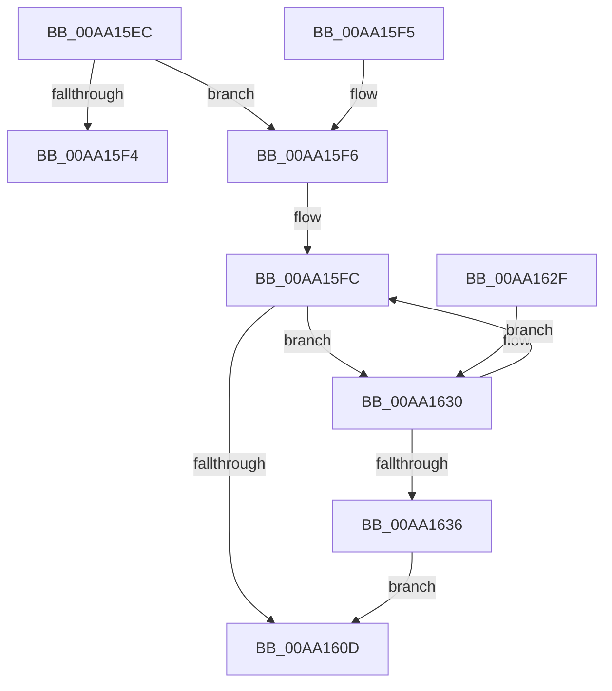

# PopThermalUpdatePassiveTimeTracking

- RVA: `0x00AA15EC`–`0x00AA1638` (길이 `76` bytes)
- VA: `0x0000000140AA15EC`
- 실행 섹션: `PAGE`
- PDB 이름 있음: `예`; PDB Function 태그: `아니요`
- unwind 정보 RVA: `0x000DB714`
- 디코드: `22`개 명령, `76/76` bytes 표시
- 미해석 바이트: `0` (있으면 어셈블리에 `.byte`로 보존)

> 이 문서는 커널 이미지의 기계어와 PDB 기호를 분석해 생성했습니다. 4번과 5번은 함수 원형과 자료형을 바이너리 사용 방식에서 추정한 C 해석이며 원본 소스 복구 결과는 아닙니다.

## 1. Dependencies

- 직접 호출 지점: **0**; 고유 호출 대상: **0**
- 직접 호출자로 확인된 함수: **9**
- RIP 상대 이미지 참조: **1**

### Outgoing calls
- 직접 디코드된 call 명령이 없습니다.

### Direct callers
- [PopCoolingTelemetryWorker](../../text/42/PopCoolingTelemetryWorker_function_0042FC3C.md) at `0x0042FD0A`
- [PopCoolingSxTransition](../../text/42/PopCoolingSxTransition_function_0042FEA8.md) at `0x0042FF1A`
- [PopThermalSxEntry](../../text/4E/PopThermalSxEntry_function_004E3D20.md) at `0x004E3DAB`
- [PopThermalTelemetryWorker](../../text/5D/PopThermalTelemetryWorker_function_005D57F0.md) at `0x005D584C`
- [PopOrphanCoolingExtension](../75/PopOrphanCoolingExtension_function_00757474.md) at `0x007574E5`
- [PopThermalZoneRemove](../75/PopThermalZoneRemove_function_0075FAD0.md) at `0x0075FB1A`
- [PopThermalWorker](../A4/PopThermalWorker_function_00A4E200.md) at `0x00A4E590`
- [PoSetThermalPassiveCooling](PoSetThermalPassiveCooling_function_00AA1540.md) at `0x00AA15B4`
- [PopDeactiveThermalRequest](../AD/PopDeactiveThermalRequest_function_00ADF634.md) at `0x00ADF688`

### Static image references
- `0x00AA1600` → RVA `0x00F0C940` (`.data`; read)

## 2. Other-region calls and transfers

- 다른 실행 섹션으로 향하는 call: **0**
- 별도 외부 분기/꼬리 이동을 확인하지 못했습니다.

## 3. Assembly (complete function range)

```asm
00AA15EC  80 39 00                        cmp byte ptr [rcx], 0
00AA15EF  4C 8B D1                        mov r10, rcx
00AA15F2  74 02                           je 0x140aa15f6
00AA15F4  C3                              ret
00AA15F5  CC                              int3
00AA15F6  41 B9 15 00 00 00               mov r9d, 0x15
00AA15FC  45 8D 41 FF                     lea r8d, [r9 - 1]
00AA1600  48 8D 05 39 B3 46 00            lea rax, [rip + 0x46b339]
00AA1607  41 3A 14 00                     cmp dl, byte ptr [r8 + rax]
00AA160B  72 23                           jb 0x140aa1630
00AA160D  48 BA 08 00 00 00 80 F7 FF FF   movabs rdx, 0xfffff78000000008
00AA1617  41 8D 49 FF                     lea ecx, [r9 - 1]
00AA161B  48 8B 12                        mov rdx, qword ptr [rdx]
00AA161E  48 8B C2                        mov rax, rdx
00AA1621  49 2B 42 08                     sub rax, qword ptr [r10 + 8]
00AA1625  49 01 44 CA 18                  add qword ptr [r10 + rcx*8 + 0x18], rax
00AA162A  49 89 52 08                     mov qword ptr [r10 + 8], rdx
00AA162E  C3                              ret
00AA162F  CC                              int3
00AA1630  41 83 C1 FF                     add r9d, -1
00AA1634  75 C6                           jne 0x140aa15fc
00AA1636  EB D5                           jmp 0x140aa160d
```

## 4. C-style interpretation (structured pseudocode)

```c
__int64 __fastcall PopThermalUpdatePassiveTimeTracking(__int64 a1, unsigned __int8 a2)
{
    __int64 result;

    if ((*(unsigned __int8 *)(a1)) == 0) goto loc_00AA15F6;
    return result;
loc_00AA15F6:
loc_00AA15FC:
    if (a2 < (*(unsigned __int8 *)(21 - 1 + v_rip + 4633401 * 1))) goto loc_00AA1630;
loc_00AA160D:
    result = (*(unsigned __int64 *)(a2)) - (*(unsigned __int64 *)(a1 + 8));
    *(unsigned __int64 *)(a1 + 8) = *(unsigned __int64 *)(a2);
    return result;
loc_00AA1630:
    a4 = (unsigned int)((21) + (-1));
    if (condition_is_not_equal) goto loc_00AA15FC;
    goto loc_00AA160D;
}
```

## 5. (Beta) C Style

```c
int64_t PopThermalUpdatePassiveTimeTracking(void *Arg1, uint8_t Arg2)
{
    uint8_t *arg1 = (uint8_t *)Arg1;

    int64_t result;

    if ((*(uint8_t *)(arg1)) == 0) goto loc_00AA15F6;
    return result;
loc_00AA15F6:
loc_00AA15FC:
    if (Arg2 < (*(uint8_t *)(21 - 0x1 + v_rip + 0x46B339 * 1))) goto loc_00AA1630;
loc_00AA160D:
    result = (*(uint64_t *)(Arg2)) - (*(uint64_t *)(arg1 + 0x8));
    *(uint64_t *)(arg1 + 0x8) = *(uint64_t *)(Arg2);
    return result;
loc_00AA1630:
    a4 = (uint32_t)((21) + (-1));
    if (condition_is_not_equal) goto loc_00AA15FC;
    goto loc_00AA160D;
}
```

### 관측된 메모리 오프셋

구조체 형식이 확인되지 않은 접근은 인자 기준의 오프셋으로만 기록했습니다.

| 기준 인자 | 오프셋 표현 | 폭 (bit) | 접근 |
|---|---:|---:|---|
| `Arg1` | `+ 0x0` | `8` | `R` |
| `Arg1` | `+ 0x8` | `64` | `R` |
| `Arg1` | `+ 0x8` | `64` | `W` |
| `Arg1` | `+ 0x18 + rcx*8` | `64` | `R/W` |

## 6. Execution-region graph

[열기: 2D/3D 그래프와 함수 탐색 컨트롤 패널](../../../control-panel.html?section=page&rva=0x00AA15EC&view=graph)

- 2D 그래프는 위에서 아래로 흐르고, 3D 그래프는 빈 공간을 드래그해 회전합니다. Shift+드래그는 이동, 휠은 확대·축소, 함수 노드 선택은 대상 보고서 이동입니다.

### Static fallback


