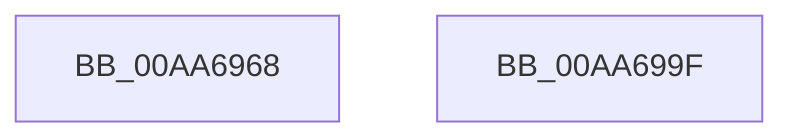

# PopUpdateBsdPowerTransitionReferenceTime

- RVA: `0x00AA6968`–`0x00AA69A0` (길이 `56` bytes)
- VA: `0x0000000140AA6968`
- 실행 섹션: `PAGE`
- PDB 이름 있음: `예`; PDB Function 태그: `아니요`
- unwind 정보 RVA: `0x0005C788`
- 디코드: `12`개 명령, `56/56` bytes 표시
- 미해석 바이트: `0` (있으면 어셈블리에 `.byte`로 보존)

> 이 문서는 커널 이미지의 기계어와 PDB 기호를 분석해 생성했습니다. 4번과 5번은 함수 원형과 자료형을 바이너리 사용 방식에서 추정한 C 해석이며 원본 소스 복구 결과는 아닙니다.

## 1. Dependencies

- 직접 호출 지점: **1**; 고유 호출 대상: **1**
- 직접 호출자로 확인된 함수: **1**
- RIP 상대 이미지 참조: **3**

### Outgoing calls
- `0x00AA698F` → [RtlComputeCrc32](../../text/46/RtlComputeCrc32_function_00468F40.md) (function, `0x00468F40`)

### Direct callers
- [PopBsdHandleRequest](../../text/4B/PopBsdHandleRequest_function_004B27A0.md) at `0x004B27F2`

### Static image references
- `0x00AA6976` → RVA `0x00E67420` (`.data`; read)
- `0x00AA6988` → RVA `0x00E67420` (`.data`; write)
- `0x00AA6994` → RVA `0x00E67428` (`.data`; write)

## 2. Other-region calls and transfers

- 다른 실행 섹션으로 향하는 call: **1**
  - `0x00AA698F` → [RtlComputeCrc32](../../text/46/RtlComputeCrc32_function_00468F40.md) (`PAGE` → `.text`)
- 별도 외부 분기/꼬리 이동을 확인하지 못했습니다.

## 3. Assembly (complete function range)

```asm
00AA6968  48 83 EC 28                     sub rsp, 0x28
00AA696C  48 B8 14 00 00 00 80 F7 FF FF   movabs rax, 0xfffff78000000014
00AA6976  48 8D 15 A3 0A 3C 00            lea rdx, [rip + 0x3c0aa3]
00AA697D  41 B8 08 00 00 00               mov r8d, 8
00AA6983  33 C9                           xor ecx, ecx
00AA6985  48 8B 00                        mov rax, qword ptr [rax]
00AA6988  48 89 05 91 0A 3C 00            mov qword ptr [rip + 0x3c0a91], rax
00AA698F  E8 AC 25 9C FF                  call 0x140468f40
00AA6994  89 05 8E 0A 3C 00               mov dword ptr [rip + 0x3c0a8e], eax
00AA699A  48 83 C4 28                     add rsp, 0x28
00AA699E  C3                              ret
00AA699F  CC                              int3
```

## 4. C-style interpretation (structured pseudocode)

```c
__int64 __fastcall PopUpdateBsdPowerTransitionReferenceTime(int a1)
{
    __int64 result;
    __int64 v_rsp;

    v_rsp = (v_rsp) - (40);
    a1 = 0;
    *(unsigned __int64 *)(v_rip + 3934865) = *(unsigned __int64 *)(result);
    result = RtlComputeCrc32(a1, v_rip + 3934883, 8, a4);
    *(unsigned int *)(v_rip + 3934862) = (unsigned int)(result);
    v_rsp = (v_rsp) + (40);
    return result;
}
```

## 5. (Beta) C Style

```c
int64_t PopUpdateBsdPowerTransitionReferenceTime(int32_t Arg1)
{
    int64_t result;
    int64_t local_rsp;

    local_rsp = (local_rsp) - (40);
    Arg1 = 0;
    *(uint64_t *)(v_rip + 0x3C0A91) = *(uint64_t *)(result);
    result = RtlComputeCrc32(Arg1, v_rip + 3934883, 8, a4);
    *(uint32_t *)(v_rip + 0x3C0A8E) = (uint32_t)(result);
    local_rsp = (local_rsp) + (40);
    return result;
}
```

## 6. Execution-region graph

[열기: 2D/3D 그래프와 함수 탐색 컨트롤 패널](../../../control-panel.html?section=page&rva=0x00AA6968&view=graph)

- 2D 그래프는 위에서 아래로 흐르고, 3D 그래프는 빈 공간을 드래그해 회전합니다. Shift+드래그는 이동, 휠은 확대·축소, 함수 노드 선택은 대상 보고서 이동입니다.

### Static fallback


