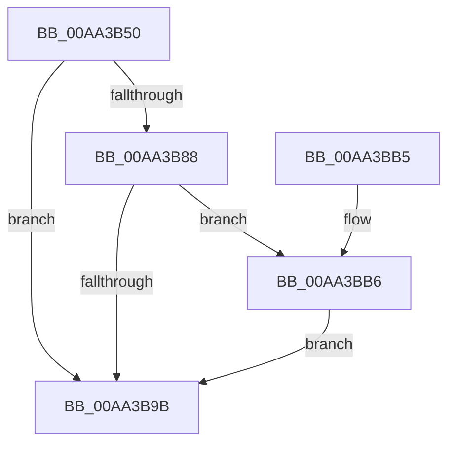

# PpmEventQosSupport

- RVA: `0x00AA3B50`–`0x00AA3C2B` (길이 `219` bytes)
- VA: `0x0000000140AA3B50`
- 실행 섹션: `PAGE`
- PDB 이름 있음: `예`; PDB Function 태그: `아니요`
- unwind 정보 RVA: `0x000BB420`
- 디코드: `55`개 명령, `219/219` bytes 표시
- 미해석 바이트: `0` (있으면 어셈블리에 `.byte`로 보존)

> 이 문서는 커널 이미지의 기계어와 PDB 기호를 분석해 생성했습니다. 4번과 5번은 함수 원형과 자료형을 바이너리 사용 방식에서 추정한 C 해석이며 원본 소스 복구 결과는 아닙니다.

## 1. Dependencies

- 직접 호출 지점: **3**; 고유 호출 대상: **3**
- 직접 호출자로 확인된 함수: **2**
- RIP 상대 이미지 참조: **8**

### Outgoing calls
- `0x00AA3B92` → [EtwEventEnabled](../../text/39/EtwEventEnabled_function_00392450.md) (function, `0x00392450`)
- `0x00AA3BA2` → [_security_check_cookie](../../text/6A/_security_check_cookie_function_006AC640.md) (function, `0x006AC640`)
- `0x00AA3C21` → [EtwWrite](../../text/41/EtwWrite_function_0041C720.md) (function, `0x0041C720`)

### Direct callers
- [PpmEventTraceControlCallback](../A5/PpmEventTraceControlCallback_function_00A51F60.md) at `0x00A520D7`
- [PpmPerfUpdateDomainPolicy](../A9/PpmPerfUpdateDomainPolicy_function_00A97030.md) at `0x00A97189`

### Static image references
- `0x00AA3B5D` → RVA `0x00E0A740` (`.data`; read)
- `0x00AA3B6D` → RVA `0x0001C810` (`.rdata`; read)
- `0x00AA3B74` → RVA `0x0001C820` (`.rdata`; read)
- `0x00AA3B7F` → RVA `0x00E67A39` (`.data`; read)
- `0x00AA3B88` → RVA `0x00F083E8` (`.data`; read)
- `0x00AA3BBD` → RVA `0x00FC6ADC` (`ALMOSTRO`; read)
- `0x00AA3BDB` → RVA `0x00FC6AA6` (`ALMOSTRO`; read)
- `0x00AA3C0D` → RVA `0x00FC6DA4` (`ALMOSTRO`; read)

## 2. Other-region calls and transfers

- 다른 실행 섹션으로 향하는 call: **3**
  - `0x00AA3B92` → [EtwEventEnabled](../../text/39/EtwEventEnabled_function_00392450.md) (`PAGE` → `.text`)
  - `0x00AA3BA2` → [_security_check_cookie](../../text/6A/_security_check_cookie_function_006AC640.md) (`PAGE` → `.text`)
  - `0x00AA3C21` → [EtwWrite](../../text/41/EtwWrite_function_0041C720.md) (`PAGE` → `.text`)
- 별도 외부 분기/꼬리 이동을 확인하지 못했습니다.

## 3. Assembly (complete function range)

```asm
00AA3B50  48 89 5C 24 08                  mov qword ptr [rsp + 8], rbx
00AA3B55  55                              push rbp
00AA3B56  48 8B EC                        mov rbp, rsp
00AA3B59  48 83 EC 70                     sub rsp, 0x70
00AA3B5D  48 8B 05 DC 6B 36 00            mov rax, qword ptr [rip + 0x366bdc]
00AA3B64  48 33 C4                        xor rax, rsp
00AA3B67  48 89 45 F8                     mov qword ptr [rbp - 8], rax
00AA3B6B  84 C9                           test cl, cl
00AA3B6D  48 8D 05 9C 8C 57 FF            lea rax, [rip - 0xa87364]
00AA3B74  48 8D 1D A5 8C 57 FF            lea rbx, [rip - 0xa8735b]
00AA3B7B  48 0F 44 D8                     cmove rbx, rax
00AA3B7F  80 3D B3 3E 3C 00 00            cmp byte ptr [rip + 0x3c3eb3], 0
00AA3B86  74 13                           je 0x140aa3b9b
00AA3B88  48 8B 0D 59 48 46 00            mov rcx, qword ptr [rip + 0x464859]
00AA3B8F  48 8B D3                        mov rdx, rbx
00AA3B92  E8 B9 E8 8E FF                  call 0x140392450
00AA3B97  84 C0                           test al, al
00AA3B99  75 1B                           jne 0x140aa3bb6
00AA3B9B  48 8B 4D F8                     mov rcx, qword ptr [rbp - 8]
00AA3B9F  48 33 CC                        xor rcx, rsp
00AA3BA2  E8 99 8A C0 FF                  call 0x1406ac640
00AA3BA7  48 8B 9C 24 80 00 00 00         mov rbx, qword ptr [rsp + 0x80]
00AA3BAF  48 83 C4 70                     add rsp, 0x70
00AA3BB3  5D                              pop rbp
00AA3BB4  C3                              ret
00AA3BB5  CC                              int3
00AA3BB6  33 C0                           xor eax, eax
00AA3BB8  B9 04 00 00 00                  mov ecx, 4
00AA3BBD  38 05 19 2F 52 00               cmp byte ptr [rip + 0x522f19], al
00AA3BC3  48 8B D3                        mov rdx, rbx
00AA3BC6  89 4D D0                        mov dword ptr [rbp - 0x30], ecx
00AA3BC9  0F 95 C0                        setne al
00AA3BCC  89 4D E0                        mov dword ptr [rbp - 0x20], ecx
00AA3BCF  89 45 C0                        mov dword ptr [rbp - 0x40], eax
00AA3BD2  44 8D 49 FF                     lea r9d, [rcx - 1]
00AA3BD6  33 C0                           xor eax, eax
00AA3BD8  89 4D F0                        mov dword ptr [rbp - 0x10], ecx
00AA3BDB  38 05 C5 2E 52 00               cmp byte ptr [rip + 0x522ec5], al
00AA3BE1  48 8B 0D 00 48 46 00            mov rcx, qword ptr [rip + 0x464800]
00AA3BE8  0F 95 C0                        setne al
00AA3BEB  83 65 D4 00                     and dword ptr [rbp - 0x2c], 0
00AA3BEF  83 65 E4 00                     and dword ptr [rbp - 0x1c], 0
00AA3BF3  45 33 C0                        xor r8d, r8d
00AA3BF6  83 65 F4 00                     and dword ptr [rbp - 0xc], 0
00AA3BFA  89 45 C4                        mov dword ptr [rbp - 0x3c], eax
00AA3BFD  48 8D 45 C0                     lea rax, [rbp - 0x40]
00AA3C01  48 89 45 C8                     mov qword ptr [rbp - 0x38], rax
00AA3C05  48 8D 45 C4                     lea rax, [rbp - 0x3c]
00AA3C09  48 89 45 D8                     mov qword ptr [rbp - 0x28], rax
00AA3C0D  48 8D 05 90 31 52 00            lea rax, [rip + 0x523190]
00AA3C14  48 89 45 E8                     mov qword ptr [rbp - 0x18], rax
00AA3C18  48 8D 45 C8                     lea rax, [rbp - 0x38]
00AA3C1C  48 89 44 24 20                  mov qword ptr [rsp + 0x20], rax
00AA3C21  E8 FA 8A 97 FF                  call 0x14041c720
00AA3C26  E9 70 FF FF FF                  jmp 0x140aa3b9b
```

## 4. C-style interpretation (structured pseudocode)

```c
__int64 __fastcall PpmEventQosSupport(unsigned __int8 a1, __int64 a2, int a3)
{
    __int64 result;
    __int64 v_rbx;
    __int64 v_rsp;
    unsigned __int64 v_stack_m10;
    unsigned int v_stack_m14;
    unsigned int v_stack_m18;
    unsigned __int64 v_stack_m20;
    unsigned int v_stack_m24;
    unsigned int v_stack_m28;
    unsigned __int64 v_stack_m30;
    unsigned int v_stack_m34;
    unsigned int v_stack_m38;
    unsigned __int64 v_stack_m40;
    unsigned int v_stack_m44;
    unsigned int v_stack_m48;
    unsigned __int64 v_stack_p20;
    unsigned __int64 v_stack_p8;

    v_stack_p8 = v_rbx;
    v_rsp = (v_rsp) - (112);
    result = (*(unsigned __int64 *)(v_rip + 3566556)) ^ (v_rsp);
    v_stack_m10 = result;
    v_rbx = v_rip - 11039579;
    if (a1 == 0) { v_rbx = v_rip - 11039588; }
    if ((*(unsigned __int8 *)(v_rip + 3948211)) == 0) goto loc_00AA3B9B;
    result = EtwEventEnabled(*(unsigned __int64 *)(v_rip + 4606041), v_rbx, a3, a4);
    if ((unsigned __int8)(result) != 0) goto loc_00AA3BB6;
loc_00AA3B9B:
    a1 = (v_stack_m10) ^ (v_rsp);
    result = _security_check_cookie(a1, v_rbx, a3, a4);
    v_rsp = (v_rsp) + (112);
    return result;
loc_00AA3BB6:
    result = 0;
    v_stack_m38 = 4;
    result = ((*(unsigned __int8 *)(v_rip + 5386009)) != 0) ? 1 : 0;
    v_stack_m28 = 4;
    v_stack_m48 = (unsigned int)(result);
    result = 0;
    v_stack_m18 = 4;
    result = ((*(unsigned __int8 *)(v_rip + 5385925)) != 0) ? 1 : 0;
    a3 = 0;
    v_stack_m44 = (unsigned int)(result);
    v_stack_m40 = v_stack_m48;
    v_stack_m30 = v_stack_m44;
    v_stack_m20 = v_rip + 5386640;
    v_stack_p20 = v_stack_m40;
    result = EtwWrite(*(unsigned __int64 *)(v_rip + 4605952), v_stack_p8, a3, 4 - 1);
    goto loc_00AA3B9B;
}
```

## 5. (Beta) C Style

```c
int64_t PpmEventQosSupport(uint8_t Arg1, int64_t Arg2, int32_t Arg3)
{
    int64_t result;
    int64_t local_rbx;
    int64_t local_rsp;
    uint64_t v_stack_m10;
    uint32_t v_stack_m14;
    uint32_t v_stack_m18;
    uint64_t v_stack_m20;
    uint32_t v_stack_m24;
    uint32_t v_stack_m28;
    uint64_t v_stack_m30;
    uint32_t v_stack_m34;
    uint32_t v_stack_m38;
    uint64_t v_stack_m40;
    uint32_t v_stack_m44;
    uint32_t v_stack_m48;
    uint64_t v_stack_p20;
    uint64_t v_stack_p8;

    v_stack_p8 = local_rbx;
    local_rsp = (local_rsp) - (112);
    result = (*(uint64_t *)(v_rip + 0x366BDC)) ^ (local_rsp);
    v_stack_m10 = result;
    local_rbx = v_rip - 11039579;
    if (Arg1 == 0) { local_rbx = v_rip - 11039588; }
    if ((*(uint8_t *)(v_rip + 0x3C3EB3)) == 0) goto loc_00AA3B9B;
    result = EtwEventEnabled(*(uint64_t *)(v_rip + 0x464859), local_rbx, Arg3, a4);
    if ((uint8_t)(result) != 0) goto loc_00AA3BB6;
loc_00AA3B9B:
    Arg1 = (v_stack_m10) ^ (local_rsp);
    result = _security_check_cookie(Arg1, local_rbx, Arg3, a4);
    local_rsp = (local_rsp) + (112);
    return result;
loc_00AA3BB6:
    result = 0;
    v_stack_m38 = 4;
    result = ((*(uint8_t *)(v_rip + 0x522F19)) != 0) ? 1 : 0;
    v_stack_m28 = 4;
    v_stack_m48 = (uint32_t)(result);
    result = 0;
    v_stack_m18 = 4;
    result = ((*(uint8_t *)(v_rip + 0x522EC5)) != 0) ? 1 : 0;
    Arg3 = 0;
    v_stack_m44 = (uint32_t)(result);
    v_stack_m40 = v_stack_m48;
    v_stack_m30 = v_stack_m44;
    v_stack_m20 = v_rip + 5386640;
    v_stack_p20 = v_stack_m40;
    result = EtwWrite(*(uint64_t *)(v_rip + 0x464800), v_stack_p8, Arg3, 4 - 1);
    goto loc_00AA3B9B;
}
```

## 6. Execution-region graph

[열기: 2D/3D 그래프와 함수 탐색 컨트롤 패널](../../../control-panel.html?section=page&rva=0x00AA3B50&view=graph)

- 2D 그래프는 위에서 아래로 흐르고, 3D 그래프는 빈 공간을 드래그해 회전합니다. Shift+드래그는 이동, 휠은 확대·축소, 함수 노드 선택은 대상 보고서 이동입니다.

### Static fallback


