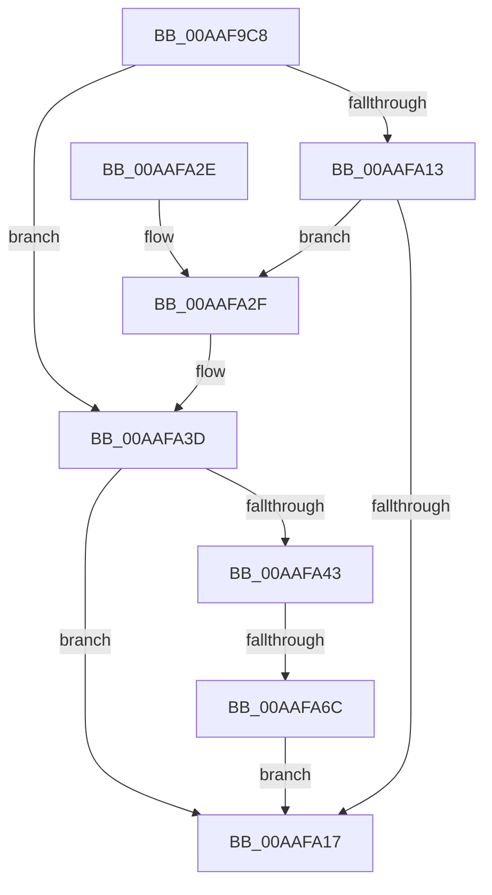

# PpmPerfResizeHistory

- RVA: `0x00AAF9C8`–`0x00AAFA73` (길이 `171` bytes)
- VA: `0x0000000140AAF9C8`
- 실행 섹션: `PAGE`
- PDB 이름 있음: `예`; PDB Function 태그: `예`
- unwind 정보 RVA: `0x000BA454`
- 디코드: `43`개 명령, `171/171` bytes 표시
- 미해석 바이트: `0` (있으면 어셈블리에 `.byte`로 보존)

> 이 문서는 커널 이미지의 기계어와 PDB 기호를 분석해 생성했습니다. 4번과 5번은 함수 원형과 자료형을 바이너리 사용 방식에서 추정한 C 해석이며 원본 소스 복구 결과는 아닙니다.

## 1. Dependencies

- 직접 호출 지점: **3**; 고유 호출 대상: **3**
- 직접 호출자로 확인된 함수: **2**
- RIP 상대 이미지 참조: **2**

### Outgoing calls
- `0x00AAF9E1` → [PpmGetPerfPolicyClass](../../text/42/PpmGetPerfPolicyClass_function_0042CF54.md) (function, `0x0042CF54`)
- `0x00AAFA34` → [ExFreePoolWithTag](../../poolcode/B8/ExFreePoolWithTag_function_00B82870.md) (function, `0x00B82870`)
- `0x00AAFA5E` → [ExAllocatePool2](../../poolcode/B8/ExAllocatePool2_function_00B820F0.md) (function, `0x00B820F0`)

### Direct callers
- [PpmPerfResizeHistoryAll](../75/PpmPerfResizeHistoryAll_function_0075ADF8.md) at `0x0075AE46`
- [PpmPerfResizeHistoryAll](../75/PpmPerfResizeHistoryAll_function_0075ADF8.md) at `0x0075AE93`
- [PpmRegisterPerfStates](../75/PpmRegisterPerfStates_function_0075B084.md) at `0x0075B965`

### Static image references
- `0x00AAF9E6` → RVA `0x00E08380` (`.data`; read)
- `0x00AAF9F5` → RVA `0x00F0CE0C` (`.data`; read)

## 2. Other-region calls and transfers

- 다른 실행 섹션으로 향하는 call: **3**
  - `0x00AAF9E1` → [PpmGetPerfPolicyClass](../../text/42/PpmGetPerfPolicyClass_function_0042CF54.md) (`PAGE` → `.text`)
  - `0x00AAFA34` → [ExFreePoolWithTag](../../poolcode/B8/ExFreePoolWithTag_function_00B82870.md) (`PAGE` → `POOLCODE`)
  - `0x00AAFA5E` → [ExAllocatePool2](../../poolcode/B8/ExAllocatePool2_function_00B820F0.md) (`PAGE` → `POOLCODE`)
- call이 아닌 외부 분기/꼬리 이동: **1**
  - `0x00AAFA66` → [sub_00B4A89A](../B4/Unknown_function_00B4A89A.md) (`tail-transfer`)

## 3. Assembly (complete function range)

```asm
00AAF9C8  48 89 5C 24 08                  mov qword ptr [rsp + 8], rbx
00AAF9CD  48 89 6C 24 10                  mov qword ptr [rsp + 0x10], rbp
00AAF9D2  48 89 74 24 18                  mov qword ptr [rsp + 0x18], rsi
00AAF9D7  57                              push rdi
00AAF9D8  48 83 EC 20                     sub rsp, 0x20
00AAF9DC  48 8B F1                        mov rsi, rcx
00AAF9DF  33 FF                           xor edi, edi
00AAF9E1  E8 6E D5 97 FF                  call 0x14042cf54
00AAF9E6  4C 8B 05 93 89 35 00            mov r8, qword ptr [rip + 0x358993]
00AAF9ED  48 8B 4E 20                     mov rcx, qword ptr [rsi + 0x20]
00AAF9F1  44 0F B6 C8                     movzx r9d, al
00AAF9F5  48 63 05 10 D4 45 00            movsxd rax, dword ptr [rip + 0x45d410]
00AAF9FC  48 69 C0 E8 01 00 00            imul rax, rax, 0x1e8
00AAFA03  49 03 C0                        add rax, r8
00AAFA06  41 0F B6 6C 01 50               movzx ebp, byte ptr [r9 + rax + 0x50]
00AAFA0C  8B DD                           mov ebx, ebp
00AAFA0E  48 85 C9                        test rcx, rcx
00AAFA11  74 2A                           je 0x140aafa3d
00AAFA13  39 19                           cmp dword ptr [rcx], ebx
00AAFA15  75 18                           jne 0x140aafa2f
00AAFA17  48 8B 5C 24 30                  mov rbx, qword ptr [rsp + 0x30]
00AAFA1C  8B C7                           mov eax, edi
00AAFA1E  48 8B 6C 24 38                  mov rbp, qword ptr [rsp + 0x38]
00AAFA23  48 8B 74 24 40                  mov rsi, qword ptr [rsp + 0x40]
00AAFA28  48 83 C4 20                     add rsp, 0x20
00AAFA2C  5F                              pop rdi
00AAFA2D  C3                              ret
00AAFA2E  CC                              int3
00AAFA2F  BA 50 50 4D 70                  mov edx, 0x704d5050
00AAFA34  E8 37 2E 0D 00                  call 0x140b82870
00AAFA39  48 89 7E 20                     mov qword ptr [rsi + 0x20], rdi
00AAFA3D  40 80 FD 01                     cmp bpl, 1
00AAFA41  76 D4                           jbe 0x140aafa17
00AAFA43  8D 04 6D 00 00 00 00            lea eax, [rbp*2]
00AAFA4A  B9 40 00 00 00                  mov ecx, 0x40
00AAFA4F  03 C5                           add eax, ebp
00AAFA51  41 B8 50 50 4D 70               mov r8d, 0x704d5050
00AAFA57  8D 14 85 2C 00 00 00            lea edx, [rax*4 + 0x2c]
00AAFA5E  E8 8D 26 0D 00                  call 0x140b820f0
00AAFA63  48 85 C0                        test rax, rax
00AAFA66  0F 85 2E AE 09 00               jne 0x140b4a89a
00AAFA6C  BF 9A 00 00 C0                  mov edi, 0xc000009a
00AAFA71  EB A4                           jmp 0x140aafa17
```

## 4. C-style interpretation (structured pseudocode)

```c
__int64 __fastcall PpmPerfResizeHistory(__int64 a1)
{
    __int64 result;
    __int64 v_rdi;
    __int64 v_rsp;
    unsigned __int64 v_stack_p10;
    unsigned __int64 v_stack_p18;
    unsigned __int64 v_stack_p8;

    v_stack_p8 = v_rbx;
    v_stack_p10 = v_rbp;
    v_stack_p18 = v_rsi;
    v_rsp = (v_rsp) - (32);
    v_rdi = 0;
    result = PpmGetPerfPolicyClass(a1, a2, a3, a4);
    result = ((int)(*(unsigned int *)(v_rip + 4576272))) * ((int)(*(unsigned int *)(v_rip + 4576272)));
    result = (result) + (*(unsigned __int64 *)(v_rip + 3508627));
    if (*(unsigned __int64 *)(a1 + 32) == 0) goto loc_00AAFA3D;
    if ((*(unsigned int *)(*(unsigned __int64 *)(a1 + 32))) != ((unsigned int)((unsigned int)((unsigned int)(*(unsigned __int8 *)((unsigned __int8)(result) + result * 1 + 80)))))) goto loc_00AAFA2F;
loc_00AAFA17:
    v_rsp = (v_rsp) + (32);
    return 0;
loc_00AAFA2F:
    result = ExFreePoolWithTag(*(unsigned __int64 *)(a1 + 32), (unsigned int)(0x704D5050ULL), *(unsigned __int64 *)(v_rip + 3508627), (unsigned __int8)(result));
    *(unsigned __int64 *)(v_stack_p18 + 32) = 0;
loc_00AAFA3D:
    if (((unsigned __int8)(v_stack_p10)) <= 1) goto loc_00AAFA17;
    result = (unsigned int)((v_stack_p10 * 2) + ((unsigned int)(v_stack_p10)));
    result = ExAllocatePool2(64, result * 4 + 44, (unsigned int)(0x704D5050ULL), (unsigned __int8)(result));
    goto loc_00AAFA17;
}
```

## 5. (Beta) C Style

```c
int64_t PpmPerfResizeHistory(void *Arg1)
{
    uint8_t *arg1 = (uint8_t *)Arg1;

    int64_t result;
    int64_t local_rdi;
    int64_t local_rsp;
    uint64_t v_stack_p10;
    uint64_t v_stack_p18;
    uint64_t v_stack_p8;

    v_stack_p8 = local_rbx;
    v_stack_p10 = local_rbp;
    v_stack_p18 = local_rsi;
    local_rsp = (local_rsp) - (32);
    local_rdi = 0;
    result = PpmGetPerfPolicyClass(Arg1, a2, a3, a4);
    result = ((int32_t)(*(uint32_t *)(v_rip + 0x45D410))) * ((int32_t)(*(uint32_t *)(v_rip + 0x45D410)));
    result = (result) + (*(uint64_t *)(v_rip + 0x358993));
    if (*(uint64_t *)(arg1 + 0x20) == 0) goto loc_00AAFA3D;
    if ((*(uint32_t *)(*(uint64_t *)(arg1 + 0x20))) != ((uint32_t)((uint32_t)((uint32_t)(*(uint8_t *)((uint8_t)(result) + result * 1 + 0x50)))))) goto loc_00AAFA2F;
loc_00AAFA17:
    local_rsp = (local_rsp) + (32);
    return 0;
loc_00AAFA2F:
    result = ExFreePoolWithTag(*(uint64_t *)(arg1 + 0x20), (uint32_t)(0x704D5050ULL), *(uint64_t *)(v_rip + 0x358993), (uint8_t)(result));
    *(uint64_t *)(v_stack_p18 + 0x20) = 0;
loc_00AAFA3D:
    if (((uint8_t)(v_stack_p10)) <= 1) goto loc_00AAFA17;
    result = (uint32_t)((v_stack_p10 * 2) + ((uint32_t)(v_stack_p10)));
    result = ExAllocatePool2(64, result * 4 + 44, (uint32_t)(0x704D5050ULL), (uint8_t)(result));
    goto loc_00AAFA17;
}
```

### 관측된 메모리 오프셋

구조체 형식이 확인되지 않은 접근은 인자 기준의 오프셋으로만 기록했습니다.

| 기준 인자 | 오프셋 표현 | 폭 (bit) | 접근 |
|---|---:|---:|---|
| `Arg1` | `+ 0x20` | `64` | `R` |
| `Arg1` | `+ 0x20` | `64` | `W` |

## 6. Execution-region graph

[열기: 2D/3D 그래프와 함수 탐색 컨트롤 패널](../../../control-panel.html?section=page&rva=0x00AAF9C8&view=graph)

- 2D 그래프는 위에서 아래로 흐르고, 3D 그래프는 빈 공간을 드래그해 회전합니다. Shift+드래그는 이동, 휠은 확대·축소, 함수 노드 선택은 대상 보고서 이동입니다.

### Static fallback


