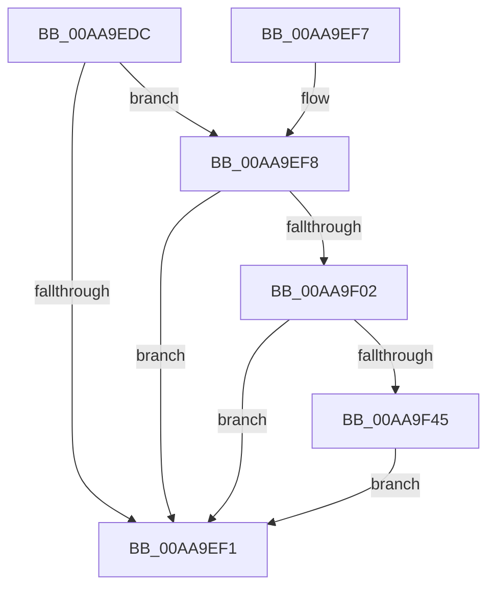

# PsApplyDeepFreezeOptimizations

- RVA: `0x00AA9EDC`–`0x00AA9F5C` (길이 `128` bytes)
- VA: `0x0000000140AA9EDC`
- 실행 섹션: `PAGE`
- PDB 이름 있음: `예`; PDB Function 태그: `아니요`
- unwind 정보 RVA: `0x000BBC4C`
- 디코드: `36`개 명령, `128/128` bytes 표시
- 미해석 바이트: `0` (있으면 어셈블리에 `.byte`로 보존)

> 이 문서는 커널 이미지의 기계어와 PDB 기호를 분석해 생성했습니다. 4번과 5번은 함수 원형과 자료형을 바이너리 사용 방식에서 추정한 C 해석이며 원본 소스 복구 결과는 아닙니다.

## 1. Dependencies

- 직접 호출 지점: **4**; 고유 호출 대상: **4**
- 직접 호출자로 확인된 함수: **2**
- RIP 상대 이미지 참조: **0**

### Outgoing calls
- `0x00AA9F02` → [PsGetProcessSessionIdEx](../../text/22/PsGetProcessSessionIdEx_function_0022F8F0.md) (function, `0x0022F8F0`)
- `0x00AA9F3C` → [PspUpdateCalloutParameters](../../text/49/PspUpdateCalloutParameters_function_0049BBA4.md) (function, `0x0049BBA4`)
- `0x00AA9F45` → [PsSessionGetWin32Callouts](../../text/47/PsSessionGetWin32Callouts_function_00474F98.md) (function, `0x00474F98`)
- `0x00AA9F55` → [ExCallCallBack](../90/ExCallCallBack_function_009054B4.md) (function, `0x009054B4`)

### Direct callers
- [PspChangeProcessExecutionStateLegacy](../../text/5E/PspChangeProcessExecutionStateLegacy_function_005E4098.md) at `0x005E41CD`
- [PspChangeProcessExecutionState](../AE/PspChangeProcessExecutionState_function_00AEC594.md) at `0x00AEC6D4`

### Static image references
- 디코드된 RIP-relative 메모리 참조가 없습니다.

## 2. Other-region calls and transfers

- 다른 실행 섹션으로 향하는 call: **3**
  - `0x00AA9F02` → [PsGetProcessSessionIdEx](../../text/22/PsGetProcessSessionIdEx_function_0022F8F0.md) (`PAGE` → `.text`)
  - `0x00AA9F3C` → [PspUpdateCalloutParameters](../../text/49/PspUpdateCalloutParameters_function_0049BBA4.md) (`PAGE` → `.text`)
  - `0x00AA9F45` → [PsSessionGetWin32Callouts](../../text/47/PsSessionGetWin32Callouts_function_00474F98.md) (`PAGE` → `.text`)
- 별도 외부 분기/꼬리 이동을 확인하지 못했습니다.

## 3. Assembly (complete function range)

```asm
00AA9EDC  40 53                           push rbx
00AA9EDE  48 83 EC 50                     sub rsp, 0x50
00AA9EE2  33 C0                           xor eax, eax
00AA9EE4  48 8B D9                        mov rbx, rcx
00AA9EE7  89 44 24 34                     mov dword ptr [rsp + 0x34], eax
00AA9EEB  8B 02                           mov eax, dword ptr [rdx]
00AA9EED  A8 01                           test al, 1
00AA9EEF  75 07                           jne 0x140aa9ef8
00AA9EF1  48 83 C4 50                     add rsp, 0x50
00AA9EF5  5B                              pop rbx
00AA9EF6  C3                              ret
00AA9EF7  CC                              int3
00AA9EF8  48 83 B9 98 02 00 00 00         cmp qword ptr [rcx + 0x298], 0
00AA9F00  74 EF                           je 0x140aa9ef1
00AA9F02  E8 E9 59 78 FF                  call 0x14022f8f0
00AA9F07  48 83 64 24 30 00               and qword ptr [rsp + 0x30], 0
00AA9F0D  4C 8D 4C 24 68                  lea r9, [rsp + 0x68]
00AA9F12  48 83 64 24 38 00               and qword ptr [rsp + 0x38], 0
00AA9F18  48 8D 54 24 30                  lea rdx, [rsp + 0x30]
00AA9F1D  89 44 24 68                     mov dword ptr [rsp + 0x68], eax
00AA9F21  45 33 C0                        xor r8d, r8d
00AA9F24  33 C0                           xor eax, eax
00AA9F26  48 89 5C 24 40                  mov qword ptr [rsp + 0x40], rbx
00AA9F2B  48 89 44 24 24                  mov qword ptr [rsp + 0x24], rax
00AA9F30  48 89 44 24 20                  mov qword ptr [rsp + 0x20], rax
00AA9F35  44 8D 50 2B                     lea r10d, [rax + 0x2b]
00AA9F39  41 8B CA                        mov ecx, r10d
00AA9F3C  E8 63 1C 9F FF                  call 0x14049bba4
00AA9F41  85 C0                           test eax, eax
00AA9F43  74 AC                           je 0x140aa9ef1
00AA9F45  E8 4E B0 9C FF                  call 0x140474f98
00AA9F4A  48 8B C8                        mov rcx, rax
00AA9F4D  4C 8D 44 24 30                  lea r8, [rsp + 0x30]
00AA9F52  41 8B D2                        mov edx, r10d
00AA9F55  E8 5A B5 E5 FF                  call 0x1409054b4
00AA9F5A  EB 95                           jmp 0x140aa9ef1
```

## 4. C-style interpretation (structured pseudocode)

```c
__int64 __fastcall PsApplyDeepFreezeOptimizations(__int64 a1, __int64 a2, int a3)
{
    __int64 result;
    __int64 v_rsp;
    unsigned int v_stack_m24;
    unsigned __int64 v_stack_p20;
    unsigned __int64 v_stack_p24;
    unsigned __int64 v_stack_p30;
    unsigned __int64 v_stack_p38;
    unsigned __int64 v_stack_p40;
    unsigned __int64 v_stack_p68;

    v_rsp = (v_rsp) - (80);
    result = 0;
    v_stack_m24 = 0;
    if ((((unsigned __int8)((unsigned int)(*(unsigned int *)(a2)))) & (1)) != 0) goto loc_00AA9EF8;
loc_00AA9EF1:
    v_rsp = (v_rsp) + (80);
    return (unsigned int)(*(unsigned int *)(a2));
loc_00AA9EF8:
    if ((*(unsigned __int64 *)(a1 + 664)) == 0) goto loc_00AA9EF1;
    result = PsGetProcessSessionIdEx(a1, a2, a3, a4);
    v_stack_p68 = (unsigned int)(result);
    a3 = 0;
    result = 0;
    v_stack_p40 = a1;
    v_stack_p24 = 0;
    v_stack_p20 = 0;
    result = PspUpdateCalloutParameters((unsigned int)((unsigned int)(result + 43)), v_stack_p30, a3, v_stack_p68);
    if ((unsigned int)(result) == 0) goto loc_00AA9EF1;
    result = PsSessionGetWin32Callouts((unsigned int)((unsigned int)(result + 43)), v_stack_p30, a3, v_stack_p68);
    result = ExCallCallBack(result, (unsigned int)((unsigned int)(result + 43)), v_stack_p30, v_stack_p68);
    goto loc_00AA9EF1;
}
```

## 5. (Beta) C Style

```c
int64_t PsApplyDeepFreezeOptimizations(void *Arg1, void *Arg2, int32_t Arg3)
{
    uint8_t *arg1 = (uint8_t *)Arg1;
    uint8_t *arg2 = (uint8_t *)Arg2;

    int64_t result;
    int64_t local_rsp;
    uint32_t v_stack_m24;
    uint64_t v_stack_p20;
    uint64_t v_stack_p24;
    uint64_t v_stack_p30;
    uint64_t v_stack_p38;
    uint64_t v_stack_p40;
    uint64_t v_stack_p68;

    local_rsp = (local_rsp) - (80);
    result = 0;
    v_stack_m24 = 0;
    if ((((uint8_t)((uint32_t)(*(uint32_t *)(arg2)))) & (1)) != 0) goto loc_00AA9EF8;
loc_00AA9EF1:
    local_rsp = (local_rsp) + (80);
    return (uint32_t)(*(uint32_t *)(arg2));
loc_00AA9EF8:
    if ((*(uint64_t *)(arg1 + 0x298)) == 0) goto loc_00AA9EF1;
    result = PsGetProcessSessionIdEx(Arg1, Arg2, Arg3, a4);
    v_stack_p68 = (uint32_t)(result);
    Arg3 = 0;
    result = 0;
    v_stack_p40 = Arg1;
    v_stack_p24 = 0;
    v_stack_p20 = 0;
    result = PspUpdateCalloutParameters((uint32_t)((uint32_t)(result + 43)), v_stack_p30, Arg3, v_stack_p68);
    if ((uint32_t)(result) == 0) goto loc_00AA9EF1;
    result = PsSessionGetWin32Callouts((uint32_t)((uint32_t)(result + 43)), v_stack_p30, Arg3, v_stack_p68);
    result = ExCallCallBack(result, (uint32_t)((uint32_t)(result + 43)), v_stack_p30, v_stack_p68);
    goto loc_00AA9EF1;
}
```

### 관측된 메모리 오프셋

구조체 형식이 확인되지 않은 접근은 인자 기준의 오프셋으로만 기록했습니다.

| 기준 인자 | 오프셋 표현 | 폭 (bit) | 접근 |
|---|---:|---:|---|
| `Arg1` | `+ 0x298` | `64` | `R` |
| `Arg2` | `+ 0x0` | `32` | `R` |

## 6. Execution-region graph

[열기: 2D/3D 그래프와 함수 탐색 컨트롤 패널](../../../control-panel.html?section=page&rva=0x00AA9EDC&view=graph)

- 2D 그래프는 위에서 아래로 흐르고, 3D 그래프는 빈 공간을 드래그해 회전합니다. Shift+드래그는 이동, 휠은 확대·축소, 함수 노드 선택은 대상 보고서 이동입니다.

### Static fallback


