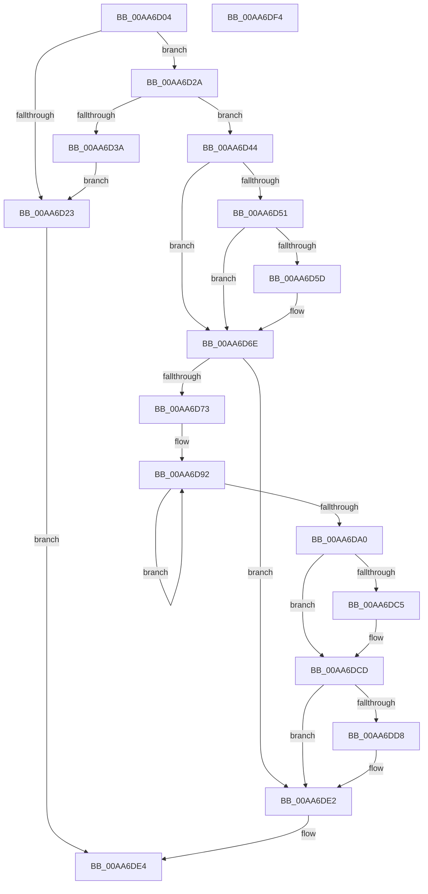

# PsFreezeProcess

- RVA: `0x00AA6D04`–`0x00AA6DF5` (길이 `241` bytes)
- VA: `0x0000000140AA6D04`
- 실행 섹션: `PAGE`
- PDB 이름 있음: `예`; PDB Function 태그: `아니요`
- unwind 정보 RVA: `0x00060BC4`
- 디코드: `64`개 명령, `241/241` bytes 표시
- 미해석 바이트: `0` (있으면 어셈블리에 `.byte`로 보존)

> 이 문서는 커널 이미지의 기계어와 PDB 기호를 분석해 생성했습니다. 4번과 5번은 함수 원형과 자료형을 바이너리 사용 방식에서 추정한 C 해석이며 원본 소스 복구 결과는 아닙니다.

## 1. Dependencies

- 직접 호출 지점: **8**; 고유 호출 대상: **8**
- 직접 호출자로 확인된 함수: **5**
- RIP 상대 이미지 참조: **2**

### Outgoing calls
- `0x00AA6D2A` → [KeFreezeProcess](../../text/46/KeFreezeProcess_function_0046B774.md) (function, `0x0046B774`)
- `0x00AA6D3D` → [KeForceResumeProcess](../../text/3C/KeForceResumeProcess_function_003C1BE4.md) (function, `0x003C1BE4`)
- `0x00AA6D69` → [EtwTiLogSuspendResumeProcess](../A7/EtwTiLogSuspendResumeProcess_function_00A7956C.md) (function, `0x00A7956C`)
- `0x00AA6D79` → [PspLockProcessExclusive](../../text/46/PspLockProcessExclusive_function_00460164.md) (function, `0x00460164`)
- `0x00AA6DB0` → [PspUnlockProcessExclusive](../../text/46/PspUnlockProcessExclusive_function_004601C0.md) (function, `0x004601C0`)
- `0x00AA6DB5` → `ext-ms-win-ntos-win32k-l1-1-0.dll!Win32kAsyncProcessFreezeThawSupportIsActive` (import, 간접 대상; import `ext-ms-win-ntos-win32k-l1-1-0.dll!Win32kAsyncProcessFreezeThawSupportIsActive`)
- `0x00AA6DC8` → [PspPostFreezeOperationWorkEnqueue](PspPostFreezeOperationWorkEnqueue_function_00AA6DFC.md) (function, `0x00AA6DFC`)
- `0x00AA6DDD` → [EtwTraceFreezeThawProcess](../A8/EtwTraceFreezeThawProcess_function_00A862A4.md) (function, `0x00A862A4`)

### Direct callers
- [PspChangeProcessExecutionStateLegacy](../../text/5E/PspChangeProcessExecutionStateLegacy_function_005E4098.md) at `0x005E41AF`
- [NtChangeProcessState](../78/NtChangeProcessState_function_00782C00.md) at `0x00782DA1`
- [DbgkpSuspendProcess](../8A/DbgkpSuspendProcess_function_008A34D4.md) at `0x008A34ED`
- [MiForceCrashForInvalidAccess](../AC/MiForceCrashForInvalidAccess_function_00ACEFA4.md) at `0x00ACF0D3`
- [PspChangeProcessExecutionState](../AE/PspChangeProcessExecutionState_function_00AEC594.md) at `0x00AEC6B3`

### Static image references
- `0x00AA6DB5` → RVA `0x00151678` (`ext-ms-win-ntos-win32k-l1-1-0.dll!Win32kAsyncProcessFreezeThawSupportIsActive (IAT)`; read)
- `0x00AA6DCD` → RVA `0x00FC6B08` (`ALMOSTRO`; read)

## 2. Other-region calls and transfers

- 다른 실행 섹션으로 향하는 call: **4**
  - `0x00AA6D2A` → [KeFreezeProcess](../../text/46/KeFreezeProcess_function_0046B774.md) (`PAGE` → `.text`)
  - `0x00AA6D3D` → [KeForceResumeProcess](../../text/3C/KeForceResumeProcess_function_003C1BE4.md) (`PAGE` → `.text`)
  - `0x00AA6D79` → [PspLockProcessExclusive](../../text/46/PspLockProcessExclusive_function_00460164.md) (`PAGE` → `.text`)
  - `0x00AA6DB0` → [PspUnlockProcessExclusive](../../text/46/PspUnlockProcessExclusive_function_004601C0.md) (`PAGE` → `.text`)
- 별도 외부 분기/꼬리 이동을 확인하지 못했습니다.

## 3. Assembly (complete function range)

```asm
00AA6D04  48 89 5C 24 08                  mov qword ptr [rsp + 8], rbx
00AA6D09  48 89 74 24 10                  mov qword ptr [rsp + 0x10], rsi
00AA6D0E  57                              push rdi
00AA6D0F  48 83 EC 20                     sub rsp, 0x20
00AA6D13  8B 81 F4 01 00 00               mov eax, dword ptr [rcx + 0x1f4]
00AA6D19  40 8A FA                        mov dil, dl
00AA6D1C  48 8B D9                        mov rbx, rcx
00AA6D1F  A8 08                           test al, 8
00AA6D21  74 07                           je 0x140aa6d2a
00AA6D23  32 C0                           xor al, al
00AA6D25  E9 BA 00 00 00                  jmp 0x140aa6de4
00AA6D2A  E8 45 4A 9C FF                  call 0x14046b774
00AA6D2F  8B 8B F4 01 00 00               mov ecx, dword ptr [rbx + 0x1f4]
00AA6D35  F6 C1 08                        test cl, 8
00AA6D38  74 0A                           je 0x140aa6d44
00AA6D3A  48 8B CB                        mov rcx, rbx
00AA6D3D  E8 A2 AE 91 FF                  call 0x1403c1be4
00AA6D42  EB DF                           jmp 0x140aa6d23
00AA6D44  65 48 8B 34 25 88 01 00 00      mov rsi, qword ptr gs:[0x188]
00AA6D4D  85 C0                           test eax, eax
00AA6D4F  75 1D                           jne 0x140aa6d6e
00AA6D51  F7 83 FC 05 00 00 00 00 08 00   test dword ptr [rbx + 0x5fc], 0x80000
00AA6D5B  74 11                           je 0x140aa6d6e
00AA6D5D  44 8D 48 02                     lea r9d, [rax + 2]
00AA6D61  4C 8B C3                        mov r8, rbx
00AA6D64  48 8B D6                        mov rdx, rsi
00AA6D67  33 C9                           xor ecx, ecx
00AA6D69  E8 FE 27 FD FF                  call 0x140a7956c
00AA6D6E  40 84 FF                        test dil, dil
00AA6D71  74 6F                           je 0x140aa6de2
00AA6D73  48 8B D6                        mov rdx, rsi
00AA6D76  48 8B CB                        mov rcx, rbx
00AA6D79  E8 E6 93 9B FF                  call 0x140460164
00AA6D7E  49 B8 B0 03 00 00 80 F7 FF FF   movabs r8, 0xfffff780000003b0
00AA6D88  49 B9 08 00 00 00 80 F7 FF FF   movabs r9, 0xfffff78000000008
00AA6D92  49 8B 10                        mov rdx, qword ptr [r8]
00AA6D95  49 8B 09                        mov rcx, qword ptr [r9]
00AA6D98  49 8B 00                        mov rax, qword ptr [r8]
00AA6D9B  48 3B D0                        cmp rdx, rax
00AA6D9E  75 F2                           jne 0x140aa6d92
00AA6DA0  48 2B CA                        sub rcx, rdx
00AA6DA3  48 8B D6                        mov rdx, rsi
00AA6DA6  48 89 8B 30 06 00 00            mov qword ptr [rbx + 0x630], rcx
00AA6DAD  48 8B CB                        mov rcx, rbx
00AA6DB0  E8 0B 94 9B FF                  call 0x1404601c0
00AA6DB5  48 FF 15 BC A8 6A FF            call qword ptr [rip - 0x955744]
00AA6DBC  0F 1F 44 00 00                  nop dword ptr [rax + rax]
00AA6DC1  84 C0                           test al, al
00AA6DC3  74 08                           je 0x140aa6dcd
00AA6DC5  48 8B CB                        mov rcx, rbx
00AA6DC8  E8 2F 00 00 00                  call 0x140aa6dfc
00AA6DCD  8B 0D 35 FD 51 00               mov ecx, dword ptr [rip + 0x51fd35]
00AA6DD3  F6 C1 02                        test cl, 2
00AA6DD6  74 0A                           je 0x140aa6de2
00AA6DD8  B2 01                           mov dl, 1
00AA6DDA  48 8B CB                        mov rcx, rbx
00AA6DDD  E8 C2 F4 FD FF                  call 0x140a862a4
00AA6DE2  B0 01                           mov al, 1
00AA6DE4  48 8B 5C 24 30                  mov rbx, qword ptr [rsp + 0x30]
00AA6DE9  48 8B 74 24 38                  mov rsi, qword ptr [rsp + 0x38]
00AA6DEE  48 83 C4 20                     add rsp, 0x20
00AA6DF2  5F                              pop rdi
00AA6DF3  C3                              ret
00AA6DF4  CC                              int3
```

## 4. C-style interpretation (structured pseudocode)

```c
__int64 __fastcall PsFreezeProcess(__int64 a1, unsigned __int8 a2)
{
    __int64 result;
    __int64 v_rsp;
    unsigned __int64 v_stack_p10;
    unsigned __int64 v_stack_p8;

    v_stack_p8 = v_rbx;
    v_stack_p10 = v_rsi;
    v_rsp = (v_rsp) - (32);
    if ((((unsigned __int8)((unsigned int)(*(unsigned int *)(a1 + 500)))) & (8)) == 0) goto loc_00AA6D2A;
loc_00AA6D23:
    result = 0;
    goto loc_00AA6DE4;
loc_00AA6D2A:
    result = KeFreezeProcess(a1, a2, a3, a4);
    if ((((unsigned __int8)((unsigned int)(*(unsigned int *)(a1 + 500)))) & (8)) == 0) goto loc_00AA6D44;
    result = KeForceResumeProcess(a1, a2, a3, a4);
    goto loc_00AA6D23;
loc_00AA6D44:
    if ((unsigned int)(result) != 0) goto loc_00AA6D6E;
    if (((*(unsigned int *)(a1 + 1532)) & (0x80000ULL)) != 0) {
        a4 = result + 2;
        a3 = a1;
        a2 = *(unsigned __int64 *)(gs_base + (0 + 392));
        a1 = 0;
        result = EtwTiLogSuspendResumeProcess(a1, a2, a3, a4);
    }
    if (a2 == 0) goto loc_00AA6DE2;
    result = PspLockProcessExclusive(0, *(unsigned __int64 *)(gs_base + (0 + 392)), a3, a4);
loc_00AA6D92:
    if ((*(unsigned __int64 *)(a3)) != (*(unsigned __int64 *)(a3))) goto loc_00AA6D92;
    a1 = (*(unsigned __int64 *)(a4)) - (*(unsigned __int64 *)(a3));
    *(unsigned __int64 *)(a1 + 1584) = a1;
    result = PspUnlockProcessExclusive(a1, *(unsigned __int64 *)(gs_base + (0 + 392)), a3, a4);
    result = ext_ms_win_ntos_win32k_l1_1_0_dll_Win32kAsyncProcessFreezeThawSupportIsActive(a1, *(unsigned __int64 *)(gs_base + (0 + 392)), a3, a4);
    if ((unsigned __int8)(result) != 0) {
        a1 = a1;
        result = PspPostFreezeOperationWorkEnqueue(a1, *(unsigned __int64 *)(gs_base + (0 + 392)), a3, a4);
    }
    if ((((unsigned __int8)((unsigned int)(*(unsigned int *)(v_rip + 5373237)))) & (2)) != 0) {
        a2 = 1;
        a1 = a1;
        result = EtwTraceFreezeThawProcess(a1, a2, a3, a4);
    }
loc_00AA6DE4:
    v_rsp = (v_rsp) + (32);
    return 1;
}
```

## 5. (Beta) C Style

```c
int64_t PsFreezeProcess(void *Arg1, uint8_t Arg2)
{
    uint8_t *arg1 = (uint8_t *)Arg1;

    int64_t result;
    int64_t local_rsp;
    uint64_t v_stack_p10;
    uint64_t v_stack_p8;

    v_stack_p8 = local_rbx;
    v_stack_p10 = local_rsi;
    local_rsp = (local_rsp) - (32);
    if ((((uint8_t)((uint32_t)(*(uint32_t *)(arg1 + 0x1F4)))) & (8)) == 0) goto loc_00AA6D2A;
loc_00AA6D23:
    result = 0;
    goto loc_00AA6DE4;
loc_00AA6D2A:
    result = KeFreezeProcess(Arg1, Arg2, a3, a4);
    if ((((uint8_t)((uint32_t)(*(uint32_t *)(arg1 + 0x1F4)))) & (8)) == 0) goto loc_00AA6D44;
    result = KeForceResumeProcess(Arg1, Arg2, a3, a4);
    goto loc_00AA6D23;
loc_00AA6D44:
    if ((uint32_t)(result) != 0) goto loc_00AA6D6E;
    if (((*(uint32_t *)(arg1 + 0x5FC)) & (0x80000ULL)) != 0) {
        a4 = result + 2;
        a3 = Arg1;
        Arg2 = *(uint64_t *)(gs_base + (0 + 0x188));
        Arg1 = 0;
        result = EtwTiLogSuspendResumeProcess(Arg1, Arg2, a3, a4);
    }
    if (Arg2 == 0) goto loc_00AA6DE2;
    result = PspLockProcessExclusive(0, *(uint64_t *)(gs_base + (0 + 0x188)), a3, a4);
loc_00AA6D92:
    if ((*(uint64_t *)(a3)) != (*(uint64_t *)(a3))) goto loc_00AA6D92;
    Arg1 = (*(uint64_t *)(a4)) - (*(uint64_t *)(a3));
    *(void **)(arg1 + 0x630) = Arg1;
    result = PspUnlockProcessExclusive(Arg1, *(uint64_t *)(gs_base + (0 + 0x188)), a3, a4);
    result = kernel_indirect_call(Arg1, *(uint64_t *)(gs_base + (0 + 0x188)), a3, a4);
    if ((uint8_t)(result) != 0) {
        Arg1 = Arg1;
        result = PspPostFreezeOperationWorkEnqueue(Arg1, *(uint64_t *)(gs_base + (0 + 0x188)), a3, a4);
    }
    if ((((uint8_t)((uint32_t)(*(uint32_t *)(v_rip + 0x51FD35)))) & (2)) != 0) {
        Arg2 = 1;
        Arg1 = Arg1;
        result = EtwTraceFreezeThawProcess(Arg1, Arg2, a3, a4);
    }
loc_00AA6DE4:
    local_rsp = (local_rsp) + (32);
    return 1;
}
```

### 관측된 메모리 오프셋

구조체 형식이 확인되지 않은 접근은 인자 기준의 오프셋으로만 기록했습니다.

| 기준 인자 | 오프셋 표현 | 폭 (bit) | 접근 |
|---|---:|---:|---|
| `Arg1` | `+ 0x1F4` | `32` | `R` |
| `Arg1` | `+ 0x5FC` | `32` | `R` |
| `Arg1` | `+ 0x630` | `64` | `W` |

## 6. Execution-region graph

[열기: 2D/3D 그래프와 함수 탐색 컨트롤 패널](../../../control-panel.html?section=page&rva=0x00AA6D04&view=graph)

- 2D 그래프는 위에서 아래로 흐르고, 3D 그래프는 빈 공간을 드래그해 회전합니다. Shift+드래그는 이동, 휠은 확대·축소, 함수 노드 선택은 대상 보고서 이동입니다.

### Static fallback


