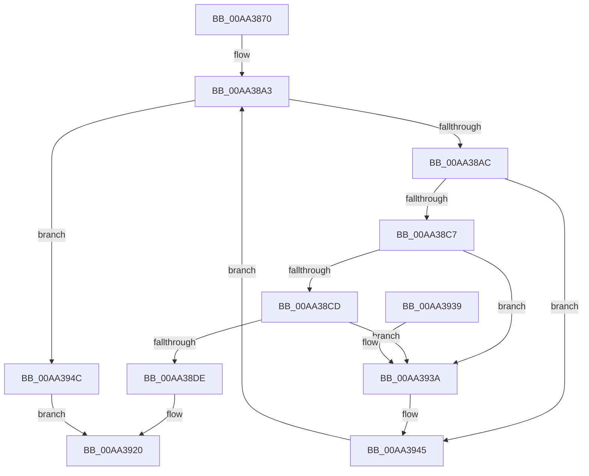

# PsRemoveCreateThreadNotifyRoutine

- RVA: `0x00AA3870`–`0x00AA395B` (길이 `235` bytes)
- VA: `0x0000000140AA3870`
- 실행 섹션: `PAGE`
- PDB 이름 있음: `예`; PDB Function 태그: `아니요`
- unwind 정보 RVA: `0x0007D214`
- 디코드: `64`개 명령, `235/235` bytes 표시
- 미해석 바이트: `0` (있으면 어셈블리에 `.byte`로 보존)

> 이 문서는 커널 이미지의 기계어와 PDB 기호를 분석해 생성했습니다. 4번과 5번은 함수 원형과 자료형을 바이너리 사용 방식에서 추정한 C 해석이며 원본 소스 복구 결과는 아닙니다.

## 1. Dependencies

- 직접 호출 지점: **8**; 고유 호출 대상: **6**
- 직접 호출자로 확인된 함수: **0**
- RIP 상대 이미지 참조: **3**

### Outgoing calls
- `0x00AA38BA` → [ExReferenceCallBackBlock](../../text/2F/ExReferenceCallBackBlock_function_002F0040.md) (function, `0x002F0040`)
- `0x00AA38D5` → [ExCompareExchangeCallBack](../../text/41/ExCompareExchangeCallBack_function_0041BCD0.md) (function, `0x0041BCD0`)
- `0x00AA38FF` → [ExDereferenceCallBackBlock](../../text/44/ExDereferenceCallBackBlock_function_0044D730.md) (function, `0x0044D730`)
- `0x00AA3907` → [KiLeaveCriticalRegionUnsafe](../../text/25/KiLeaveCriticalRegionUnsafe_function_0025F010.md) (function, `0x0025F010`)
- `0x00AA390F` → [ExWaitForRundownProtectionRelease](../../text/2A/ExWaitForRundownProtectionRelease_function_002A4CB0.md) (function, `0x002A4CB0`)
- `0x00AA3919` → [ExFreePoolWithTag](../../poolcode/B8/ExFreePoolWithTag_function_00B82870.md) (function, `0x00B82870`)
- `0x00AA3940` → [ExDereferenceCallBackBlock](../../text/44/ExDereferenceCallBackBlock_function_0044D730.md) (function, `0x0044D730`)
- `0x00AA394F` → [KiLeaveCriticalRegionUnsafe](../../text/25/KiLeaveCriticalRegionUnsafe_function_0025F010.md) (function, `0x0025F010`)

### Direct callers
- 이 함수 시작 RVA로 연결되는 직접 call은 확인되지 않았습니다. 간접 호출은 완전히 역산할 수 없습니다.

### Static image references
- `0x00AA38AC` → RVA `0x00F06120` (`.data`; read)
- `0x00AA38E3` → RVA `0x00FD9E14` (`PAGEDATA`; read)
- `0x00AA38EA` → RVA `0x00FD9E20` (`PAGEDATA`; read)

## 2. Other-region calls and transfers

- 다른 실행 섹션으로 향하는 call: **8**
  - `0x00AA38BA` → [ExReferenceCallBackBlock](../../text/2F/ExReferenceCallBackBlock_function_002F0040.md) (`PAGE` → `.text`)
  - `0x00AA38D5` → [ExCompareExchangeCallBack](../../text/41/ExCompareExchangeCallBack_function_0041BCD0.md) (`PAGE` → `.text`)
  - `0x00AA38FF` → [ExDereferenceCallBackBlock](../../text/44/ExDereferenceCallBackBlock_function_0044D730.md) (`PAGE` → `.text`)
  - `0x00AA3907` → [KiLeaveCriticalRegionUnsafe](../../text/25/KiLeaveCriticalRegionUnsafe_function_0025F010.md) (`PAGE` → `.text`)
  - `0x00AA390F` → [ExWaitForRundownProtectionRelease](../../text/2A/ExWaitForRundownProtectionRelease_function_002A4CB0.md) (`PAGE` → `.text`)
  - `0x00AA3919` → [ExFreePoolWithTag](../../poolcode/B8/ExFreePoolWithTag_function_00B82870.md) (`PAGE` → `POOLCODE`)
  - `0x00AA3940` → [ExDereferenceCallBackBlock](../../text/44/ExDereferenceCallBackBlock_function_0044D730.md) (`PAGE` → `.text`)
  - `0x00AA394F` → [KiLeaveCriticalRegionUnsafe](../../text/25/KiLeaveCriticalRegionUnsafe_function_0025F010.md) (`PAGE` → `.text`)
- 별도 외부 분기/꼬리 이동을 확인하지 못했습니다.

## 3. Assembly (complete function range)

```asm
00AA3870  48 89 5C 24 08                  mov qword ptr [rsp + 8], rbx
00AA3875  48 89 6C 24 10                  mov qword ptr [rsp + 0x10], rbp
00AA387A  48 89 74 24 18                  mov qword ptr [rsp + 0x18], rsi
00AA387F  57                              push rdi
00AA3880  41 56                           push r14
00AA3882  41 57                           push r15
00AA3884  48 83 EC 20                     sub rsp, 0x20
00AA3888  65 48 8B 34 25 88 01 00 00      mov rsi, qword ptr gs:[0x188]
00AA3891  41 83 CF FF                     or r15d, 0xffffffff
00AA3895  4C 8B F1                        mov r14, rcx
00AA3898  66 44 01 BE E4 01 00 00         add word ptr [rsi + 0x1e4], r15w
00AA38A0  90                              nop
00AA38A1  33 FF                           xor edi, edi
00AA38A3  83 FF 40                        cmp edi, 0x40
00AA38A6  0F 83 A0 00 00 00               jae 0x140aa394c
00AA38AC  48 8D 0D 6D 28 46 00            lea rcx, [rip + 0x46286d]
00AA38B3  48 8D 2C F9                     lea rbp, [rcx + rdi*8]
00AA38B7  48 8B CD                        mov rcx, rbp
00AA38BA  E8 81 C7 84 FF                  call 0x1402f0040
00AA38BF  48 8B D8                        mov rbx, rax
00AA38C2  48 85 C0                        test rax, rax
00AA38C5  74 7E                           je 0x140aa3945
00AA38C7  4C 39 70 08                     cmp qword ptr [rax + 8], r14
00AA38CB  75 6D                           jne 0x140aa393a
00AA38CD  4C 8B C0                        mov r8, rax
00AA38D0  33 D2                           xor edx, edx
00AA38D2  48 8B CD                        mov rcx, rbp
00AA38D5  E8 F6 83 97 FF                  call 0x14041bcd0
00AA38DA  84 C0                           test al, al
00AA38DC  74 5C                           je 0x140aa393a
00AA38DE  48 83 7B 10 00                  cmp qword ptr [rbx + 0x10], 0
00AA38E3  48 8D 0D 2A 65 53 00            lea rcx, [rip + 0x53652a]
00AA38EA  48 8D 15 2F 65 53 00            lea rdx, [rip + 0x53652f]
00AA38F1  48 0F 44 D1                     cmove rdx, rcx
00AA38F5  F0 44 01 3A                     lock add dword ptr [rdx], r15d
00AA38F9  48 8B D3                        mov rdx, rbx
00AA38FC  48 8B CD                        mov rcx, rbp
00AA38FF  E8 2C 9E 9A FF                  call 0x14044d730
00AA3904  48 8B CE                        mov rcx, rsi
00AA3907  E8 04 B7 7B FF                  call 0x14025f010
00AA390C  48 8B CB                        mov rcx, rbx
00AA390F  E8 9C 13 80 FF                  call 0x1402a4cb0
00AA3914  33 D2                           xor edx, edx
00AA3916  48 8B CB                        mov rcx, rbx
00AA3919  E8 52 EF 0D 00                  call 0x140b82870
00AA391E  33 C0                           xor eax, eax
00AA3920  48 8B 5C 24 40                  mov rbx, qword ptr [rsp + 0x40]
00AA3925  48 8B 6C 24 48                  mov rbp, qword ptr [rsp + 0x48]
00AA392A  48 8B 74 24 50                  mov rsi, qword ptr [rsp + 0x50]
00AA392F  48 83 C4 20                     add rsp, 0x20
00AA3933  41 5F                           pop r15
00AA3935  41 5E                           pop r14
00AA3937  5F                              pop rdi
00AA3938  C3                              ret
00AA3939  CC                              int3
00AA393A  48 8B D3                        mov rdx, rbx
00AA393D  48 8B CD                        mov rcx, rbp
00AA3940  E8 EB 9D 9A FF                  call 0x14044d730
00AA3945  FF C7                           inc edi
00AA3947  E9 57 FF FF FF                  jmp 0x140aa38a3
00AA394C  48 8B CE                        mov rcx, rsi
00AA394F  E8 BC B6 7B FF                  call 0x14025f010
00AA3954  B8 7A 00 00 C0                  mov eax, 0xc000007a
00AA3959  EB C5                           jmp 0x140aa3920
```

## 4. C-style interpretation (structured pseudocode)

```c
__int64 __fastcall PsRemoveCreateThreadNotifyRoutine(__int64 a1, int a2)
{
    __int64 result;
    __int64 v_r15;
    __int64 v_rdi;
    __int64 v_rsp;
    unsigned __int64 v_stack_p10;
    unsigned __int64 v_stack_p18;
    unsigned __int64 v_stack_p8;

    v_stack_p8 = v_rbx;
    v_stack_p10 = v_rbp;
    v_stack_p18 = v_rsi;
    v_rsp = (v_rsp) - (32);
    v_r15 = (unsigned int)((v_r15) | (0xFFFFFFFFULL));
    v_rdi = 0;
loc_00AA38A3:
    if (0 >= 64) goto loc_00AA394C;
    result = ExReferenceCallBackBlock(v_rip + 4597869 + v_rdi * 8, a2, a3, a4);
    if (result == 0) goto loc_00AA3945;
    if ((*(unsigned __int64 *)(result + 8)) != a1) goto loc_00AA393A;
    a2 = 0;
    result = ExCompareExchangeCallBack(v_rip + 4597869 + v_rdi * 8, a2, result, a4);
    if ((unsigned __int8)(result) == 0) goto loc_00AA393A;
    a2 = v_rip + 5465391;
    if ((*(unsigned __int64 *)(result + 16)) == 0) { a2 = v_rip + 5465386; }
    result = ExDereferenceCallBackBlock(v_rip + 4597869 + v_rdi * 8, result, result, a4);
    result = KiLeaveCriticalRegionUnsafe(*(unsigned __int64 *)(gs_base + (0 + 392)), result, result, a4);
    result = ExWaitForRundownProtectionRelease(result, result, result, a4);
    a2 = 0;
    result = ExFreePoolWithTag(result, a2, result, a4);
    result = 0;
loc_00AA3920:
    v_rsp = (v_rsp) + (32);
    return result;
loc_00AA393A:
    result = ExDereferenceCallBackBlock(v_stack_p10, v_stack_p8, result, a4);
loc_00AA3945:
    v_rdi = (unsigned int)((v_rdi) + 1);
    goto loc_00AA38A3;
loc_00AA394C:
    result = KiLeaveCriticalRegionUnsafe(v_stack_p18, v_stack_p8, result, a4);
    goto loc_00AA3920;
}
```

## 5. (Beta) C Style

```c
int64_t PsRemoveCreateThreadNotifyRoutine(int64_t Arg1, int32_t Arg2)
{
    int64_t result;
    int64_t local_r15;
    int64_t local_rdi;
    int64_t local_rsp;
    uint64_t v_stack_p10;
    uint64_t v_stack_p18;
    uint64_t v_stack_p8;

    v_stack_p8 = local_rbx;
    v_stack_p10 = local_rbp;
    v_stack_p18 = local_rsi;
    local_rsp = (local_rsp) - (32);
    local_r15 = (uint32_t)((local_r15) | (0xFFFFFFFFULL));
    local_rdi = 0;
loc_00AA38A3:
    if (0 >= 64) goto loc_00AA394C;
    result = ExReferenceCallBackBlock(v_rip + 4597869 + local_rdi * 8, Arg2, a3, a4);
    if (result == 0) goto loc_00AA3945;
    if ((*(uint64_t *)(result + 0x8)) != Arg1) goto loc_00AA393A;
    Arg2 = 0;
    result = ExCompareExchangeCallBack(v_rip + 4597869 + local_rdi * 8, Arg2, result, a4);
    if ((uint8_t)(result) == 0) goto loc_00AA393A;
    Arg2 = v_rip + 5465391;
    if ((*(uint64_t *)(result + 0x10)) == 0) { Arg2 = v_rip + 5465386; }
    result = ExDereferenceCallBackBlock(v_rip + 4597869 + local_rdi * 8, result, result, a4);
    result = KiLeaveCriticalRegionUnsafe(*(uint64_t *)(gs_base + (0 + 0x188)), result, result, a4);
    result = ExWaitForRundownProtectionRelease(result, result, result, a4);
    Arg2 = 0;
    result = ExFreePoolWithTag(result, Arg2, result, a4);
    result = 0;
loc_00AA3920:
    local_rsp = (local_rsp) + (32);
    return result;
loc_00AA393A:
    result = ExDereferenceCallBackBlock(v_stack_p10, v_stack_p8, result, a4);
loc_00AA3945:
    local_rdi = (uint32_t)((local_rdi) + 1);
    goto loc_00AA38A3;
loc_00AA394C:
    result = KiLeaveCriticalRegionUnsafe(v_stack_p18, v_stack_p8, result, a4);
    goto loc_00AA3920;
}
```

## 6. Execution-region graph

[열기: 2D/3D 그래프와 함수 탐색 컨트롤 패널](../../../control-panel.html?section=page&rva=0x00AA3870&view=graph)

- 2D 그래프는 위에서 아래로 흐르고, 3D 그래프는 빈 공간을 드래그해 회전합니다. Shift+드래그는 이동, 휠은 확대·축소, 함수 노드 선택은 대상 보고서 이동입니다.

### Static fallback


