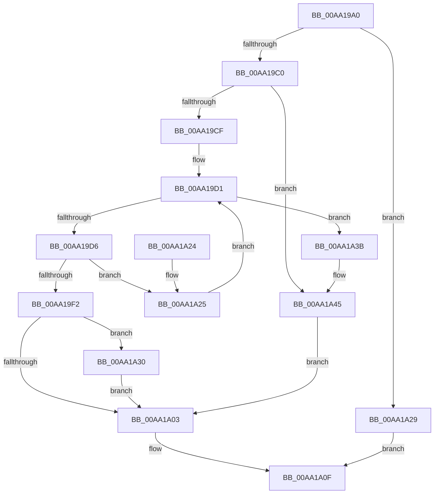

# PsSetLoadImageNotifyRoutineEx

- RVA: `0x00AA19A0`–`0x00AA1A4C` (길이 `172` bytes)
- VA: `0x0000000140AA19A0`
- 실행 섹션: `PAGE`
- PDB 이름 있음: `예`; PDB Function 태그: `아니요`
- unwind 정보 RVA: `0x000848E8`
- 디코드: `50`개 명령, `172/172` bytes 표시
- 미해석 바이트: `0` (있으면 어셈블리에 `.byte`로 보존)

> 이 문서는 커널 이미지의 기계어와 PDB 기호를 분석해 생성했습니다. 4번과 5번은 함수 원형과 자료형을 바이너리 사용 방식에서 추정한 C 해석이며 원본 소스 복구 결과는 아닙니다.

## 1. Dependencies

- 직접 호출 지점: **4**; 고유 호출 대상: **4**
- 직접 호출자로 확인된 함수: **2**
- RIP 상대 이미지 참조: **4**

### Outgoing calls
- `0x00AA19C0` → [ExAllocateCallBack](ExAllocateCallBack_function_00AA1AE0.md) (function, `0x00AA1AE0`)
- `0x00AA19E9` → [ExCompareExchangeCallBack](../../text/41/ExCompareExchangeCallBack_function_0041BCD0.md) (function, `0x0041BCD0`)
- `0x00AA1A08` → [PspLogAuditSetLoadImageNotifyRoutineEvent](PspLogAuditSetLoadImageNotifyRoutineEvent_function_00AA1A54.md) (function, `0x00AA1A54`)
- `0x00AA1A40` → [ExFreePoolWithTag](../../poolcode/B8/ExFreePoolWithTag_function_00B82870.md) (function, `0x00B82870`)

### Direct callers
- [PsSetLoadImageNotifyRoutine](../78/PsSetLoadImageNotifyRoutine_function_00787850.md) at `0x00787856`
- [EtwpCoverageSamplerStart](../7C/EtwpCoverageSamplerStart_function_007C2248.md) at `0x007C2421`

### Static image references
- `0x00AA19D8` → RVA `0x00F05F20` (`.data`; read)
- `0x00AA19F2` → RVA `0x00FD9E1C` (`PAGEDATA`; read/write)
- `0x00AA19F9` → RVA `0x00FD9A88` (`PAGEDATA`; read)
- `0x00AA1A30` → RVA `0x00FD9A88` (`PAGEDATA`; read/write)

## 2. Other-region calls and transfers

- 다른 실행 섹션으로 향하는 call: **2**
  - `0x00AA19E9` → [ExCompareExchangeCallBack](../../text/41/ExCompareExchangeCallBack_function_0041BCD0.md) (`PAGE` → `.text`)
  - `0x00AA1A40` → [ExFreePoolWithTag](../../poolcode/B8/ExFreePoolWithTag_function_00B82870.md) (`PAGE` → `POOLCODE`)
- 별도 외부 분기/꼬리 이동을 확인하지 못했습니다.

## 3. Assembly (complete function range)

```asm
00AA19A0  48 89 5C 24 08                  mov qword ptr [rsp + 8], rbx
00AA19A5  48 89 6C 24 10                  mov qword ptr [rsp + 0x10], rbp
00AA19AA  48 89 74 24 18                  mov qword ptr [rsp + 0x18], rsi
00AA19AF  57                              push rdi
00AA19B0  48 83 EC 20                     sub rsp, 0x20
00AA19B4  48 8B E9                        mov rbp, rcx
00AA19B7  48 F7 C2 FE FF FF FF            test rdx, -2
00AA19BE  75 69                           jne 0x140aa1a29
00AA19C0  E8 1B 01 00 00                  call 0x140aa1ae0
00AA19C5  33 DB                           xor ebx, ebx
00AA19C7  48 8B F0                        mov rsi, rax
00AA19CA  48 85 C0                        test rax, rax
00AA19CD  74 76                           je 0x140aa1a45
00AA19CF  8B FB                           mov edi, ebx
00AA19D1  83 FF 40                        cmp edi, 0x40
00AA19D4  73 65                           jae 0x140aa1a3b
00AA19D6  8B C7                           mov eax, edi
00AA19D8  48 8D 0D 41 45 46 00            lea rcx, [rip + 0x464541]
00AA19DF  45 33 C0                        xor r8d, r8d
00AA19E2  48 8B D6                        mov rdx, rsi
00AA19E5  48 8D 0C C1                     lea rcx, [rcx + rax*8]
00AA19E9  E8 E2 A2 97 FF                  call 0x14041bcd0
00AA19EE  84 C0                           test al, al
00AA19F0  74 33                           je 0x140aa1a25
00AA19F2  F0 FF 05 23 84 53 00            lock inc dword ptr [rip + 0x538423]
00AA19F9  8B 05 89 80 53 00               mov eax, dword ptr [rip + 0x538089]
00AA19FF  A8 01                           test al, 1
00AA1A01  74 2D                           je 0x140aa1a30
00AA1A03  8B D3                           mov edx, ebx
00AA1A05  48 8B CD                        mov rcx, rbp
00AA1A08  E8 47 00 00 00                  call 0x140aa1a54
00AA1A0D  8B C3                           mov eax, ebx
00AA1A0F  48 8B 5C 24 30                  mov rbx, qword ptr [rsp + 0x30]
00AA1A14  48 8B 6C 24 38                  mov rbp, qword ptr [rsp + 0x38]
00AA1A19  48 8B 74 24 40                  mov rsi, qword ptr [rsp + 0x40]
00AA1A1E  48 83 C4 20                     add rsp, 0x20
00AA1A22  5F                              pop rdi
00AA1A23  C3                              ret
00AA1A24  CC                              int3
00AA1A25  FF C7                           inc edi
00AA1A27  EB A8                           jmp 0x140aa19d1
00AA1A29  B8 F0 00 00 C0                  mov eax, 0xc00000f0
00AA1A2E  EB DF                           jmp 0x140aa1a0f
00AA1A30  F0 0F BA 2D 4F 80 53 00 00      lock bts dword ptr [rip + 0x53804f], 0
00AA1A39  EB C8                           jmp 0x140aa1a03
00AA1A3B  33 D2                           xor edx, edx
00AA1A3D  48 8B CE                        mov rcx, rsi
00AA1A40  E8 2B 0E 0E 00                  call 0x140b82870
00AA1A45  BB 9A 00 00 C0                  mov ebx, 0xc000009a
00AA1A4A  EB B7                           jmp 0x140aa1a03
```

## 4. C-style interpretation (structured pseudocode)

```c
__int64 __fastcall PsSetLoadImageNotifyRoutineEx(__int64 a1, __int64 a2, int a3)
{
    __int64 result;
    __int64 v_rbx;
    __int64 v_rdi;
    __int64 v_rsp;
    unsigned __int64 v_stack_p10;
    unsigned __int64 v_stack_p18;
    unsigned __int64 v_stack_p8;

    v_stack_p8 = v_rbx;
    v_stack_p10 = v_rbp;
    v_stack_p18 = v_rsi;
    v_rsp = (v_rsp) - (32);
    if (((a2) & (-2)) != 0) goto loc_00AA1A29;
    result = ExAllocateCallBack(a1, a2, a3, a4);
    v_rbx = 0;
    if (result == 0) goto loc_00AA1A45;
loc_00AA19D1:
    if (0 >= 64) goto loc_00AA1A3B;
    a3 = 0;
    result = ExCompareExchangeCallBack(v_rip + 4605249 + 0 * 8, result, a3, a4);
    if ((unsigned __int8)(result) == 0) goto loc_00AA1A25;
    if ((((unsigned __int8)((unsigned int)(*(unsigned int *)(v_rip + 5472393)))) & (1)) == 0) goto loc_00AA1A30;
loc_00AA1A03:
    result = PspLogAuditSetLoadImageNotifyRoutineEvent(a1, 0, a3, a4);
loc_00AA1A0F:
    v_rsp = (v_rsp) + (32);
    return 0;
loc_00AA1A25:
    v_rdi = (unsigned int)((0) + 1);
    goto loc_00AA19D1;
loc_00AA1A29:
    goto loc_00AA1A0F;
loc_00AA1A30:
    goto loc_00AA1A03;
loc_00AA1A3B:
    a2 = 0;
    result = ExFreePoolWithTag(v_stack_p18, a2, a3, a4);
loc_00AA1A45:
    goto loc_00AA1A03;
}
```

## 5. (Beta) C Style

```c
int64_t PsSetLoadImageNotifyRoutineEx(int64_t Arg1, int64_t Arg2, int32_t Arg3)
{
    int64_t result;
    int64_t local_rbx;
    int64_t local_rdi;
    int64_t local_rsp;
    uint64_t v_stack_p10;
    uint64_t v_stack_p18;
    uint64_t v_stack_p8;

    v_stack_p8 = local_rbx;
    v_stack_p10 = local_rbp;
    v_stack_p18 = local_rsi;
    local_rsp = (local_rsp) - (32);
    if (((Arg2) & (-2)) != 0) goto loc_00AA1A29;
    result = ExAllocateCallBack(Arg1, Arg2, Arg3, a4);
    local_rbx = 0;
    if (result == 0) goto loc_00AA1A45;
loc_00AA19D1:
    if (0 >= 64) goto loc_00AA1A3B;
    Arg3 = 0;
    result = ExCompareExchangeCallBack(v_rip + 4605249 + 0 * 8, result, Arg3, a4);
    if ((uint8_t)(result) == 0) goto loc_00AA1A25;
    if ((((uint8_t)((uint32_t)(*(uint32_t *)(v_rip + 0x538089)))) & (1)) == 0) goto loc_00AA1A30;
loc_00AA1A03:
    result = PspLogAuditSetLoadImageNotifyRoutineEvent(Arg1, 0, Arg3, a4);
loc_00AA1A0F:
    local_rsp = (local_rsp) + (32);
    return 0;
loc_00AA1A25:
    local_rdi = (uint32_t)((0) + 1);
    goto loc_00AA19D1;
loc_00AA1A29:
    goto loc_00AA1A0F;
loc_00AA1A30:
    goto loc_00AA1A03;
loc_00AA1A3B:
    Arg2 = 0;
    result = ExFreePoolWithTag(v_stack_p18, Arg2, Arg3, a4);
loc_00AA1A45:
    goto loc_00AA1A03;
}
```

## 6. Execution-region graph

[열기: 2D/3D 그래프와 함수 탐색 컨트롤 패널](../../../control-panel.html?section=page&rva=0x00AA19A0&view=graph)

- 2D 그래프는 위에서 아래로 흐르고, 3D 그래프는 빈 공간을 드래그해 회전합니다. Shift+드래그는 이동, 휠은 확대·축소, 함수 노드 선택은 대상 보고서 이동입니다.

### Static fallback


