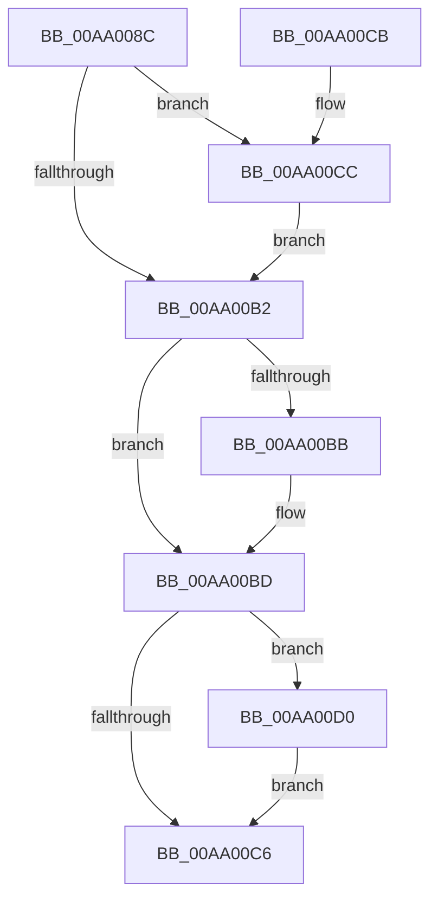

# PspComputeExecutionState

- RVA: `0x00AA008C`–`0x00AA00D4` (길이 `72` bytes)
- VA: `0x0000000140AA008C`
- 실행 섹션: `PAGE`
- PDB 이름 있음: `예`; PDB Function 태그: `아니요`
- unwind 정보 RVA: `0x0009654C`
- 디코드: `21`개 명령, `72/72` bytes 표시
- 미해석 바이트: `0` (있으면 어셈블리에 `.byte`로 보존)

> 이 문서는 커널 이미지의 기계어와 PDB 기호를 분석해 생성했습니다. 4번과 5번은 함수 원형과 자료형을 바이너리 사용 방식에서 추정한 C 해석이며 원본 소스 복구 결과는 아닙니다.

## 1. Dependencies

- 직접 호출 지점: **1**; 고유 호출 대상: **1**
- 직접 호출자로 확인된 함수: **3**
- RIP 상대 이미지 참조: **0**

### Outgoing calls
- `0x00AA00A0` → [PspInitializeProcessExecutionState](../../text/4B/PspInitializeProcessExecutionState_function_004BE450.md) (function, `0x004BE450`)

### Direct callers
- [PspSetJobFreezeCountCallback](../../text/4B/PspSetJobFreezeCountCallback_function_004B3EC0.md) at `0x004B3F00`
- [PsSwapProcessWorkingSet](../78/PsSwapProcessWorkingSet_function_00781C24.md) at `0x00781C8C`
- [PspApplyJobChainLimitsToProcess](../87/PspApplyJobChainLimitsToProcess_function_0087EB5C.md) at `0x0087EBC5`
- [PspApplyJobChainLimitsToProcess](../87/PspApplyJobChainLimitsToProcess_function_0087EB5C.md) at `0x0087EBDF`

### Static image references
- 디코드된 RIP-relative 메모리 참조가 없습니다.

## 2. Other-region calls and transfers

- 다른 실행 섹션으로 향하는 call: **1**
  - `0x00AA00A0` → [PspInitializeProcessExecutionState](../../text/4B/PspInitializeProcessExecutionState_function_004BE450.md) (`PAGE` → `.text`)
- 별도 외부 분기/꼬리 이동을 확인하지 못했습니다.

## 3. Assembly (complete function range)

```asm
00AA008C  48 83 EC 28                     sub rsp, 0x28
00AA0090  48 8B D1                        mov rdx, rcx
00AA0093  45 33 C0                        xor r8d, r8d
00AA0096  48 8D 4C 24 30                  lea rcx, [rsp + 0x30]
00AA009B  44 88 44 24 30                  mov byte ptr [rsp + 0x30], r8b
00AA00A0  E8 AB E3 A1 FF                  call 0x1404be450
00AA00A5  8A 44 24 30                     mov al, byte ptr [rsp + 0x30]
00AA00A9  44 39 82 34 04 00 00            cmp dword ptr [rdx + 0x434], r8d
00AA00B0  77 1A                           ja 0x140aa00cc
00AA00B2  44 39 82 28 04 00 00            cmp dword ptr [rdx + 0x428], r8d
00AA00B9  76 02                           jbe 0x140aa00bd
00AA00BB  0C 01                           or al, 1
00AA00BD  44 39 82 2C 04 00 00            cmp dword ptr [rdx + 0x42c], r8d
00AA00C4  77 0A                           ja 0x140aa00d0
00AA00C6  48 83 C4 28                     add rsp, 0x28
00AA00CA  C3                              ret
00AA00CB  CC                              int3
00AA00CC  0C 02                           or al, 2
00AA00CE  EB E2                           jmp 0x140aa00b2
00AA00D0  0C 04                           or al, 4
00AA00D2  EB F2                           jmp 0x140aa00c6
```

## 4. C-style interpretation (structured pseudocode)

```c
__int64 __fastcall PspComputeExecutionState(__int64 a1, __int64 a2, int a3)
{
    __int64 result;
    __int64 v_rsp;
    unsigned __int64 v_stack_p8;

    v_rsp = (v_rsp) - (40);
    a3 = 0;
    v_stack_p8 = 0;
    result = PspInitializeProcessExecutionState(v_stack_p8, a1, a3, a4);
    if ((*(unsigned int *)(a1 + 1076)) > 0) goto loc_00AA00CC;
loc_00AA00B2:
    result = v_stack_p8;
    if ((*(unsigned int *)(a1 + 1064)) >= = 0) {
        result = (unsigned __int8)((v_stack_p8) | (1));
    }
    if ((*(unsigned int *)(a1 + 1068)) > 0) goto loc_00AA00D0;
loc_00AA00C6:
    v_rsp = (v_rsp) + (40);
    return result;
loc_00AA00CC:
    result = (unsigned __int8)((result) | (2));
    goto loc_00AA00B2;
loc_00AA00D0:
    result = (unsigned __int8)((result) | (4));
    goto loc_00AA00C6;
}
```

## 5. (Beta) C Style

```c
int64_t PspComputeExecutionState(int64_t Arg1, int64_t Arg2, int32_t Arg3)
{
    int64_t result;
    int64_t local_rsp;
    uint64_t v_stack_p8;

    local_rsp = (local_rsp) - (40);
    Arg3 = 0;
    v_stack_p8 = 0;
    result = PspInitializeProcessExecutionState(v_stack_p8, Arg1, Arg3, a4);
    if ((*(uint32_t *)(Arg1 + 0x434)) > 0) goto loc_00AA00CC;
loc_00AA00B2:
    result = v_stack_p8;
    if ((*(uint32_t *)(Arg1 + 0x428)) >= = 0) {
        result = (uint8_t)((v_stack_p8) | (1));
    }
    if ((*(uint32_t *)(Arg1 + 0x42C)) > 0) goto loc_00AA00D0;
loc_00AA00C6:
    local_rsp = (local_rsp) + (40);
    return result;
loc_00AA00CC:
    result = (uint8_t)((result) | (2));
    goto loc_00AA00B2;
loc_00AA00D0:
    result = (uint8_t)((result) | (4));
    goto loc_00AA00C6;
}
```

## 6. Execution-region graph

[열기: 2D/3D 그래프와 함수 탐색 컨트롤 패널](../../../control-panel.html?section=page&rva=0x00AA008C&view=graph)

- 2D 그래프는 위에서 아래로 흐르고, 3D 그래프는 빈 공간을 드래그해 회전합니다. Shift+드래그는 이동, 휠은 확대·축소, 함수 노드 선택은 대상 보고서 이동입니다.

### Static fallback


