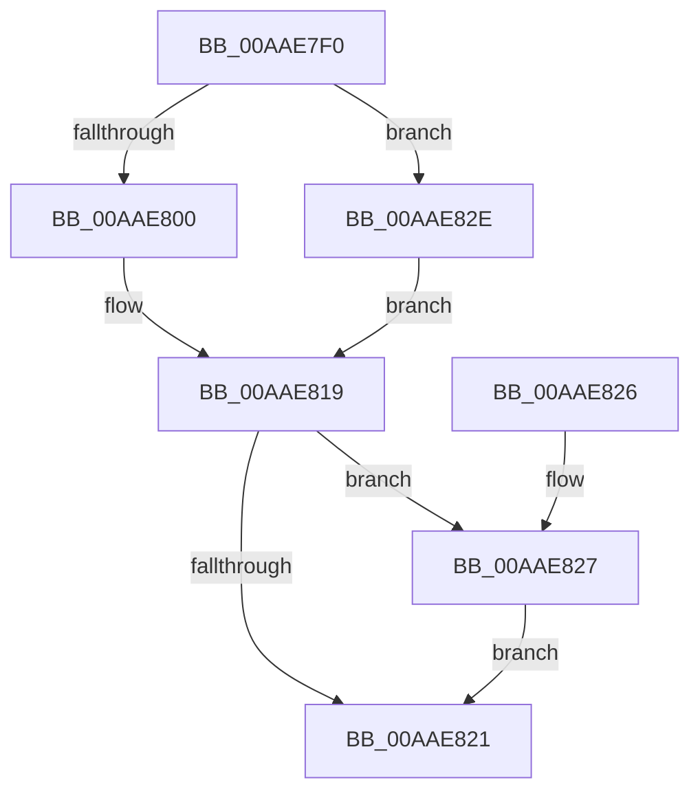

# PspDeleteSiloContext

- RVA: `0x00AAE7F0`–`0x00AAE835` (길이 `69` bytes)
- VA: `0x0000000140AAE7F0`
- 실행 섹션: `PAGE`
- PDB 이름 있음: `예`; PDB Function 태그: `아니요`
- unwind 정보 RVA: `0x00064C74`
- 디코드: `21`개 명령, `69/69` bytes 표시
- 미해석 바이트: `0` (있으면 어셈블리에 `.byte`로 보존)

> 이 문서는 커널 이미지의 기계어와 PDB 기호를 분석해 생성했습니다. 4번과 5번은 함수 원형과 자료형을 바이너리 사용 방식에서 추정한 C 해석이며 원본 소스 복구 결과는 아닙니다.

## 1. Dependencies

- 직접 호출 지점: **1**; 고유 호출 대상: **1**
- 직접 호출자로 확인된 함수: **0**
- RIP 상대 이미지 참조: **1**

### Outgoing calls
- `0x00AAE827` → [guard_dispatch_icall](../../text/6B/guard_dispatch_icall_function_006BAAD0.md) (function, `0x006BAAD0`)

### Direct callers
- 이 함수 시작 RVA로 연결되는 직접 call은 확인되지 않았습니다. 간접 호출은 완전히 역산할 수 없습니다.

### Static image references
- `0x00AAE803` → RVA `0x00F0FF80` (`.data`; read)

## 2. Other-region calls and transfers

- 다른 실행 섹션으로 향하는 call: **1**
  - `0x00AAE827` → [guard_dispatch_icall](../../text/6B/guard_dispatch_icall_function_006BAAD0.md) (`PAGE` → `.text`)
- 별도 외부 분기/꼬리 이동을 확인하지 못했습니다.

## 3. Assembly (complete function range)

```asm
00AAE7F0  48 83 EC 28                     sub rsp, 0x28
00AAE7F4  48 8D 51 D0                     lea rdx, [rcx - 0x30]
00AAE7F8  0F B6 42 1A                     movzx eax, byte ptr [rdx + 0x1a]
00AAE7FC  A8 40                           test al, 0x40
00AAE7FE  74 2E                           je 0x140aae82e
00AAE800  83 E0 7F                        and eax, 0x7f
00AAE803  4C 8D 05 76 17 46 00            lea r8, [rip + 0x461776]
00AAE80A  42 0F B6 04 00                  movzx eax, byte ptr [rax + r8]
00AAE80F  48 2B D0                        sub rdx, rax
00AAE812  48 8B 02                        mov rax, qword ptr [rdx]
00AAE815  48 83 C0 28                     add rax, 0x28
00AAE819  48 8B 00                        mov rax, qword ptr [rax]
00AAE81C  48 85 C0                        test rax, rax
00AAE81F  75 06                           jne 0x140aae827
00AAE821  48 83 C4 28                     add rsp, 0x28
00AAE825  C3                              ret
00AAE826  CC                              int3
00AAE827  E8 A4 C2 C0 FF                  call 0x1406baad0
00AAE82C  EB F3                           jmp 0x140aae821
00AAE82E  B8 08 00 00 00                  mov eax, 8
00AAE833  EB E4                           jmp 0x140aae819
```

## 4. C-style interpretation (structured pseudocode)

```c
__int64 __fastcall PspDeleteSiloContext(__int64 a1)
{
    __int64 result;
    __int64 v_rsp;

    v_rsp = (v_rsp) - (40);
    if ((((unsigned __int8)(*(unsigned __int8 *)(a1 - 48 + 26))) & (64)) == 0) goto loc_00AAE82E;
    result = (unsigned int)((*(unsigned __int8 *)(a1 - 48 + 26)) & (127));
    a2 = (a1 - 48) - (*(unsigned __int8 *)(result + v_rip + 4593526 * 1));
    result = (*(unsigned __int64 *)(a2)) + (40);
loc_00AAE819:
    if (*(unsigned __int64 *)(result) != 0) goto loc_00AAE827;
loc_00AAE821:
    v_rsp = (v_rsp) + (40);
    return *(unsigned __int64 *)(result);
loc_00AAE827:
    result = guard_dispatch_icall(a1, a2, v_rip + 4593526, a4);
    goto loc_00AAE821;
loc_00AAE82E:
    goto loc_00AAE819;
}
```

## 5. (Beta) C Style

```c
int64_t PspDeleteSiloContext(void *Arg1)
{
    uint8_t *arg1 = (uint8_t *)Arg1;

    int64_t result;
    int64_t local_rsp;

    local_rsp = (local_rsp) - (40);
    if ((((uint8_t)(*(uint8_t *)(arg1 - 0x30 + 0x1A))) & (64)) == 0) goto loc_00AAE82E;
    result = (uint32_t)((*(uint8_t *)(arg1 - 0x30 + 0x1A)) & (127));
    a2 = (Arg1 - 48) - (*(uint8_t *)(result + v_rip + 0x461776 * 1));
    result = (*(uint64_t *)(a2)) + (40);
loc_00AAE819:
    if (*(uint64_t *)(result) != 0) goto loc_00AAE827;
loc_00AAE821:
    local_rsp = (local_rsp) + (40);
    return *(uint64_t *)(result);
loc_00AAE827:
    result = guard_dispatch_icall(Arg1, a2, v_rip + 4593526, a4);
    goto loc_00AAE821;
loc_00AAE82E:
    goto loc_00AAE819;
}
```

### 관측된 메모리 오프셋

구조체 형식이 확인되지 않은 접근은 인자 기준의 오프셋으로만 기록했습니다.

| 기준 인자 | 오프셋 표현 | 폭 (bit) | 접근 |
|---|---:|---:|---|
| `Arg1` | `- 0x30` | `64` | `R` |
| `Arg1` | `+ 0x0` | `64` | `R` |
| `Arg1` | `+ 0x1A` | `8` | `R` |

## 6. Execution-region graph

[열기: 2D/3D 그래프와 함수 탐색 컨트롤 패널](../../../control-panel.html?section=page&rva=0x00AAE7F0&view=graph)

- 2D 그래프는 위에서 아래로 흐르고, 3D 그래프는 빈 공간을 드래그해 회전합니다. Shift+드래그는 이동, 휠은 확대·축소, 함수 노드 선택은 대상 보고서 이동입니다.

### Static fallback


