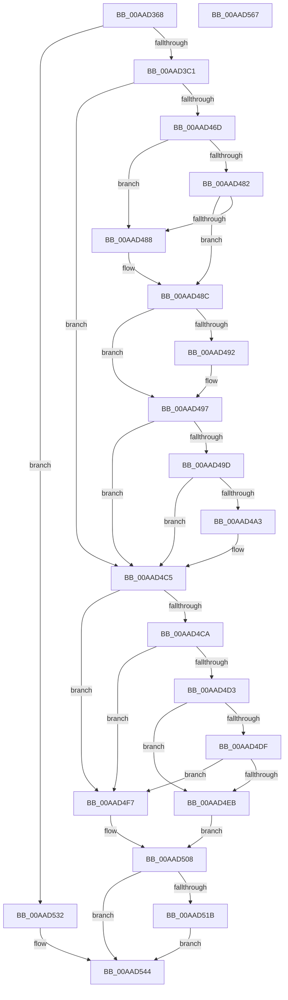

# PspInitializeProcessSecurity

- RVA: `0x00AAD368`–`0x00AAD568` (길이 `512` bytes)
- VA: `0x0000000140AAD368`
- 실행 섹션: `PAGE`
- PDB 이름 있음: `예`; PDB Function 태그: `아니요`
- unwind 정보 RVA: `0x000BC0E8`
- 디코드: `136`개 명령, `512/512` bytes 표시
- 미해석 바이트: `0` (있으면 어셈블리에 `.byte`로 보존)

> 이 문서는 커널 이미지의 기계어와 PDB 기호를 분석해 생성했습니다. 4번과 5번은 함수 원형과 자료형을 바이너리 사용 방식에서 추정한 C 해석이며 원본 소스 복구 결과는 아닙니다.

## 1. Dependencies

- 직접 호출 지점: **8**; 고유 호출 대상: **8**
- 직접 호출자로 확인된 함수: **1**
- RIP 상대 이미지 참조: **1**

### Outgoing calls
- `0x00AAD3F5` → [Feature_DecoupleAppContainerAndIntegrityLevel__private_IsEnabledDeviceUsageNoInline](../../text/4E/Feature_DecoupleAppContainerAndIntegrityLevel__private_IsEnabledDeviceUsageNoInline_function_004EF788.md) (function, `0x004EF788`)
- `0x00AAD40F` → [PsGetProcessSessionId](../../text/22/PsGetProcessSessionId_function_002233A0.md) (function, `0x002233A0`)
- `0x00AAD45F` → [SeSubProcessToken](SeSubProcessToken_function_00AAD570.md) (function, `0x00AAD570`)
- `0x00AAD478` → [ObInitializeFastReference](../9F/ObInitializeFastReference_function_009F0D24.md) (function, `0x009F0D24`)
- `0x00AAD4AB` → [PsReferencePrimaryTokenWithTag](../../text/20/PsReferencePrimaryTokenWithTag_function_0020FF80.md) (function, `0x0020FF80`)
- `0x00AAD4BE` → [PspIdentityBasedJobBreakaway](../A8/PspIdentityBasedJobBreakaway_function_00A899CC.md) (function, `0x00A899CC`)
- `0x00AAD52B` → [ObFastDereferenceObject](../../text/3E/ObFastDereferenceObject_function_003ED5F0.md) (function, `0x003ED5F0`)
- `0x00AAD53F` → [SeAssignPrimaryToken](../9F/SeAssignPrimaryToken_function_009F117C.md) (function, `0x009F117C`)

### Direct callers
- [PspAllocateProcess](../A1/PspAllocateProcess_function_00A13B3C.md) at `0x00A15469`

### Static image references
- `0x00AAD4FC` → RVA `0x00E0C590` (`.data`; read/write)

## 2. Other-region calls and transfers

- 다른 실행 섹션으로 향하는 call: **4**
  - `0x00AAD3F5` → [Feature_DecoupleAppContainerAndIntegrityLevel__private_IsEnabledDeviceUsageNoInline](../../text/4E/Feature_DecoupleAppContainerAndIntegrityLevel__private_IsEnabledDeviceUsageNoInline_function_004EF788.md) (`PAGE` → `.text`)
  - `0x00AAD40F` → [PsGetProcessSessionId](../../text/22/PsGetProcessSessionId_function_002233A0.md) (`PAGE` → `.text`)
  - `0x00AAD4AB` → [PsReferencePrimaryTokenWithTag](../../text/20/PsReferencePrimaryTokenWithTag_function_0020FF80.md) (`PAGE` → `.text`)
  - `0x00AAD52B` → [ObFastDereferenceObject](../../text/3E/ObFastDereferenceObject_function_003ED5F0.md) (`PAGE` → `.text`)
- 별도 외부 분기/꼬리 이동을 확인하지 못했습니다.

## 3. Assembly (complete function range)

```asm
00AAD368  48 8B C4                        mov rax, rsp
00AAD36B  48 89 58 10                     mov qword ptr [rax + 0x10], rbx
00AAD36F  48 89 70 18                     mov qword ptr [rax + 0x18], rsi
00AAD373  48 89 78 20                     mov qword ptr [rax + 0x20], rdi
00AAD377  55                              push rbp
00AAD378  41 54                           push r12
00AAD37A  41 55                           push r13
00AAD37C  41 56                           push r14
00AAD37E  41 57                           push r15
00AAD380  48 8D 68 D1                     lea rbp, [rax - 0x2f]
00AAD384  48 81 EC 90 00 00 00            sub rsp, 0x90
00AAD38B  4C 8B B5 A7 00 00 00            mov r14, qword ptr [rbp + 0xa7]
00AAD392  33 DB                           xor ebx, ebx
00AAD394  33 C0                           xor eax, eax
00AAD396  48 89 5D D7                     mov qword ptr [rbp - 0x29], rbx
00AAD39A  66 89 45 37                     mov word ptr [rbp + 0x37], ax
00AAD39E  45 8B E9                        mov r13d, r9d
00AAD3A1  88 45 39                        mov byte ptr [rbp + 0x39], al
00AAD3A4  4D 8B E0                        mov r12, r8
00AAD3A7  66 41 89 1E                     mov word ptr [r14], bx
00AAD3AB  48 8B FA                        mov rdi, rdx
00AAD3AE  48 89 5D FF                     mov qword ptr [rbp - 1], rbx
00AAD3B2  48 8B F1                        mov rsi, rcx
00AAD3B5  44 8B FB                        mov r15d, ebx
00AAD3B8  48 85 C9                        test rcx, rcx
00AAD3BB  0F 84 71 01 00 00               je 0x140aad532
00AAD3C1  41 8B C1                        mov eax, r9d
00AAD3C4  48 89 4D EF                     mov qword ptr [rbp - 0x11], rcx
00AAD3C8  F7 D8                           neg eax
00AAD3CA  8B 45 57                        mov eax, dword ptr [rbp + 0x57]
00AAD3CD  89 45 DF                        mov dword ptr [rbp - 0x21], eax
00AAD3D0  1B DB                           sbb ebx, ebx
00AAD3D2  8B 85 8F 00 00 00               mov eax, dword ptr [rbp + 0x8f]
00AAD3D8  83 E3 FE                        and ebx, 0xfffffffe
00AAD3DB  89 45 E3                        mov dword ptr [rbp - 0x1d], eax
00AAD3DE  8B 45 5F                        mov eax, dword ptr [rbp + 0x5f]
00AAD3E1  89 45 E7                        mov dword ptr [rbp - 0x19], eax
00AAD3E4  8B 45 67                        mov eax, dword ptr [rbp + 0x67]
00AAD3E7  89 45 EB                        mov dword ptr [rbp - 0x15], eax
00AAD3EA  48 8B 85 97 00 00 00            mov rax, qword ptr [rbp + 0x97]
00AAD3F1  48 89 45 F7                     mov qword ptr [rbp - 9], rax
00AAD3F5  E8 8E 23 A4 FF                  call 0x1404ef788
00AAD3FA  48 8B 4D FF                     mov rcx, qword ptr [rbp - 1]
00AAD3FE  85 C0                           test eax, eax
00AAD400  48 0F 45 8D 9F 00 00 00         cmovne rcx, qword ptr [rbp + 0x9f]
00AAD408  48 89 4D FF                     mov qword ptr [rbp - 1], rcx
00AAD40C  48 8B CF                        mov rcx, rdi
00AAD40F  E8 8C 5F 77 FF                  call 0x1402233a0
00AAD414  44 8B C0                        mov r8d, eax
00AAD417  44 8D 4B 03                     lea r9d, [rbx + 3]
00AAD41B  48 8D 45 37                     lea rax, [rbp + 0x37]
00AAD41F  49 8B D4                        mov rdx, r12
00AAD422  48 89 44 24 50                  mov qword ptr [rsp + 0x50], rax
00AAD427  48 8B CF                        mov rcx, rdi
00AAD42A  48 8B 85 87 00 00 00            mov rax, qword ptr [rbp + 0x87]
00AAD431  48 89 44 24 48                  mov qword ptr [rsp + 0x48], rax
00AAD436  8B 45 7F                        mov eax, dword ptr [rbp + 0x7f]
00AAD439  89 44 24 40                     mov dword ptr [rsp + 0x40], eax
00AAD43D  48 8B 45 77                     mov rax, qword ptr [rbp + 0x77]
00AAD441  48 89 44 24 38                  mov qword ptr [rsp + 0x38], rax
00AAD446  8B 45 6F                        mov eax, dword ptr [rbp + 0x6f]
00AAD449  89 44 24 30                     mov dword ptr [rsp + 0x30], eax
00AAD44D  48 8D 45 DF                     lea rax, [rbp - 0x21]
00AAD451  48 89 44 24 28                  mov qword ptr [rsp + 0x28], rax
00AAD456  44 89 44 24 20                  mov dword ptr [rsp + 0x20], r8d
00AAD45B  4C 8D 45 D7                     lea r8, [rbp - 0x29]
00AAD45F  E8 0C 01 00 00                  call 0x140aad570
00AAD464  45 33 E4                        xor r12d, r12d
00AAD467  8B D8                           mov ebx, eax
00AAD469  85 C0                           test eax, eax
00AAD46B  78 58                           js 0x140aad4c5
00AAD46D  48 8B 55 D7                     mov rdx, qword ptr [rbp - 0x29]
00AAD471  48 8D 8F 48 02 00 00            lea rcx, [rdi + 0x248]
00AAD478  E8 A7 38 F4 FF                  call 0x1409f0d24
00AAD47D  45 85 ED                        test r13d, r13d
00AAD480  75 06                           jne 0x140aad488
00AAD482  44 38 65 37                     cmp byte ptr [rbp + 0x37], r12b
00AAD486  74 04                           je 0x140aad48c
00AAD488  41 C6 06 01                     mov byte ptr [r14], 1
00AAD48C  44 38 65 38                     cmp byte ptr [rbp + 0x38], r12b
00AAD490  74 05                           je 0x140aad497
00AAD492  41 C6 46 01 01                  mov byte ptr [r14 + 1], 1
00AAD497  45 38 66 01                     cmp byte ptr [r14 + 1], r12b
00AAD49B  75 28                           jne 0x140aad4c5
00AAD49D  44 38 65 39                     cmp byte ptr [rbp + 0x39], r12b
00AAD4A1  74 22                           je 0x140aad4c5
00AAD4A3  BA 44 66 6C 74                  mov edx, 0x746c6644
00AAD4A8  48 8B CE                        mov rcx, rsi
00AAD4AB  E8 D0 2A 76 FF                  call 0x14020ff80
00AAD4B0  48 8B 55 D7                     mov rdx, qword ptr [rbp - 0x29]
00AAD4B4  4D 8D 46 01                     lea r8, [r14 + 1]
00AAD4B8  48 8B C8                        mov rcx, rax
00AAD4BB  4C 8B F8                        mov r15, rax
00AAD4BE  E8 09 C5 FD FF                  call 0x140a899cc
00AAD4C3  8B D8                           mov ebx, eax
00AAD4C5  45 38 26                        cmp byte ptr [r14], r12b
00AAD4C8  75 2D                           jne 0x140aad4f7
00AAD4CA  44 39 A6 50 07 00 00            cmp dword ptr [rsi + 0x750], r12d
00AAD4D1  7C 24                           jl 0x140aad4f7
00AAD4D3  F7 87 FC 05 00 00 00 00 80 00   test dword ptr [rdi + 0x5fc], 0x800000
00AAD4DD  74 0C                           je 0x140aad4eb
00AAD4DF  48 8B 86 60 07 00 00            mov rax, qword ptr [rsi + 0x760]
00AAD4E6  48 85 C0                        test rax, rax
00AAD4E9  74 0C                           je 0x140aad4f7
00AAD4EB  48 8B C6                        mov rax, rsi
00AAD4EE  48 8B 80 60 07 00 00            mov rax, qword ptr [rax + 0x760]
00AAD4F5  EB 11                           jmp 0x140aad508
00AAD4F7  B8 01 00 00 00                  mov eax, 1
00AAD4FC  F0 48 0F C1 05 8B F0 35 00      lock xadd qword ptr [rip + 0x35f08b], rax
00AAD505  48 FF C0                        inc rax
00AAD508  48 89 87 60 07 00 00            mov qword ptr [rdi + 0x760], rax
00AAD50F  48 89 87 68 07 00 00            mov qword ptr [rdi + 0x768], rax
00AAD516  4D 85 FF                        test r15, r15
00AAD519  74 29                           je 0x140aad544
00AAD51B  48 8D 8E 48 02 00 00            lea rcx, [rsi + 0x248]
00AAD522  41 B8 44 66 6C 74               mov r8d, 0x746c6644
00AAD528  49 8B D7                        mov rdx, r15
00AAD52B  E8 C0 00 94 FF                  call 0x1403ed5f0
00AAD530  EB 12                           jmp 0x140aad544
00AAD532  48 89 9A 48 02 00 00            mov qword ptr [rdx + 0x248], rbx
00AAD539  48 8B CF                        mov rcx, rdi
00AAD53C  49 8B D4                        mov rdx, r12
00AAD53F  E8 38 3C F4 FF                  call 0x1409f117c
00AAD544  4C 8D 9C 24 90 00 00 00         lea r11, [rsp + 0x90]
00AAD54C  8B C3                           mov eax, ebx
00AAD54E  49 8B 5B 38                     mov rbx, qword ptr [r11 + 0x38]
00AAD552  49 8B 73 40                     mov rsi, qword ptr [r11 + 0x40]
00AAD556  49 8B 7B 48                     mov rdi, qword ptr [r11 + 0x48]
00AAD55A  49 8B E3                        mov rsp, r11
00AAD55D  41 5F                           pop r15
00AAD55F  41 5E                           pop r14
00AAD561  41 5D                           pop r13
00AAD563  41 5C                           pop r12
00AAD565  5D                              pop rbp
00AAD566  C3                              ret
00AAD567  CC                              int3
```

## 4. C-style interpretation (structured pseudocode)

```c
__int64 __fastcall PspInitializeProcessSecurity(__int64 a1, __int64 a2, __int64 a3, int a4)
{
    __int64 result;
    __int64 v_r12;
    __int64 v_r15;
    __int64 v_rbx;
    __int64 v_rsp;
    unsigned __int64 v_stack_m28;
    unsigned __int64 v_stack_m68;
    unsigned __int64 v_stack_m70;
    unsigned int v_stack_m78;
    unsigned __int64 v_stack_m80;
    unsigned int v_stack_m88;
    unsigned __int64 v_stack_m90;
    unsigned int v_stack_m98;

    *(unsigned __int64 *)(v_rsp + 16) = v_rbx;
    *(unsigned __int64 *)(v_rsp + 24) = v_rsi;
    *(unsigned __int64 *)(v_rsp + 32) = v_rdi;
    v_rsp = (v_rsp) - (144);
    v_rbx = 0;
    result = 0;
    *(unsigned __int64 *)(v_rsp - 47 - 41) = 0;
    *(unsigned __int16 *)(v_rsp - 47 + 55) = 0;
    *(unsigned __int8 *)(v_rsp - 47 + 57) = 0;
    *(unsigned __int16 *)(*(unsigned __int64 *)(v_rsp - 47 + 167)) = 0;
    *(unsigned __int64 *)(v_rsp - 47 - 1) = 0;
    if (a1 == 0) goto loc_00AAD532;
    *(unsigned __int64 *)(v_rsp - 47 - 17) = a1;
    result = (unsigned int)(-((unsigned int)(a4)));
    *(unsigned int *)(v_rsp - 47 - 33) = (unsigned int)((unsigned int)(*(unsigned int *)(v_rsp - 47 + 87)));
    v_rbx = (unsigned int)((v_rbx) & (0xFFFFFFFEULL));
    *(unsigned int *)(v_rsp - 47 - 29) = (unsigned int)((unsigned int)(*(unsigned int *)(v_rsp - 47 + 143)));
    *(unsigned int *)(v_rsp - 47 - 25) = (unsigned int)((unsigned int)(*(unsigned int *)(v_rsp - 47 + 95)));
    *(unsigned int *)(v_rsp - 47 - 21) = (unsigned int)((unsigned int)(*(unsigned int *)(v_rsp - 47 + 103)));
    *(unsigned __int64 *)(v_rsp - 47 - 9) = *(unsigned __int64 *)(v_rsp - 47 + 151);
    result = Feature_DecoupleAppContainerAndIntegrityLevel__private_IsEnabledDeviceUsageNoInline(a1, a2, a3, a4);
    a1 = *(unsigned __int64 *)(v_rsp - 47 - 1);
    if ((unsigned int)(result) != 0) { a1 = *(unsigned __int64 *)(v_rsp - 47 + 159); }
    *(unsigned __int64 *)(v_rsp - 47 - 1) = a1;
    result = PsGetProcessSessionId(a2, a2, a3, a4);
    v_stack_m68 = v_rsp - 47 + 55;
    v_stack_m70 = *(unsigned __int64 *)(v_rsp - 47 + 135);
    v_stack_m78 = (unsigned int)((unsigned int)(*(unsigned int *)(v_rsp - 47 + 127)));
    v_stack_m80 = *(unsigned __int64 *)(v_rsp - 47 + 119);
    v_stack_m88 = (unsigned int)((unsigned int)(*(unsigned int *)(v_rsp - 47 + 111)));
    v_stack_m90 = v_rsp - 47 - 33;
    v_stack_m98 = (unsigned int)((unsigned int)((unsigned int)(result)));
    result = SeSubProcessToken(a2, a3, v_rsp - 47 - 41, v_rbx + 3);
    v_r12 = 0;
    if (sign_flag) goto loc_00AAD4C5;
    result = ObInitializeFastReference(a2 + 584, *(unsigned __int64 *)(v_rsp - 47 - 41), v_rsp - 47 - 41, v_rbx + 3);
    if ((unsigned int)((unsigned int)(a4)) != 0) goto loc_00AAD488;
    if ((*(unsigned __int8 *)(v_rsp - 47 + 55)) != 0) {
        *(unsigned __int8 *)(*(unsigned __int64 *)(v_rsp - 47 + 167)) = 1;
    }
    if ((*(unsigned __int8 *)(v_rsp - 47 + 56)) != 0) {
        *(unsigned __int8 *)(*(unsigned __int64 *)(v_rsp - 47 + 167) + 1) = 1;
    }
    if ((*(unsigned __int8 *)(*(unsigned __int64 *)(v_rsp - 47 + 167) + 1)) != 0) goto loc_00AAD4C5;
    v_rbx = (unsigned int)((unsigned int)(result));
    v_r15 = 0;
    if ((*(unsigned __int8 *)(v_rsp - 47 + 57)) != 0) {
        a2 = 0x746C6644ULL;
        a1 = a1;
        result = PsReferencePrimaryTokenWithTag(a1, a2, v_rsp - 47 - 41, v_rbx + 3);
        a2 = *(unsigned __int64 *)(v_rsp - 47 - 41);
        a3 = *(unsigned __int64 *)(v_rsp - 47 + 167) + 1;
        a1 = result;
        v_r15 = result;
        result = PspIdentityBasedJobBreakaway(a1, a2, a3, v_rbx + 3);
        v_rbx = (unsigned int)(result);
    }
    if ((*(unsigned __int8 *)(*(unsigned __int64 *)(v_rsp - 47 + 167))) != 0) goto loc_00AAD4F7;
    if ((*(unsigned int *)(a1 + 1872)) < 0) goto loc_00AAD4F7;
    if (((*(unsigned int *)(a2 + 1532)) & (0x800000ULL)) == 0) goto loc_00AAD4EB;
    if (*(unsigned __int64 *)(a1 + 1888) == 0) goto loc_00AAD4F7;
loc_00AAD4EB:
    goto loc_00AAD508;
loc_00AAD4F7:
    result = (1) + 1;
loc_00AAD508:
    *(unsigned __int64 *)(a2 + 1888) = result;
    *(unsigned __int64 *)(a2 + 1896) = result;
    if (v_r15 == 0) goto loc_00AAD544;
    result = ObFastDereferenceObject(a1 + 584, v_r15, (unsigned int)(0x746C6644ULL), v_rbx + 3);
    goto loc_00AAD544;
loc_00AAD532:
    *(unsigned __int64 *)(v_r15 + 584) = v_rbx;
    result = SeAssignPrimaryToken(a2, 0, (unsigned int)(0x746C6644ULL), v_rbx + 3);
loc_00AAD544:
    return (unsigned int)((unsigned int)(v_rbx));
}
```

## 5. (Beta) C Style

```c
int64_t PspInitializeProcessSecurity(void *Arg1, void *Arg2, int64_t Arg3, int32_t Arg4)
{
    uint8_t *arg1 = (uint8_t *)Arg1;
    uint8_t *arg2 = (uint8_t *)Arg2;

    int64_t result;
    int64_t local_r12;
    int64_t local_r15;
    int64_t local_rbx;
    int64_t local_rsp;
    uint64_t v_stack_m28;
    uint64_t v_stack_m68;
    uint64_t v_stack_m70;
    uint32_t v_stack_m78;
    uint64_t v_stack_m80;
    uint32_t v_stack_m88;
    uint64_t v_stack_m90;
    uint32_t v_stack_m98;

    *(uint64_t *)(local_rsp + 0x10) = local_rbx;
    *(uint64_t *)(local_rsp + 0x18) = local_rsi;
    *(uint64_t *)(local_rsp + 0x20) = local_rdi;
    local_rsp = (local_rsp) - (144);
    local_rbx = 0;
    result = 0;
    *(uint64_t *)(local_rsp - 0x2F - 0x29) = 0;
    *(uint16_t *)(local_rsp - 0x2F + 0x37) = 0;
    *(uint8_t *)(local_rsp - 0x2F + 0x39) = 0;
    *(uint16_t *)(*(uint64_t *)(local_rsp - 0x2F + 0xA7)) = 0;
    *(uint64_t *)(local_rsp - 0x2F - 0x1) = 0;
    if (Arg1 == NULL) goto loc_00AAD532;
    *(void **)(local_rsp - 0x2F - 0x11) = Arg1;
    result = (uint32_t)(-((uint32_t)(Arg4)));
    *(uint32_t *)(local_rsp - 0x2F - 0x21) = (uint32_t)((uint32_t)(*(uint32_t *)(local_rsp - 0x2F + 0x57)));
    local_rbx = (uint32_t)((local_rbx) & (0xFFFFFFFEULL));
    *(uint32_t *)(local_rsp - 0x2F - 0x1D) = (uint32_t)((uint32_t)(*(uint32_t *)(local_rsp - 0x2F + 0x8F)));
    *(uint32_t *)(local_rsp - 0x2F - 0x19) = (uint32_t)((uint32_t)(*(uint32_t *)(local_rsp - 0x2F + 0x5F)));
    *(uint32_t *)(local_rsp - 0x2F - 0x15) = (uint32_t)((uint32_t)(*(uint32_t *)(local_rsp - 0x2F + 0x67)));
    *(uint64_t *)(local_rsp - 0x2F - 0x9) = *(uint64_t *)(local_rsp - 0x2F + 0x97);
    result = Feature_DecoupleAppContainerAndIntegrityLevel__private_IsEnabledDeviceUsageNoInline(Arg1, Arg2, Arg3, Arg4);
    Arg1 = *(uint64_t *)(local_rsp - 0x2F - 0x1);
    if ((uint32_t)(result) != 0) { Arg1 = *(uint64_t *)(local_rsp - 0x2F + 0x9F); }
    *(void **)(local_rsp - 0x2F - 0x1) = Arg1;
    result = PsGetProcessSessionId(Arg2, Arg2, Arg3, Arg4);
    v_stack_m68 = local_rsp - 47 + 55;
    v_stack_m70 = *(uint64_t *)(local_rsp - 0x2F + 0x87);
    v_stack_m78 = (uint32_t)((uint32_t)(*(uint32_t *)(local_rsp - 0x2F + 0x7F)));
    v_stack_m80 = *(uint64_t *)(local_rsp - 0x2F + 0x77);
    v_stack_m88 = (uint32_t)((uint32_t)(*(uint32_t *)(local_rsp - 0x2F + 0x6F)));
    v_stack_m90 = local_rsp - 47 - 33;
    v_stack_m98 = (uint32_t)((uint32_t)((uint32_t)(result)));
    result = SeSubProcessToken(Arg2, Arg3, local_rsp - 47 - 41, local_rbx + 3);
    local_r12 = 0;
    if (sign_flag) goto loc_00AAD4C5;
    result = ObInitializeFastReference(Arg2 + 584, *(uint64_t *)(local_rsp - 0x2F - 0x29), local_rsp - 47 - 41, local_rbx + 3);
    if ((uint32_t)((uint32_t)(Arg4)) != 0) goto loc_00AAD488;
    if ((*(uint8_t *)(local_rsp - 0x2F + 0x37)) != 0) {
        *(uint8_t *)(*(uint64_t *)(local_rsp - 0x2F + 0xA7)) = 1;
    }
    if ((*(uint8_t *)(local_rsp - 0x2F + 0x38)) != 0) {
        *(uint8_t *)(*(uint64_t *)(local_rsp - 0x2F + 0xA7) + 0x1) = 1;
    }
    if ((*(uint8_t *)(*(uint64_t *)(local_rsp - 0x2F + 0xA7) + 0x1)) != 0) goto loc_00AAD4C5;
    local_rbx = (uint32_t)((uint32_t)(result));
    local_r15 = 0;
    if ((*(uint8_t *)(local_rsp - 0x2F + 0x39)) != 0) {
        Arg2 = 0x746C6644ULL;
        Arg1 = Arg1;
        result = PsReferencePrimaryTokenWithTag(Arg1, Arg2, local_rsp - 47 - 41, local_rbx + 3);
        Arg2 = *(uint64_t *)(local_rsp - 0x2F - 0x29);
        Arg3 = *(uint64_t *)(local_rsp - 0x2F + 0xA7) + 1;
        Arg1 = result;
        local_r15 = result;
        result = PspIdentityBasedJobBreakaway(Arg1, Arg2, Arg3, local_rbx + 3);
        local_rbx = (uint32_t)(result);
    }
    if ((*(uint8_t *)(*(uint64_t *)(local_rsp - 0x2F + 0xA7))) != 0) goto loc_00AAD4F7;
    if ((*(uint32_t *)(arg1 + 0x750)) < 0) goto loc_00AAD4F7;
    if (((*(uint32_t *)(arg2 + 0x5FC)) & (0x800000ULL)) == 0) goto loc_00AAD4EB;
    if (*(uint64_t *)(arg1 + 0x760) == 0) goto loc_00AAD4F7;
loc_00AAD4EB:
    goto loc_00AAD508;
loc_00AAD4F7:
    result = (1) + 1;
loc_00AAD508:
    *(uint64_t *)(arg2 + 0x760) = result;
    *(uint64_t *)(arg2 + 0x768) = result;
    if (local_r15 == 0) goto loc_00AAD544;
    result = ObFastDereferenceObject(Arg1 + 584, local_r15, (uint32_t)(0x746C6644ULL), local_rbx + 3);
    goto loc_00AAD544;
loc_00AAD532:
    *(uint64_t *)(local_r15 + 0x248) = local_rbx;
    result = SeAssignPrimaryToken(Arg2, 0, (uint32_t)(0x746C6644ULL), local_rbx + 3);
loc_00AAD544:
    return (uint32_t)((uint32_t)(local_rbx));
}
```

### 관측된 메모리 오프셋

구조체 형식이 확인되지 않은 접근은 인자 기준의 오프셋으로만 기록했습니다.

| 기준 인자 | 오프셋 표현 | 폭 (bit) | 접근 |
|---|---:|---:|---|
| `Arg1` | `+ 0x248` | `64` | `R` |
| `Arg1` | `+ 0x750` | `32` | `R` |
| `Arg1` | `+ 0x760` | `64` | `R` |
| `Arg2` | `+ 0x248` | `64` | `R` |
| `Arg2` | `+ 0x248` | `64` | `W` |
| `Arg2` | `+ 0x5FC` | `32` | `R` |
| `Arg2` | `+ 0x760` | `64` | `W` |
| `Arg2` | `+ 0x768` | `64` | `W` |

## 6. Execution-region graph

[열기: 2D/3D 그래프와 함수 탐색 컨트롤 패널](../../../control-panel.html?section=page&rva=0x00AAD368&view=graph)

- 2D 그래프는 위에서 아래로 흐르고, 3D 그래프는 빈 공간을 드래그해 회전합니다. Shift+드래그는 이동, 휠은 확대·축소, 함수 노드 선택은 대상 보고서 이동입니다.

### Static fallback


