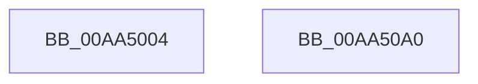

# PspLogAuditTerminateRemoteProcessEvent

- RVA: `0x00AA5004`–`0x00AA50A1` (길이 `157` bytes)
- VA: `0x0000000140AA5004`
- 실행 섹션: `PAGE`
- PDB 이름 있음: `예`; PDB Function 태그: `아니요`
- unwind 정보 RVA: `0x000BB624`
- 디코드: `37`개 명령, `157/157` bytes 표시
- 미해석 바이트: `0` (있으면 어셈블리에 `.byte`로 보존)

> 이 문서는 커널 이미지의 기계어와 PDB 기호를 분석해 생성했습니다. 4번과 5번은 함수 원형과 자료형을 바이너리 사용 방식에서 추정한 C 해석이며 원본 소스 복구 결과는 아닙니다.

## 1. Dependencies

- 직접 호출 지점: **2**; 고유 호출 대상: **2**
- 직접 호출자로 확인된 함수: **1**
- RIP 상대 이미지 참조: **3**

### Outgoing calls
- `0x00AA5086` → [EtwWrite](../../text/41/EtwWrite_function_0041C720.md) (function, `0x0041C720`)
- `0x00AA5092` → [_security_check_cookie](../../text/6A/_security_check_cookie_function_006AC640.md) (function, `0x006AC640`)

### Direct callers
- [NtTerminateProcess](../AE/NtTerminateProcess_function_00AEC320.md) at `0x00AEC47C`

### Static image references
- `0x00AA5020` → RVA `0x00E0A740` (`.data`; read)
- `0x00AA502E` → RVA `0x00EFFA38` (`.data`; read)
- `0x00AA503D` → RVA `0x0001C840` (`.rdata`; read)

## 2. Other-region calls and transfers

- 다른 실행 섹션으로 향하는 call: **2**
  - `0x00AA5086` → [EtwWrite](../../text/41/EtwWrite_function_0041C720.md) (`PAGE` → `.text`)
  - `0x00AA5092` → [_security_check_cookie](../../text/6A/_security_check_cookie_function_006AC640.md) (`PAGE` → `.text`)
- 별도 외부 분기/꼬리 이동을 확인하지 못했습니다.

## 3. Assembly (complete function range)

```asm
00AA5004  48 8B C4                        mov rax, rsp
00AA5007  4C 89 48 20                     mov qword ptr [rax + 0x20], r9
00AA500B  4C 89 40 18                     mov qword ptr [rax + 0x18], r8
00AA500F  89 50 10                        mov dword ptr [rax + 0x10], edx
00AA5012  89 48 08                        mov dword ptr [rax + 8], ecx
00AA5015  55                              push rbp
00AA5016  48 8B EC                        mov rbp, rsp
00AA5019  48 81 EC 80 00 00 00            sub rsp, 0x80
00AA5020  48 8B 05 19 57 36 00            mov rax, qword ptr [rip + 0x365719]
00AA5027  48 33 C4                        xor rax, rsp
00AA502A  48 89 45 F0                     mov qword ptr [rbp - 0x10], rax
00AA502E  48 8B 0D 03 AA 45 00            mov rcx, qword ptr [rip + 0x45aa03]
00AA5035  48 8D 45 10                     lea rax, [rbp + 0x10]
00AA5039  48 89 45 B0                     mov qword ptr [rbp - 0x50], rax
00AA503D  48 8D 15 FC 77 57 FF            lea rdx, [rip - 0xa88804]
00AA5044  41 B9 04 00 00 00               mov r9d, 4
00AA504A  48 C7 45 D8 08 00 00 00         mov qword ptr [rbp - 0x28], 8
00AA5052  48 8D 45 18                     lea rax, [rbp + 0x18]
00AA5056  4C 89 4D B8                     mov qword ptr [rbp - 0x48], r9
00AA505A  48 89 45 C0                     mov qword ptr [rbp - 0x40], rax
00AA505E  45 33 C0                        xor r8d, r8d
00AA5061  48 8D 45 20                     lea rax, [rbp + 0x20]
00AA5065  4C 89 4D C8                     mov qword ptr [rbp - 0x38], r9
00AA5069  48 89 45 D0                     mov qword ptr [rbp - 0x30], rax
00AA506D  48 8D 45 28                     lea rax, [rbp + 0x28]
00AA5071  48 89 45 E0                     mov qword ptr [rbp - 0x20], rax
00AA5075  48 8D 45 B0                     lea rax, [rbp - 0x50]
00AA5079  48 89 44 24 20                  mov qword ptr [rsp + 0x20], rax
00AA507E  48 C7 45 E8 08 00 00 00         mov qword ptr [rbp - 0x18], 8
00AA5086  E8 95 76 97 FF                  call 0x14041c720
00AA508B  48 8B 4D F0                     mov rcx, qword ptr [rbp - 0x10]
00AA508F  48 33 CC                        xor rcx, rsp
00AA5092  E8 A9 75 C0 FF                  call 0x1406ac640
00AA5097  48 81 C4 80 00 00 00            add rsp, 0x80
00AA509E  5D                              pop rbp
00AA509F  C3                              ret
00AA50A0  CC                              int3
```

## 4. C-style interpretation (structured pseudocode)

```c
__int64 __fastcall PspLogAuditTerminateRemoteProcessEvent(int a1, int a2, __int64 a3, __int64 a4)
{
    __int64 result;
    __int64 v_rsp;
    unsigned __int64 v_stack_m18;
    unsigned __int64 v_stack_m20;
    unsigned __int64 v_stack_m28;
    unsigned __int64 v_stack_m30;
    unsigned __int64 v_stack_m38;
    unsigned __int64 v_stack_m40;
    unsigned __int64 v_stack_m48;
    unsigned __int64 v_stack_m50;
    unsigned __int64 v_stack_m58;
    unsigned __int64 v_stack_m68;
    unsigned __int64 v_stack_p10;
    unsigned __int64 v_stack_p18;
    unsigned __int64 v_stack_p20;
    unsigned __int64 v_stack_p8;

    *(unsigned __int64 *)(v_rsp + 32) = a4;
    *(unsigned __int64 *)(v_rsp + 24) = a3;
    *(unsigned int *)(v_rsp + 16) = a2;
    *(unsigned int *)(v_rsp + 8) = a1;
    v_rsp = (v_rsp) - (128);
    result = (*(unsigned __int64 *)(v_rip + 3561241)) ^ (v_rsp);
    v_stack_m18 = result;
    v_stack_m58 = v_stack_p8;
    v_stack_m30 = 8;
    v_stack_m50 = 4;
    v_stack_m48 = v_stack_p10;
    a3 = 0;
    v_stack_m40 = 4;
    v_stack_m38 = v_stack_p18;
    v_stack_m28 = v_stack_p20;
    v_stack_m68 = v_stack_m58;
    v_stack_m20 = 8;
    result = EtwWrite(*(unsigned __int64 *)(v_rip + 4565507), v_rip - 11044868, a3, 4);
    a1 = (v_stack_m18) ^ (v_rsp);
    result = _security_check_cookie(a1, v_rip - 11044868, a3, 4);
    v_rsp = (v_rsp) + (128);
    return result;
}
```

## 5. (Beta) C Style

```c
int64_t PspLogAuditTerminateRemoteProcessEvent(int32_t Arg1, int32_t Arg2, int64_t Arg3, int64_t Arg4)
{
    int64_t result;
    int64_t local_rsp;
    uint64_t v_stack_m18;
    uint64_t v_stack_m20;
    uint64_t v_stack_m28;
    uint64_t v_stack_m30;
    uint64_t v_stack_m38;
    uint64_t v_stack_m40;
    uint64_t v_stack_m48;
    uint64_t v_stack_m50;
    uint64_t v_stack_m58;
    uint64_t v_stack_m68;
    uint64_t v_stack_p10;
    uint64_t v_stack_p18;
    uint64_t v_stack_p20;
    uint64_t v_stack_p8;

    *(uint64_t *)(local_rsp + 0x20) = Arg4;
    *(uint64_t *)(local_rsp + 0x18) = Arg3;
    *(uint32_t *)(local_rsp + 0x10) = Arg2;
    *(uint32_t *)(local_rsp + 0x8) = Arg1;
    local_rsp = (local_rsp) - (128);
    result = (*(uint64_t *)(v_rip + 0x365719)) ^ (local_rsp);
    v_stack_m18 = result;
    v_stack_m58 = v_stack_p8;
    v_stack_m30 = 8;
    v_stack_m50 = 4;
    v_stack_m48 = v_stack_p10;
    Arg3 = 0;
    v_stack_m40 = 4;
    v_stack_m38 = v_stack_p18;
    v_stack_m28 = v_stack_p20;
    v_stack_m68 = v_stack_m58;
    v_stack_m20 = 8;
    result = EtwWrite(*(uint64_t *)(v_rip + 0x45AA03), v_rip - 11044868, Arg3, 4);
    Arg1 = (v_stack_m18) ^ (local_rsp);
    result = _security_check_cookie(Arg1, v_rip - 11044868, Arg3, 4);
    local_rsp = (local_rsp) + (128);
    return result;
}
```

## 6. Execution-region graph

[열기: 2D/3D 그래프와 함수 탐색 컨트롤 패널](../../../control-panel.html?section=page&rva=0x00AA5004&view=graph)

- 2D 그래프는 위에서 아래로 흐르고, 3D 그래프는 빈 공간을 드래그해 회전합니다. Shift+드래그는 이동, 휠은 확대·축소, 함수 노드 선택은 대상 보고서 이동입니다.

### Static fallback


