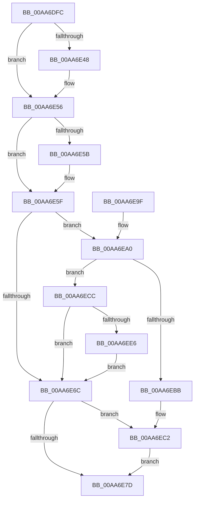

# PspPostFreezeOperationWorkEnqueue

- RVA: `0x00AA6DFC`–`0x00AA6F04` (길이 `264` bytes)
- VA: `0x0000000140AA6DFC`
- 실행 섹션: `PAGE`
- PDB 이름 있음: `예`; PDB Function 태그: `아니요`
- unwind 정보 RVA: `0x000A91D0`
- 디코드: `64`개 명령, `264/264` bytes 표시
- 미해석 바이트: `0` (있으면 어셈블리에 `.byte`로 보존)

> 이 문서는 커널 이미지의 기계어와 PDB 기호를 분석해 생성했습니다. 4번과 5번은 함수 원형과 자료형을 바이너리 사용 방식에서 추정한 C 해석이며 원본 소스 복구 결과는 아닙니다.

## 1. Dependencies

- 직접 호출 지점: **7**; 고유 호출 대상: **7**
- 직접 호출자로 확인된 함수: **2**
- RIP 상대 이미지 참조: **8**

### Outgoing calls
- `0x00AA6E37` → [KeAbPreAcquire](../../text/21/KeAbPreAcquire_function_00210230.md) (function, `0x00210230`)
- `0x00AA6E51` → [ExfAcquirePushLockExclusiveEx](../../text/20/ExfAcquirePushLockExclusiveEx_function_0020FC90.md) (function, `0x0020FC90`)
- `0x00AA6E80` → [KeAbPostRelease](../../text/2E/KeAbPostRelease_function_002E1600.md) (function, `0x002E1600`)
- `0x00AA6E85` → [KeLeaveCriticalRegion](../../text/25/KeLeaveCriticalRegion_function_0025D8B0.md) (function, `0x0025D8B0`)
- `0x00AA6EA3` → [ObfReferenceObject](../../text/20/ObfReferenceObject_function_0020FA20.md) (function, `0x0020FA20`)
- `0x00AA6EC5` → [ExfTryToWakePushLock](../../text/26/ExfTryToWakePushLock_function_00265DD0.md) (function, `0x00265DD0`)
- `0x00AA6EF2` → [ExQueueWorkItem](../../text/2F/ExQueueWorkItem_function_002F9520.md) (function, `0x002F9520`)

### Direct callers
- [PsThawMultiProcess](../../text/45/PsThawMultiProcess_function_0045FFE0.md) at `0x00460154`
- [PsFreezeProcess](PsFreezeProcess_function_00AA6D04.md) at `0x00AA6DC8`

### Static image references
- `0x00AA6E19` → RVA `0x00F06728` (`.data`; read)
- `0x00AA6E6C` → RVA `0x00F06728` (`.data`; read/write)
- `0x00AA6EA8` → RVA `0x00F06738` (`.data`; read)
- `0x00AA6EAF` → RVA `0x00F06730` (`.data`; read)
- `0x00AA6ED6` → RVA `0x00F06720` (`.data`; read)
- `0x00AA6EDD` → RVA `0x00F06738` (`.data`; write)
- `0x00AA6EEB` → RVA `0x00F06740` (`.data`; read)
- `0x00AA6EF7` → RVA `0x00F06720` (`.data`; read/write)

## 2. Other-region calls and transfers

- 다른 실행 섹션으로 향하는 call: **7**
  - `0x00AA6E37` → [KeAbPreAcquire](../../text/21/KeAbPreAcquire_function_00210230.md) (`PAGE` → `.text`)
  - `0x00AA6E51` → [ExfAcquirePushLockExclusiveEx](../../text/20/ExfAcquirePushLockExclusiveEx_function_0020FC90.md) (`PAGE` → `.text`)
  - `0x00AA6E80` → [KeAbPostRelease](../../text/2E/KeAbPostRelease_function_002E1600.md) (`PAGE` → `.text`)
  - `0x00AA6E85` → [KeLeaveCriticalRegion](../../text/25/KeLeaveCriticalRegion_function_0025D8B0.md) (`PAGE` → `.text`)
  - `0x00AA6EA3` → [ObfReferenceObject](../../text/20/ObfReferenceObject_function_0020FA20.md) (`PAGE` → `.text`)
  - `0x00AA6EC5` → [ExfTryToWakePushLock](../../text/26/ExfTryToWakePushLock_function_00265DD0.md) (`PAGE` → `.text`)
  - `0x00AA6EF2` → [ExQueueWorkItem](../../text/2F/ExQueueWorkItem_function_002F9520.md) (`PAGE` → `.text`)
- 별도 외부 분기/꼬리 이동을 확인하지 못했습니다.

## 3. Assembly (complete function range)

```asm
00AA6DFC  48 89 5C 24 08                  mov qword ptr [rsp + 8], rbx
00AA6E01  48 89 6C 24 10                  mov qword ptr [rsp + 0x10], rbp
00AA6E06  48 89 74 24 18                  mov qword ptr [rsp + 0x18], rsi
00AA6E0B  57                              push rdi
00AA6E0C  48 83 EC 20                     sub rsp, 0x20
00AA6E10  65 48 8B 04 25 88 01 00 00      mov rax, qword ptr gs:[0x188]
00AA6E19  48 8D 2D 08 F9 45 00            lea rbp, [rip + 0x45f908]
00AA6E20  48 8B F1                        mov rsi, rcx
00AA6E23  48 83 CB FF                     or rbx, 0xffffffffffffffff
00AA6E27  45 33 C0                        xor r8d, r8d
00AA6E2A  33 D2                           xor edx, edx
00AA6E2C  48 8B CD                        mov rcx, rbp
00AA6E2F  66 01 98 E4 01 00 00            add word ptr [rax + 0x1e4], bx
00AA6E36  90                              nop
00AA6E37  E8 F4 93 76 FF                  call 0x140210230
00AA6E3C  F0 48 0F BA 6D 00 00            lock bts qword ptr [rbp], 0
00AA6E43  48 8B F8                        mov rdi, rax
00AA6E46  73 0E                           jae 0x140aa6e56
00AA6E48  4C 8B C5                        mov r8, rbp
00AA6E4B  48 8B D0                        mov rdx, rax
00AA6E4E  48 8B CD                        mov rcx, rbp
00AA6E51  E8 3A 8E 76 FF                  call 0x14020fc90
00AA6E56  48 85 FF                        test rdi, rdi
00AA6E59  74 04                           je 0x140aa6e5f
00AA6E5B  C6 47 0A 01                     mov byte ptr [rdi + 0xa], 1
00AA6E5F  48 8D BE 08 08 00 00            lea rdi, [rsi + 0x808]
00AA6E66  48 83 3F 00                     cmp qword ptr [rdi], 0
00AA6E6A  74 34                           je 0x140aa6ea0
00AA6E6C  F0 48 0F C1 1D B3 F8 45 00      lock xadd qword ptr [rip + 0x45f8b3], rbx
00AA6E75  80 E3 06                        and bl, 6
00AA6E78  80 FB 02                        cmp bl, 2
00AA6E7B  74 45                           je 0x140aa6ec2
00AA6E7D  48 8B CD                        mov rcx, rbp
00AA6E80  E8 7B A7 83 FF                  call 0x1402e1600
00AA6E85  E8 26 6A 7B FF                  call 0x14025d8b0
00AA6E8A  48 8B 5C 24 30                  mov rbx, qword ptr [rsp + 0x30]
00AA6E8F  48 8B 6C 24 38                  mov rbp, qword ptr [rsp + 0x38]
00AA6E94  48 8B 74 24 40                  mov rsi, qword ptr [rsp + 0x40]
00AA6E99  48 83 C4 20                     add rsp, 0x20
00AA6E9D  5F                              pop rdi
00AA6E9E  C3                              ret
00AA6E9F  CC                              int3
00AA6EA0  48 8B CE                        mov rcx, rsi
00AA6EA3  E8 78 8B 76 FF                  call 0x14020fa20
00AA6EA8  48 8B 05 89 F8 45 00            mov rax, qword ptr [rip + 0x45f889]
00AA6EAF  48 8D 0D 7A F8 45 00            lea rcx, [rip + 0x45f87a]
00AA6EB6  48 39 08                        cmp qword ptr [rax], rcx
00AA6EB9  74 11                           je 0x140aa6ecc
00AA6EBB  B9 03 00 00 00                  mov ecx, 3
00AA6EC0  CD 29                           int 0x29
00AA6EC2  48 8B CD                        mov rcx, rbp
00AA6EC5  E8 06 EF 7B FF                  call 0x140265dd0
00AA6ECA  EB B1                           jmp 0x140aa6e7d
00AA6ECC  48 89 0F                        mov qword ptr [rdi], rcx
00AA6ECF  48 89 47 08                     mov qword ptr [rdi + 8], rax
00AA6ED3  48 89 38                        mov qword ptr [rax], rdi
00AA6ED6  F6 05 43 F8 45 00 01            test byte ptr [rip + 0x45f843], 1
00AA6EDD  48 89 3D 54 F8 45 00            mov qword ptr [rip + 0x45f854], rdi
00AA6EE4  75 86                           jne 0x140aa6e6c
00AA6EE6  BA 01 00 00 00                  mov edx, 1
00AA6EEB  48 8D 0D 4E F8 45 00            lea rcx, [rip + 0x45f84e]
00AA6EF2  E8 29 26 85 FF                  call 0x1402f9520
00AA6EF7  48 83 0D 21 F8 45 00 01         or qword ptr [rip + 0x45f821], 1
00AA6EFF  E9 68 FF FF FF                  jmp 0x140aa6e6c
```

## 4. C-style interpretation (structured pseudocode)

```c
__int64 __fastcall PspPostFreezeOperationWorkEnqueue(__int64 a1, int a2, int a3)
{
    __int64 result;
    __int64 v_rbx;
    __int64 v_rsp;
    unsigned __int64 v_stack_p10;
    unsigned __int64 v_stack_p18;
    unsigned __int64 v_stack_p8;

    v_stack_p8 = v_rbx;
    v_stack_p10 = v_rbp;
    v_stack_p18 = v_rsi;
    v_rsp = (v_rsp) - (32);
    v_rbx = (v_rbx) | (-1);
    a3 = 0;
    a2 = 0;
    result = KeAbPreAcquire(v_rip + 4585736, a2, a3, a4);
    if (!(condition_is_above_or_equal)) {
        a3 = v_rip + 4585736;
        a2 = result;
        a1 = v_rip + 4585736;
        result = ExfAcquirePushLockExclusiveEx(a1, a2, a3, a4);
    }
    if (result != 0) {
        *(unsigned __int8 *)(result + 10) = 1;
    }
    if ((*(unsigned __int64 *)(a1 + 2056)) == 0) goto loc_00AA6EA0;
loc_00AA6E6C:
    v_rbx = (unsigned __int8)((v_rbx) & (6));
    if (((unsigned __int8)(v_rbx)) == 2) goto loc_00AA6EC2;
loc_00AA6E7D:
    result = KeAbPostRelease(v_rip + 4585736, a2, a3, a4);
    result = KeLeaveCriticalRegion(v_rip + 4585736, a2, a3, a4);
    v_rsp = (v_rsp) + (32);
    return result;
loc_00AA6EA0:
    result = ObfReferenceObject(v_stack_p18, a2, a3, a4);
    if ((*(unsigned __int64 *)(*(unsigned __int64 *)(v_rip + 4585609))) == (v_rip + 4585594)) goto loc_00AA6ECC;
loc_00AA6EC2:
    result = ExfTryToWakePushLock(v_stack_p10, a2, a3, a4);
    goto loc_00AA6E7D;
loc_00AA6ECC:
    *(unsigned __int64 *)(a1 + 2056) = v_stack_p10;
    *(unsigned __int64 *)(a1 + 2056 + 8) = result;
    *(unsigned __int64 *)(result) = a1 + 2056;
    *(unsigned __int64 *)(v_rip + 4585556) = a1 + 2056;
    if (((*(unsigned __int8 *)(v_rip + 4585539)) & (1)) != 0) goto loc_00AA6E6C;
    result = ExQueueWorkItem(v_rip + 4585550, 1, a3, a4);
    goto loc_00AA6E6C;
}
```

## 5. (Beta) C Style

```c
int64_t PspPostFreezeOperationWorkEnqueue(void *Arg1, int32_t Arg2, int32_t Arg3)
{
    uint8_t *arg1 = (uint8_t *)Arg1;

    int64_t result;
    int64_t local_rbx;
    int64_t local_rsp;
    uint64_t v_stack_p10;
    uint64_t v_stack_p18;
    uint64_t v_stack_p8;

    v_stack_p8 = local_rbx;
    v_stack_p10 = local_rbp;
    v_stack_p18 = local_rsi;
    local_rsp = (local_rsp) - (32);
    local_rbx = (local_rbx) | (-1);
    Arg3 = 0;
    Arg2 = 0;
    result = KeAbPreAcquire(v_rip + 4585736, Arg2, Arg3, a4);
    if (!(condition_is_above_or_equal)) {
        Arg3 = v_rip + 4585736;
        Arg2 = result;
        Arg1 = v_rip + 4585736;
        result = ExfAcquirePushLockExclusiveEx(Arg1, Arg2, Arg3, a4);
    }
    if (result != 0) {
        *(uint8_t *)(result + 0xA) = 1;
    }
    if ((*(uint64_t *)(arg1 + 0x808)) == 0) goto loc_00AA6EA0;
loc_00AA6E6C:
    local_rbx = (uint8_t)((local_rbx) & (6));
    if (((uint8_t)(local_rbx)) == 2) goto loc_00AA6EC2;
loc_00AA6E7D:
    result = KeAbPostRelease(v_rip + 4585736, Arg2, Arg3, a4);
    result = KeLeaveCriticalRegion(v_rip + 4585736, Arg2, Arg3, a4);
    local_rsp = (local_rsp) + (32);
    return result;
loc_00AA6EA0:
    result = ObfReferenceObject(v_stack_p18, Arg2, Arg3, a4);
    if ((*(uint64_t *)(*(uint64_t *)(v_rip + 0x45F889))) == (v_rip + 4585594)) goto loc_00AA6ECC;
loc_00AA6EC2:
    result = ExfTryToWakePushLock(v_stack_p10, Arg2, Arg3, a4);
    goto loc_00AA6E7D;
loc_00AA6ECC:
    *(uint64_t *)(arg1 + 0x808) = v_stack_p10;
    *(uint64_t *)(arg1 + 0x808 + 0x8) = result;
    *(void **)(result) = Arg1 + 2056;
    *(void **)(v_rip + 0x45F854) = Arg1 + 2056;
    if (((*(uint8_t *)(v_rip + 0x45F843)) & (1)) != 0) goto loc_00AA6E6C;
    result = ExQueueWorkItem(v_rip + 4585550, 1, Arg3, a4);
    goto loc_00AA6E6C;
}
```

### 관측된 메모리 오프셋

구조체 형식이 확인되지 않은 접근은 인자 기준의 오프셋으로만 기록했습니다.

| 기준 인자 | 오프셋 표현 | 폭 (bit) | 접근 |
|---|---:|---:|---|
| `Arg1` | `+ 0x0` | `64` | `R` |
| `Arg1` | `+ 0x0` | `64` | `W` |
| `Arg1` | `+ 0x8` | `64` | `W` |
| `Arg1` | `+ 0x808` | `64` | `R` |

## 6. Execution-region graph

[열기: 2D/3D 그래프와 함수 탐색 컨트롤 패널](../../../control-panel.html?section=page&rva=0x00AA6DFC&view=graph)

- 2D 그래프는 위에서 아래로 흐르고, 3D 그래프는 빈 공간을 드래그해 회전합니다. Shift+드래그는 이동, 휠은 확대·축소, 함수 노드 선택은 대상 보고서 이동입니다.

### Static fallback


