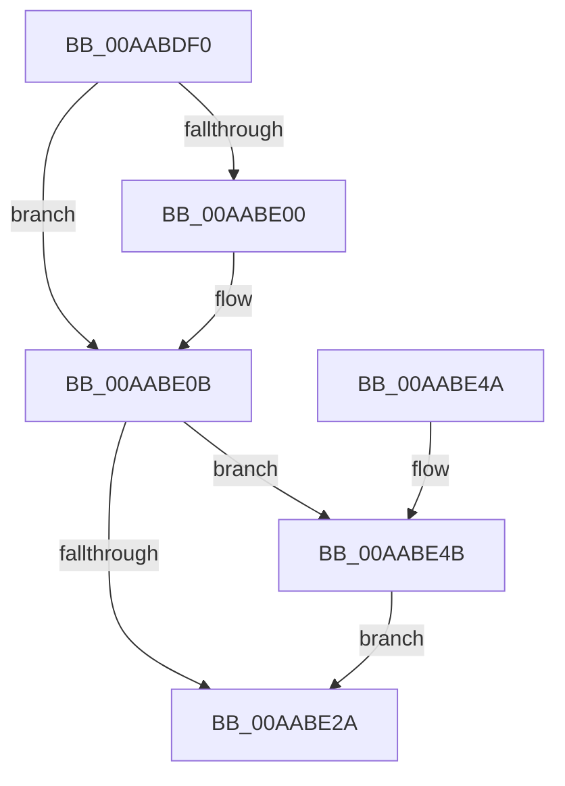

# PspSecureThreadStartup

- RVA: `0x00AABDF0`–`0x00AABE5D` (길이 `109` bytes)
- VA: `0x0000000140AABDF0`
- 실행 섹션: `PAGE`
- PDB 이름 있음: `예`; PDB Function 태그: `아니요`
- unwind 정보 RVA: `0x0006F13C`
- 디코드: `31`개 명령, `109/109` bytes 표시
- 미해석 바이트: `0` (있으면 어셈블리에 `.byte`로 보존)

> 이 문서는 커널 이미지의 기계어와 PDB 기호를 분석해 생성했습니다. 4번과 5번은 함수 원형과 자료형을 바이너리 사용 방식에서 추정한 C 해석이며 원본 소스 복구 결과는 아닙니다.

## 1. Dependencies

- 직접 호출 지점: **6**; 고유 호출 대상: **5**
- 직접 호출자로 확인된 함수: **0**
- RIP 상대 이미지 참조: **1**

### Outgoing calls
- `0x00AABE06` → [KiLowerIrqlProcessIrqlFlags](../../text/4F/KiLowerIrqlProcessIrqlFlags_function_004F5698.md) (function, `0x004F5698`)
- `0x00AABE1B` → [PspDisablePrimaryTokenExchange](../8D/PspDisablePrimaryTokenExchange_function_008D5C10.md) (function, `0x008D5C10`)
- `0x00AABE2D` → [PspNotifyThreadCreation](../8D/PspNotifyThreadCreation_function_008D5D48.md) (function, `0x008D5D48`)
- `0x00AABE32` → [VslStartSecureThread](VslStartSecureThread_function_00AABE64.md) (function, `0x00AABE64`)
- `0x00AABE3F` → [PspTerminateThreadByPointer](../90/PspTerminateThreadByPointer_function_00905E80.md) (function, `0x00905E80`)
- `0x00AABE56` → [PspTerminateThreadByPointer](../90/PspTerminateThreadByPointer_function_00905E80.md) (function, `0x00905E80`)

### Direct callers
- 이 함수 시작 RVA로 연결되는 직접 call은 확인되지 않았습니다. 간접 호출은 완전히 역산할 수 없습니다.

### Static image references
- `0x00AABDF8` → RVA `0x00FC6D20` (`ALMOSTRO`; read)

## 2. Other-region calls and transfers

- 다른 실행 섹션으로 향하는 call: **1**
  - `0x00AABE06` → [KiLowerIrqlProcessIrqlFlags](../../text/4F/KiLowerIrqlProcessIrqlFlags_function_004F5698.md) (`PAGE` → `.text`)
- 별도 외부 분기/꼬리 이동을 확인하지 못했습니다.

## 3. Assembly (complete function range)

```asm
00AABDF0  40 53                           push rbx
00AABDF2  48 83 EC 20                     sub rsp, 0x20
00AABDF6  33 DB                           xor ebx, ebx
00AABDF8  39 1D 22 AF 51 00               cmp dword ptr [rip + 0x51af22], ebx
00AABDFE  74 0B                           je 0x140aabe0b
00AABE00  44 0F 20 C1                     mov rcx, cr8
00AABE04  33 D2                           xor edx, edx
00AABE06  E8 8D 98 A4 FF                  call 0x1404f5698
00AABE0B  44 0F 22 C3                     mov cr8, rbx
00AABE0F  65 48 8B 1C 25 88 01 00 00      mov rbx, qword ptr gs:[0x188]
00AABE18  48 8B CB                        mov rcx, rbx
00AABE1B  E8 F0 9D E2 FF                  call 0x1408d5c10
00AABE20  8B 83 A0 05 00 00               mov eax, dword ptr [rbx + 0x5a0]
00AABE26  A8 02                           test al, 2
00AABE28  74 21                           je 0x140aabe4b
00AABE2A  48 8B CB                        mov rcx, rbx
00AABE2D  E8 16 9F E2 FF                  call 0x1408d5d48
00AABE32  E8 2D 00 00 00                  call 0x140aabe64
00AABE37  41 B0 01                        mov r8b, 1
00AABE3A  8B D0                           mov edx, eax
00AABE3C  48 8B CB                        mov rcx, rbx
00AABE3F  E8 3C A0 E5 FF                  call 0x140905e80
00AABE44  48 83 C4 20                     add rsp, 0x20
00AABE48  5B                              pop rbx
00AABE49  C3                              ret
00AABE4A  CC                              int3
00AABE4B  41 B0 01                        mov r8b, 1
00AABE4E  BA 4B 00 00 C0                  mov edx, 0xc000004b
00AABE53  48 8B CB                        mov rcx, rbx
00AABE56  E8 25 A0 E5 FF                  call 0x140905e80
00AABE5B  EB CD                           jmp 0x140aabe2a
```

## 4. C-style interpretation (structured pseudocode)

```c
__int64 __fastcall PspSecureThreadStartup(__int64 a1, int a2)
{
    __int64 result;
    __int64 v_rbx;
    __int64 v_rsp;

    v_rsp = (v_rsp) - (32);
    v_rbx = 0;
    if ((*(unsigned int *)(v_rip + 5353250)) != 0) {
        a1 = v_cr8;
        a2 = 0;
        result = KiLowerIrqlProcessIrqlFlags(a1, a2, a3, a4);
    }
    result = PspDisablePrimaryTokenExchange(*(unsigned __int64 *)(gs_base + (0 + 392)), a2, a3, a4);
    if ((((unsigned __int8)((unsigned int)(*(unsigned int *)(*(unsigned __int64 *)(gs_base + (0 + 392)) + 1440)))) & (2)) == 0) goto loc_00AABE4B;
loc_00AABE2A:
    result = PspNotifyThreadCreation(*(unsigned __int64 *)(gs_base + (0 + 392)), a2, a3, a4);
    result = VslStartSecureThread(*(unsigned __int64 *)(gs_base + (0 + 392)), a2, a3, a4);
    result = PspTerminateThreadByPointer(*(unsigned __int64 *)(gs_base + (0 + 392)), (unsigned int)((unsigned int)(result)), 1, a4);
    v_rsp = (v_rsp) + (32);
    return result;
loc_00AABE4B:
    result = PspTerminateThreadByPointer(*(unsigned __int64 *)(gs_base + (0 + 392)), (unsigned int)(0xC000004BULL), 1, a4);
    goto loc_00AABE2A;
}
```

## 5. (Beta) C Style

```c
int64_t PspSecureThreadStartup(int64_t Arg1, int32_t Arg2)
{
    int64_t result;
    int64_t local_rbx;
    int64_t local_rsp;

    local_rsp = (local_rsp) - (32);
    local_rbx = 0;
    if ((*(uint32_t *)(v_rip + 0x51AF22)) != 0) {
        Arg1 = v_cr8;
        Arg2 = 0;
        result = KiLowerIrqlProcessIrqlFlags(Arg1, Arg2, a3, a4);
    }
    result = PspDisablePrimaryTokenExchange(*(uint64_t *)(gs_base + (0 + 0x188)), Arg2, a3, a4);
    if ((((uint8_t)((uint32_t)(*(uint32_t *)(*(uint64_t *)(gs_base + (0 + 0x188)) + 0x5A0)))) & (2)) == 0) goto loc_00AABE4B;
loc_00AABE2A:
    result = PspNotifyThreadCreation(*(uint64_t *)(gs_base + (0 + 0x188)), Arg2, a3, a4);
    result = VslStartSecureThread(*(uint64_t *)(gs_base + (0 + 0x188)), Arg2, a3, a4);
    result = PspTerminateThreadByPointer(*(uint64_t *)(gs_base + (0 + 0x188)), (uint32_t)((uint32_t)(result)), 1, a4);
    local_rsp = (local_rsp) + (32);
    return result;
loc_00AABE4B:
    result = PspTerminateThreadByPointer(*(uint64_t *)(gs_base + (0 + 0x188)), (uint32_t)(0xC000004BULL), 1, a4);
    goto loc_00AABE2A;
}
```

## 6. Execution-region graph

[열기: 2D/3D 그래프와 함수 탐색 컨트롤 패널](../../../control-panel.html?section=page&rva=0x00AABDF0&view=graph)

- 2D 그래프는 위에서 아래로 흐르고, 3D 그래프는 빈 공간을 드래그해 회전합니다. Shift+드래그는 이동, 휠은 확대·축소, 함수 노드 선택은 대상 보고서 이동입니다.

### Static fallback


