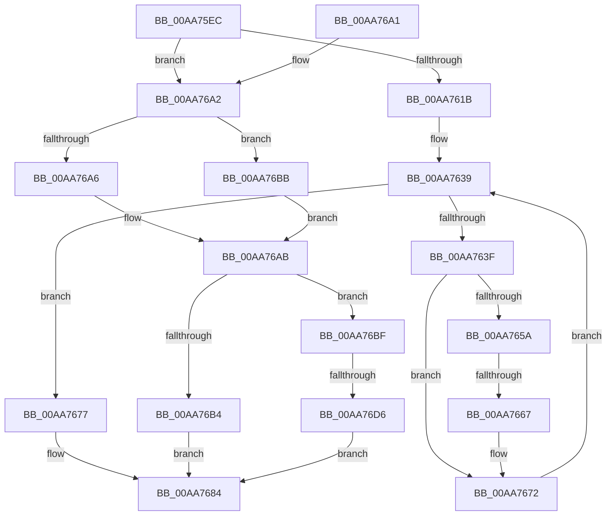

# PspSetCreateProcessNotifyRoutine

- RVA: `0x00AA75EC`–`0x00AA76DD` (길이 `241` bytes)
- VA: `0x0000000140AA75EC`
- 실행 섹션: `PAGE`
- PDB 이름 있음: `예`; PDB Function 태그: `예`
- unwind 정보 RVA: `0x000B3FAC`
- 디코드: `70`개 명령, `241/241` bytes 표시
- 미해석 바이트: `0` (있으면 어셈블리에 `.byte`로 보존)

> 이 문서는 커널 이미지의 기계어와 PDB 기호를 분석해 생성했습니다. 4번과 5번은 함수 원형과 자료형을 바이너리 사용 방식에서 추정한 C 해석이며 원본 소스 복구 결과는 아닙니다.

## 1. Dependencies

- 직접 호출 지점: **5**; 고유 호출 대상: **5**
- 직접 호출자로 확인된 함수: **3**
- RIP 상대 이미지 참조: **1**

### Outgoing calls
- `0x00AA764D` → [ExReferenceCallBackBlock](../../text/2F/ExReferenceCallBackBlock_function_002F0040.md) (function, `0x002F0040`)
- `0x00AA766D` → [ExDereferenceCallBackBlock](../../text/44/ExDereferenceCallBackBlock_function_0044D730.md) (function, `0x0044D730`)
- `0x00AA767A` → [KiLeaveCriticalRegionUnsafe](../../text/25/KiLeaveCriticalRegionUnsafe_function_0025F010.md) (function, `0x0025F010`)
- `0x00AA76AB` → [MmVerifyCallbackFunctionCheckFlags](../../text/4F/MmVerifyCallbackFunctionCheckFlags_function_004F7360.md) (function, `0x004F7360`)
- `0x00AA76C5` → [ExAllocateCallBack](ExAllocateCallBack_function_00AA1AE0.md) (function, `0x00AA1AE0`)

### Direct callers
- [PsSetCreateProcessNotifyRoutine](../78/PsSetCreateProcessNotifyRoutine_function_00787760.md) at `0x0078776D`
- [PsSetCreateProcessNotifyRoutineEx](../78/PsSetCreateProcessNotifyRoutineEx_function_00787780.md) at `0x0078778D`
- [PsSetCreateProcessNotifyRoutineEx2](../78/PsSetCreateProcessNotifyRoutineEx2_function_007877A0.md) at `0x007877BF`

### Static image references
- `0x00AA7624` → RVA `0x00F06320` (`.data`; read)

## 2. Other-region calls and transfers

- 다른 실행 섹션으로 향하는 call: **4**
  - `0x00AA764D` → [ExReferenceCallBackBlock](../../text/2F/ExReferenceCallBackBlock_function_002F0040.md) (`PAGE` → `.text`)
  - `0x00AA766D` → [ExDereferenceCallBackBlock](../../text/44/ExDereferenceCallBackBlock_function_0044D730.md) (`PAGE` → `.text`)
  - `0x00AA767A` → [KiLeaveCriticalRegionUnsafe](../../text/25/KiLeaveCriticalRegionUnsafe_function_0025F010.md) (`PAGE` → `.text`)
  - `0x00AA76AB` → [MmVerifyCallbackFunctionCheckFlags](../../text/4F/MmVerifyCallbackFunctionCheckFlags_function_004F7360.md) (`PAGE` → `.text`)
- call이 아닌 외부 분기/꼬리 이동: **2**
  - `0x00AA7661` → [sub_00B49F04](../B4/Unknown_function_00B49F04.md) (`tail-transfer`)
  - `0x00AA76D0` → [sub_00B49F04 + 0x6C](../B4/Unknown_function_00B49F04.md) (`tail-transfer`)

## 3. Assembly (complete function range)

```asm
00AA75EC  48 89 5C 24 08                  mov qword ptr [rsp + 8], rbx
00AA75F1  48 89 6C 24 10                  mov qword ptr [rsp + 0x10], rbp
00AA75F6  48 89 74 24 18                  mov qword ptr [rsp + 0x18], rsi
00AA75FB  57                              push rdi
00AA75FC  41 54                           push r12
00AA75FE  41 55                           push r13
00AA7600  41 56                           push r14
00AA7602  41 57                           push r15
00AA7604  48 83 EC 20                     sub rsp, 0x20
00AA7608  8B F2                           mov esi, edx
00AA760A  8B DA                           mov ebx, edx
00AA760C  83 E6 02                        and esi, 2
00AA760F  4C 8B F9                        mov r15, rcx
00AA7612  F6 C2 01                        test dl, 1
00AA7615  0F 84 87 00 00 00               je 0x140aa76a2
00AA761B  65 48 8B 2C 25 88 01 00 00      mov rbp, qword ptr gs:[0x188]
00AA7624  4C 8D 2D F5 EC 45 00            lea r13, [rip + 0x45ecf5]
00AA762B  83 C8 FF                        or eax, 0xffffffff
00AA762E  66 01 85 E4 01 00 00            add word ptr [rbp + 0x1e4], ax
00AA7635  90                              nop
00AA7636  45 33 F6                        xor r14d, r14d
00AA7639  41 83 FE 40                     cmp r14d, 0x40
00AA763D  73 38                           jae 0x140aa7677
00AA763F  4E 8D 24 F5 00 00 00 00         lea r12, [r14*8]
00AA7647  4D 03 E5                        add r12, r13
00AA764A  49 8B CC                        mov rcx, r12
00AA764D  E8 EE 89 84 FF                  call 0x1402f0040
00AA7652  48 8B F8                        mov rdi, rax
00AA7655  48 85 C0                        test rax, rax
00AA7658  74 18                           je 0x140aa7672
00AA765A  83 E3 FE                        and ebx, 0xfffffffe
00AA765D  4C 39 78 08                     cmp qword ptr [rax + 8], r15
00AA7661  0F 84 9D 28 0A 00               je 0x140b49f04
00AA7667  48 8B D7                        mov rdx, rdi
00AA766A  49 8B CC                        mov rcx, r12
00AA766D  E8 BE 60 9A FF                  call 0x14044d730
00AA7672  41 FF C6                        inc r14d
00AA7675  EB C2                           jmp 0x140aa7639
00AA7677  48 8B CD                        mov rcx, rbp
00AA767A  E8 91 79 7B FF                  call 0x14025f010
00AA767F  B8 7A 00 00 C0                  mov eax, 0xc000007a
00AA7684  48 8B 5C 24 50                  mov rbx, qword ptr [rsp + 0x50]
00AA7689  48 8B 6C 24 58                  mov rbp, qword ptr [rsp + 0x58]
00AA768E  48 8B 74 24 60                  mov rsi, qword ptr [rsp + 0x60]
00AA7693  48 83 C4 20                     add rsp, 0x20
00AA7697  41 5F                           pop r15
00AA7699  41 5E                           pop r14
00AA769B  41 5D                           pop r13
00AA769D  41 5C                           pop r12
00AA769F  5F                              pop rdi
00AA76A0  C3                              ret
00AA76A1  CC                              int3
00AA76A2  85 F6                           test esi, esi
00AA76A4  74 15                           je 0x140aa76bb
00AA76A6  BA 20 00 00 00                  mov edx, 0x20
00AA76AB  E8 B0 FC A4 FF                  call 0x1404f7360
00AA76B0  85 C0                           test eax, eax
00AA76B2  75 0B                           jne 0x140aa76bf
00AA76B4  B8 22 00 00 C0                  mov eax, 0xc0000022
00AA76B9  EB C9                           jmp 0x140aa7684
00AA76BB  33 D2                           xor edx, edx
00AA76BD  EB EC                           jmp 0x140aa76ab
00AA76BF  48 8B D3                        mov rdx, rbx
00AA76C2  49 8B CF                        mov rcx, r15
00AA76C5  E8 16 A4 FF FF                  call 0x140aa1ae0
00AA76CA  48 8B F8                        mov rdi, rax
00AA76CD  48 85 C0                        test rax, rax
00AA76D0  0F 85 9A 28 0A 00               jne 0x140b49f70
00AA76D6  B8 9A 00 00 C0                  mov eax, 0xc000009a
00AA76DB  EB A7                           jmp 0x140aa7684
```

## 4. C-style interpretation (structured pseudocode)

```c
__int64 __fastcall PspSetCreateProcessNotifyRoutine(__int64 a1, int a2)
{
    __int64 result;
    __int64 v_r12;
    __int64 v_r14;
    __int64 v_rbx;
    __int64 v_rsi;
    __int64 v_rsp;
    unsigned __int64 v_stack_p10;
    unsigned __int64 v_stack_p18;
    unsigned __int64 v_stack_p8;

    v_stack_p8 = v_rbx;
    v_stack_p10 = v_rbp;
    v_stack_p18 = v_rsi;
    v_rsp = (v_rsp) - (32);
    v_rsi = (unsigned int)(((unsigned int)(a2)) & (2));
    if ((((unsigned __int8)(a2)) & (1)) == 0) goto loc_00AA76A2;
    result = (unsigned int)((result) | (0xFFFFFFFFULL));
    v_r14 = 0;
loc_00AA7639:
    if (0 >= 64) goto loc_00AA7677;
    v_r12 = (v_r14 * 8) + (v_rip + 4582645);
    result = ExReferenceCallBackBlock(v_r12, a2, a3, a4);
    if (result == 0) goto loc_00AA7672;
    v_rbx = (unsigned int)(((unsigned int)(a2)) & (0xFFFFFFFEULL));
    result = ExDereferenceCallBackBlock(v_r12, result, a3, a4);
loc_00AA7672:
    v_r14 = (unsigned int)((v_r14) + 1);
    goto loc_00AA7639;
loc_00AA7677:
    result = KiLeaveCriticalRegionUnsafe(*(unsigned __int64 *)(gs_base + (0 + 392)), result, a3, a4);
loc_00AA7684:
    v_rsp = (v_rsp) + (32);
    return (unsigned int)(0xC000007AULL);
loc_00AA76A2:
    if ((unsigned int)(v_stack_p18) == 0) goto loc_00AA76BB;
loc_00AA76AB:
    result = MmVerifyCallbackFunctionCheckFlags(*(unsigned __int64 *)(gs_base + (0 + 392)), 32, a3, a4);
    if ((unsigned int)(result) != 0) goto loc_00AA76BF;
    goto loc_00AA7684;
loc_00AA76BB:
    a2 = 0;
    goto loc_00AA76AB;
loc_00AA76BF:
    result = ExAllocateCallBack(a1, v_stack_p8, a3, a4);
    goto loc_00AA7684;
}
```

## 5. (Beta) C Style

```c
int64_t PspSetCreateProcessNotifyRoutine(int64_t Arg1, int32_t Arg2)
{
    int64_t result;
    int64_t local_r12;
    int64_t local_r14;
    int64_t local_rbx;
    int64_t local_rsi;
    int64_t local_rsp;
    uint64_t v_stack_p10;
    uint64_t v_stack_p18;
    uint64_t v_stack_p8;

    v_stack_p8 = local_rbx;
    v_stack_p10 = local_rbp;
    v_stack_p18 = local_rsi;
    local_rsp = (local_rsp) - (32);
    local_rsi = (uint32_t)(((uint32_t)(Arg2)) & (2));
    if ((((uint8_t)(Arg2)) & (1)) == 0) goto loc_00AA76A2;
    result = (uint32_t)((result) | (0xFFFFFFFFULL));
    local_r14 = 0;
loc_00AA7639:
    if (0 >= 64) goto loc_00AA7677;
    local_r12 = (local_r14 * 8) + (v_rip + 4582645);
    result = ExReferenceCallBackBlock(local_r12, Arg2, a3, a4);
    if (result == 0) goto loc_00AA7672;
    local_rbx = (uint32_t)(((uint32_t)(Arg2)) & (0xFFFFFFFEULL));
    result = ExDereferenceCallBackBlock(local_r12, result, a3, a4);
loc_00AA7672:
    local_r14 = (uint32_t)((local_r14) + 1);
    goto loc_00AA7639;
loc_00AA7677:
    result = KiLeaveCriticalRegionUnsafe(*(uint64_t *)(gs_base + (0 + 0x188)), result, a3, a4);
loc_00AA7684:
    local_rsp = (local_rsp) + (32);
    return (uint32_t)(0xC000007AULL);
loc_00AA76A2:
    if ((uint32_t)(v_stack_p18) == 0) goto loc_00AA76BB;
loc_00AA76AB:
    result = MmVerifyCallbackFunctionCheckFlags(*(uint64_t *)(gs_base + (0 + 0x188)), 32, a3, a4);
    if ((uint32_t)(result) != 0) goto loc_00AA76BF;
    goto loc_00AA7684;
loc_00AA76BB:
    Arg2 = 0;
    goto loc_00AA76AB;
loc_00AA76BF:
    result = ExAllocateCallBack(Arg1, v_stack_p8, a3, a4);
    goto loc_00AA7684;
}
```

## 6. Execution-region graph

[열기: 2D/3D 그래프와 함수 탐색 컨트롤 패널](../../../control-panel.html?section=page&rva=0x00AA75EC&view=graph)

- 2D 그래프는 위에서 아래로 흐르고, 3D 그래프는 빈 공간을 드래그해 회전합니다. Shift+드래그는 이동, 휠은 확대·축소, 함수 노드 선택은 대상 보고서 이동입니다.

### Static fallback


