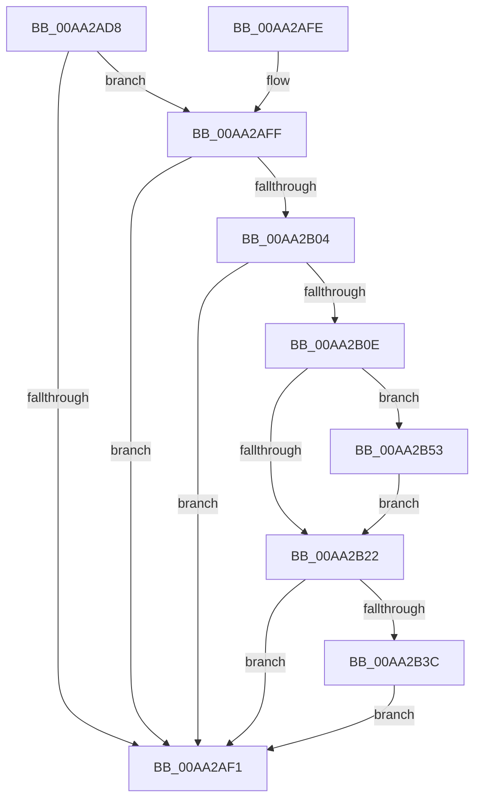

# PspValidateCreateProcessProtection

- RVA: `0x00AA2AD8`–`0x00AA2B97` (길이 `191` bytes)
- VA: `0x0000000140AA2AD8`
- 실행 섹션: `PAGE`
- PDB 이름 있음: `예`; PDB Function 태그: `아니요`
- unwind 정보 RVA: `0x000BB200`
- 디코드: `51`개 명령, `191/191` bytes 표시
- 미해석 바이트: `0` (있으면 어셈블리에 `.byte`로 보존)

> 이 문서는 커널 이미지의 기계어와 PDB 기호를 분석해 생성했습니다. 4번과 5번은 함수 원형과 자료형을 바이너리 사용 방식에서 추정한 C 해석이며 원본 소스 복구 결과는 아닙니다.

## 1. Dependencies

- 직접 호출 지점: **3**; 고유 호출 대상: **3**
- 직접 호출자로 확인된 함수: **1**
- RIP 상대 이미지 참조: **3**

### Outgoing calls
- `0x00AA2B42` → [RtlTestProtectedAccess](../A1/RtlTestProtectedAccess_function_00A100C8.md) (function, `0x00A100C8`)
- `0x00AA2B7A` → [wil_details_FeatureReporting_ReportUsageToService](../../text/53/wil_details_FeatureReporting_ReportUsageToService_function_0053E6E4.md) (function, `0x0053E6E4`)
- `0x00AA2B90` → [wil_details_FeatureStateCache_TryEnableDeviceUsageFastPath](../../text/53/wil_details_FeatureStateCache_TryEnableDeviceUsageFastPath_function_0053E774.md) (function, `0x0053E774`)

### Direct callers
- [NtCreateUserProcess](../AE/NtCreateUserProcess_function_00AEA680.md) at `0x00AEB076`
- [NtCreateUserProcess](../AE/NtCreateUserProcess_function_00AEA680.md) at `0x00AEB1BB`

### Static image references
- `0x00AA2B0E` → RVA `0x00FC4B40` (`.data`; read)
- `0x00AA2B2D` → RVA `0x00B4C274` (`PAGE`; read)
- `0x00AA2B6A` → RVA `0x000DF0A8` (`.rdata`; read)

## 2. Other-region calls and transfers

- 다른 실행 섹션으로 향하는 call: **2**
  - `0x00AA2B7A` → [wil_details_FeatureReporting_ReportUsageToService](../../text/53/wil_details_FeatureReporting_ReportUsageToService_function_0053E6E4.md) (`PAGE` → `.text`)
  - `0x00AA2B90` → [wil_details_FeatureStateCache_TryEnableDeviceUsageFastPath](../../text/53/wil_details_FeatureStateCache_TryEnableDeviceUsageFastPath_function_0053E774.md) (`PAGE` → `.text`)
- 별도 외부 분기/꼬리 이동을 확인하지 못했습니다.

## 3. Assembly (complete function range)

```asm
00AA2AD8  48 89 5C 24 10                  mov qword ptr [rsp + 0x10], rbx
00AA2ADD  57                              push rdi
00AA2ADE  48 83 EC 20                     sub rsp, 0x20
00AA2AE2  0F B6 99 FA 05 00 00            movzx ebx, byte ptr [rcx + 0x5fa]
00AA2AE9  33 FF                           xor edi, edi
00AA2AEB  41 F6 C1 04                     test r9b, 4
00AA2AEF  75 0E                           jne 0x140aa2aff
00AA2AF1  48 8B 5C 24 38                  mov rbx, qword ptr [rsp + 0x38]
00AA2AF6  8B C7                           mov eax, edi
00AA2AF8  48 83 C4 20                     add rsp, 0x20
00AA2AFC  5F                              pop rdi
00AA2AFD  C3                              ret
00AA2AFE  CC                              int3
00AA2AFF  45 84 C0                        test r8b, r8b
00AA2B02  74 ED                           je 0x140aa2af1
00AA2B04  8B 42 08                        mov eax, dword ptr [rdx + 8]
00AA2B07  48 0F BA E0 0B                  bt rax, 0xb
00AA2B0C  72 E3                           jb 0x140aa2af1
00AA2B0E  8B 0D 2C 20 52 00               mov ecx, dword ptr [rip + 0x52202c]
00AA2B14  48 89 7C 24 30                  mov qword ptr [rsp + 0x30], rdi
00AA2B19  89 4C 24 30                     mov dword ptr [rsp + 0x30], ecx
00AA2B1D  F6 C1 10                        test cl, 0x10
00AA2B20  74 31                           je 0x140aa2b53
00AA2B22  48 8B C3                        mov rax, rbx
00AA2B25  48 C1 E8 04                     shr rax, 4
00AA2B29  48 8D 0C 40                     lea rcx, [rax + rax*2]
00AA2B2D  48 8D 05 40 97 0A 00            lea rax, [rip + 0xa9740]
00AA2B34  8B 0C 88                        mov ecx, dword ptr [rax + rcx*4]
00AA2B37  F6 C1 40                        test cl, 0x40
00AA2B3A  74 B5                           je 0x140aa2af1
00AA2B3C  8A 4C 24 50                     mov cl, byte ptr [rsp + 0x50]
00AA2B40  8A D3                           mov dl, bl
00AA2B42  E8 81 D5 F6 FF                  call 0x140a100c8
00AA2B47  84 C0                           test al, al
00AA2B49  B9 0D 00 00 C0                  mov ecx, 0xc000000d
00AA2B4E  0F 44 F9                        cmove edi, ecx
00AA2B51  EB 9E                           jmp 0x140aa2af1
00AA2B53  48 8B 44 24 30                  mov rax, qword ptr [rsp + 0x30]
00AA2B58  41 B9 01 00 00 00               mov r9d, 1
00AA2B5E  41 0B C9                        or ecx, r9d
00AA2B61  48 89 44 24 30                  mov qword ptr [rsp + 0x30], rax
00AA2B66  89 4C 24 30                     mov dword ptr [rsp + 0x30], ecx
00AA2B6A  48 8D 0D 37 C5 63 FF            lea rcx, [rip - 0x9c3ac9]
00AA2B71  48 8B 54 24 30                  mov rdx, qword ptr [rsp + 0x30]
00AA2B76  45 8D 41 02                     lea r8d, [r9 + 2]
00AA2B7A  E8 65 BB A9 FF                  call 0x14053e6e4
00AA2B7F  48 8B 4C 24 30                  mov rcx, qword ptr [rsp + 0x30]
00AA2B84  4C 8D 05 1D C5 63 FF            lea r8, [rip - 0x9c3ae3]
00AA2B8B  BA 03 00 00 00                  mov edx, 3
00AA2B90  E8 DF BB A9 FF                  call 0x14053e774
00AA2B95  EB 8B                           jmp 0x140aa2b22
```

## 4. C-style interpretation (structured pseudocode)

```c
__int64 __fastcall PspValidateCreateProcessProtection(__int64 a1, __int64 a2, unsigned __int8 a3, unsigned __int8 a4, unsigned __int8 a5)
{
    __int64 result;
    __int64 v_rdi;
    __int64 v_rsp;
    unsigned __int64 v_stack_p10;
    unsigned __int64 v_stack_p30;

    v_stack_p10 = v_rbx;
    v_rsp = (v_rsp) - (32);
    v_rdi = 0;
    if (((a4) & (4)) != 0) goto loc_00AA2AFF;
loc_00AA2AF1:
    v_rsp = (v_rsp) + (32);
    return 0;
loc_00AA2AFF:
    if (a3 == 0) goto loc_00AA2AF1;
    if (condition_is_below) goto loc_00AA2AF1;
    v_stack_p30 = 0;
    v_stack_p30 = (unsigned int)((unsigned int)(*(unsigned int *)(v_rip + 5382188)));
    if ((((unsigned __int8)((unsigned int)(*(unsigned int *)(v_rip + 5382188)))) & (16)) == 0) goto loc_00AA2B53;
loc_00AA2B22:
    result = (v_stack_p10) >> (4);
    if ((((unsigned __int8)((unsigned int)(*(unsigned int *)(v_rip + 694080 + result + result * 2 * 4)))) & (64)) == 0) goto loc_00AA2AF1;
    result = RtlTestProtectedAccess(a5, (unsigned __int8)(v_stack_p10), a3, a4);
    if ((unsigned __int8)(result) == 0) { v_rdi = (unsigned int)((unsigned int)(0xC000000DULL)); }
    goto loc_00AA2AF1;
loc_00AA2B53:
    a1 = (unsigned int)(((unsigned int)(0xC000000DULL)) | (1));
    v_stack_p30 = v_stack_p30;
    v_stack_p30 = (unsigned int)(a1);
    result = wil_details_FeatureReporting_ReportUsageToService(v_rip - 10238665, v_stack_p30, 1 + 2, 1);
    result = wil_details_FeatureStateCache_TryEnableDeviceUsageFastPath(v_stack_p30, 3, v_rip - 10238691, 1);
    goto loc_00AA2B22;
}
```

## 5. (Beta) C Style

```c
int64_t PspValidateCreateProcessProtection(void *Arg1, void *Arg2, uint8_t Arg3, uint8_t Arg4, uint8_t Arg5)
{
    uint8_t *arg1 = (uint8_t *)Arg1;
    uint8_t *arg2 = (uint8_t *)Arg2;

    int64_t result;
    int64_t local_rdi;
    int64_t local_rsp;
    uint64_t v_stack_p10;
    uint64_t v_stack_p30;

    v_stack_p10 = local_rbx;
    local_rsp = (local_rsp) - (32);
    local_rdi = 0;
    if (((Arg4) & (4)) != 0) goto loc_00AA2AFF;
loc_00AA2AF1:
    local_rsp = (local_rsp) + (32);
    return 0;
loc_00AA2AFF:
    if (Arg3 == 0) goto loc_00AA2AF1;
    if (condition_is_below) goto loc_00AA2AF1;
    v_stack_p30 = 0;
    v_stack_p30 = (uint32_t)((uint32_t)(*(uint32_t *)(v_rip + 0x52202C)));
    if ((((uint8_t)((uint32_t)(*(uint32_t *)(v_rip + 0x52202C)))) & (16)) == 0) goto loc_00AA2B53;
loc_00AA2B22:
    result = (v_stack_p10) >> (4);
    if ((((uint8_t)((uint32_t)(*(uint32_t *)(v_rip + 0xA9740 + result + result * 2 * 4)))) & (64)) == 0) goto loc_00AA2AF1;
    result = RtlTestProtectedAccess(Arg5, (uint8_t)(v_stack_p10), Arg3, Arg4);
    if ((uint8_t)(result) == 0) { local_rdi = (uint32_t)((uint32_t)(0xC000000DULL)); }
    goto loc_00AA2AF1;
loc_00AA2B53:
    Arg1 = (uint32_t)(((uint32_t)(0xC000000DULL)) | (1));
    v_stack_p30 = v_stack_p30;
    v_stack_p30 = (uint32_t)(Arg1);
    result = wil_details_FeatureReporting_ReportUsageToService(v_rip - 10238665, v_stack_p30, 1 + 2, 1);
    result = wil_details_FeatureStateCache_TryEnableDeviceUsageFastPath(v_stack_p30, 3, v_rip - 10238691, 1);
    goto loc_00AA2B22;
}
```

### 관측된 메모리 오프셋

구조체 형식이 확인되지 않은 접근은 인자 기준의 오프셋으로만 기록했습니다.

| 기준 인자 | 오프셋 표현 | 폭 (bit) | 접근 |
|---|---:|---:|---|
| `Arg1` | `+ 0x5FA` | `8` | `R` |
| `Arg2` | `+ 0x8` | `32` | `R` |

## 6. Execution-region graph

[열기: 2D/3D 그래프와 함수 탐색 컨트롤 패널](../../../control-panel.html?section=page&rva=0x00AA2AD8&view=graph)

- 2D 그래프는 위에서 아래로 흐르고, 3D 그래프는 빈 공간을 드래그해 회전합니다. Shift+드래그는 이동, 휠은 확대·축소, 함수 노드 선택은 대상 보고서 이동입니다.

### Static fallback


