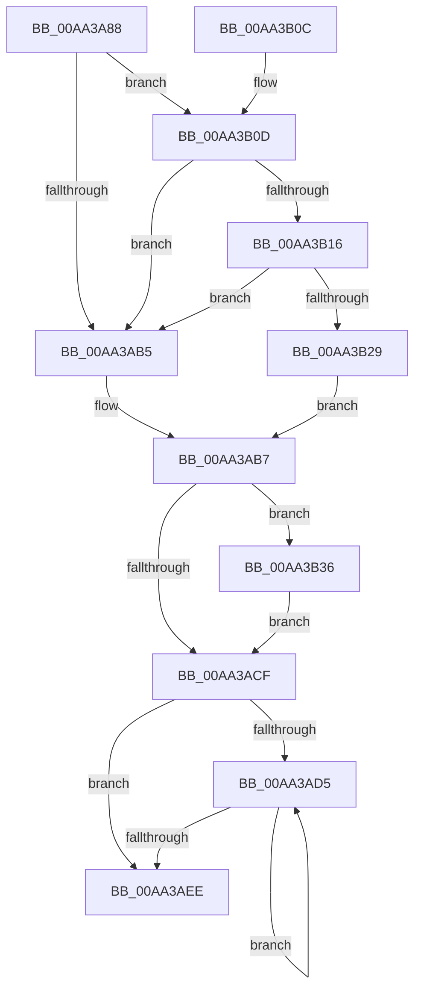

# PspWin32kProcessFreezeNotify

- RVA: `0x00AA3A88`–`0x00AA3B49` (길이 `193` bytes)
- VA: `0x0000000140AA3A88`
- 실행 섹션: `PAGE`
- PDB 이름 있음: `예`; PDB Function 태그: `아니요`
- unwind 정보 RVA: `0x000BB404`
- 디코드: `56`개 명령, `193/193` bytes 표시
- 미해석 바이트: `0` (있으면 어셈블리에 `.byte`로 보존)

> 이 문서는 커널 이미지의 기계어와 PDB 기호를 분석해 생성했습니다. 4번과 5번은 함수 원형과 자료형을 바이너리 사용 방식에서 추정한 C 해석이며 원본 소스 복구 결과는 아닙니다.

## 1. Dependencies

- 직접 호출 지점: **4**; 고유 호출 대상: **4**
- 직접 호출자로 확인된 함수: **1**
- RIP 상대 이미지 참조: **4**

### Outgoing calls
- `0x00AA3ABF` → `ext-ms-win-ntos-win32k-l1-1-0.dll!Win32kProcessFreezeChangeNotify` (import, 간접 대상; import `ext-ms-win-ntos-win32k-l1-1-0.dll!Win32kProcessFreezeChangeNotify`)
- `0x00AA3AD9` → [ObfDereferenceObject](../../text/2F/ObfDereferenceObject_function_002F9350.md) (function, `0x002F9350`)
- `0x00AA3B2F` → [EtwTraceWin32kFreezeChangeNotifyStart](../7B/EtwTraceWin32kFreezeChangeNotifyStart_function_007B8410.md) (function, `0x007B8410`)
- `0x00AA3B42` → [EtwTraceWin32kFreezeChangeNotifyStop](../7B/EtwTraceWin32kFreezeChangeNotifyStop_function_007B84CC.md) (function, `0x007B84CC`)

### Direct callers
- [PspPostFreezeOperationWorker](../A9/PspPostFreezeOperationWorker_function_00A94CB0.md) at `0x00A94FDC`

### Static image references
- `0x00AA3AA1` → RVA `0x00E091A0` (`.data`; read)
- `0x00AA3ABF` → RVA `0x00151688` (`ext-ms-win-ntos-win32k-l1-1-0.dll!Win32kProcessFreezeChangeNotify (IAT)`; read)
- `0x00AA3B0D` → RVA `0x00E091B0` (`.data`; read)
- `0x00AA3B16` → RVA `0x00E091B8` (`.data`; read)

## 2. Other-region calls and transfers

- 다른 실행 섹션으로 향하는 call: **1**
  - `0x00AA3AD9` → [ObfDereferenceObject](../../text/2F/ObfDereferenceObject_function_002F9350.md) (`PAGE` → `.text`)
- 별도 외부 분기/꼬리 이동을 확인하지 못했습니다.

## 3. Assembly (complete function range)

```asm
00AA3A88  48 8B C4                        mov rax, rsp
00AA3A8B  48 89 58 08                     mov qword ptr [rax + 8], rbx
00AA3A8F  48 89 70 10                     mov qword ptr [rax + 0x10], rsi
00AA3A93  48 89 78 18                     mov qword ptr [rax + 0x18], rdi
00AA3A97  4C 89 70 20                     mov qword ptr [rax + 0x20], r14
00AA3A9B  41 57                           push r15
00AA3A9D  48 83 EC 20                     sub rsp, 0x20
00AA3AA1  83 3D F8 56 36 00 05            cmp dword ptr [rip + 0x3656f8], 5
00AA3AA8  49 8B F9                        mov rdi, r9
00AA3AAB  4D 8B F8                        mov r15, r8
00AA3AAE  4C 8B F2                        mov r14, rdx
00AA3AB1  8B F1                           mov esi, ecx
00AA3AB3  77 58                           ja 0x140aa3b0d
00AA3AB5  32 DB                           xor bl, bl
00AA3AB7  44 8B 07                        mov r8d, dword ptr [rdi]
00AA3ABA  49 8B D6                        mov rdx, r14
00AA3ABD  8B CE                           mov ecx, esi
00AA3ABF  48 FF 15 C2 DB 6A FF            call qword ptr [rip - 0x95243e]
00AA3AC6  0F 1F 44 00 00                  nop dword ptr [rax + rax]
00AA3ACB  84 DB                           test bl, bl
00AA3ACD  75 67                           jne 0x140aa3b36
00AA3ACF  33 F6                           xor esi, esi
00AA3AD1  39 37                           cmp dword ptr [rdi], esi
00AA3AD3  76 19                           jbe 0x140aa3aee
00AA3AD5  49 8B 0C F6                     mov rcx, qword ptr [r14 + rsi*8]
00AA3AD9  E8 72 58 85 FF                  call 0x1402f9350
00AA3ADE  49 83 24 F6 00                  and qword ptr [r14 + rsi*8], 0
00AA3AE3  41 83 24 B7 00                  and dword ptr [r15 + rsi*4], 0
00AA3AE8  FF C6                           inc esi
00AA3AEA  3B 37                           cmp esi, dword ptr [rdi]
00AA3AEC  72 E7                           jb 0x140aa3ad5
00AA3AEE  83 27 00                        and dword ptr [rdi], 0
00AA3AF1  48 8B 7C 24 40                  mov rdi, qword ptr [rsp + 0x40]
00AA3AF6  48 8B 5C 24 30                  mov rbx, qword ptr [rsp + 0x30]
00AA3AFB  48 8B 74 24 38                  mov rsi, qword ptr [rsp + 0x38]
00AA3B00  4C 8B 74 24 48                  mov r14, qword ptr [rsp + 0x48]
00AA3B05  48 83 C4 20                     add rsp, 0x20
00AA3B09  41 5F                           pop r15
00AA3B0B  C3                              ret
00AA3B0C  CC                              int3
00AA3B0D  F6 05 9C 56 36 00 04            test byte ptr [rip + 0x36569c], 4
00AA3B14  74 9F                           je 0x140aa3ab5
00AA3B16  48 8B 05 9B 56 36 00            mov rax, qword ptr [rip + 0x36569b]
00AA3B1D  83 E0 04                        and eax, 4
00AA3B20  48 3B 05 91 56 36 00            cmp rax, qword ptr [rip + 0x365691]
00AA3B27  75 8C                           jne 0x140aa3ab5
00AA3B29  41 0F B7 11                     movzx edx, word ptr [r9]
00AA3B2D  B3 01                           mov bl, 1
00AA3B2F  E8 DC 48 D1 FF                  call 0x1407b8410
00AA3B34  EB 81                           jmp 0x140aa3ab7
00AA3B36  44 0F B7 07                     movzx r8d, word ptr [rdi]
00AA3B3A  44 8B C8                        mov r9d, eax
00AA3B3D  49 8B D7                        mov rdx, r15
00AA3B40  8B CE                           mov ecx, esi
00AA3B42  E8 85 49 D1 FF                  call 0x1407b84cc
00AA3B47  EB 86                           jmp 0x140aa3acf
```

## 4. C-style interpretation (structured pseudocode)

```c
__int64 __fastcall PspWin32kProcessFreezeNotify(int a1, __int64 a2, __int64 a3, __int64 a4)
{
    __int64 result;
    __int64 v_rbx;
    __int64 v_rsi;
    __int64 v_rsp;
    unsigned __int64 v_stack_p10;
    unsigned __int64 v_stack_p18;
    unsigned __int64 v_stack_p20;
    unsigned __int64 v_stack_p8;

    *(unsigned __int64 *)(v_rsp + 8) = v_rbx;
    *(unsigned __int64 *)(v_rsp + 16) = v_rsi;
    *(unsigned __int64 *)(v_rsp + 24) = v_rdi;
    *(unsigned __int64 *)(v_rsp + 32) = v_r14;
    v_rsp = (v_rsp) - (32);
    if ((*(unsigned int *)(v_rip + 3561208)) > 5) goto loc_00AA3B0D;
loc_00AA3AB5:
    v_rbx = 0;
loc_00AA3AB7:
    result = ext_ms_win_ntos_win32k_l1_1_0_dll_Win32kProcessFreezeChangeNotify((unsigned int)((unsigned int)((unsigned int)(a1))), a2, (unsigned int)(*(unsigned int *)(a4)), a4);
    if (0 != 0) goto loc_00AA3B36;
loc_00AA3ACF:
    v_rsi = 0;
    if ((*(unsigned int *)(a4)) <= 0) goto loc_00AA3AEE;
loc_00AA3AD5:
    result = ObfDereferenceObject(*(unsigned __int64 *)(a2 + v_rsi * 8), a2, (unsigned int)(*(unsigned int *)(a4)), a4);
    v_rsi = (unsigned int)((v_rsi) + 1);
    if (((unsigned int)(v_rsi)) < (*(unsigned int *)(a4))) goto loc_00AA3AD5;
loc_00AA3AEE:
    v_rsp = (v_rsp) + (32);
    return result;
loc_00AA3B0D:
    if (((*(unsigned __int8 *)(v_rip + 3561116)) & (4)) == 0) goto loc_00AA3AB5;
    result = (unsigned int)((*(unsigned __int64 *)(v_rip + 3561115)) & (4));
    if (result != (*(unsigned __int64 *)(v_rip + 3561105))) goto loc_00AA3AB5;
    result = EtwTraceWin32kFreezeChangeNotifyStart(*(unsigned __int64 *)(a2 + v_rsi * 8), *(unsigned __int16 *)(a4), (unsigned int)(*(unsigned int *)(a4)), a4);
    goto loc_00AA3AB7;
loc_00AA3B36:
    result = EtwTraceWin32kFreezeChangeNotifyStop((unsigned int)((unsigned int)(v_stack_p10)), a3, *(unsigned __int16 *)(v_stack_p18), (unsigned int)((unsigned int)(result)));
    goto loc_00AA3ACF;
}
```

## 5. (Beta) C Style

```c
int64_t PspWin32kProcessFreezeNotify(int32_t Arg1, void *Arg2, void *Arg3, void *Arg4)
{
    uint8_t *arg2 = (uint8_t *)Arg2;
    uint8_t *arg3 = (uint8_t *)Arg3;
    uint8_t *arg4 = (uint8_t *)Arg4;

    int64_t result;
    int64_t local_rbx;
    int64_t local_rsi;
    int64_t local_rsp;
    uint64_t v_stack_p10;
    uint64_t v_stack_p18;
    uint64_t v_stack_p20;
    uint64_t v_stack_p8;

    *(uint64_t *)(local_rsp + 0x8) = local_rbx;
    *(uint64_t *)(local_rsp + 0x10) = local_rsi;
    *(uint64_t *)(local_rsp + 0x18) = local_rdi;
    *(uint64_t *)(local_rsp + 0x20) = local_r14;
    local_rsp = (local_rsp) - (32);
    if ((*(uint32_t *)(v_rip + 0x3656F8)) > 5) goto loc_00AA3B0D;
loc_00AA3AB5:
    local_rbx = 0;
loc_00AA3AB7:
    result = kernel_indirect_call((uint32_t)((uint32_t)((uint32_t)(Arg1))), Arg2, (uint32_t)(*(uint32_t *)(arg4)), Arg4);
    if (0 != 0) goto loc_00AA3B36;
loc_00AA3ACF:
    local_rsi = 0;
    if ((*(uint32_t *)(arg4)) <= 0) goto loc_00AA3AEE;
loc_00AA3AD5:
    result = ObfDereferenceObject(*(uint64_t *)(arg2 + local_rsi * 8), Arg2, (uint32_t)(*(uint32_t *)(arg4)), Arg4);
    local_rsi = (uint32_t)((local_rsi) + 1);
    if (((uint32_t)(local_rsi)) < (*(uint32_t *)(arg4))) goto loc_00AA3AD5;
loc_00AA3AEE:
    local_rsp = (local_rsp) + (32);
    return result;
loc_00AA3B0D:
    if (((*(uint8_t *)(v_rip + 0x36569C)) & (4)) == 0) goto loc_00AA3AB5;
    result = (uint32_t)((*(uint64_t *)(v_rip + 0x36569B)) & (4));
    if (result != (*(uint64_t *)(v_rip + 0x365691))) goto loc_00AA3AB5;
    result = EtwTraceWin32kFreezeChangeNotifyStart(*(uint64_t *)(arg2 + local_rsi * 8), *(uint16_t *)(arg4), (uint32_t)(*(uint32_t *)(arg4)), Arg4);
    goto loc_00AA3AB7;
loc_00AA3B36:
    result = EtwTraceWin32kFreezeChangeNotifyStop((uint32_t)((uint32_t)(v_stack_p10)), Arg3, *(uint16_t *)(v_stack_p18), (uint32_t)((uint32_t)(result)));
    goto loc_00AA3ACF;
}
```

### 관측된 메모리 오프셋

구조체 형식이 확인되지 않은 접근은 인자 기준의 오프셋으로만 기록했습니다.

| 기준 인자 | 오프셋 표현 | 폭 (bit) | 접근 |
|---|---:|---:|---|
| `Arg2` | `+ 0x0 + rsi*8` | `64` | `R` |
| `Arg2` | `+ 0x0 + rsi*8` | `64` | `R/W` |
| `Arg3` | `+ 0x0 + rsi*4` | `32` | `R/W` |
| `Arg4` | `+ 0x0` | `16` | `R` |
| `Arg4` | `+ 0x0` | `32` | `R` |
| `Arg4` | `+ 0x0` | `32` | `R/W` |

## 6. Execution-region graph

[열기: 2D/3D 그래프와 함수 탐색 컨트롤 패널](../../../control-panel.html?section=page&rva=0x00AA3A88&view=graph)

- 2D 그래프는 위에서 아래로 흐르고, 3D 그래프는 빈 공간을 드래그해 회전합니다. Shift+드래그는 이동, 휠은 확대·축소, 함수 노드 선택은 대상 보고서 이동입니다.

### Static fallback


