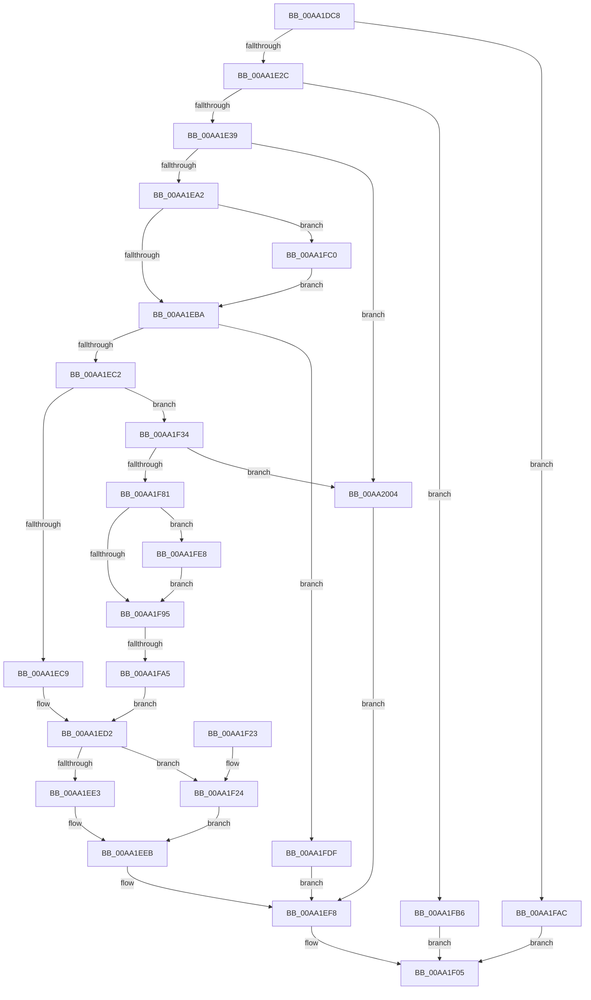

# RawQueryFsSizeInfo

- RVA: `0x00AA1DC8`–`0x00AA200E` (길이 `582` bytes)
- VA: `0x0000000140AA1DC8`
- 실행 섹션: `PAGE`
- PDB 이름 있음: `예`; PDB Function 태그: `예`
- unwind 정보 RVA: `0x000BADB0`
- 디코드: `158`개 명령, `582/582` bytes 표시
- 미해석 바이트: `0` (있으면 어셈블리에 `.byte`로 보존)

> 이 문서는 커널 이미지의 기계어와 PDB 기호를 분석해 생성했습니다. 4번과 5번은 함수 원형과 자료형을 바이너리 사용 방식에서 추정한 C 해석이며 원본 소스 복구 결과는 아닙니다.

## 1. Dependencies

- 직접 호출 지점: **11**; 고유 호출 대상: **8**
- 직접 호출자로 확인된 함수: **1**
- RIP 상대 이미지 참조: **1**

### Outgoing calls
- `0x00AA1E2C` → [RawBeginOperation](../../text/41/RawBeginOperation_function_00411F10.md) (function, `0x00411F10`)
- `0x00AA1E4E` → [KeInitializeEvent](../../text/40/KeInitializeEvent_function_0040DD10.md) (function, `0x0040DD10`)
- `0x00AA1E94` → [IoBuildDeviceIoControlRequest](../../text/20/IoBuildDeviceIoControlRequest_function_00204FD0.md) (function, `0x00204FD0`)
- `0x00AA1EA8` → [IofCallDriver](../../text/29/IofCallDriver_function_0029B4B0.md) (function, `0x0029B4B0`)
- `0x00AA1EFE` → [RawEndOperation](../../text/48/RawEndOperation_function_0048E70C.md) (function, `0x0048E70C`)
- `0x00AA1F0C` → [_security_check_cookie](../../text/6A/_security_check_cookie_function_006AC640.md) (function, `0x006AC640`)
- `0x00AA1F38` → [KeResetEvent](../../text/24/KeResetEvent_function_00248350.md) (function, `0x00248350`)
- `0x00AA1F73` → [IoBuildDeviceIoControlRequest](../../text/20/IoBuildDeviceIoControlRequest_function_00204FD0.md) (function, `0x00204FD0`)
- `0x00AA1F87` → [IofCallDriver](../../text/29/IofCallDriver_function_0029B4B0.md) (function, `0x0029B4B0`)
- `0x00AA1FD2` → [KeWaitForSingleObject](../../text/20/KeWaitForSingleObject_function_0020E6B0.md) (function, `0x0020E6B0`)
- `0x00AA1FFA` → [KeWaitForSingleObject](../../text/20/KeWaitForSingleObject_function_0020E6B0.md) (function, `0x0020E6B0`)

### Direct callers
- [RawQueryVolumeInformation](../9A/RawQueryVolumeInformation_function_009A4414.md) at `0x009A44FF`

### Static image references
- `0x00AA1DDF` → RVA `0x00E0A740` (`.data`; read)

## 2. Other-region calls and transfers

- 다른 실행 섹션으로 향하는 call: **11**
  - `0x00AA1E2C` → [RawBeginOperation](../../text/41/RawBeginOperation_function_00411F10.md) (`PAGE` → `.text`)
  - `0x00AA1E4E` → [KeInitializeEvent](../../text/40/KeInitializeEvent_function_0040DD10.md) (`PAGE` → `.text`)
  - `0x00AA1E94` → [IoBuildDeviceIoControlRequest](../../text/20/IoBuildDeviceIoControlRequest_function_00204FD0.md) (`PAGE` → `.text`)
  - `0x00AA1EA8` → [IofCallDriver](../../text/29/IofCallDriver_function_0029B4B0.md) (`PAGE` → `.text`)
  - `0x00AA1EFE` → [RawEndOperation](../../text/48/RawEndOperation_function_0048E70C.md) (`PAGE` → `.text`)
  - `0x00AA1F0C` → [_security_check_cookie](../../text/6A/_security_check_cookie_function_006AC640.md) (`PAGE` → `.text`)
  - `0x00AA1F38` → [KeResetEvent](../../text/24/KeResetEvent_function_00248350.md) (`PAGE` → `.text`)
  - `0x00AA1F73` → [IoBuildDeviceIoControlRequest](../../text/20/IoBuildDeviceIoControlRequest_function_00204FD0.md) (`PAGE` → `.text`)
  - `0x00AA1F87` → [IofCallDriver](../../text/29/IofCallDriver_function_0029B4B0.md) (`PAGE` → `.text`)
  - `0x00AA1FD2` → [KeWaitForSingleObject](../../text/20/KeWaitForSingleObject_function_0020E6B0.md) (`PAGE` → `.text`)
  - `0x00AA1FFA` → [KeWaitForSingleObject](../../text/20/KeWaitForSingleObject_function_0020E6B0.md) (`PAGE` → `.text`)
- call이 아닌 외부 분기/꼬리 이동: **1**
  - `0x00AA1F9F` → [sub_00B49880](../B4/Unknown_function_00B49880.md) (`tail-transfer`)

## 3. Assembly (complete function range)

```asm
00AA1DC8  40 55                           push rbp
00AA1DCA  53                              push rbx
00AA1DCB  56                              push rsi
00AA1DCC  57                              push rdi
00AA1DCD  41 54                           push r12
00AA1DCF  41 56                           push r14
00AA1DD1  41 57                           push r15
00AA1DD3  48 8D 6C 24 D9                  lea rbp, [rsp - 0x27]
00AA1DD8  48 81 EC C0 00 00 00            sub rsp, 0xc0
00AA1DDF  48 8B 05 5A 89 36 00            mov rax, qword ptr [rip + 0x36895a]
00AA1DE6  48 33 C4                        xor rax, rsp
00AA1DE9  48 89 45 1F                     mov qword ptr [rbp + 0x1f], rax
00AA1DED  33 C0                           xor eax, eax
00AA1DEF  0F 57 C0                        xorps xmm0, xmm0
00AA1DF2  48 21 45 FF                     and qword ptr [rbp - 1], rax
00AA1DF6  0F 57 C9                        xorps xmm1, xmm1
00AA1DF9  48 21 45 DF                     and qword ptr [rbp - 0x21], rax
00AA1DFD  4D 8B F1                        mov r14, r9
00AA1E00  41 83 39 18                     cmp dword ptr [r9], 0x18
00AA1E04  49 8B F0                        mov rsi, r8
00AA1E07  4C 8B E2                        mov r12, rdx
00AA1E0A  48 89 45 C7                     mov qword ptr [rbp - 0x39], rax
00AA1E0E  4C 8B F9                        mov r15, rcx
00AA1E11  48 89 45 F7                     mov qword ptr [rbp - 9], rax
00AA1E15  0F 11 45 B7                     movups xmmword ptr [rbp - 0x49], xmm0
00AA1E19  0F 11 45 CF                     movups xmmword ptr [rbp - 0x31], xmm0
00AA1E1D  0F 11 4D E7                     movups xmmword ptr [rbp - 0x19], xmm1
00AA1E21  F3 0F 7F 45 0F                  movdqu xmmword ptr [rbp + 0xf], xmm0
00AA1E26  0F 82 80 01 00 00               jb 0x140aa1fac
00AA1E2C  E8 DF 00 97 FF                  call 0x140411f10
00AA1E31  84 C0                           test al, al
00AA1E33  0F 84 7D 01 00 00               je 0x140aa1fb6
00AA1E39  0F 57 C0                        xorps xmm0, xmm0
00AA1E3C  48 8D 4D B7                     lea rcx, [rbp - 0x49]
00AA1E40  33 C0                           xor eax, eax
00AA1E42  45 33 C0                        xor r8d, r8d
00AA1E45  0F 11 06                        movups xmmword ptr [rsi], xmm0
00AA1E48  33 D2                           xor edx, edx
00AA1E4A  48 89 46 10                     mov qword ptr [rsi + 0x10], rax
00AA1E4E  E8 BD BE 96 FF                  call 0x14040dd10
00AA1E53  49 8B 87 C8 00 00 00            mov rax, qword ptr [r15 + 0xc8]
00AA1E5A  45 33 C9                        xor r9d, r9d
00AA1E5D  45 33 C0                        xor r8d, r8d
00AA1E60  B9 00 00 07 00                  mov ecx, 0x70000
00AA1E65  48 8B 78 10                     mov rdi, qword ptr [rax + 0x10]
00AA1E69  48 8D 45 CF                     lea rax, [rbp - 0x31]
00AA1E6D  48 89 44 24 40                  mov qword ptr [rsp + 0x40], rax
00AA1E72  48 8B D7                        mov rdx, rdi
00AA1E75  48 8D 45 B7                     lea rax, [rbp - 0x49]
00AA1E79  48 89 44 24 38                  mov qword ptr [rsp + 0x38], rax
00AA1E7E  48 8D 45 E7                     lea rax, [rbp - 0x19]
00AA1E82  C6 44 24 30 00                  mov byte ptr [rsp + 0x30], 0
00AA1E87  C7 44 24 28 18 00 00 00         mov dword ptr [rsp + 0x28], 0x18
00AA1E8F  48 89 44 24 20                  mov qword ptr [rsp + 0x20], rax
00AA1E94  E8 37 31 76 FF                  call 0x140204fd0
00AA1E99  48 85 C0                        test rax, rax
00AA1E9C  0F 84 62 01 00 00               je 0x140aa2004
00AA1EA2  48 8B D0                        mov rdx, rax
00AA1EA5  48 8B CF                        mov rcx, rdi
00AA1EA8  E8 03 96 7F FF                  call 0x14029b4b0
00AA1EAD  8B D8                           mov ebx, eax
00AA1EAF  3D 03 01 00 00                  cmp eax, 0x103
00AA1EB4  0F 84 06 01 00 00               je 0x140aa1fc0
00AA1EBA  85 DB                           test ebx, ebx
00AA1EBC  0F 88 1D 01 00 00               js 0x140aa1fdf
00AA1EC2  8B 47 34                        mov eax, dword ptr [rdi + 0x34]
00AA1EC5  A8 04                           test al, 4
00AA1EC7  74 6B                           je 0x140aa1f34
00AA1EC9  32 C0                           xor al, al
00AA1ECB  45 33 C0                        xor r8d, r8d
00AA1ECE  4C 89 45 07                     mov qword ptr [rbp + 7], r8
00AA1ED2  8B 4D FB                        mov ecx, dword ptr [rbp - 5]
00AA1ED5  89 4E 14                        mov dword ptr [rsi + 0x14], ecx
00AA1ED8  C7 46 10 01 00 00 00            mov dword ptr [rsi + 0x10], 1
00AA1EDF  3C 01                           cmp al, 1
00AA1EE1  75 41                           jne 0x140aa1f24
00AA1EE3  33 D2                           xor edx, edx
00AA1EE5  49 8B C0                        mov rax, r8
00AA1EE8  48 F7 F1                        div rcx
00AA1EEB  48 89 46 08                     mov qword ptr [rsi + 8], rax
00AA1EEF  48 89 06                        mov qword ptr [rsi], rax
00AA1EF2  41 83 06 E8                     add dword ptr [r14], -0x18
00AA1EF6  33 DB                           xor ebx, ebx
00AA1EF8  49 8B D4                        mov rdx, r12
00AA1EFB  49 8B CF                        mov rcx, r15
00AA1EFE  E8 09 C8 9E FF                  call 0x14048e70c
00AA1F03  8B C3                           mov eax, ebx
00AA1F05  48 8B 4D 1F                     mov rcx, qword ptr [rbp + 0x1f]
00AA1F09  48 33 CC                        xor rcx, rsp
00AA1F0C  E8 2F A7 C0 FF                  call 0x1406ac640
00AA1F11  48 81 C4 C0 00 00 00            add rsp, 0xc0
00AA1F18  41 5F                           pop r15
00AA1F1A  41 5E                           pop r14
00AA1F1C  41 5C                           pop r12
00AA1F1E  5F                              pop rdi
00AA1F1F  5E                              pop rsi
00AA1F20  5B                              pop rbx
00AA1F21  5D                              pop rbp
00AA1F22  C3                              ret
00AA1F23  CC                              int3
00AA1F24  8B 45 F7                        mov eax, dword ptr [rbp - 9]
00AA1F27  0F AF 45 F3                     imul eax, dword ptr [rbp - 0xd]
00AA1F2B  48 98                           cdqe
00AA1F2D  48 0F AF 45 E7                  imul rax, qword ptr [rbp - 0x19]
00AA1F32  EB B7                           jmp 0x140aa1eeb
00AA1F34  48 8D 4D B7                     lea rcx, [rbp - 0x49]
00AA1F38  E8 13 64 7A FF                  call 0x140248350
00AA1F3D  48 8D 45 CF                     lea rax, [rbp - 0x31]
00AA1F41  45 33 C9                        xor r9d, r9d
00AA1F44  48 89 44 24 40                  mov qword ptr [rsp + 0x40], rax
00AA1F49  45 33 C0                        xor r8d, r8d
00AA1F4C  48 8D 45 B7                     lea rax, [rbp - 0x49]
00AA1F50  48 8B D7                        mov rdx, rdi
00AA1F53  48 89 44 24 38                  mov qword ptr [rsp + 0x38], rax
00AA1F58  B9 5C 40 07 00                  mov ecx, 0x7405c
00AA1F5D  C6 44 24 30 00                  mov byte ptr [rsp + 0x30], 0
00AA1F62  48 8D 45 DF                     lea rax, [rbp - 0x21]
00AA1F66  C7 44 24 28 08 00 00 00         mov dword ptr [rsp + 0x28], 8
00AA1F6E  48 89 44 24 20                  mov qword ptr [rsp + 0x20], rax
00AA1F73  E8 58 30 76 FF                  call 0x140204fd0
00AA1F78  48 85 C0                        test rax, rax
00AA1F7B  0F 84 83 00 00 00               je 0x140aa2004
00AA1F81  48 8B D0                        mov rdx, rax
00AA1F84  48 8B CF                        mov rcx, rdi
00AA1F87  E8 24 95 7F FF                  call 0x14029b4b0
00AA1F8C  BB 03 01 00 00                  mov ebx, 0x103
00AA1F91  3B C3                           cmp eax, ebx
00AA1F93  74 53                           je 0x140aa1fe8
00AA1F95  4C 8B 45 DF                     mov r8, qword ptr [rbp - 0x21]
00AA1F99  4C 89 45 07                     mov qword ptr [rbp + 7], r8
00AA1F9D  85 C0                           test eax, eax
00AA1F9F  0F 88 DB 78 0A 00               js 0x140b49880
00AA1FA5  B0 01                           mov al, 1
00AA1FA7  E9 26 FF FF FF                  jmp 0x140aa1ed2
00AA1FAC  B8 05 00 00 80                  mov eax, 0x80000005
00AA1FB1  E9 4F FF FF FF                  jmp 0x140aa1f05
00AA1FB6  B8 6E 02 00 C0                  mov eax, 0xc000026e
00AA1FBB  E9 45 FF FF FF                  jmp 0x140aa1f05
00AA1FC0  48 83 64 24 20 00               and qword ptr [rsp + 0x20], 0
00AA1FC6  48 8D 4D B7                     lea rcx, [rbp - 0x49]
00AA1FCA  45 33 C9                        xor r9d, r9d
00AA1FCD  45 33 C0                        xor r8d, r8d
00AA1FD0  33 D2                           xor edx, edx
00AA1FD2  E8 D9 C6 76 FF                  call 0x14020e6b0
00AA1FD7  8B 5D CF                        mov ebx, dword ptr [rbp - 0x31]
00AA1FDA  E9 DB FE FF FF                  jmp 0x140aa1eba
00AA1FDF  41 83 26 00                     and dword ptr [r14], 0
00AA1FE3  E9 10 FF FF FF                  jmp 0x140aa1ef8
00AA1FE8  48 83 64 24 20 00               and qword ptr [rsp + 0x20], 0
00AA1FEE  48 8D 4D B7                     lea rcx, [rbp - 0x49]
00AA1FF2  45 33 C9                        xor r9d, r9d
00AA1FF5  45 33 C0                        xor r8d, r8d
00AA1FF8  33 D2                           xor edx, edx
00AA1FFA  E8 B1 C6 76 FF                  call 0x14020e6b0
00AA1FFF  8B 45 CF                        mov eax, dword ptr [rbp - 0x31]
00AA2002  EB 91                           jmp 0x140aa1f95
00AA2004  BB 9A 00 00 C0                  mov ebx, 0xc000009a
00AA2009  E9 EA FE FF FF                  jmp 0x140aa1ef8
```

## 4. C-style interpretation (structured pseudocode)

```c
__int64 __fastcall RawQueryFsSizeInfo(__int64 a1, __int64 a2, __int64 a3, __int64 a4)
{
    __int64 result;
    __int64 v_rbx;
    __int64 v_rsp;
    unsigned __int64 v_stack_m40;
    unsigned __int64 v_stack_m50;
    unsigned __int64 v_stack_m58;
    unsigned __int64 v_stack_m5F;
    unsigned __int64 v_stack_m60;
    unsigned int v_stack_m64;
    unsigned __int64 v_stack_m68;
    unsigned int v_stack_m6C;
    unsigned __int64 v_stack_m78;
    unsigned __int64 v_stack_m80;
    unsigned __int64 v_stack_m90;
    unsigned __int64 v_stack_m98;
    unsigned __int64 v_stack_mA8;
    unsigned __int64 v_stack_mB8;
    unsigned __int64 v_stack_mC0;
    unsigned __int8 v_stack_mC8;
    unsigned int v_stack_mD0;
    unsigned __int64 v_stack_mD8;
    unsigned __int64 v_stack_p20;
    unsigned int v_stack_p28;
    unsigned __int8 v_stack_p30;
    unsigned __int64 v_stack_p38;
    unsigned __int64 v_stack_p40;

    v_rsp = (v_rsp) - (192);
    result = (*(unsigned __int64 *)(v_rip + 3574106)) ^ (v_rsp);
    v_stack_m40 = result;
    result = 0;
    v_stack_m98 = 0;
    v_stack_m68 = 0;
    v_stack_mA8 = v_xmm0;
    v_stack_m90 = v_xmm0;
    v_stack_m78 = v_xmm1;
    v_stack_m50 = v_xmm0;
    if ((*(unsigned int *)(a4)) < 24) goto loc_00AA1FAC;
    result = RawBeginOperation(a1, a2, a3, a4);
    if ((unsigned __int8)(result) == 0) goto loc_00AA1FB6;
    result = 0;
    a3 = 0;
    *(unsigned __int64 *)(a3) = v_xmm0;
    a2 = 0;
    *(unsigned __int64 *)(a3 + 16) = 0;
    result = KeInitializeEvent(v_stack_mA8, a2, a3, a4);
    a4 = 0;
    a3 = 0;
    v_stack_mB8 = v_stack_m90;
    v_stack_mC0 = v_stack_mA8;
    v_stack_mC8 = 0;
    v_stack_mD0 = 24;
    v_stack_mD8 = v_stack_m78;
    result = IoBuildDeviceIoControlRequest((unsigned int)(0x70000ULL), *(unsigned __int64 *)(*(unsigned __int64 *)(a1 + 200) + 16), a3, a4);
    if (result == 0) goto loc_00AA2004;
    result = IofCallDriver(*(unsigned __int64 *)(*(unsigned __int64 *)(a1 + 200) + 16), result, a3, a4);
    if (((unsigned int)(result)) == 259) goto loc_00AA1FC0;
loc_00AA1EBA:
    if (sign_flag) goto loc_00AA1FDF;
    if ((((unsigned __int8)((unsigned int)(*(unsigned int *)(*(unsigned __int64 *)(*(unsigned __int64 *)(a1 + 200) + 16) + 52)))) & (4)) == 0) goto loc_00AA1F34;
    result = 0;
    a3 = 0;
    v_stack_m58 = 0;
loc_00AA1ED2:
    *(unsigned int *)(a3 + 20) = (unsigned int)((unsigned int)(v_stack_m64));
    *(unsigned int *)(a3 + 16) = 1;
    if (0 != 1) goto loc_00AA1F24;
    a2 = 0;
loc_00AA1EEB:
    *(unsigned __int64 *)(a3 + 8) = 0;
    *(unsigned __int64 *)(a3) = 0;
    v_rbx = 0;
loc_00AA1EF8:
    result = RawEndOperation(a1, 0, a3, a4);
loc_00AA1F05:
    a1 = (v_stack_m40) ^ (v_rsp);
    result = _security_check_cookie(a1, 0, a3, a4);
    v_rsp = (v_rsp) + (192);
    return result;
loc_00AA1F24:
    result = (unsigned int)(((unsigned int)(v_stack_m68)) * (v_stack_m6C));
    result = (result) * (v_stack_m78);
    goto loc_00AA1EEB;
loc_00AA1F34:
    result = KeResetEvent(v_stack_mA8, 0, a3, a4);
    a4 = 0;
    v_stack_p40 = v_stack_m90;
    a3 = 0;
    v_stack_p38 = v_stack_mA8;
    v_stack_p30 = 0;
    v_stack_p28 = 8;
    v_stack_p20 = v_stack_m80;
    result = IoBuildDeviceIoControlRequest((unsigned int)(0x7405CULL), *(unsigned __int64 *)(*(unsigned __int64 *)(a1 + 200) + 16), a3, a4);
    if (result == 0) goto loc_00AA2004;
    result = IofCallDriver(*(unsigned __int64 *)(*(unsigned __int64 *)(a1 + 200) + 16), result, a3, a4);
    if (((unsigned int)(result)) == 259) goto loc_00AA1FE8;
loc_00AA1F95:
    v_stack_m58 = v_stack_m80;
    goto loc_00AA1ED2;
loc_00AA1FAC:
    goto loc_00AA1F05;
loc_00AA1FB6:
    goto loc_00AA1F05;
loc_00AA1FC0:
    a4 = 0;
    a3 = 0;
    a2 = 0;
    result = KeWaitForSingleObject(v_stack_mA8, a2, a3, a4);
    goto loc_00AA1EBA;
loc_00AA1FDF:
    goto loc_00AA1EF8;
loc_00AA1FE8:
    a4 = 0;
    a3 = 0;
    a2 = 0;
    result = KeWaitForSingleObject(v_stack_mA8, a2, a3, a4);
    goto loc_00AA1F95;
loc_00AA2004:
    goto loc_00AA1EF8;
}
```

## 5. (Beta) C Style

```c
int64_t RawQueryFsSizeInfo(void *Arg1, int64_t Arg2, void *Arg3, void *Arg4)
{
    uint8_t *arg1 = (uint8_t *)Arg1;
    uint8_t *arg3 = (uint8_t *)Arg3;
    uint8_t *arg4 = (uint8_t *)Arg4;

    int64_t result;
    int64_t local_rbx;
    int64_t local_rsp;
    uint64_t v_stack_m40;
    uint64_t v_stack_m50;
    uint64_t v_stack_m58;
    uint64_t v_stack_m5F;
    uint64_t v_stack_m60;
    uint32_t v_stack_m64;
    uint64_t v_stack_m68;
    uint32_t v_stack_m6C;
    uint64_t v_stack_m78;
    uint64_t v_stack_m80;
    uint64_t v_stack_m90;
    uint64_t v_stack_m98;
    uint64_t v_stack_mA8;
    uint64_t v_stack_mB8;
    uint64_t v_stack_mC0;
    uint8_t v_stack_mC8;
    uint32_t v_stack_mD0;
    uint64_t v_stack_mD8;
    uint64_t v_stack_p20;
    uint32_t v_stack_p28;
    uint8_t v_stack_p30;
    uint64_t v_stack_p38;
    uint64_t v_stack_p40;

    local_rsp = (local_rsp) - (192);
    result = (*(uint64_t *)(v_rip + 0x36895A)) ^ (local_rsp);
    v_stack_m40 = result;
    result = 0;
    v_stack_m98 = 0;
    v_stack_m68 = 0;
    v_stack_mA8 = v_xmm0;
    v_stack_m90 = v_xmm0;
    v_stack_m78 = v_xmm1;
    v_stack_m50 = v_xmm0;
    if ((*(uint32_t *)(arg4)) < 24) goto loc_00AA1FAC;
    result = RawBeginOperation(Arg1, Arg2, Arg3, Arg4);
    if ((uint8_t)(result) == 0) goto loc_00AA1FB6;
    result = 0;
    Arg3 = 0;
    *(uint64_t *)(arg3) = v_xmm0;
    Arg2 = 0;
    *(uint64_t *)(arg3 + 0x10) = 0;
    result = KeInitializeEvent(v_stack_mA8, Arg2, Arg3, Arg4);
    Arg4 = 0;
    Arg3 = 0;
    v_stack_mB8 = v_stack_m90;
    v_stack_mC0 = v_stack_mA8;
    v_stack_mC8 = 0;
    v_stack_mD0 = 24;
    v_stack_mD8 = v_stack_m78;
    result = IoBuildDeviceIoControlRequest((uint32_t)(0x70000ULL), *(uint64_t *)(*(uint64_t *)(arg1 + 0xC8) + 0x10), Arg3, Arg4);
    if (result == 0) goto loc_00AA2004;
    result = IofCallDriver(*(uint64_t *)(*(uint64_t *)(arg1 + 0xC8) + 0x10), result, Arg3, Arg4);
    if (((uint32_t)(result)) == 259) goto loc_00AA1FC0;
loc_00AA1EBA:
    if (sign_flag) goto loc_00AA1FDF;
    if ((((uint8_t)((uint32_t)(*(uint32_t *)(*(uint64_t *)(*(uint64_t *)(arg1 + 0xC8) + 0x10) + 0x34)))) & (4)) == 0) goto loc_00AA1F34;
    result = 0;
    Arg3 = 0;
    v_stack_m58 = 0;
loc_00AA1ED2:
    *(uint32_t *)(arg3 + 0x14) = (uint32_t)((uint32_t)(v_stack_m64));
    *(uint32_t *)(arg3 + 0x10) = 1;
    if (0 != 1) goto loc_00AA1F24;
    Arg2 = 0;
loc_00AA1EEB:
    *(uint64_t *)(arg3 + 0x8) = 0;
    *(uint64_t *)(arg3) = 0;
    local_rbx = 0;
loc_00AA1EF8:
    result = RawEndOperation(Arg1, 0, Arg3, Arg4);
loc_00AA1F05:
    Arg1 = (v_stack_m40) ^ (local_rsp);
    result = _security_check_cookie(Arg1, 0, Arg3, Arg4);
    local_rsp = (local_rsp) + (192);
    return result;
loc_00AA1F24:
    result = (uint32_t)(((uint32_t)(v_stack_m68)) * (v_stack_m6C));
    result = (result) * (v_stack_m78);
    goto loc_00AA1EEB;
loc_00AA1F34:
    result = KeResetEvent(v_stack_mA8, 0, Arg3, Arg4);
    Arg4 = 0;
    v_stack_p40 = v_stack_m90;
    Arg3 = 0;
    v_stack_p38 = v_stack_mA8;
    v_stack_p30 = 0;
    v_stack_p28 = 8;
    v_stack_p20 = v_stack_m80;
    result = IoBuildDeviceIoControlRequest((uint32_t)(0x7405CULL), *(uint64_t *)(*(uint64_t *)(arg1 + 0xC8) + 0x10), Arg3, Arg4);
    if (result == 0) goto loc_00AA2004;
    result = IofCallDriver(*(uint64_t *)(*(uint64_t *)(arg1 + 0xC8) + 0x10), result, Arg3, Arg4);
    if (((uint32_t)(result)) == 259) goto loc_00AA1FE8;
loc_00AA1F95:
    v_stack_m58 = v_stack_m80;
    goto loc_00AA1ED2;
loc_00AA1FAC:
    goto loc_00AA1F05;
loc_00AA1FB6:
    goto loc_00AA1F05;
loc_00AA1FC0:
    Arg4 = 0;
    Arg3 = 0;
    Arg2 = 0;
    result = KeWaitForSingleObject(v_stack_mA8, Arg2, Arg3, Arg4);
    goto loc_00AA1EBA;
loc_00AA1FDF:
    goto loc_00AA1EF8;
loc_00AA1FE8:
    Arg4 = 0;
    Arg3 = 0;
    Arg2 = 0;
    result = KeWaitForSingleObject(v_stack_mA8, Arg2, Arg3, Arg4);
    goto loc_00AA1F95;
loc_00AA2004:
    goto loc_00AA1EF8;
}
```

### 관측된 메모리 오프셋

구조체 형식이 확인되지 않은 접근은 인자 기준의 오프셋으로만 기록했습니다.

| 기준 인자 | 오프셋 표현 | 폭 (bit) | 접근 |
|---|---:|---:|---|
| `Arg1` | `+ 0xC8` | `64` | `R` |
| `Arg3` | `+ 0x0` | `64` | `W` |
| `Arg3` | `+ 0x0` | `128` | `R` |
| `Arg3` | `+ 0x8` | `64` | `W` |
| `Arg3` | `+ 0x10` | `32` | `W` |
| `Arg3` | `+ 0x10` | `64` | `W` |
| `Arg3` | `+ 0x14` | `32` | `W` |
| `Arg4` | `+ 0x0` | `32` | `R` |
| `Arg4` | `+ 0x0` | `32` | `R/W` |

## 6. Execution-region graph

[열기: 2D/3D 그래프와 함수 탐색 컨트롤 패널](../../../control-panel.html?section=page&rva=0x00AA1DC8&view=graph)

- 2D 그래프는 위에서 아래로 흐르고, 3D 그래프는 빈 공간을 드래그해 회전합니다. Shift+드래그는 이동, 휠은 확대·축소, 함수 노드 선택은 대상 보고서 이동입니다.

### Static fallback


