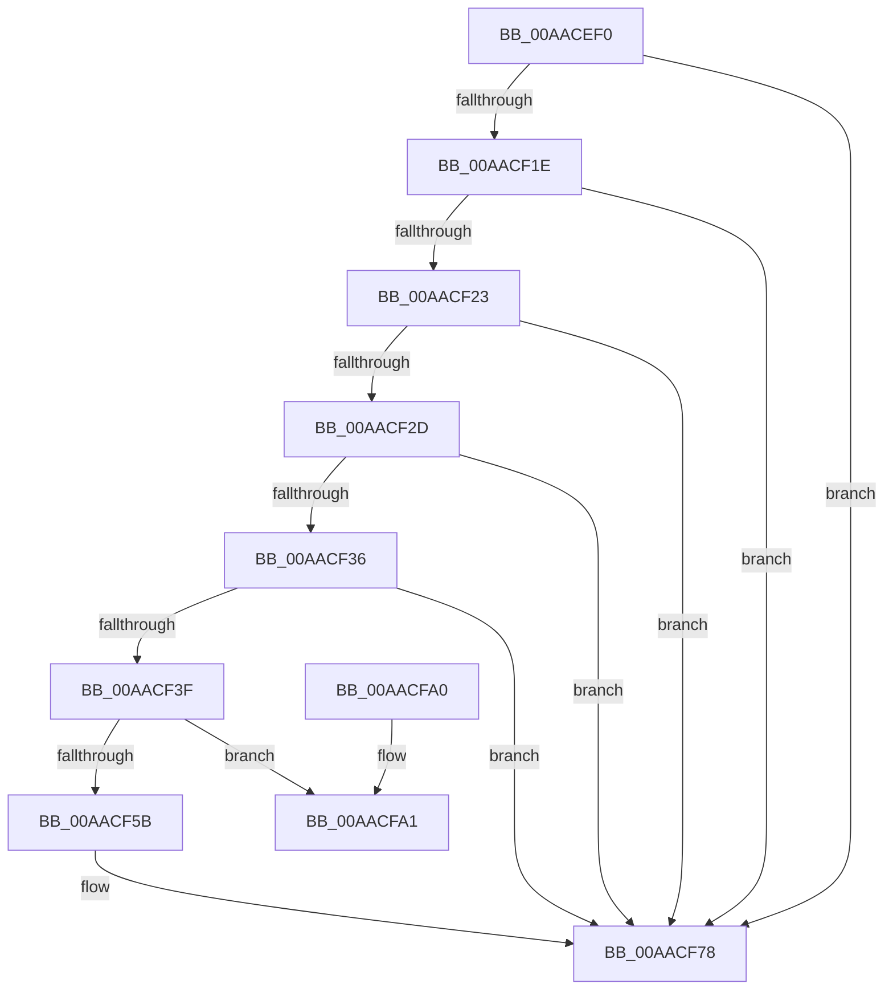

# RtlCultureNameToLCID

- RVA: `0x00AACEF0`–`0x00AACFA7` (길이 `183` bytes)
- VA: `0x0000000140AACEF0`
- 실행 섹션: `PAGE`
- PDB 이름 있음: `예`; PDB Function 태그: `아니요`
- unwind 정보 RVA: `0x000BC024`
- 디코드: `50`개 명령, `183/183` bytes 표시
- 미해석 바이트: `0` (있으면 어셈블리에 `.byte`로 보존)

> 이 문서는 커널 이미지의 기계어와 PDB 기호를 분석해 생성했습니다. 4번과 5번은 함수 원형과 자료형을 바이너리 사용 방식에서 추정한 C 해석이며 원본 소스 복구 결과는 아닙니다.

## 1. Dependencies

- 직접 호출 지점: **4**; 고유 호출 대상: **4**
- 직접 호출자로 확인된 함수: **9**
- RIP 상대 이미지 참조: **1**

### Outgoing calls
- `0x00AACF47` → [memcpy](../../text/6C/memcpy_function_006C6840.md) (function, `0x006C6840`)
- `0x00AACF68` → [DownLevelLanguageNameToLangID](../../text/4C/DownLevelLanguageNameToLangID_function_004C3748.md) (function, `0x004C3748`)
- `0x00AACF86` → [_security_check_cookie](../../text/6A/_security_check_cookie_function_006AC640.md) (function, `0x006AC640`)
- `0x00AACFA1` → [_report_rangecheckfailure](../../text/4F/_report_rangecheckfailure_function_004F5FDC.md) (function, `0x004F5FDC`)

### Direct callers
- [RtlpMuiRegLoadLicInformation](../../text/4C/RtlpMuiRegLoadLicInformation_function_004CB26C.md) at `0x004CB3CD`
- [RtlpMuiRegLoadLicInformation](../../text/4C/RtlpMuiRegLoadLicInformation_function_004CB26C.md) at `0x004CB41C`
- [RtlpMuiRegLoadLicInformation](../../text/4C/RtlpMuiRegLoadLicInformation_function_004CB26C.md) at `0x004CB4F4`
- [RtlpMuiRegLoadLicInformation](../../text/4C/RtlpMuiRegLoadLicInformation_function_004CB26C.md) at `0x004CB544`
- [RtlpMuiRegLoadLicInformation](../../text/4C/RtlpMuiRegLoadLicInformation_function_004CB26C.md) at `0x004CB655`
- [RtlpMuiRegLoadLicInformation](../../text/4C/RtlpMuiRegLoadLicInformation_function_004CB26C.md) at `0x004CB69D`
- [RtlpLoadInstallLanguageFallback](../83/RtlpLoadInstallLanguageFallback_function_0083D278.md) at `0x0083D3C0`
- [RtlpLoadInstallLanguageFallback](../83/RtlpLoadInstallLanguageFallback_function_0083D278.md) at `0x0083D3EB`
- [RtlpLoadPolicyLanguageSpec](../83/RtlpLoadPolicyLanguageSpec_function_0083D594.md) at `0x0083D6A1`
- [RtlpMuiRegConfigMatchesInstalled](../83/RtlpMuiRegConfigMatchesInstalled_function_0083DA08.md) at `0x0083DBB2`
- [RtlpMuiRegGetInstalledLanguageIndex](../83/RtlpMuiRegGetInstalledLanguageIndex_function_0083E1CC.md) at `0x0083E2A4`
- [RtlpMuiRegGetLanguageSpec](../83/RtlpMuiRegGetLanguageSpec_function_0083E680.md) at `0x0083E6CB`
- [RtlpMuiRegLangInfoMatchesSpec](../83/RtlpMuiRegLangInfoMatchesSpec_function_0083EBD0.md) at `0x0083EC72`
- [RtlMuiRegAddLIPParent](../83/RtlMuiRegAddLIPParent_function_0083F2BC.md) at `0x0083F336`
- [RtlpMuiRegInitAnyLanguage](../83/RtlpMuiRegInitAnyLanguage_function_0083F7FC.md) at `0x0083F84E`

### Static image references
- `0x00AACF02` → RVA `0x00E0A740` (`.data`; read)

## 2. Other-region calls and transfers

- 다른 실행 섹션으로 향하는 call: **4**
  - `0x00AACF47` → [memcpy](../../text/6C/memcpy_function_006C6840.md) (`PAGE` → `.text`)
  - `0x00AACF68` → [DownLevelLanguageNameToLangID](../../text/4C/DownLevelLanguageNameToLangID_function_004C3748.md) (`PAGE` → `.text`)
  - `0x00AACF86` → [_security_check_cookie](../../text/6A/_security_check_cookie_function_006AC640.md) (`PAGE` → `.text`)
  - `0x00AACFA1` → [_report_rangecheckfailure](../../text/4F/_report_rangecheckfailure_function_004F5FDC.md) (`PAGE` → `.text`)
- 별도 외부 분기/꼬리 이동을 확인하지 못했습니다.

## 3. Assembly (complete function range)

```asm
00AACEF0  48 89 5C 24 18                  mov qword ptr [rsp + 0x18], rbx
00AACEF5  48 89 74 24 20                  mov qword ptr [rsp + 0x20], rsi
00AACEFA  57                              push rdi
00AACEFB  48 81 EC E0 00 00 00            sub rsp, 0xe0
00AACF02  48 8B 05 37 D8 35 00            mov rax, qword ptr [rip + 0x35d837]
00AACF09  48 33 C4                        xor rax, rsp
00AACF0C  48 89 84 24 D0 00 00 00         mov qword ptr [rsp + 0xd0], rax
00AACF14  33 FF                           xor edi, edi
00AACF16  48 8B F2                        mov rsi, rdx
00AACF19  48 85 C9                        test rcx, rcx
00AACF1C  74 5A                           je 0x140aacf78
00AACF1E  48 85 D2                        test rdx, rdx
00AACF21  74 55                           je 0x140aacf78
00AACF23  44 0F B7 01                     movzx r8d, word ptr [rcx]
00AACF27  66 41 3B F8                     cmp di, r8w
00AACF2B  74 4B                           je 0x140aacf78
00AACF2D  48 8B 51 08                     mov rdx, qword ptr [rcx + 8]
00AACF31  48 85 D2                        test rdx, rdx
00AACF34  74 42                           je 0x140aacf78
00AACF36  41 8D 40 02                     lea eax, [r8 + 2]
00AACF3A  83 F8 55                        cmp eax, 0x55
00AACF3D  77 39                           ja 0x140aacf78
00AACF3F  48 8D 4C 24 20                  lea rcx, [rsp + 0x20]
00AACF44  41 8B D8                        mov ebx, r8d
00AACF47  E8 F4 98 C1 FF                  call 0x1406c6840
00AACF4C  48 D1 EB                        shr rbx, 1
00AACF4F  48 03 DB                        add rbx, rbx
00AACF52  48 81 FB AA 00 00 00            cmp rbx, 0xaa
00AACF59  73 46                           jae 0x140aacfa1
00AACF5B  8D 57 02                        lea edx, [rdi + 2]
00AACF5E  66 89 7C 1C 20                  mov word ptr [rsp + rbx + 0x20], di
00AACF63  48 8D 4C 24 20                  lea rcx, [rsp + 0x20]
00AACF68  E8 DB 67 A1 FF                  call 0x1404c3748
00AACF6D  0F B7 C0                        movzx eax, ax
00AACF70  85 C0                           test eax, eax
00AACF72  89 06                           mov dword ptr [rsi], eax
00AACF74  40 0F 95 C7                     setne dil
00AACF78  40 8A C7                        mov al, dil
00AACF7B  48 8B 8C 24 D0 00 00 00         mov rcx, qword ptr [rsp + 0xd0]
00AACF83  48 33 CC                        xor rcx, rsp
00AACF86  E8 B5 F6 BF FF                  call 0x1406ac640
00AACF8B  4C 8D 9C 24 E0 00 00 00         lea r11, [rsp + 0xe0]
00AACF93  49 8B 5B 20                     mov rbx, qword ptr [r11 + 0x20]
00AACF97  49 8B 73 28                     mov rsi, qword ptr [r11 + 0x28]
00AACF9B  49 8B E3                        mov rsp, r11
00AACF9E  5F                              pop rdi
00AACF9F  C3                              ret
00AACFA0  CC                              int3
00AACFA1  E8 36 90 A4 FF                  call 0x1404f5fdc
00AACFA6  CC                              int3
```

## 4. C-style interpretation (structured pseudocode)

```c
__int64 __fastcall RtlCultureNameToLCID(__int64 a1, __int64 a2)
{
    __int64 result;
    __int64 v_rbx;
    __int64 v_rdi;
    __int64 v_rsp;
    unsigned __int64 v_stack_m18;
    unsigned __int64 v_stack_m8;
    unsigned __int64 v_stack_mC8;
    unsigned __int64 v_stack_p18;
    unsigned __int64 v_stack_p20;

    v_stack_p18 = v_rbx;
    v_stack_p20 = v_rsi;
    v_rsp = (v_rsp) - (224);
    result = (*(unsigned __int64 *)(v_rip + 3528759)) ^ (v_rsp);
    v_stack_m18 = result;
    v_rdi = 0;
    if (a1 == 0) goto loc_00AACF78;
    if (a2 == 0) goto loc_00AACF78;
    if (0 == ((unsigned __int16)(*(unsigned __int16 *)(a1)))) goto loc_00AACF78;
    if (*(unsigned __int64 *)(a1 + 8) == 0) goto loc_00AACF78;
    if (((unsigned int)(*(unsigned __int16 *)(a1) + 2)) > 85) goto loc_00AACF78;
    result = memcpy(v_stack_mC8, *(unsigned __int64 *)(a1 + 8), *(unsigned __int16 *)(a1), a4);
    v_rbx = ((unsigned int)((unsigned int)(*(unsigned __int16 *)(a1)))) >> (1);
    v_rbx = (v_rbx) + (v_rbx);
    if (v_rbx >= 170) goto loc_00AACFA1;
    *(unsigned __int16 *)(v_rsp + v_rbx * 1 + 32) = 0;
    result = DownLevelLanguageNameToLangID(v_stack_mC8, v_rdi + 2, *(unsigned __int16 *)(a1), a4);
    *(unsigned int *)(a2) = (unsigned int)((unsigned __int16)(result));
    v_rdi = ((unsigned int)((unsigned __int16)(result)) != 0) ? 1 : 0;
loc_00AACF78:
    a1 = (v_stack_m18) ^ (v_rsp);
    result = _security_check_cookie(a1, v_rdi + 2, *(unsigned __int16 *)(a1), a4);
    return result;
loc_00AACFA1:
    result = _report_rangecheckfailure(a1, v_rdi + 2, *(unsigned __int16 *)(a1), a4);
    return result;
}
```

## 5. (Beta) C Style

```c
int64_t RtlCultureNameToLCID(int64_t Arg1, void *Arg2)
{
    uint8_t *arg2 = (uint8_t *)Arg2;

    int64_t result;
    int64_t local_rbx;
    int64_t local_rdi;
    int64_t local_rsp;
    uint64_t v_stack_m18;
    uint64_t v_stack_m8;
    uint64_t v_stack_mC8;
    uint64_t v_stack_p18;
    uint64_t v_stack_p20;

    v_stack_p18 = local_rbx;
    v_stack_p20 = local_rsi;
    local_rsp = (local_rsp) - (224);
    result = (*(uint64_t *)(v_rip + 0x35D837)) ^ (local_rsp);
    v_stack_m18 = result;
    local_rdi = 0;
    if (Arg1 == 0) goto loc_00AACF78;
    if (Arg2 == NULL) goto loc_00AACF78;
    if (0 == ((uint16_t)(*(uint16_t *)(Arg1)))) goto loc_00AACF78;
    if (*(uint64_t *)(Arg1 + 0x8) == 0) goto loc_00AACF78;
    if (((uint32_t)(*(uint16_t *)(Arg1) + 2)) > 85) goto loc_00AACF78;
    result = memcpy(v_stack_mC8, *(uint64_t *)(Arg1 + 0x8), *(uint16_t *)(Arg1), a4);
    local_rbx = ((uint32_t)((uint32_t)(*(uint16_t *)(Arg1)))) >> (1);
    local_rbx = (local_rbx) + (local_rbx);
    if (local_rbx >= 170) goto loc_00AACFA1;
    *(uint16_t *)(local_rsp + local_rbx * 1 + 0x20) = 0;
    result = DownLevelLanguageNameToLangID(v_stack_mC8, local_rdi + 2, *(uint16_t *)(Arg1), a4);
    *(uint32_t *)(arg2) = (uint32_t)((uint16_t)(result));
    local_rdi = ((uint32_t)((uint16_t)(result)) != 0) ? 1 : 0;
loc_00AACF78:
    Arg1 = (v_stack_m18) ^ (local_rsp);
    result = _security_check_cookie(Arg1, local_rdi + 2, *(uint16_t *)(Arg1), a4);
    return result;
loc_00AACFA1:
    result = _report_rangecheckfailure(Arg1, local_rdi + 2, *(uint16_t *)(Arg1), a4);
    return result;
}
```

### 관측된 메모리 오프셋

구조체 형식이 확인되지 않은 접근은 인자 기준의 오프셋으로만 기록했습니다.

| 기준 인자 | 오프셋 표현 | 폭 (bit) | 접근 |
|---|---:|---:|---|
| `Arg2` | `+ 0x0` | `32` | `W` |

## 6. Execution-region graph

[열기: 2D/3D 그래프와 함수 탐색 컨트롤 패널](../../../control-panel.html?section=page&rva=0x00AACEF0&view=graph)

- 2D 그래프는 위에서 아래로 흐르고, 3D 그래프는 빈 공간을 드래그해 회전합니다. Shift+드래그는 이동, 휠은 확대·축소, 함수 노드 선택은 대상 보고서 이동입니다.

### Static fallback


