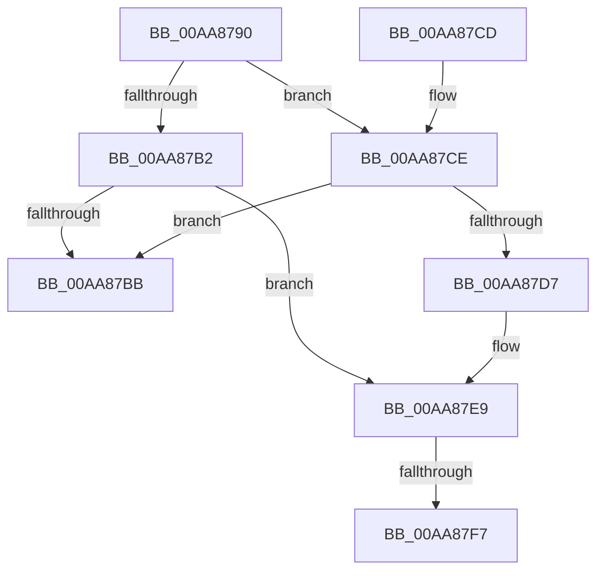

# RtlDestroyHeap

- RVA: `0x00AA8790`–`0x00AA8814` (길이 `132` bytes)
- VA: `0x0000000140AA8790`
- 실행 섹션: `PAGE`
- PDB 이름 있음: `예`; PDB Function 태그: `예`
- unwind 정보 RVA: `0x000BBBB0`
- 디코드: `35`개 명령, `132/132` bytes 표시
- 미해석 바이트: `0` (있으면 어셈블리에 `.byte`로 보존)

> 이 문서는 커널 이미지의 기계어와 PDB 기호를 분석해 생성했습니다. 4번과 5번은 함수 원형과 자료형을 바이너리 사용 방식에서 추정한 C 해석이며 원본 소스 복구 결과는 아닙니다.

## 1. Dependencies

- 직접 호출 지점: **3**; 고유 호출 대상: **3**
- 직접 호출자로 확인된 함수: **0**
- RIP 상대 이미지 참조: **2**

### Outgoing calls
- `0x00AA87DE` → [DbgPrint](../../text/35/DbgPrint_function_00358CB0.md) (function, `0x00358CB0`)
- `0x00AA87E3` → [RtlpHeapHandleError](../../text/5F/RtlpHeapHandleError_function_005F12AC.md) (function, `0x005F12AC`)
- `0x00AA8809` → [RtlpCallInterceptRoutine](../../text/47/RtlpCallInterceptRoutine_function_00479594.md) (function, `0x00479594`)

### Direct callers
- 이 함수 시작 RVA로 연결되는 직접 call은 확인되지 않았습니다. 간접 호출은 완전히 역산할 수 없습니다.

### Static image references
- `0x00AA87CE` → RVA `0x00E67B60` (`.data`; read)
- `0x00AA87D7` → RVA `0x00B059F0` (` ?? ::NNGAKEGL::`string'`; read)

## 2. Other-region calls and transfers

- 다른 실행 섹션으로 향하는 call: **3**
  - `0x00AA87DE` → [DbgPrint](../../text/35/DbgPrint_function_00358CB0.md) (`PAGE` → `.text`)
  - `0x00AA87E3` → [RtlpHeapHandleError](../../text/5F/RtlpHeapHandleError_function_005F12AC.md) (`PAGE` → `.text`)
  - `0x00AA8809` → [RtlpCallInterceptRoutine](../../text/47/RtlpCallInterceptRoutine_function_00479594.md) (`PAGE` → `.text`)
- call이 아닌 외부 분기/꼬리 이동: **2**
  - `0x00AA87F1` → [sub_00B4A4E4](../B4/Unknown_function_00B4A4E4.md) (`tail-transfer`)
  - `0x00AA880F` → [sub_00B4A4E4](../B4/Unknown_function_00B4A4E4.md) (`tail-transfer`)

## 3. Assembly (complete function range)

```asm
00AA8790  48 8B C4                        mov rax, rsp
00AA8793  48 89 58 18                     mov qword ptr [rax + 0x18], rbx
00AA8797  48 89 70 20                     mov qword ptr [rax + 0x20], rsi
00AA879B  57                              push rdi
00AA879C  48 83 EC 30                     sub rsp, 0x30
00AA87A0  48 83 60 08 00                  and qword ptr [rax + 8], 0
00AA87A5  48 8B F9                        mov rdi, rcx
00AA87A8  48 83 60 10 00                  and qword ptr [rax + 0x10], 0
00AA87AD  48 85 C9                        test rcx, rcx
00AA87B0  74 1C                           je 0x140aa87ce
00AA87B2  81 79 10 DD CC DD CC            cmp dword ptr [rcx + 0x10], 0xccddccdd
00AA87B9  75 2E                           jne 0x140aa87e9
00AA87BB  48 8B 5C 24 50                  mov rbx, qword ptr [rsp + 0x50]
00AA87C0  33 C0                           xor eax, eax
00AA87C2  48 8B 74 24 58                  mov rsi, qword ptr [rsp + 0x58]
00AA87C7  48 83 C4 30                     add rsp, 0x30
00AA87CB  5F                              pop rdi
00AA87CC  C3                              ret
00AA87CD  CC                              int3
00AA87CE  83 3D 8B F3 3B 00 02            cmp dword ptr [rip + 0x3bf38b], 2
00AA87D5  7C E4                           jl 0x140aa87bb
00AA87D7  48 8D 0D 12 D2 05 00            lea rcx, [rip + 0x5d212]
00AA87DE  E8 CD 04 8B FF                  call 0x140358cb0
00AA87E3  E8 C4 8A B4 FF                  call 0x1405f12ac
00AA87E8  CC                              int3
00AA87E9  8B 89 90 00 00 00               mov ecx, dword ptr [rcx + 0x90]
00AA87EF  85 C9                           test ecx, ecx
00AA87F1  0F 84 ED 1C 0A 00               je 0x140b4a4e4
00AA87F7  48 83 64 24 20 00               and qword ptr [rsp + 0x20], 0
00AA87FD  41 B9 08 00 00 00               mov r9d, 8
00AA8803  45 33 C0                        xor r8d, r8d
00AA8806  48 8B D7                        mov rdx, rdi
00AA8809  E8 86 0D 9D FF                  call 0x140479594
00AA880E  90                              nop
00AA880F  E9 D0 1C 0A 00                  jmp 0x140b4a4e4
```

## 4. C-style interpretation (structured pseudocode)

```c
__int64 __fastcall RtlDestroyHeap(__int64 a1, __int64 a2, int a3)
{
    __int64 result;
    __int64 v_rsp;
    unsigned __int64 v_stack_p18;
    unsigned __int64 v_stack_p20;

    *(unsigned __int64 *)(v_rsp + 24) = v_rbx;
    *(unsigned __int64 *)(v_rsp + 32) = v_rsi;
    v_rsp = (v_rsp) - (48);
    if (a1 == 0) goto loc_00AA87CE;
    if ((*(unsigned int *)(a1 + 16)) != 0xCCDDCCDDULL) goto loc_00AA87E9;
loc_00AA87BB:
    result = 0;
    v_rsp = (v_rsp) + (48);
    return result;
loc_00AA87CE:
    if ((*(unsigned int *)(v_rip + 3928971)) < 2) goto loc_00AA87BB;
    result = DbgPrint(v_rip + 381458, a2, a3, a4);
    result = RtlpHeapHandleError(v_rip + 381458, a2, a3, a4);
loc_00AA87E9:
    a3 = 0;
    result = RtlpCallInterceptRoutine((unsigned int)(*(unsigned int *)(v_rip + 381458 + 144)), a1, a3, 8);
}
```

## 5. (Beta) C Style

```c
int64_t RtlDestroyHeap(int64_t Arg1, int64_t Arg2, int32_t Arg3)
{
    int64_t result;
    int64_t local_rsp;
    uint64_t v_stack_p18;
    uint64_t v_stack_p20;

    *(uint64_t *)(local_rsp + 0x18) = local_rbx;
    *(uint64_t *)(local_rsp + 0x20) = local_rsi;
    local_rsp = (local_rsp) - (48);
    if (Arg1 == 0) goto loc_00AA87CE;
    if ((*(uint32_t *)(Arg1 + 0x10)) != 0xCCDDCCDDULL) goto loc_00AA87E9;
loc_00AA87BB:
    result = 0;
    local_rsp = (local_rsp) + (48);
    return result;
loc_00AA87CE:
    if ((*(uint32_t *)(v_rip + 0x3BF38B)) < 2) goto loc_00AA87BB;
    result = DbgPrint(v_rip + 381458, Arg2, Arg3, a4);
    result = RtlpHeapHandleError(v_rip + 381458, Arg2, Arg3, a4);
loc_00AA87E9:
    Arg3 = 0;
    result = RtlpCallInterceptRoutine((uint32_t)(*(uint32_t *)(v_rip + 0x5D212 + 0x90)), Arg1, Arg3, 8);
}
```

## 6. Execution-region graph

[열기: 2D/3D 그래프와 함수 탐색 컨트롤 패널](../../../control-panel.html?section=page&rva=0x00AA8790&view=graph)

- 2D 그래프는 위에서 아래로 흐르고, 3D 그래프는 빈 공간을 드래그해 회전합니다. Shift+드래그는 이동, 휠은 확대·축소, 함수 노드 선택은 대상 보고서 이동입니다.

### Static fallback


