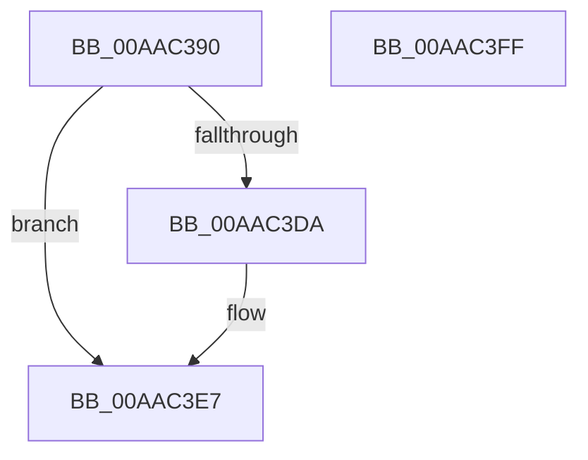

# RtlSystemTimeToLocalTime

- RVA: `0x00AAC390`–`0x00AAC400` (길이 `112` bytes)
- VA: `0x0000000140AAC390`
- 실행 섹션: `PAGE`
- PDB 이름 있음: `예`; PDB Function 태그: `아니요`
- unwind 정보 RVA: `0x000BBED8`
- 디코드: `31`개 명령, `112/112` bytes 표시
- 미해석 바이트: `0` (있으면 어셈블리에 `.byte`로 보존)

> 이 문서는 커널 이미지의 기계어와 PDB 기호를 분석해 생성했습니다. 4번과 5번은 함수 원형과 자료형을 바이너리 사용 방식에서 추정한 C 해석이며 원본 소스 복구 결과는 아닙니다.

## 1. Dependencies

- 직접 호출 지점: **2**; 고유 호출 대상: **2**
- 직접 호출자로 확인된 함수: **0**
- RIP 상대 이미지 참조: **1**

### Outgoing calls
- `0x00AAC3D1` → [ZwQuerySystemInformation](../../text/6A/ZwQuerySystemInformation_function_006AD790.md) (function, `0x006AD790`)
- `0x00AAC3EF` → [_security_check_cookie](../../text/6A/_security_check_cookie_function_006AC640.md) (function, `0x006AC640`)

### Direct callers
- 이 함수 시작 RVA로 연결되는 직접 call은 확인되지 않았습니다. 간접 호출은 완전히 역산할 수 없습니다.

### Static image references
- `0x00AAC39A` → RVA `0x00E0A740` (`.data`; read)

## 2. Other-region calls and transfers

- 다른 실행 섹션으로 향하는 call: **2**
  - `0x00AAC3D1` → [ZwQuerySystemInformation](../../text/6A/ZwQuerySystemInformation_function_006AD790.md) (`PAGE` → `.text`)
  - `0x00AAC3EF` → [_security_check_cookie](../../text/6A/_security_check_cookie_function_006AC640.md) (`PAGE` → `.text`)
- 별도 외부 분기/꼬리 이동을 확인하지 못했습니다.

## 3. Assembly (complete function range)

```asm
00AAC390  48 89 5C 24 08                  mov qword ptr [rsp + 8], rbx
00AAC395  57                              push rdi
00AAC396  48 83 EC 60                     sub rsp, 0x60
00AAC39A  48 8B 05 9F E3 35 00            mov rax, qword ptr [rip + 0x35e39f]
00AAC3A1  48 33 C4                        xor rax, rsp
00AAC3A4  48 89 44 24 50                  mov qword ptr [rsp + 0x50], rax
00AAC3A9  0F 57 C0                        xorps xmm0, xmm0
00AAC3AC  45 33 C9                        xor r9d, r9d
00AAC3AF  48 8B FA                        mov rdi, rdx
00AAC3B2  48 8B D9                        mov rbx, rcx
00AAC3B5  48 8D 54 24 20                  lea rdx, [rsp + 0x20]
00AAC3BA  0F 11 44 24 20                  movups xmmword ptr [rsp + 0x20], xmm0
00AAC3BF  45 8D 41 30                     lea r8d, [r9 + 0x30]
00AAC3C3  41 8D 49 03                     lea ecx, [r9 + 3]
00AAC3C7  0F 11 44 24 30                  movups xmmword ptr [rsp + 0x30], xmm0
00AAC3CC  0F 11 44 24 40                  movups xmmword ptr [rsp + 0x40], xmm0
00AAC3D1  E8 BA 13 C0 FF                  call 0x1406ad790
00AAC3D6  85 C0                           test eax, eax
00AAC3D8  78 0D                           js 0x140aac3e7
00AAC3DA  48 8B 03                        mov rax, qword ptr [rbx]
00AAC3DD  48 2B 44 24 30                  sub rax, qword ptr [rsp + 0x30]
00AAC3E2  48 89 07                        mov qword ptr [rdi], rax
00AAC3E5  33 C0                           xor eax, eax
00AAC3E7  48 8B 4C 24 50                  mov rcx, qword ptr [rsp + 0x50]
00AAC3EC  48 33 CC                        xor rcx, rsp
00AAC3EF  E8 4C 02 C0 FF                  call 0x1406ac640
00AAC3F4  48 8B 5C 24 70                  mov rbx, qword ptr [rsp + 0x70]
00AAC3F9  48 83 C4 60                     add rsp, 0x60
00AAC3FD  5F                              pop rdi
00AAC3FE  C3                              ret
00AAC3FF  CC                              int3
```

## 4. C-style interpretation (structured pseudocode)

```c
__int64 __fastcall RtlSystemTimeToLocalTime(__int64 a1, __int64 a2, __int64 a3, int a4)
{
    __int64 result;
    __int64 v_rsp;
    unsigned __int64 v_stack_m18;
    unsigned __int64 v_stack_m28;
    unsigned __int64 v_stack_m38;
    unsigned __int64 v_stack_m48;
    unsigned __int64 v_stack_p8;

    v_stack_p8 = v_rbx;
    v_rsp = (v_rsp) - (96);
    result = (*(unsigned __int64 *)(v_rip + 3531679)) ^ (v_rsp);
    v_stack_m18 = result;
    a4 = 0;
    v_stack_m48 = v_xmm0;
    v_stack_m38 = v_xmm0;
    v_stack_m28 = v_xmm0;
    result = ZwQuerySystemInformation(a4 + 3, v_stack_m48, a4 + 48, a4);
    if (!(sign_flag)) {
        result = *(unsigned __int64 *)(a1);
        result = (result) - (v_stack_m38);
        *(unsigned __int64 *)(a2) = result;
        result = 0;
    }
    a1 = (v_stack_m18) ^ (v_rsp);
    result = _security_check_cookie(a1, v_stack_m48, a4 + 48, a4);
    v_rsp = (v_rsp) + (96);
    return result;
}
```

## 5. (Beta) C Style

```c
int64_t RtlSystemTimeToLocalTime(void *Arg1, void *Arg2, int64_t Arg3, int32_t Arg4)
{
    uint8_t *arg1 = (uint8_t *)Arg1;
    uint8_t *arg2 = (uint8_t *)Arg2;

    int64_t result;
    int64_t local_rsp;
    uint64_t v_stack_m18;
    uint64_t v_stack_m28;
    uint64_t v_stack_m38;
    uint64_t v_stack_m48;
    uint64_t v_stack_p8;

    v_stack_p8 = local_rbx;
    local_rsp = (local_rsp) - (96);
    result = (*(uint64_t *)(v_rip + 0x35E39F)) ^ (local_rsp);
    v_stack_m18 = result;
    Arg4 = 0;
    v_stack_m48 = v_xmm0;
    v_stack_m38 = v_xmm0;
    v_stack_m28 = v_xmm0;
    result = ZwQuerySystemInformation(Arg4 + 3, v_stack_m48, Arg4 + 48, Arg4);
    if (!(sign_flag)) {
        result = *(uint64_t *)(arg1);
        result = (result) - (v_stack_m38);
        *(uint64_t *)(arg2) = result;
        result = 0;
    }
    Arg1 = (v_stack_m18) ^ (local_rsp);
    result = _security_check_cookie(Arg1, v_stack_m48, Arg4 + 48, Arg4);
    local_rsp = (local_rsp) + (96);
    return result;
}
```

### 관측된 메모리 오프셋

구조체 형식이 확인되지 않은 접근은 인자 기준의 오프셋으로만 기록했습니다.

| 기준 인자 | 오프셋 표현 | 폭 (bit) | 접근 |
|---|---:|---:|---|
| `Arg1` | `+ 0x0` | `64` | `R` |
| `Arg2` | `+ 0x0` | `64` | `W` |

## 6. Execution-region graph

[열기: 2D/3D 그래프와 함수 탐색 컨트롤 패널](../../../control-panel.html?section=page&rva=0x00AAC390&view=graph)

- 2D 그래프는 위에서 아래로 흐르고, 3D 그래프는 빈 공간을 드래그해 회전합니다. Shift+드래그는 이동, 휠은 확대·축소, 함수 노드 선택은 대상 보고서 이동입니다.

### Static fallback


