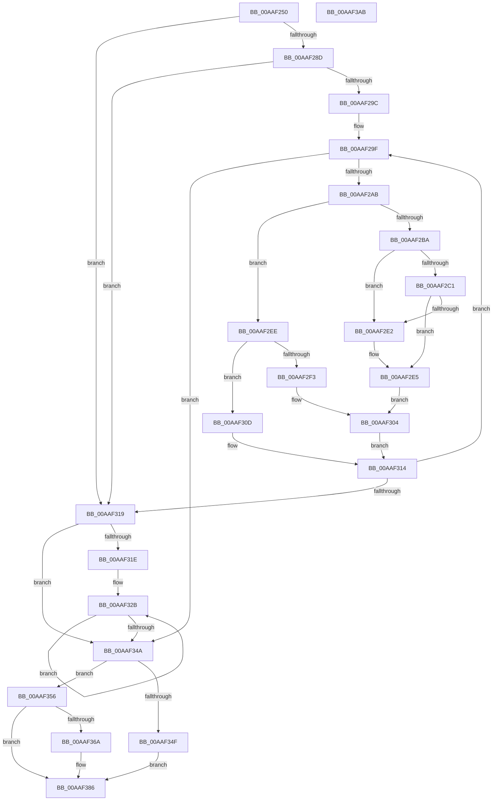

# RtlpFcCalculateRequiredSizeForNewFeatureTable

- RVA: `0x00AAF250`–`0x00AAF3AC` (길이 `348` bytes)
- VA: `0x0000000140AAF250`
- 실행 섹션: `PAGE`
- PDB 이름 있음: `예`; PDB Function 태그: `아니요`
- unwind 정보 RVA: `0x000BC37C`
- 디코드: `111`개 명령, `348/348` bytes 표시
- 미해석 바이트: `0` (있으면 어셈블리에 `.byte`로 보존)

> 이 문서는 커널 이미지의 기계어와 PDB 기호를 분석해 생성했습니다. 4번과 5번은 함수 원형과 자료형을 바이너리 사용 방식에서 추정한 C 해석이며 원본 소스 복구 결과는 아닙니다.

## 1. Dependencies

- 직접 호출 지점: **7**; 고유 호출 대상: **6**
- 직접 호출자로 확인된 함수: **1**
- RIP 상대 이미지 참조: **1**

### Outgoing calls
- `0x00AAF2B1` → [RtlpFcCompareFeatureToUpdate](RtlpFcCompareFeatureToUpdate_function_00AAF3B4.md) (function, `0x00AAF3B4`)
- `0x00AAF2CF` → [RtlpFcUpdateFeature](../79/RtlpFcUpdateFeature_function_0079AAAC.md) (function, `0x0079AAAC`)
- `0x00AAF2D9` → [RtlpFcDoesFeatureHaveUniqueState](../79/RtlpFcDoesFeatureHaveUniqueState_function_0079A6F4.md) (function, `0x0079A6F4`)
- `0x00AAF2F6` → [RtlpFcIsUpdateModifyingOrAddingFeature](../79/RtlpFcIsUpdateModifyingOrAddingFeature_function_0079A9DC.md) (function, `0x0079A9DC`)
- `0x00AAF32E` → [RtlpFcIsUpdateModifyingOrAddingFeature](../79/RtlpFcIsUpdateModifyingOrAddingFeature_function_0079A9DC.md) (function, `0x0079A9DC`)
- `0x00AAF361` → [RtlULongLongMult](../../text/43/RtlULongLongMult_function_0043E530.md) (function, `0x0043E530`)
- `0x00AAF38E` → [_security_check_cookie](../../text/6A/_security_check_cookie_function_006AC640.md) (function, `0x006AC640`)

### Direct callers
- [RtlpFcUpdateFeatureConfiguration](../AB/RtlpFcUpdateFeatureConfiguration_function_00ABD7A0.md) at `0x00ABD86D`

### Static image references
- `0x00AAF264` → RVA `0x00E0A740` (`.data`; read)

## 2. Other-region calls and transfers

- 다른 실행 섹션으로 향하는 call: **2**
  - `0x00AAF361` → [RtlULongLongMult](../../text/43/RtlULongLongMult_function_0043E530.md) (`PAGE` → `.text`)
  - `0x00AAF38E` → [_security_check_cookie](../../text/6A/_security_check_cookie_function_006AC640.md) (`PAGE` → `.text`)
- 별도 외부 분기/꼬리 이동을 확인하지 못했습니다.

## 3. Assembly (complete function range)

```asm
00AAF250  48 89 5C 24 18                  mov qword ptr [rsp + 0x18], rbx
00AAF255  55                              push rbp
00AAF256  56                              push rsi
00AAF257  57                              push rdi
00AAF258  41 54                           push r12
00AAF25A  41 55                           push r13
00AAF25C  41 56                           push r14
00AAF25E  41 57                           push r15
00AAF260  48 83 EC 40                     sub rsp, 0x40
00AAF264  48 8B 05 D5 B4 35 00            mov rax, qword ptr [rip + 0x35b4d5]
00AAF26B  48 33 C4                        xor rax, rsp
00AAF26E  48 89 44 24 30                  mov qword ptr [rsp + 0x30], rax
00AAF273  45 33 DB                        xor r11d, r11d
00AAF276  45 33 FF                        xor r15d, r15d
00AAF279  33 DB                           xor ebx, ebx
00AAF27B  4D 8B F1                        mov r14, r9
00AAF27E  49 8B E8                        mov rbp, r8
00AAF281  4C 8B EA                        mov r13, rdx
00AAF284  48 85 C9                        test rcx, rcx
00AAF287  0F 84 8C 00 00 00               je 0x140aaf319
00AAF28D  44 8B 19                        mov r11d, dword ptr [rcx]
00AAF290  48 8D 71 04                     lea rsi, [rcx + 4]
00AAF294  45 8B E3                        mov r12d, r11d
00AAF297  4D 85 DB                        test r11, r11
00AAF29A  74 7D                           je 0x140aaf319
00AAF29C  48 8B FA                        mov rdi, rdx
00AAF29F  4D 8B CB                        mov r9, r11
00AAF2A2  48 3B DD                        cmp rbx, rbp
00AAF2A5  0F 83 9F 00 00 00               jae 0x140aaf34a
00AAF2AB  48 8B D7                        mov rdx, rdi
00AAF2AE  48 8B CE                        mov rcx, rsi
00AAF2B1  E8 FE 00 00 00                  call 0x140aaf3b4
00AAF2B6  85 C0                           test eax, eax
00AAF2B8  75 34                           jne 0x140aaf2ee
00AAF2BA  8B 47 1C                        mov eax, dword ptr [rdi + 0x1c]
00AAF2BD  A8 04                           test al, 4
00AAF2BF  75 21                           jne 0x140aaf2e2
00AAF2C1  0F 10 06                        movups xmm0, xmmword ptr [rsi]
00AAF2C4  48 8D 4C 24 20                  lea rcx, [rsp + 0x20]
00AAF2C9  F3 0F 7F 44 24 20               movdqu xmmword ptr [rsp + 0x20], xmm0
00AAF2CF  E8 D8 B7 CE FF                  call 0x14079aaac
00AAF2D4  48 8D 4C 24 20                  lea rcx, [rsp + 0x20]
00AAF2D9  E8 16 B4 CE FF                  call 0x14079a6f4
00AAF2DE  84 C0                           test al, al
00AAF2E0  75 03                           jne 0x140aaf2e5
00AAF2E2  49 FF CB                        dec r11
00AAF2E5  49 FF C7                        inc r15
00AAF2E8  48 83 C6 10                     add rsi, 0x10
00AAF2EC  EB 16                           jmp 0x140aaf304
00AAF2EE  83 F8 01                        cmp eax, 1
00AAF2F1  75 1A                           jne 0x140aaf30d
00AAF2F3  48 8B CF                        mov rcx, rdi
00AAF2F6  E8 E1 B6 CE FF                  call 0x14079a9dc
00AAF2FB  49 FF C3                        inc r11
00AAF2FE  84 C0                           test al, al
00AAF300  4D 0F 44 D9                     cmove r11, r9
00AAF304  48 FF C3                        inc rbx
00AAF307  48 83 C7 20                     add rdi, 0x20
00AAF30B  EB 07                           jmp 0x140aaf314
00AAF30D  49 FF C7                        inc r15
00AAF310  48 83 C6 10                     add rsi, 0x10
00AAF314  4D 3B FC                        cmp r15, r12
00AAF317  72 86                           jb 0x140aaf29f
00AAF319  48 3B DD                        cmp rbx, rbp
00AAF31C  73 2C                           jae 0x140aaf34a
00AAF31E  4C 8B CB                        mov r9, rbx
00AAF321  49 C1 E1 05                     shl r9, 5
00AAF325  4D 03 CD                        add r9, r13
00AAF328  48 2B EB                        sub rbp, rbx
00AAF32B  49 8B C9                        mov rcx, r9
00AAF32E  E8 A9 B6 CE FF                  call 0x14079a9dc
00AAF333  84 C0                           test al, al
00AAF335  49 8D 4B 01                     lea rcx, [r11 + 1]
00AAF339  49 0F 44 CB                     cmove rcx, r11
00AAF33D  49 83 C1 20                     add r9, 0x20
00AAF341  4C 8B D9                        mov r11, rcx
00AAF344  48 83 ED 01                     sub rbp, 1
00AAF348  75 E1                           jne 0x140aaf32b
00AAF34A  4D 85 DB                        test r11, r11
00AAF34D  75 07                           jne 0x140aaf356
00AAF34F  4D 21 1E                        and qword ptr [r14], r11
00AAF352  33 C0                           xor eax, eax
00AAF354  EB 30                           jmp 0x140aaf386
00AAF356  4D 8B C6                        mov r8, r14
00AAF359  BA 10 00 00 00                  mov edx, 0x10
00AAF35E  49 8B CB                        mov rcx, r11
00AAF361  E8 CA F1 98 FF                  call 0x14043e530
00AAF366  85 C0                           test eax, eax
00AAF368  78 1C                           js 0x140aaf386
00AAF36A  49 8B 0E                        mov rcx, qword ptr [r14]
00AAF36D  48 83 CA FF                     or rdx, 0xffffffffffffffff
00AAF371  48 8D 41 04                     lea rax, [rcx + 4]
00AAF375  48 3B C1                        cmp rax, rcx
00AAF378  48 0F 43 D0                     cmovae rdx, rax
00AAF37C  1B C0                           sbb eax, eax
00AAF37E  25 95 00 00 C0                  and eax, 0xc0000095
00AAF383  49 89 16                        mov qword ptr [r14], rdx
00AAF386  48 8B 4C 24 30                  mov rcx, qword ptr [rsp + 0x30]
00AAF38B  48 33 CC                        xor rcx, rsp
00AAF38E  E8 AD D2 BF FF                  call 0x1406ac640
00AAF393  48 8B 9C 24 90 00 00 00         mov rbx, qword ptr [rsp + 0x90]
00AAF39B  48 83 C4 40                     add rsp, 0x40
00AAF39F  41 5F                           pop r15
00AAF3A1  41 5E                           pop r14
00AAF3A3  41 5D                           pop r13
00AAF3A5  41 5C                           pop r12
00AAF3A7  5F                              pop rdi
00AAF3A8  5E                              pop rsi
00AAF3A9  5D                              pop rbp
00AAF3AA  C3                              ret
00AAF3AB  CC                              int3
```

## 4. C-style interpretation (structured pseudocode)

```c
__int64 __fastcall RtlpFcCalculateRequiredSizeForNewFeatureTable(__int64 a1, __int64 a2, __int64 a3, __int64 a4)
{
    __int64 result;
    __int64 v_r11;
    __int64 v_r15;
    __int64 v_rbp;
    __int64 v_rbx;
    __int64 v_rdi;
    __int64 v_rsi;
    __int64 v_rsp;
    unsigned __int64 v_stack_m48;
    unsigned __int64 v_stack_m58;
    unsigned __int64 v_stack_p18;

    v_stack_p18 = v_rbx;
    v_rsp = (v_rsp) - (64);
    result = (*(unsigned __int64 *)(v_rip + 3519701)) ^ (v_rsp);
    v_stack_m48 = result;
    v_r11 = 0;
    v_r15 = 0;
    v_rbx = 0;
    if (a1 == 0) goto loc_00AAF319;
    if ((unsigned int)(*(unsigned int *)(a1)) == 0) goto loc_00AAF319;
loc_00AAF29F:
    if (0 >= a3) goto loc_00AAF34A;
    result = RtlpFcCompareFeatureToUpdate(a1 + 4, a2, a3, (unsigned int)(*(unsigned int *)(a1)));
    if ((unsigned int)(result) != 0) goto loc_00AAF2EE;
    if ((((unsigned __int8)((unsigned int)(*(unsigned int *)(a2 + 28)))) & (4)) != 0) goto loc_00AAF2E2;
    v_stack_m58 = v_xmm0;
    result = RtlpFcUpdateFeature(v_stack_m58, a2, a3, (unsigned int)(*(unsigned int *)(a1)));
    result = RtlpFcDoesFeatureHaveUniqueState(v_stack_m58, a2, a3, (unsigned int)(*(unsigned int *)(a1)));
    v_r11 = (unsigned int)(*(unsigned int *)(a1));
    if ((unsigned __int8)(result) == 0) {
        v_r11 = ((unsigned int)(*(unsigned int *)(a1))) - 1;
    }
    v_r15 = (v_r15) + 1;
    v_rsi = (a1 + 4) + (16);
    goto loc_00AAF304;
loc_00AAF2EE:
    if (((unsigned int)(result)) != 1) goto loc_00AAF30D;
    result = RtlpFcIsUpdateModifyingOrAddingFeature(a2, a2, a3, (unsigned int)(*(unsigned int *)(a1)));
    v_r11 = (v_r11) + 1;
    if ((unsigned __int8)(result) == 0) { v_r11 = (unsigned int)(*(unsigned int *)(a1)); }
loc_00AAF304:
    v_rbx = (v_rbx) + 1;
    v_rdi = (a2) + (32);
    goto loc_00AAF314;
loc_00AAF30D:
    v_r15 = (v_r15) + 1;
    v_rsi = (v_rsi) + (16);
loc_00AAF314:
    if (v_r15 < ((unsigned int)((unsigned int)((unsigned int)(*(unsigned int *)(a1)))))) goto loc_00AAF29F;
loc_00AAF319:
    if (v_rbx >= a3) goto loc_00AAF34A;
    a4 = (v_rbx) << (5);
    a4 = (a4) + (a2);
    v_rbp = (a3) - (v_rbx);
loc_00AAF32B:
    result = RtlpFcIsUpdateModifyingOrAddingFeature(a4, a2, a3, a4);
    a1 = v_r11 + 1;
    if ((unsigned __int8)(result) == 0) { a1 = v_r11; }
    a4 = (a4) + (32);
    v_rbp = (v_rbp) - (1);
    if (condition_is_not_equal) goto loc_00AAF32B;
loc_00AAF34A:
    if (a1 != 0) goto loc_00AAF356;
    result = 0;
    goto loc_00AAF386;
loc_00AAF356:
    result = RtlULongLongMult(a1, 16, a4, a4);
    if (!(sign_flag)) {
        a1 = *(unsigned __int64 *)(a4);
        a2 = (16) | (-1);
        result = a1 + 4;
        if (result >= a1) { a2 = result; }
        result = (unsigned int)((result) & (0xC0000095ULL));
        *(unsigned __int64 *)(a4) = a2;
    }
    a1 = (v_stack_m48) ^ (v_rsp);
    result = _security_check_cookie(a1, a2, a4, a4);
    v_rsp = (v_rsp) + (64);
    return result;
}
```

## 5. (Beta) C Style

```c
int64_t RtlpFcCalculateRequiredSizeForNewFeatureTable(int64_t Arg1, void *Arg2, int64_t Arg3, void *Arg4)
{
    uint8_t *arg2 = (uint8_t *)Arg2;
    uint8_t *arg4 = (uint8_t *)Arg4;

    int64_t result;
    int64_t local_r11;
    int64_t local_r15;
    int64_t local_rbp;
    int64_t local_rbx;
    int64_t local_rdi;
    int64_t local_rsi;
    int64_t local_rsp;
    uint64_t v_stack_m48;
    uint64_t v_stack_m58;
    uint64_t v_stack_p18;

    v_stack_p18 = local_rbx;
    local_rsp = (local_rsp) - (64);
    result = (*(uint64_t *)(v_rip + 0x35B4D5)) ^ (local_rsp);
    v_stack_m48 = result;
    local_r11 = 0;
    local_r15 = 0;
    local_rbx = 0;
    if (Arg1 == 0) goto loc_00AAF319;
    if ((uint32_t)(*(uint32_t *)(Arg1)) == 0) goto loc_00AAF319;
loc_00AAF29F:
    if (0 >= Arg3) goto loc_00AAF34A;
    result = RtlpFcCompareFeatureToUpdate(Arg1 + 4, Arg2, Arg3, (uint32_t)(*(uint32_t *)(Arg1)));
    if ((uint32_t)(result) != 0) goto loc_00AAF2EE;
    if ((((uint8_t)((uint32_t)(*(uint32_t *)(arg2 + 0x1C)))) & (4)) != 0) goto loc_00AAF2E2;
    v_stack_m58 = v_xmm0;
    result = RtlpFcUpdateFeature(v_stack_m58, Arg2, Arg3, (uint32_t)(*(uint32_t *)(Arg1)));
    result = RtlpFcDoesFeatureHaveUniqueState(v_stack_m58, Arg2, Arg3, (uint32_t)(*(uint32_t *)(Arg1)));
    local_r11 = (uint32_t)(*(uint32_t *)(Arg1));
    if ((uint8_t)(result) == 0) {
        local_r11 = ((uint32_t)(*(uint32_t *)(Arg1))) - 1;
    }
    local_r15 = (local_r15) + 1;
    local_rsi = (Arg1 + 4) + (16);
    goto loc_00AAF304;
loc_00AAF2EE:
    if (((uint32_t)(result)) != 1) goto loc_00AAF30D;
    result = RtlpFcIsUpdateModifyingOrAddingFeature(Arg2, Arg2, Arg3, (uint32_t)(*(uint32_t *)(Arg1)));
    local_r11 = (local_r11) + 1;
    if ((uint8_t)(result) == 0) { local_r11 = (uint32_t)(*(uint32_t *)(Arg1)); }
loc_00AAF304:
    local_rbx = (local_rbx) + 1;
    local_rdi = (Arg2) + (32);
    goto loc_00AAF314;
loc_00AAF30D:
    local_r15 = (local_r15) + 1;
    local_rsi = (local_rsi) + (16);
loc_00AAF314:
    if (local_r15 < ((uint32_t)((uint32_t)((uint32_t)(*(uint32_t *)(Arg1)))))) goto loc_00AAF29F;
loc_00AAF319:
    if (local_rbx >= Arg3) goto loc_00AAF34A;
    Arg4 = (local_rbx) << (5);
    Arg4 = (Arg4) + (Arg2);
    local_rbp = (Arg3) - (local_rbx);
loc_00AAF32B:
    result = RtlpFcIsUpdateModifyingOrAddingFeature(Arg4, Arg2, Arg3, Arg4);
    Arg1 = local_r11 + 1;
    if ((uint8_t)(result) == 0) { Arg1 = local_r11; }
    Arg4 = (Arg4) + (32);
    local_rbp = (local_rbp) - (1);
    if (condition_is_not_equal) goto loc_00AAF32B;
loc_00AAF34A:
    if (Arg1 != 0) goto loc_00AAF356;
    result = 0;
    goto loc_00AAF386;
loc_00AAF356:
    result = RtlULongLongMult(Arg1, 16, Arg4, Arg4);
    if (!(sign_flag)) {
        Arg1 = *(uint64_t *)(arg4);
        Arg2 = (16) | (-1);
        result = Arg1 + 4;
        if (result >= Arg1) { Arg2 = result; }
        result = (uint32_t)((result) & (0xC0000095ULL));
        *(void **)(arg4) = Arg2;
    }
    Arg1 = (v_stack_m48) ^ (local_rsp);
    result = _security_check_cookie(Arg1, Arg2, Arg4, Arg4);
    local_rsp = (local_rsp) + (64);
    return result;
}
```

### 관측된 메모리 오프셋

구조체 형식이 확인되지 않은 접근은 인자 기준의 오프셋으로만 기록했습니다.

| 기준 인자 | 오프셋 표현 | 폭 (bit) | 접근 |
|---|---:|---:|---|
| `Arg2` | `+ 0x1C` | `32` | `R` |
| `Arg4` | `+ 0x0` | `64` | `R` |
| `Arg4` | `+ 0x0` | `64` | `R/W` |
| `Arg4` | `+ 0x0` | `64` | `W` |

## 6. Execution-region graph

[열기: 2D/3D 그래프와 함수 탐색 컨트롤 패널](../../../control-panel.html?section=page&rva=0x00AAF250&view=graph)

- 2D 그래프는 위에서 아래로 흐르고, 3D 그래프는 빈 공간을 드래그해 회전합니다. Shift+드래그는 이동, 휠은 확대·축소, 함수 노드 선택은 대상 보고서 이동입니다.

### Static fallback


