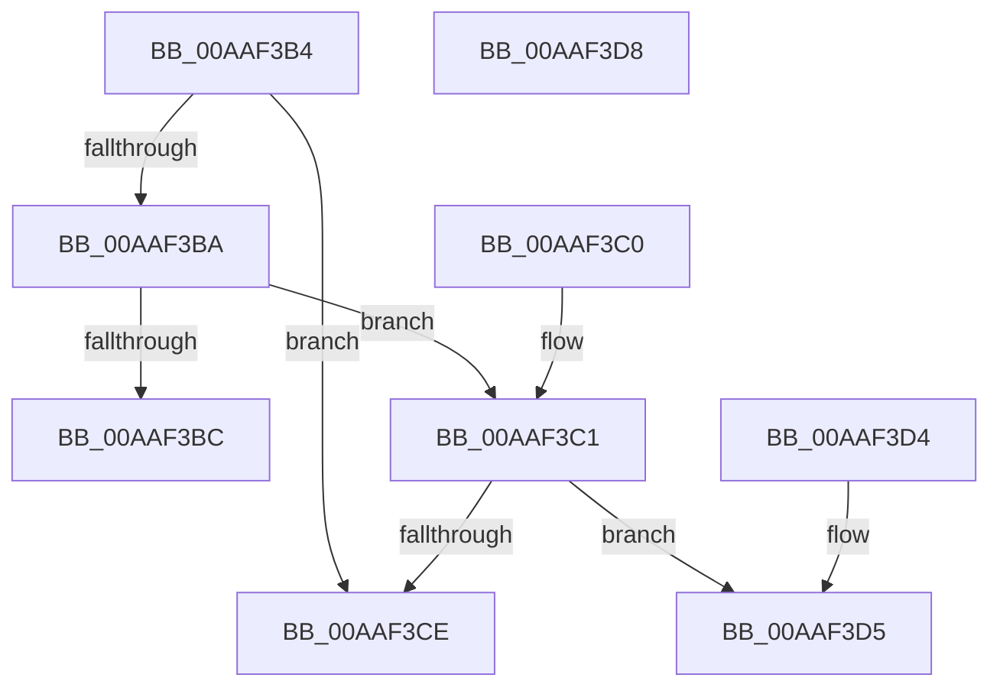

# RtlpFcCompareFeatureToUpdate

- RVA: `0x00AAF3B4`–`0x00AAF3D9` (길이 `37` bytes)
- VA: `0x0000000140AAF3B4`
- 실행 섹션: `PAGE`
- PDB 이름 있음: `예`; PDB Function 태그: `아니요`
- unwind 정보 RVA: `0x000DB714`
- 디코드: `18`개 명령, `37/37` bytes 표시
- 미해석 바이트: `0` (있으면 어셈블리에 `.byte`로 보존)

> 이 문서는 커널 이미지의 기계어와 PDB 기호를 분석해 생성했습니다. 4번과 5번은 함수 원형과 자료형을 바이너리 사용 방식에서 추정한 C 해석이며 원본 소스 복구 결과는 아닙니다.

## 1. Dependencies

- 직접 호출 지점: **0**; 고유 호출 대상: **0**
- 직접 호출자로 확인된 함수: **2**
- RIP 상대 이미지 참조: **0**

### Outgoing calls
- 직접 디코드된 call 명령이 없습니다.

### Direct callers
- [RtlpFcCalculateRequiredSizeForNewFeatureTable](RtlpFcCalculateRequiredSizeForNewFeatureTable_function_00AAF250.md) at `0x00AAF2B1`
- [RtlpFcUpdateFeatureConfiguration](../AB/RtlpFcUpdateFeatureConfiguration_function_00ABD7A0.md) at `0x00ABD8F6`

### Static image references
- 디코드된 RIP-relative 메모리 참조가 없습니다.

## 2. Other-region calls and transfers

- 다른 실행 섹션으로 향하는 call: **0**
- 별도 외부 분기/꼬리 이동을 확인하지 못했습니다.

## 3. Assembly (complete function range)

```asm
00AAF3B4  8B 01                           mov eax, dword ptr [rcx]
00AAF3B6  3B 02                           cmp eax, dword ptr [rdx]
00AAF3B8  77 14                           ja 0x140aaf3ce
00AAF3BA  73 05                           jae 0x140aaf3c1
00AAF3BC  83 C8 FF                        or eax, 0xffffffff
00AAF3BF  C3                              ret
00AAF3C0  CC                              int3
00AAF3C1  8B 41 04                        mov eax, dword ptr [rcx + 4]
00AAF3C4  8B 4A 04                        mov ecx, dword ptr [rdx + 4]
00AAF3C7  83 E0 0F                        and eax, 0xf
00AAF3CA  3B C8                           cmp ecx, eax
00AAF3CC  76 07                           jbe 0x140aaf3d5
00AAF3CE  B8 01 00 00 00                  mov eax, 1
00AAF3D3  C3                              ret
00AAF3D4  CC                              int3
00AAF3D5  1B C0                           sbb eax, eax
00AAF3D7  C3                              ret
00AAF3D8  CC                              int3
```

## 4. C-style interpretation (structured pseudocode)

```c
__int64 __fastcall RtlpFcCompareFeatureToUpdate(__int64 a1, __int64 a2)
{
    __int64 result;

    if (((unsigned int)((unsigned int)(*(unsigned int *)(a1)))) > (*(unsigned int *)(a2))) goto loc_00AAF3CE;
    if (((unsigned int)((unsigned int)(*(unsigned int *)(a1)))) >= (*(unsigned int *)(a2))) goto loc_00AAF3C1;
    result = (unsigned int)(((unsigned int)(*(unsigned int *)(a1))) | (0xFFFFFFFFULL));
    return result;
loc_00AAF3C1:
    result = (unsigned int)(((unsigned int)(*(unsigned int *)(a1 + 4))) & (15));
    if (((unsigned int)((unsigned int)(*(unsigned int *)(a2 + 4)))) <= ((unsigned int)(result))) goto loc_00AAF3D5;
loc_00AAF3CE:
    return 1;
loc_00AAF3D5:
    return 1;
}
```

## 5. (Beta) C Style

```c
int64_t RtlpFcCompareFeatureToUpdate(void *Arg1, void *Arg2)
{
    uint8_t *arg1 = (uint8_t *)Arg1;
    uint8_t *arg2 = (uint8_t *)Arg2;

    int64_t result;

    if (((uint32_t)((uint32_t)(*(uint32_t *)(arg1)))) > (*(uint32_t *)(arg2))) goto loc_00AAF3CE;
    if (((uint32_t)((uint32_t)(*(uint32_t *)(arg1)))) >= (*(uint32_t *)(arg2))) goto loc_00AAF3C1;
    result = (uint32_t)(((uint32_t)(*(uint32_t *)(arg1))) | (0xFFFFFFFFULL));
    return result;
loc_00AAF3C1:
    result = (uint32_t)(((uint32_t)(*(uint32_t *)(arg1 + 0x4))) & (15));
    if (((uint32_t)((uint32_t)(*(uint32_t *)(arg2 + 0x4)))) <= ((uint32_t)(result))) goto loc_00AAF3D5;
loc_00AAF3CE:
    return 1;
loc_00AAF3D5:
    return 1;
}
```

### 관측된 메모리 오프셋

구조체 형식이 확인되지 않은 접근은 인자 기준의 오프셋으로만 기록했습니다.

| 기준 인자 | 오프셋 표현 | 폭 (bit) | 접근 |
|---|---:|---:|---|
| `Arg1` | `+ 0x0` | `32` | `R` |
| `Arg1` | `+ 0x4` | `32` | `R` |
| `Arg2` | `+ 0x0` | `32` | `R` |
| `Arg2` | `+ 0x4` | `32` | `R` |

## 6. Execution-region graph

[열기: 2D/3D 그래프와 함수 탐색 컨트롤 패널](../../../control-panel.html?section=page&rva=0x00AAF3B4&view=graph)

- 2D 그래프는 위에서 아래로 흐르고, 3D 그래프는 빈 공간을 드래그해 회전합니다. Shift+드래그는 이동, 휠은 확대·축소, 함수 노드 선택은 대상 보고서 이동입니다.

### Static fallback


