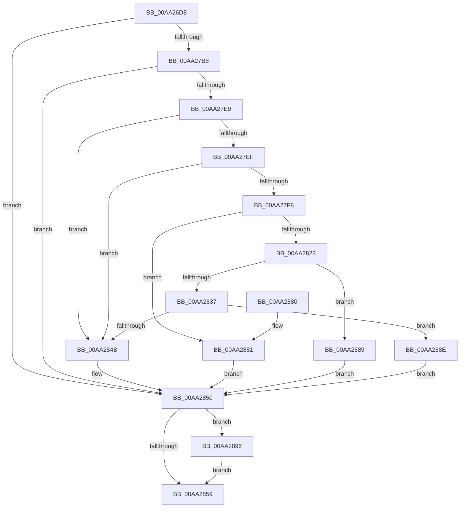

# RtlpGetNtProductTypeFromRegistry

- RVA: `0x00AA26D8`–`0x00AA289D` (길이 `453` bytes)
- VA: `0x0000000140AA26D8`
- 실행 섹션: `PAGE`
- PDB 이름 있음: `예`; PDB Function 태그: `아니요`
- unwind 정보 RVA: `0x000BB1B8`
- 디코드: `110`개 명령, `453/453` bytes 표시
- 미해석 바이트: `0` (있으면 어셈블리에 `.byte`로 보존)

> 이 문서는 커널 이미지의 기계어와 PDB 기호를 분석해 생성했습니다. 4번과 5번은 함수 원형과 자료형을 바이너리 사용 방식에서 추정한 C 해석이며 원본 소스 복구 결과는 아닙니다.

## 1. Dependencies

- 직접 호출 지점: **7**; 고유 호출 대상: **5**
- 직접 호출자로 확인된 함수: **2**
- RIP 상대 이미지 참조: **6**

### Outgoing calls
- `0x00AA27A9` → [ZwOpenKey](../../text/6A/ZwOpenKey_function_006AD310.md) (function, `0x006AD310`)
- `0x00AA27DE` → [ZwQueryValueKey](../../text/6A/ZwQueryValueKey_function_006AD3B0.md) (function, `0x006AD3B0`)
- `0x00AA281A` → [RtlEqualUnicodeString](../93/RtlEqualUnicodeString_function_00932A20.md) (function, `0x00932A20`)
- `0x00AA282E` → [RtlEqualUnicodeString](../93/RtlEqualUnicodeString_function_00932A20.md) (function, `0x00932A20`)
- `0x00AA2842` → [RtlEqualUnicodeString](../93/RtlEqualUnicodeString_function_00932A20.md) (function, `0x00932A20`)
- `0x00AA2862` → [_security_check_cookie](../../text/6A/_security_check_cookie_function_006AC640.md) (function, `0x006AC640`)
- `0x00AA2896` → [ZwClose](../../text/6A/ZwClose_function_006AD2B0.md) (function, `0x006AD2B0`)

### Direct callers
- [RtlGetNtProductType](../../text/43/RtlGetNtProductType_function_00436270.md) at `0x004362C1`
- [PspSiloInitializeUserSharedData](../78/PspSiloInitializeUserSharedData_function_00780684.md) at `0x007807AE`

### Static image references
- `0x00AA26F3` → RVA `0x00E0A740` (`.data`; read)
- `0x00AA2705` → RVA `0x00B05B60` (` ?? ::NNGAKEGL::`string'`; read)
- `0x00AA2735` → RVA `0x00B05BF0` (` ?? ::NNGAKEGL::`string'`; read)
- `0x00AA274C` → RVA `0x00B05B10` (` ?? ::NNGAKEGL::`string'`; read)
- `0x00AA2757` → RVA `0x00B05B30` (` ?? ::NNGAKEGL::`string'`; read)
- `0x00AA2762` → RVA `0x00B05B50` (` ?? ::NNGAKEGL::`string'`; read)

## 2. Other-region calls and transfers

- 다른 실행 섹션으로 향하는 call: **4**
  - `0x00AA27A9` → [ZwOpenKey](../../text/6A/ZwOpenKey_function_006AD310.md) (`PAGE` → `.text`)
  - `0x00AA27DE` → [ZwQueryValueKey](../../text/6A/ZwQueryValueKey_function_006AD3B0.md) (`PAGE` → `.text`)
  - `0x00AA2862` → [_security_check_cookie](../../text/6A/_security_check_cookie_function_006AC640.md) (`PAGE` → `.text`)
  - `0x00AA2896` → [ZwClose](../../text/6A/ZwClose_function_006AD2B0.md) (`PAGE` → `.text`)
- 별도 외부 분기/꼬리 이동을 확인하지 못했습니다.

## 3. Assembly (complete function range)

```asm
00AA26D8  48 8B C4                        mov rax, rsp
00AA26DB  48 89 58 10                     mov qword ptr [rax + 0x10], rbx
00AA26DF  48 89 78 18                     mov qword ptr [rax + 0x18], rdi
00AA26E3  4C 89 78 20                     mov qword ptr [rax + 0x20], r15
00AA26E7  55                              push rbp
00AA26E8  48 8D 68 A1                     lea rbp, [rax - 0x5f]
00AA26EC  48 81 EC 00 01 00 00            sub rsp, 0x100
00AA26F3  48 8B 05 46 80 36 00            mov rax, qword ptr [rip + 0x368046]
00AA26FA  48 33 C4                        xor rax, rsp
00AA26FD  48 89 45 4F                     mov qword ptr [rbp + 0x4f], rax
00AA2701  83 65 13 00                     and dword ptr [rbp + 0x13], 0
00AA2705  48 8D 05 54 34 06 00            lea rax, [rip + 0x63454]
00AA270C  83 65 87 00                     and dword ptr [rbp - 0x79], 0
00AA2710  4C 8D 45 F7                     lea r8, [rbp - 9]
00AA2714  83 65 9B 00                     and dword ptr [rbp - 0x65], 0
00AA2718  48 8B F9                        mov rdi, rcx
00AA271B  48 83 65 8F 00                  and qword ptr [rbp - 0x71], 0
00AA2720  48 8D 4D 8F                     lea rcx, [rbp - 0x71]
00AA2724  48 83 65 FF 00                  and qword ptr [rbp - 1], 0
00AA2729  0F 57 C0                        xorps xmm0, xmm0
00AA272C  48 89 45 AF                     mov qword ptr [rbp - 0x51], rax
00AA2730  BA 01 00 00 00                  mov edx, 1
00AA2735  48 8D 05 B4 34 06 00            lea rax, [rip + 0x634b4]
00AA273C  48 C7 45 F7 30 00 00 00         mov qword ptr [rbp - 9], 0x30
00AA2744  83 65 FB 00                     and dword ptr [rbp - 5], 0
00AA2748  48 89 45 BF                     mov qword ptr [rbp - 0x41], rax
00AA274C  48 8D 05 BD 33 06 00            lea rax, [rip + 0x633bd]
00AA2753  48 89 45 DF                     mov qword ptr [rbp - 0x21], rax
00AA2757  48 8D 05 D2 33 06 00            lea rax, [rip + 0x633d2]
00AA275E  48 89 45 EF                     mov qword ptr [rbp - 0x11], rax
00AA2762  48 8D 05 E7 33 06 00            lea rax, [rip + 0x633e7]
00AA2769  48 89 45 CF                     mov qword ptr [rbp - 0x31], rax
00AA276D  48 8D 45 A7                     lea rax, [rbp - 0x59]
00AA2771  48 89 45 07                     mov qword ptr [rbp + 7], rax
00AA2775  48 C7 45 A7 82 00 84 00         mov qword ptr [rbp - 0x59], 0x840082
00AA277D  48 C7 45 B7 16 00 18 00         mov qword ptr [rbp - 0x49], 0x180016
00AA2785  48 C7 45 D7 10 00 12 00         mov qword ptr [rbp - 0x29], 0x120010
00AA278D  48 C7 45 E7 10 00 12 00         mov qword ptr [rbp - 0x19], 0x120010
00AA2795  48 C7 45 C7 0A 00 0C 00         mov qword ptr [rbp - 0x39], 0xc000a
00AA279D  C7 45 0F 40 02 00 00            mov dword ptr [rbp + 0xf], 0x240
00AA27A4  F3 0F 7F 45 17                  movdqu xmmword ptr [rbp + 0x17], xmm0
00AA27A9  E8 62 AB C0 FF                  call 0x1406ad310
00AA27AE  8B D8                           mov ebx, eax
00AA27B0  85 C0                           test eax, eax
00AA27B2  0F 88 98 00 00 00               js 0x140aa2850
00AA27B8  48 8B 4D 8F                     mov rcx, qword ptr [rbp - 0x71]
00AA27BC  48 8D 45 87                     lea rax, [rbp - 0x79]
00AA27C0  48 89 44 24 28                  mov qword ptr [rsp + 0x28], rax
00AA27C5  4C 8D 4D 27                     lea r9, [rbp + 0x27]
00AA27C9  41 BF 02 00 00 00               mov r15d, 2
00AA27CF  C7 44 24 20 24 00 00 00         mov dword ptr [rsp + 0x20], 0x24
00AA27D7  45 8B C7                        mov r8d, r15d
00AA27DA  48 8D 55 B7                     lea rdx, [rbp - 0x49]
00AA27DE  E8 CD AB C0 FF                  call 0x1406ad3b0
00AA27E3  8B D8                           mov ebx, eax
00AA27E5  85 C0                           test eax, eax
00AA27E7  78 67                           js 0x140aa2850
00AA27E9  83 7D 2B 01                     cmp dword ptr [rbp + 0x2b], 1
00AA27ED  75 5C                           jne 0x140aa284b
00AA27EF  48 8B 4D 2F                     mov rcx, qword ptr [rbp + 0x2f]
00AA27F3  41 3B CF                        cmp ecx, r15d
00AA27F6  72 53                           jb 0x140aa284b
00AA27F8  48 8D 45 33                     lea rax, [rbp + 0x33]
00AA27FC  66 89 4D 99                     mov word ptr [rbp - 0x67], cx
00AA2800  48 89 45 9F                     mov qword ptr [rbp - 0x61], rax
00AA2804  48 8D 55 C7                     lea rdx, [rbp - 0x39]
00AA2808  0F B7 C1                        movzx eax, cx
00AA280B  41 B0 01                        mov r8b, 1
00AA280E  66 41 2B C7                     sub ax, r15w
00AA2812  48 8D 4D 97                     lea rcx, [rbp - 0x69]
00AA2816  66 89 45 97                     mov word ptr [rbp - 0x69], ax
00AA281A  E8 01 02 E9 FF                  call 0x140932a20
00AA281F  84 C0                           test al, al
00AA2821  75 5E                           jne 0x140aa2881
00AA2823  41 B0 01                        mov r8b, 1
00AA2826  48 8D 55 D7                     lea rdx, [rbp - 0x29]
00AA282A  48 8D 4D 97                     lea rcx, [rbp - 0x69]
00AA282E  E8 ED 01 E9 FF                  call 0x140932a20
00AA2833  84 C0                           test al, al
00AA2835  75 52                           jne 0x140aa2889
00AA2837  41 B0 01                        mov r8b, 1
00AA283A  48 8D 55 E7                     lea rdx, [rbp - 0x19]
00AA283E  48 8D 4D 97                     lea rcx, [rbp - 0x69]
00AA2842  E8 D9 01 E9 FF                  call 0x140932a20
00AA2847  84 C0                           test al, al
00AA2849  75 43                           jne 0x140aa288e
00AA284B  BB 0B 09 00 C0                  mov ebx, 0xc000090b
00AA2850  48 8B 4D 8F                     mov rcx, qword ptr [rbp - 0x71]
00AA2854  48 85 C9                        test rcx, rcx
00AA2857  75 3D                           jne 0x140aa2896
00AA2859  8B C3                           mov eax, ebx
00AA285B  48 8B 4D 4F                     mov rcx, qword ptr [rbp + 0x4f]
00AA285F  48 33 CC                        xor rcx, rsp
00AA2862  E8 D9 9D C0 FF                  call 0x1406ac640
00AA2867  4C 8D 9C 24 00 01 00 00         lea r11, [rsp + 0x100]
00AA286F  49 8B 5B 18                     mov rbx, qword ptr [r11 + 0x18]
00AA2873  49 8B 7B 20                     mov rdi, qword ptr [r11 + 0x20]
00AA2877  4D 8B 7B 28                     mov r15, qword ptr [r11 + 0x28]
00AA287B  49 8B E3                        mov rsp, r11
00AA287E  5D                              pop rbp
00AA287F  C3                              ret
00AA2880  CC                              int3
00AA2881  C7 07 01 00 00 00               mov dword ptr [rdi], 1
00AA2887  EB C7                           jmp 0x140aa2850
00AA2889  44 89 3F                        mov dword ptr [rdi], r15d
00AA288C  EB C2                           jmp 0x140aa2850
00AA288E  C7 07 03 00 00 00               mov dword ptr [rdi], 3
00AA2894  EB BA                           jmp 0x140aa2850
00AA2896  E8 15 AA C0 FF                  call 0x1406ad2b0
00AA289B  EB BC                           jmp 0x140aa2859
```

## 4. C-style interpretation (structured pseudocode)

```c
__int64 __fastcall RtlpGetNtProductTypeFromRegistry(__int64 a1)
{
    __int64 result;
    __int64 v_rsp;
    unsigned __int64 v_stack_m8;
    unsigned __int64 v_stack_mE0;
    unsigned int v_stack_mE8;

    *(unsigned __int64 *)(v_rsp + 16) = v_rbx;
    *(unsigned __int64 *)(v_rsp + 24) = v_rdi;
    *(unsigned __int64 *)(v_rsp + 32) = v_r15;
    v_rsp = (v_rsp) - (256);
    result = (*(unsigned __int64 *)(v_rip + 3571782)) ^ (v_rsp);
    *(unsigned __int64 *)(v_rsp - 95 + 79) = result;
    *(unsigned __int64 *)(v_rsp - 95 - 81) = v_rip + 406612;
    *(unsigned __int64 *)(v_rsp - 95 - 9) = 48;
    *(unsigned __int64 *)(v_rsp - 95 - 65) = v_rip + 406708;
    *(unsigned __int64 *)(v_rsp - 95 - 33) = v_rip + 406461;
    *(unsigned __int64 *)(v_rsp - 95 - 17) = v_rip + 406482;
    *(unsigned __int64 *)(v_rsp - 95 - 49) = v_rip + 406503;
    *(unsigned __int64 *)(v_rsp - 95 + 7) = v_rsp - 95 - 89;
    *(unsigned __int64 *)(v_rsp - 95 - 89) = 0x840082ULL;
    *(unsigned __int64 *)(v_rsp - 95 - 73) = 0x180016ULL;
    *(unsigned __int64 *)(v_rsp - 95 - 41) = 0x120010ULL;
    *(unsigned __int64 *)(v_rsp - 95 - 25) = 0x120010ULL;
    *(unsigned __int64 *)(v_rsp - 95 - 57) = 0xC000AULL;
    *(unsigned int *)(v_rsp - 95 + 15) = 576;
    *(unsigned __int64 *)(v_rsp - 95 + 23) = v_xmm0;
    result = ZwOpenKey(v_rsp - 95 - 113, 1, v_rsp - 95 - 9, a4);
    if (sign_flag) goto loc_00AA2850;
    v_stack_mE0 = v_rsp - 95 - 121;
    v_stack_mE8 = 36;
    result = ZwQueryValueKey(*(unsigned __int64 *)(v_rsp - 95 - 113), v_rsp - 95 - 73, 2, v_rsp - 95 + 39);
    if (sign_flag) goto loc_00AA2850;
    if ((*(unsigned int *)(v_rsp - 95 + 43)) != 1) goto loc_00AA284B;
    if (((unsigned int)(*(unsigned __int64 *)(v_rsp - 95 + 47))) < 2) goto loc_00AA284B;
    *(unsigned __int16 *)(v_rsp - 95 - 103) = (unsigned __int16)(*(unsigned __int64 *)(v_rsp - 95 + 47));
    *(unsigned __int64 *)(v_rsp - 95 - 97) = v_rsp - 95 + 51;
    result = (unsigned __int16)(((unsigned __int16)(*(unsigned __int64 *)(v_rsp - 95 + 47))) - (2));
    *(unsigned __int16 *)(v_rsp - 95 - 105) = (unsigned __int16)(result);
    result = RtlEqualUnicodeString(v_rsp - 95 - 105, v_rsp - 95 - 57, 1, v_rsp - 95 + 39);
    if ((unsigned __int8)(result) != 0) goto loc_00AA2881;
    result = RtlEqualUnicodeString(v_rsp - 95 - 105, v_rsp - 95 - 41, 1, v_rsp - 95 + 39);
    if ((unsigned __int8)(result) != 0) goto loc_00AA2889;
    result = RtlEqualUnicodeString(v_rsp - 95 - 105, v_rsp - 95 - 25, 1, v_rsp - 95 + 39);
    if ((unsigned __int8)(result) != 0) goto loc_00AA288E;
loc_00AA284B:
loc_00AA2850:
    if (*(unsigned __int64 *)(v_rsp - 95 - 113) != 0) goto loc_00AA2896;
loc_00AA2859:
    a1 = (*(unsigned __int64 *)(v_rsp - 95 + 79)) ^ (v_rsp);
    result = _security_check_cookie(a1, v_rsp - 95 - 25, 1, v_rsp - 95 + 39);
    return result;
loc_00AA2881:
    *(unsigned int *)(*(unsigned __int64 *)(v_stack_m8 + 32)) = 1;
    goto loc_00AA2850;
loc_00AA2889:
    *(unsigned int *)(*(unsigned __int64 *)(v_stack_m8 + 32)) = (unsigned int)(*(unsigned __int64 *)(v_stack_m8 + 40));
    goto loc_00AA2850;
loc_00AA288E:
    *(unsigned int *)(*(unsigned __int64 *)(v_stack_m8 + 32)) = 3;
    goto loc_00AA2850;
loc_00AA2896:
    result = ZwClose(a1, v_rsp - 95 - 25, 1, v_rsp - 95 + 39);
    goto loc_00AA2859;
}
```

## 5. (Beta) C Style

```c
int64_t RtlpGetNtProductTypeFromRegistry(void *Arg1)
{
    uint8_t *arg1 = (uint8_t *)Arg1;

    int64_t result;
    int64_t local_rsp;
    uint64_t v_stack_m8;
    uint64_t v_stack_mE0;
    uint32_t v_stack_mE8;

    *(uint64_t *)(local_rsp + 0x10) = local_rbx;
    *(uint64_t *)(local_rsp + 0x18) = local_rdi;
    *(uint64_t *)(local_rsp + 0x20) = local_r15;
    local_rsp = (local_rsp) - (256);
    result = (*(uint64_t *)(v_rip + 0x368046)) ^ (local_rsp);
    *(uint64_t *)(local_rsp - 0x5F + 0x4F) = result;
    *(uint64_t *)(local_rsp - 0x5F - 0x51) = v_rip + 406612;
    *(uint64_t *)(local_rsp - 0x5F - 0x9) = 48;
    *(uint64_t *)(local_rsp - 0x5F - 0x41) = v_rip + 406708;
    *(uint64_t *)(local_rsp - 0x5F - 0x21) = v_rip + 406461;
    *(uint64_t *)(local_rsp - 0x5F - 0x11) = v_rip + 406482;
    *(uint64_t *)(local_rsp - 0x5F - 0x31) = v_rip + 406503;
    *(uint64_t *)(local_rsp - 0x5F + 0x7) = local_rsp - 95 - 89;
    *(uint64_t *)(local_rsp - 0x5F - 0x59) = 0x840082ULL;
    *(uint64_t *)(local_rsp - 0x5F - 0x49) = 0x180016ULL;
    *(uint64_t *)(local_rsp - 0x5F - 0x29) = 0x120010ULL;
    *(uint64_t *)(local_rsp - 0x5F - 0x19) = 0x120010ULL;
    *(uint64_t *)(local_rsp - 0x5F - 0x39) = 0xC000AULL;
    *(uint32_t *)(local_rsp - 0x5F + 0xF) = 576;
    *(uint64_t *)(local_rsp - 0x5F + 0x17) = v_xmm0;
    result = ZwOpenKey(local_rsp - 95 - 113, 1, local_rsp - 95 - 9, a4);
    if (sign_flag) goto loc_00AA2850;
    v_stack_mE0 = local_rsp - 95 - 121;
    v_stack_mE8 = 36;
    result = ZwQueryValueKey(*(uint64_t *)(local_rsp - 0x5F - 0x71), local_rsp - 95 - 73, 2, local_rsp - 95 + 39);
    if (sign_flag) goto loc_00AA2850;
    if ((*(uint32_t *)(local_rsp - 0x5F + 0x2B)) != 1) goto loc_00AA284B;
    if (((uint32_t)(*(uint64_t *)(local_rsp - 0x5F + 0x2F))) < 2) goto loc_00AA284B;
    *(uint16_t *)(local_rsp - 0x5F - 0x67) = (uint16_t)(*(uint64_t *)(local_rsp - 0x5F + 0x2F));
    *(uint64_t *)(local_rsp - 0x5F - 0x61) = local_rsp - 95 + 51;
    result = (uint16_t)(((uint16_t)(*(uint64_t *)(local_rsp - 0x5F + 0x2F))) - (2));
    *(uint16_t *)(local_rsp - 0x5F - 0x69) = (uint16_t)(result);
    result = RtlEqualUnicodeString(local_rsp - 95 - 105, local_rsp - 95 - 57, 1, local_rsp - 95 + 39);
    if ((uint8_t)(result) != 0) goto loc_00AA2881;
    result = RtlEqualUnicodeString(local_rsp - 95 - 105, local_rsp - 95 - 41, 1, local_rsp - 95 + 39);
    if ((uint8_t)(result) != 0) goto loc_00AA2889;
    result = RtlEqualUnicodeString(local_rsp - 95 - 105, local_rsp - 95 - 25, 1, local_rsp - 95 + 39);
    if ((uint8_t)(result) != 0) goto loc_00AA288E;
loc_00AA284B:
loc_00AA2850:
    if (*(uint64_t *)(local_rsp - 0x5F - 0x71) != 0) goto loc_00AA2896;
loc_00AA2859:
    Arg1 = (*(uint64_t *)(local_rsp - 0x5F + 0x4F)) ^ (local_rsp);
    result = _security_check_cookie(Arg1, local_rsp - 95 - 25, 1, local_rsp - 95 + 39);
    return result;
loc_00AA2881:
    *(uint32_t *)(*(uint64_t *)(v_stack_m8 + 0x20)) = 1;
    goto loc_00AA2850;
loc_00AA2889:
    *(uint32_t *)(*(uint64_t *)(v_stack_m8 + 0x20)) = (uint32_t)(*(uint64_t *)(v_stack_m8 + 0x28));
    goto loc_00AA2850;
loc_00AA288E:
    *(uint32_t *)(*(uint64_t *)(v_stack_m8 + 0x20)) = 3;
    goto loc_00AA2850;
loc_00AA2896:
    result = ZwClose(Arg1, local_rsp - 95 - 25, 1, local_rsp - 95 + 39);
    goto loc_00AA2859;
}
```

### 관측된 메모리 오프셋

구조체 형식이 확인되지 않은 접근은 인자 기준의 오프셋으로만 기록했습니다.

| 기준 인자 | 오프셋 표현 | 폭 (bit) | 접근 |
|---|---:|---:|---|
| `Arg1` | `+ 0x0` | `32` | `W` |

## 6. Execution-region graph

[열기: 2D/3D 그래프와 함수 탐색 컨트롤 패널](../../../control-panel.html?section=page&rva=0x00AA26D8&view=graph)

- 2D 그래프는 위에서 아래로 흐르고, 3D 그래프는 빈 공간을 드래그해 회전합니다. Shift+드래그는 이동, 휠은 확대·축소, 함수 노드 선택은 대상 보고서 이동입니다.

### Static fallback


